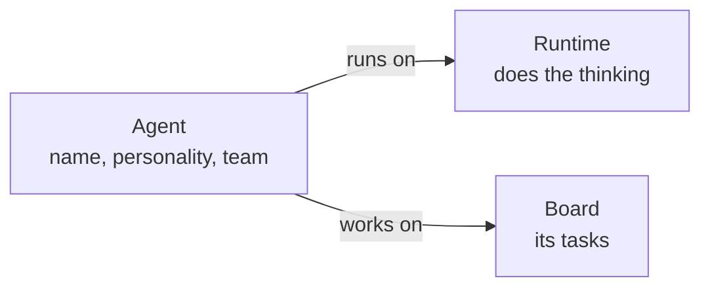

An **agent** is one AI worker in Clawboo. It has a name, a personality, a team and a runtime, the engine that runs its turns. The dashboard draws each agent as a **Boo**, the ghost avatar you see in the sidebar, the Org chart and team chat. One agent, **Boo Zero**, leads every team.

Use this page to understand what an agent is made of, who leads a team, and what you can change after you create an agent.

## The mental model

Think of an agent as a staff card. The card says who the agent is and which team it works on. The runtime is the engine behind the card: it reads the conversation, calls tools and writes the reply. The board holds the work the agent has been given.

Clawboo keeps every agent's card in its own database. That is why the sidebar and the Org chart still list your agents while a runtime is offline: you can see an agent you cannot reach at the moment.

## Every agent runs on one runtime

A runtime is the software that runs an agent's turns. Clawboo supports five, and they work in three ways:

| How it runs     | Runtimes                   | What that means for you                                                                                                  |
| --------------- | -------------------------- | ------------------------------------------------------------------------------------------------------------------------ |
| Built in        | Clawboo Native             | Runs inside the Clawboo server, on the provider key or local Ollama you connect.                                         |
| Connected       | OpenClaw                   | Runs in your OpenClaw Gateway, a separate program Clawboo connects to. Clawboo keeps its own copy of each agent in sync. |
| Started per run | Claude Code, Codex, Hermes | Coding tools that Clawboo starts for a turn or a task, and stops when it ends.                                           |

The runtime is set when the agent is created and never changes. No dashboard control or API call moves an existing agent to another runtime. To try the same role on a different runtime, create a new agent there.

Which runtime a new agent gets:

- **Create Boo**, and adding an agent on the Org chart, put the agent on OpenClaw while the Clawboo server is connected to a Gateway, and on Clawboo Native otherwise.
- Deploying a team lets you pick the runtime for each member in **Customize team**, so one team can mix runtimes.

After that you can edit its personality and its files. See [Manage agents](/using/agents) for the controls and [Choose a runtime](/runtimes/index) to compare the runtimes.

A Clawboo Native agent that has no key for its provider shows **No provider key** at the top of its chat. Connect that provider in [Providers and runtimes](/using/providers-and-runtimes) and it can run again.

## Boo Zero leads every team

**Boo Zero** is the one agent that leads all of your teams, and every room inside each team. When you send a message in a team chat, Boo Zero answers it or hands the work to a teammate. Start a message with `@` and a teammate's name to send it to that teammate instead. [How work is delegated](/concepts/delegation-and-orchestration) explains the hand-off.

Usually Boo Zero belongs to no team, which is how it can preside over all of them. Clawboo picks Boo Zero in this order, and the first match wins:

1. **An agent designated as Boo Zero**, on any runtime. The dashboard has no control for this. If you set up Clawboo with **Sign in with ChatGPT**, the lead of the team you deploy during setup (its Leader, or else its first agent) is designated automatically, unless you already have a Boo Zero from this rung or the next. You can also set one through the API (see the [Boo Zero API](/reference/rest-api/boo-zero)).
2. **The Boo Zero that Clawboo creates for you** on Clawboo Native. Clawboo creates it as soon as a Clawboo Native agent is on a team and a provider is connected for Clawboo Native.
3. **Your OpenClaw Gateway's default agent**, when you use OpenClaw and neither of the above exists.

If none of these exists, each chat is led by the team's Leader (below) when that agent is in the chat, and otherwise by the chat's first member. A team with no active members has no lead at all.

To rename Boo Zero, open Boo Zero's own page and use its **Brief** tab. The briefs you can write for Boo Zero reach it less often than their names suggest: the global brief is saved but not read, and a team's brief is read only when you mention that team in Boo Zero's own chat. [Configure Boo Zero](/using/boo-zero) lists exactly what Boo Zero reads.

## A team's Leader

Some teams also have a **Leader**: one member marked with a **Leader** badge. When you deploy a team, Clawboo gives the badge to the member whose name or role reads as a leadership title, such as CEO, CTO or Team Lead. Many teams have no Leader, and that is fine: Boo Zero coordinates them.

On Clawboo Native, the Leader is set up as a lead. It gets the lead instructions and, unless you pick a model, the provider's default lead model. The other members get the provider's default specialist model, often a faster, cheaper one.

|                   | Boo Zero                                                                  | A team's Leader                                                                                            |
| ----------------- | ------------------------------------------------------------------------- | ---------------------------------------------------------------------------------------------------------- |
| How many          | One for your whole Clawboo                                                | At most one per team, often none                                                                           |
| Team membership   | Usually none                                                              | A member of its own team                                                                                   |
| Answers team chat | Every team and every room                                                 | Only when there is no Boo Zero, in chats it belongs to                                                     |
| How it is chosen  | Designated, created by Clawboo, or your Gateway's default (in that order) | Detected from names and roles at deploy; in a ChatGPT sign-in setup, the first agent when none is detected |

## What you control

- **Who an agent is**: its personality and files, on the agent's page. See [Manage agents](/using/agents).
- **Its team**: set when you create it. **Create Boo** adds the new agent to the team you have selected. An agent belongs to one team at a time, or to none.
- **Its runtime**: chosen once, when you create the agent or deploy its team.
- **Boo Zero's name**: on Boo Zero's page. [Configure Boo Zero](/using/boo-zero) covers the name, the briefs, and which of them Boo Zero reads.

## Limits

- An agent's runtime cannot be changed. Create a new agent to use another runtime.
- There is no dashboard control to choose a different Boo Zero.
- A team chat needs at least one active member. Boo Zero does not lead an empty team.

<Accordion title="Under the hood">

- **The agent record.** Every agent is an `AgentRecord` row in Clawboo's database with `id`, `runtime`, `teamId`, `participantKind`, `personalityConfig` and `execConfig`, among others. Three kinds of source fill it. The OpenClaw source syncs from the Gateway, and a re-sync rewrites only Gateway-owned fields, keeping Clawboo's own. The Clawboo Native source and one source per coding runtime keep the only copy in Clawboo's database. See [AgentSource](/internals/agent-source).
- **Runtime classes.** Each adapter declares a `runtimeClass`: `native` (Clawboo Native), `connected-substrate` (OpenClaw) or `wrapped-oneshot` (Claude Code, Codex, Hermes). Clawboo routes runs on this class, never on a runtime id. See [RuntimeAdapter](/internals/runtime-adapter).
- **Boo Zero resolution.** The server resolves Boo Zero in the order above and returns its id as `defaultId` from `GET /api/agents`. `GET /api/boo-zero/override` reports `{ overrideAgentId, effective, tier }`, and `POST /api/boo-zero/override` with `{ "agentId": "<id>" }` designates one (`null` clears it). `isDefault` on a record marks the Gateway's own default agent, which is Boo Zero only when nothing outranks it.
- **Sessions.** Boo Zero talks to each team in a team-scoped session, `agent:<agentId>:team:<teamId>` for General, with `:room:<roomId>` added for each room, so its conversations never mix.
- **Reserved fields.** `participantKind` is `agent` or `human`. Nothing runs a human participant: a Routine aimed at one is refused. `tenantId` is always `null`.
- **`providerReady`.** Set on Clawboo Native agents only. It is `false` when no key resolves for the agent's provider or its fallbacks, which is what the **No provider key** label reads.
- **Command approval on OpenClaw.** The Gateway, not Clawboo, enforces an OpenClaw agent's command-approval setting, so Clawboo writes the setting there when it creates the agent and when you change it. If the Gateway refuses it at creation, the agent is removed and not created. See [OpenClaw](/runtimes/openclaw).

</Accordion>

## Related

- [Teams, rooms and runtimes](/concepts/teams-and-planes): what a team shares and what each runtime keeps to itself.
- [How work is delegated](/concepts/delegation-and-orchestration): how Boo Zero hands work to teammates.
- [Choose a runtime](/runtimes/index): what each of the five runtimes is good at.
- [Configure Boo Zero](/using/boo-zero): Boo Zero's name, global brief and team briefs.
- [Manage agents](/using/agents): create, edit and remove agents.
