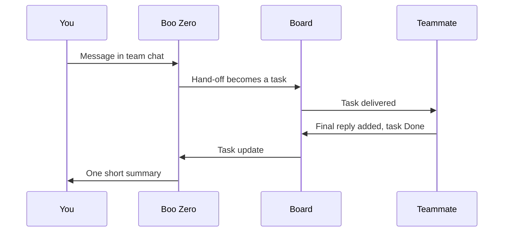

When Boo Zero, or any agent, decides that a teammate should do part of the work, it **delegates**. Clawboo turns the hand-off into a task on the board, sends it to the teammate, and brings the result back to whoever handed it off. You see the task appear on the board, and a short reply from the lead when the work is done.

Use this page to understand what a teammate is given, what comes back, and the limits that keep a team from running away.

## How a hand-off flows

<Steps>
<Step title="You send a message">

You write in General or a room. Boo Zero answers it, unless you start the message with `@` and a teammate's name. A simple question gets a direct answer; hands-on work gets handed off.

</Step>
<Step title="The lead hands off">

The lead calls its delegate tool, or writes a delegate line, naming a teammate and the task. Clawboo only acts on these structured hand-offs. An `@`-mention in the middle of a reply hands off nothing.

</Step>
<Step title="Clawboo creates a task">

The hand-off becomes a card on the board, claimed for that teammate and moved to In progress. If the teammate is busy, the card waits in To do until it is free. You can watch it in the team chat's **Tasks** card and on the board.

</Step>
<Step title="The teammate works on its own runtime">

The teammate runs the task on whichever runtime it uses, with its own tools.

</Step>
<Step title="The result comes back">

The teammate's final reply is added to the card, the card moves to Done, and the result goes to whoever handed it off. The lead then writes you one short summary.

</Step>
</Steps>

## What the teammate receives

- **The task the lead wrote.** The teammate does not see your conversation with the lead, so a good hand-off is self-contained. Clawboo's delegate tools ask the lead for exactly that.
- **The team rules and the list of teammates.**
- **A note about its role.** It is told that it works on one task for its lead and cannot reach you: its reply goes back to the lead.
- **What is waiting for it.** Results of work it handed out, your comments on its tasks, alerts, and new posts in the agents' peer room (see [Peer chat](/concepts/peer-chat)).
- **Its usual tools**, including shared memory and the board.

Your introduction to the team is not included: it rides only the turns whose reply you read. [What an agent sees](/concepts/agent-context) lists everything that goes into a turn.

## What comes back

- **A summary, not a transcript.** The teammate's final reply is recorded as a comment on its card, with very long output trimmed. Its intermediate steps stay out of the lead's view.
- **A task update for whoever handed it off.** Results that finish within a few seconds of each other arrive together in one update. A task the lead handed out reports to the lead. A sub-task reports to the teammate that handed it off, and that report climbs the chain to the lead. Only the lead's summary reaches the chat.
- **A completion line in the chat**, so you can see the task finished even before the lead replies.
- **An honest empty result.** If the teammate returned nothing, the lead is told so, rather than seeing a false success.

A task you give an agent yourself, with **New task** on the board, reports to nobody: its result stays on the card for you to read.

If a result arrives when no run is listening, it waits in the agent's mailbox. The agent reads it when its next run starts or, while it is running, alongside the answer to its next call to one of Clawboo's task or peer-room tools.

## How each runtime signals a hand-off

Each runtime hands work off in its own way. Clawboo reads only these structured signals, never intent guessed from prose.

| Agent handing off on       | How it hands off                                                                                                  |
| -------------------------- | ----------------------------------------------------------------------------------------------------------------- |
| Clawboo Native             | Calls its `delegate` tool with a teammate's name and the task.                                                    |
| Claude Code, Codex, Hermes | Calls the `team_delegate` tool, which Clawboo provides on team chat runs.                                         |
| OpenClaw                   | Writes `<delegate to="@Name">the task</delegate>` in its reply. A `sessions_send` call to a teammate also counts. |

Any agent's finished reply can also carry `<delegate>` lines, or a `<plan>` made of `<step>` blocks: an ordered plan in which each step waits for the one before it. Clawboo forgives small slips such as smart quotes or a missing `<`. Sometimes a reply looks like a hand-off but cannot be read, for example because it names no real teammate. Clawboo then tells the lead once to send it again in the right form.

## Busy teammates

A teammate works one hand-off at a time. If it is busy, the new task waits in To do and starts as soon as the teammate is free. A message for a busy agent waits for its current turn to end; it never interrupts it.

## Risky hand-offs wait for you

Clawboo holds a hand-off whose task text contains any of these words, in any letter case: delete, destroy, deploy, publish, release, secret, credential, prod or production, the phrases drop table and rm -rf, and api_key, api-key, apikey, force-push, force_push or forcepush. It asks you to approve it, and the request appears in Needs you and in [Approvals](/using/approvals). If you decline, or nobody answers within 5 minutes, the hand-off is skipped and the lead is told.

The check is a plain whole-word match on the task text, so ordinary work that mentions a release can trip it, while "deleted", "secrets", or "API key" and "force push" written with a space do not. Steps of a `<plan>` are not checked this way.

## Limits

| Limit                 | Value                                                                                                                 | When it is reached                                                                                                                    |
| --------------------- | --------------------------------------------------------------------------------------------------------------------- | ------------------------------------------------------------------------------------------------------------------------------------- |
| How deep hand-offs go | Three tasks below the lead                                                                                            | The lead hands a task to A, A hands part of it to B, and B to C. C cannot hand off further and is told to do the work or report back. |
| Hand-offs in one turn | 8                                                                                                                     | Extra hand-offs in the same turn are not started, and the agent is told to send them again later.                                     |
| A teammate goes quiet | 8 minutes with no activity; 24 minutes while it is inside one tool call, or waiting for another run on the same agent | The task is marked blocked as **Timed out**, and the lead is told.                                                                    |
| Repeated failures     | 3 failures in a row of the same task by the same teammate                                                             | Clawboo stops handing that task to that teammate and tells the lead to do it, reassign it, or tell you it cannot be done.             |

[Limits and defaults](/reference/limits-and-defaults) lists these with every other number Clawboo enforces.

## Where a failure shows up

When a handed-off task fails, you can see it in three places:

1. **On the board.** The task moves to Needs you as **Failed** or **Timed out**, with the reason as a comment on its card.
2. **In the lead's next turn.** The task update says the work did not complete and why, so the lead can retry it, give it to someone else, or tell you.
3. **In the plan.** Steps that were waiting on the failed task are cancelled, and the update names them.

If a hand-off cannot start at all, for example because of the depth limit or a declined approval, the lead is told at once. When the hand-off came from a task, a note is added to that task's card.

## Stop, and your own moves

Pressing **Stop** in a chat halts that chat's running work. Tasks it was running go back to To do without counting as failures, and they do not restart on their own: Needs you shows them as **Stopped**. Work that had been handed out but had not started yet never starts.

Moving a card yourself outranks the run. Clawboo stops the run working on that task. When you mark the task Done or cancel it, whoever handed it off is told, and a cancelled task's waiting steps are cancelled with it. A late result from the stopped run is kept as a comment and changes nothing else. See [The board](/concepts/the-board).

## Two ways work runs

Everything on this page happens in team chat, which is how most work runs. Clawboo has a second path, the task runner, used by agent Routines and the runtime run API. Per-task worktrees, automatic checks, automatic memory recall and spending breakers apply only there. [How a team works](/intro/how-it-works) compares the two.

<Accordion title="Under the hood">

- **The engine.** Each chat, General and every room, has one long-lived orchestration engine on the server. It reads typed run events, never prose. A hand-off is a tool call whose name matches `sessions_send` or has a `delegate` segment (so `delegate`, `team_delegate` and namespaced forms count), or a `<delegate>` or `<plan>` block in a finished turn. A `<plan>` wins over `<delegate>` blocks in the same turn. Self-delegations, unknown names and empty tasks are dropped.
- **Spawning.** For each hand-off the engine checks the teammate's session, the repeated-failure breaker, the depth cap and the risky-word approval. Then it creates the task, claims it, opens a run record and delivers the message. A busy teammate gets a deferred `todo` task that the dispatcher fires when the teammate is free.
- **No sub-agents.** Every delegated run carries a blocklist of `sessions_send`, `sessions_spawn` and `sessions_yield`. OpenClaw cannot block tools per message, so Clawboo denies `sessions_spawn` and `sessions_yield` in the Gateway's `tools.deny` and repeats the team contract in each OpenClaw turn.
- **Mailbox.** Undelivered notices live in the agent's durable mailbox with the kinds `task_update`, `alert` and `signal`.

See [Executor runner](/internals/executor-runner) for the other path and [team-orchestration](/reference/packages/team-orchestration) for the engine package.

</Accordion>

## Related

- [The board](/concepts/the-board): statuses, Needs you and when a task restarts by itself.
- [Teams, rooms and runtimes](/concepts/teams-and-planes): which chat runs a hand-off.
- [Peer chat](/concepts/peer-chat): the agents' own room, separate from hand-offs.
- [Governance](/concepts/governance): budgets, caps and approvals across Clawboo.
- [Chat with your team](/using/team-chat): sending messages, `@` mentions and Stop.
