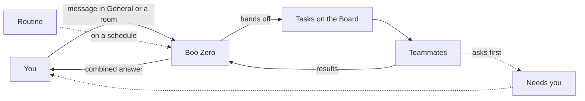

Clawboo uses a small set of words for its parts. Learn these eleven and the rest of the docs will make sense. Each entry gives a one-sentence definition, an everyday comparison, why the thing exists, and where you find it in the app.

## The whole system in one minute

You give a team work in its chat. Boo Zero, the team's leader, answers or splits the work into tasks on the Board. Teammates do the tasks and report back, and Boo Zero sends you the combined answer. Each teammate runs on a runtime and thinks with a provider's models. Along the way agents can save facts to memory and use the connectors you share with them. Routines start work on a schedule, and anything that needs your decision waits under **Needs you**.

[How a team works](/intro/how-it-works) follows one message through this loop in detail.

## The concepts

### Agent (Boo)

An agent is an AI worker with a name, a role and a personality. Each one appears in the app as a Boo, a small mascot.

- **Like:** a teammate with a job description.
- **Why it exists:** several agents with narrow roles can work at once, and each stays focused on its part.
- **Where you see it:** the Boos at the top of the sidebar for the selected team. Click one to open its page; **Create Boo** adds a new one.
- **More:** [Agents](/using/agents)

### Boo Zero

Boo Zero is your team leader: it reads what you ask, answers it or splits it into tasks for the team, and brings the results back to you.

- **Like:** a project manager who takes the brief and hands out the work.
- **Why it exists:** you ask once, in one place, instead of instructing each agent.
- **Where you see it:** the red Boo at the top of the far-left rail opens Boo Zero's own page. In a team's chat, Boo Zero answers unless you @mention someone. Clawboo sets Boo Zero up for you; without one, the team's own **Leader** or its first member leads.
- **More:** [Boo Zero](/using/boo-zero)

### Team

A team is a group of agents that work together, with its own chat, tasks and rules.

- **Like:** a department, or a small agency crew.
- **Why it exists:** each kind of work keeps its own people, history and rules in one place.
- **Where you see it:** the team icons on the far-left rail. The **+** below them opens ready-made teams in the Marketplace.
- **More:** [Teams](/using/teams)

### Room

A room is an extra chat inside a team, with some of its members, its own conversation and its own tasks.

- **Like:** a breakout meeting.
- **Why it exists:** a few agents can work on one topic without crowding the team's main chat.
- **Where you see it:** every team has **General (Main Room)**, and **New room** in the sidebar adds another. Boo Zero leads each room the way it leads General.
- **More:** [Work with your team in chat](/using/team-chat)

### Board and task

A task is one piece of work with an owner and a status. The Board shows every task, and each hand-off between agents creates one.

- **Like:** a shared wall of sticky notes that move across columns.
- **Why it exists:** work stays visible and survives a closed tab or a restart, and you can change it at any time.
- **Where you see it:** **Board** in the sidebar, and the **Tasks** card beside a team's chat. **New task** on the Board gives an agent work directly.
- **More:** [Board](/using/board)

### Runtime

A runtime is the program that runs an agent: Clawboo Native (built in), Claude Code, Codex, Hermes or OpenClaw.

- **Like:** if the AI model is the brain, the runtime is the body. It decides which tools the agent has and how it uses them.
- **Why it exists:** runtimes are good at different jobs, such as coding, and one team can mix them.
- **Where you see it:** **Settings** > **Runtimes**. You pick each agent's runtime when you set up a team.
- **More:** [Choose a runtime](/runtimes/index)

### Provider

A provider is the service whose AI models do the thinking, such as Anthropic, OpenAI, OpenRouter or a local Ollama.

- **Like:** a utility. You connect your account once, and it bills you for what your agents use. A local model through Ollama has no bill, and Clawboo's spend numbers record it as free.
- **Why it exists:** Clawboo is free and brings no models of its own, so you choose who answers, and who bills you.
- **Where you see it:** **Settings** > **Providers**. Setup connects your first one.
- **More:** [Providers and runtimes](/using/providers-and-runtimes)

A runtime and a provider are different things. A Claude Code agent (a runtime) uses Anthropic's models (a provider), and a Clawboo Native agent can use any of 11 providers.

### Memory

Memory is the team's shared notebook: facts agents save so that teammates can find them later.

- **Like:** a team wiki.
- **Why it exists:** what one agent learns stays available after the chat moves on.
- **Where you see it:** **Memory** in the sidebar shows every saved fact and where it came from. **Add a fact** writes one yourself.
- **More:** [Memory](/using/memory)

### Connector

A connector links Clawboo to an outside app or tool, such as GitHub, a web browser or Gmail, so agents can use it.

- **Like:** a key card for one door, handed only to the agents that need it.
- **Why it exists:** agents can act where your work lives, and you decide which agent reaches which app.
- **Where you see it:** **Connectors** in the sidebar connects one. Then share it with an agent on the Org chart or a team graph: drag the connector onto the Boo and pick **Read**, **Write** or **Admin**.
- **More:** [Connectors](/using/connectors)

### Routine

A routine sends work on a schedule, either into a team's chat or straight to one agent.

- **Like:** a recurring calendar entry that does the job instead of reminding you.
- **Why it exists:** regular work, such as a Monday report, happens without you starting it.
- **Where you see it:** **Settings** > **Routines**. Upcoming runs also show on the Board, and on an agent's **Tasks & Routines** card.
- **More:** [Routines](/using/routines)

### Approval and Needs you

**Needs you** is where everything waiting on your decision collects: approval requests, failed or stopped tasks, and tasks with no agent. An approval is a request that needs your yes first, such as running a command, calling a connector or handing off risky work.

- **Like:** the in-tray on your desk.
- **Why it exists:** agents work unattended, so the few things that need a person wait in one place.
- **Where you see it:** the **Needs you** column on the Board, the **Tasks** card beside a team's chat, and approval cards in the chat itself.
- **More:** [Approvals](/using/approvals) and [What agents can do](/concepts/permissions)

## The building blocks

Each concept has a page that goes deeper. Start with the four big-picture pages, then follow whichever building block you need.

| Page                                                            | What it explains                                                         |
| --------------------------------------------------------------- | ------------------------------------------------------------------------ |
| [How a team works](/intro/how-it-works)                         | What happens to a message, and the two ways Clawboo runs agents          |
| [What an agent sees](/concepts/agent-context)                   | The context every turn and run carries, and what it leaves out           |
| [What agents can do](/concepts/permissions)                     | What each runtime can reach, and when Clawboo asks you first             |
| [How work is checked](/concepts/verification)                   | When finished work is tested, and what is never checked                  |
| [Agents and Boo Zero](/concepts/agent-model)                    | What an agent is, and how Boo Zero is chosen                             |
| [Teams, rooms and runtimes](/concepts/teams-and-planes)         | What a team shares, and what each runtime keeps to itself                |
| [The board](/concepts/the-board)                                | Task statuses, Needs you, and how work survives a restart                |
| [How work is delegated](/concepts/delegation-and-orchestration) | How a leader hands off work and gets the results back                    |
| [How agents talk to each other](/concepts/peer-chat)            | The room agents use among themselves                                     |
| [Memory](/concepts/memory)                                      | Shared and private memory, and how facts are found                       |
| [Capabilities](/concepts/capabilities)                          | The skills, tools and connectors each agent can use                      |
| [Budgets and guardrails](/concepts/governance)                  | Spend limits, caps and circuit breakers                                  |
| [Observability](/concepts/observability)                        | The event log, traces and fleet health                                   |
| [Worktrees and handoff](/concepts/worktrees-and-handoff)        | Separate checkouts for coding tasks, and passing a task between runtimes |
| [How routines run](/concepts/scheduling)                        | The engine behind Routines                                               |

## Next steps

- [Quickstart](/getting-started/quickstart): get a team running.
- [How a team works](/intro/how-it-works): follow one message from start to finish.
- [Glossary](/appendices/glossary): every other term, and the old names you may still see.
