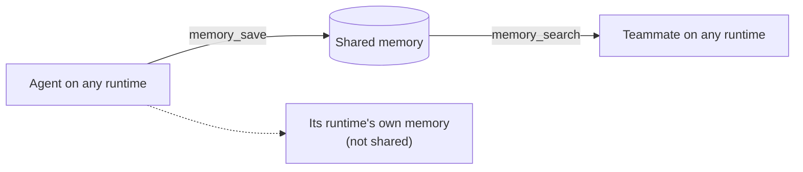

Clawboo gives each team a **shared memory**: facts and how-tos that any teammate can save and recall, whatever runtime it uses. Separately, some runtimes keep **their own memory**, such as Hermes's `MEMORY.md`. Clawboo leaves that alone and never shares it. Shared memory also learns from use: agents report which facts helped, and the facts the team trusts rise to the top.

Use this page to understand what shared memory holds, who can see a fact, when agents recall facts without asking, and how search and embeddings work.

## The mental model

Shared memory is the team's notebook. When an agent learns something the team should keep, such as the staging deploy command or the tone you prefer, it writes it down. Any teammate can look it up later. A runtime's own memory is usually that agent's private diary; Claude Code is the exception, described under "Each runtime's own memory" below. Clawboo never copies between the two: an agent chooses what to write in the shared notebook.

## What shared memory holds

- **Facts.** A short statement with a title, content and optional tags, for example "Staging deploys run `pnpm deploy:staging`".
- **Procedures.** A named how-to. Saving one under the same name again adds a new version.

Before anything is stored, Clawboo masks values that look like secrets, such as API keys, in a fact's title and content and in a procedure's content. An agent's save whose content is nothing but a secret is refused. Masking catches credential-shaped values only, so it is not a guarantee that no sensitive text is ever saved.

Agents work with four Memory tools: `memory_save`, `memory_search`, `memory_browse` and `memory_feedback`. You browse, search and add facts in the **Memory** panel (**Settings**, then **Workspace**, then **Memory**); see [Memory](/using/memory).

## Who can see a fact

| Saved by                                                                          | Filed under | Readable by                       |
| --------------------------------------------------------------------------------- | ----------- | --------------------------------- |
| An agent on Clawboo Native, Claude Code, Codex or Hermes, during a run for a team | That team   | Every member of the team, and you |
| The same agents, during a run with no team                                        | Global      | Everyone                          |
| An OpenClaw agent                                                                 | Global      | Everyone                          |
| You, in the Memory panel                                                          | Global      | Everyone                          |

The panel labels each fact **Team-shared**, **Agent-scoped** or **Global**. When an agent searches, it sees its team's facts, facts filed for that agent, and global facts, never another team's.

OpenClaw agents see global facts only: one Gateway configuration serves all of them, so Clawboo cannot tell which team an OpenClaw agent works for. The scope comes from the agent's connection, not from what the model asks for, so an agent cannot widen what it sees or file a fact under another team.

## Memory learns from use

When an agent uses a fact, it can report how it went with `memory_feedback`. The outcomes are **useful**, **dead end** (it misled or wasted effort) and **corrected** (it was wrong, and the note holds the correction). In the Memory panel's graph you can do the same: click a fact, then **Helpful** or **Outdated**.

Clawboo turns these reports into a status on each fact:

| Status    | When                                                                           |
| --------- | ------------------------------------------------------------------------------ |
| preferred | Two or more different reporters found it useful, and none reported against it. |
| tentative | One reporter found it useful, and none reported against it.                    |
| contested | Reports disagree. The panel shows it as "contested · verify".                  |
| dead end  | Only negative reports.                                                         |

A "different reporter" is a different agent, or the same agent on a different task, so your own clicks alone cannot make a fact preferred. Older reports count for less: a report's weight halves every 30 days. Search results show each fact's status and id, so an agent can report on the fact it used.

## The memory graph

The Memory panel draws your facts as a graph. Facts that share tags are linked, versions of a procedure are linked, and, when embeddings are on, facts with a similar meaning are linked too. Clusters of related facts are grouped and coloured together. Click a fact to read it, see its history, and mark it **Helpful** or **Outdated**.

## When facts are recalled without asking

Whether an agent starts with facts already in hand depends on how the run started:

| How the run started                                                                                       | Facts added at the start                                                                                                                                                                                                                                          |
| --------------------------------------------------------------------------------------------------------- | ----------------------------------------------------------------------------------------------------------------------------------------------------------------------------------------------------------------------------------------------------------------- |
| Team chat: your messages, every hand-off and every task you start from the board                          | None. The agent searches memory with `memory_search` when it needs to.                                                                                                                                                                                            |
| A one-to-one chat with a Clawboo Native, Claude Code, Codex or Hermes agent                               | Up to 8 of the agent's own and global notes, on the first turn of a conversation and again after `/reset`. Team facts are left out.                                                                                                                               |
| The task runner: an agent Routine on Clawboo Native, Claude Code, Codex or Hermes, or the runtime run API | An `<auto-memory>` block with up to 5 facts that best match the task's title and description, within 1,500 characters, plus up to 2 closely related facts. The run is also told how shared memory differs from its own, and asked to report on the facts it used. |

Most work runs through team chat, so most runs start with no facts and rely on the agent to search. A direct run through the runtime run API can turn the block off with `disableMemoryAutoInject: true`. [How a team works](/intro/how-it-works) explains the two paths.

The block ranks preferred facts higher, flags contested ones, and leaves dead-end facts out; they can still be found with a search. Before a fact enters another agent's prompt, Clawboo drops it if it contains instructions aimed at the agent, such as "ignore your previous instructions", and masks secrets again.

## How search works

Keyword search always works, with no setup. When embeddings are on, a search is **hybrid**: it weighs meaning (60%) and keyword match (40%), so a search for "deploy steps" can find a fact that says "release process". A fact embedded by a different model matches on keywords only.

## Embeddings: local first

Embeddings are what let memory match on meaning. Clawboo picks a provider in this order:

| Order | Provider                                                     | When Clawboo uses it                                                                                                                                                                                                                | What leaves your machine                 |
| ----- | ------------------------------------------------------------ | ----------------------------------------------------------------------------------------------------------------------------------------------------------------------------------------------------------------------------------- | ---------------------------------------- |
| 1     | Ollama at `http://localhost:11434`, model `nomic-embed-text` | Whenever it answers with that model installed                                                                                                                                                                                       | Nothing                                  |
| 2     | OpenAI, model `text-embedding-3-small`                       | When Ollama cannot serve and you have connected an OpenAI key. Once any fact has been indexed by Ollama, only after you choose **Use OpenAI instead** during an Ollama outage, and only until Ollama is back or the key is removed. | Fact text and memory searches, to OpenAI |
| 3     | None                                                         | Otherwise                                                                                                                                                                                                                           | Nothing; keyword search only             |

- To turn on local embeddings, run `ollama pull nomic-embed-text`, or press **Install model** in the Memory panel.
- Memory always looks for Ollama at `http://localhost:11434`. `OLLAMA_BASE_URL` does not change it.
- The OpenAI key counts when you connected it in Clawboo or exported `OPENAI_API_KEY`. A key that only OpenClaw holds is never used for memory.
- Set `CLAWBOO_DISABLE_EMBEDDINGS=1` to stay on keyword search.
- No restart is needed. Clawboo re-checks every 10 minutes while Ollama serves and every 30 seconds otherwise, and indexes facts saved without an embedding in the background.

## Each runtime's own memory

| Runtime        | Its own memory                                                                                                | Shared with teammates?                                         |
| -------------- | ------------------------------------------------------------------------------------------------------------- | -------------------------------------------------------------- |
| Clawboo Native | Its saved conversations, in its own folder under `~/.clawboo/runtimes/clawboo-native/`                        | No                                                             |
| Hermes         | `MEMORY.md`, `state.db` and the skills it creates, in its own Hermes home under `~/.clawboo/runtimes/hermes/` | No. Clawboo never edits them.                                  |
| Codex          | None that Clawboo keeps. Its folder under `~/.clawboo/runtimes/codex/` holds its login and session files.     | Not applicable                                                 |
| OpenClaw       | Kept in your OpenClaw Gateway's own state                                                                     | No                                                             |
| Claude Code    | Your own `~/.claude` settings and memory, and the `CLAUDE.md` of the folder it runs in                        | Yes, with every Claude Code agent and your own Claude Code use |

<Warning>

Claude Code agents run with your own Claude Code setup: your `~/.claude` settings and memory, and the `CLAUDE.md` files of the folder they run in. Every Claude Code agent loads them, and so do your own Claude Code sessions. Do not keep anything there that you would not hand to the team.

</Warning>

Clawboo never copies a runtime's own memory into shared memory, or the other way round. In task-runner runs, each agent is told that its own memory is private to it and that knowledge the team needs belongs in shared memory. See [Teams, rooms and runtimes](/concepts/teams-and-planes) for where each runtime keeps its state.

## What you control

- **See and add facts**: in the Memory panel, which also shows the graph and each fact's status. See [Memory](/using/memory).
- **Correct the team's memory**: mark a fact **Helpful** or **Outdated** in the graph.
- **Turn on matching by meaning**: install `nomic-embed-text` in Ollama, or press **Install model**.
- **Decide about OpenAI**: choose **Use OpenAI instead** during an Ollama outage, or set `CLAWBOO_DISABLE_EMBEDDINGS=1` so memory never calls an embedding provider.

## Limits

- Team chat runs, which are most runs, get no facts added automatically. Agents have to search.
- OpenClaw agents read and save global facts only.
- Masking secrets is a pattern match on credential-shaped values, not a guarantee.
- With OpenAI as the embedding provider, fact text and searches are sent to OpenAI.
- The Memory panel saves facts as global; it does not file them under a team.

<Accordion title="Under the hood">

- **Storage.** Facts and procedures live in `memory_facts` and `memory_procedures`, with an FTS5 table for keyword search and a stored vector per fact. Feedback lives in `memory_outcomes`. Tables: [Database schema](/reference/database-schema).
- **Tools.** `memory_save` saves a fact, or a versioned procedure when `procedureName` is set. `memory_search` takes `mode` (`fts`, `vector` or `hybrid`; hybrid when embeddings are available, otherwise `fts`) and `limit` (1 to 100). `memory_browse` takes `limit` (1 to 200). `memory_feedback` takes a fact id, or an id prefix of at least 8 characters, an `outcome`, and a note, which `corrected` requires. See [MCP tools](/reference/mcp-tools).
- **Scope binding.** Clawboo binds each run's Memory connection to its team and agent: in process for Clawboo Native, and in a signed URL for the other runtimes. A bound save is filed under the team only. A run with no team reads global facts only, and so does an HTTP connection without a valid signature, which also saves to global. The `clawboo-mcp-memory` stdio program, which you run yourself, takes its scope from the tool arguments and defaults to `~/.openclaw/clawboo/clawboo.db`, not the server's database, unless you set `CLAWBOO_DB_PATH`; see [MCP servers](/operating/mcp-servers).
- **Automatic recall.** The task runner searches in hybrid mode with the task's title and description, scoped to the task's team and agent. Each line in the block starts with an 8-character `(id …)` so the agent can cite it, and each fact shown is recorded as cited once per task. The block goes into the part of the prompt that is rebuilt every run.
- **Learning.** Status rules: mixed signals give `contested`, negatives only give `dead_end`, two or more distinct `(agent, task)` reporters of `useful` give `preferred`, one gives `tentative`. Weights decay with a 30-day half-life.
- **REST.** `GET` and `POST /api/memory`, `GET /api/memory/browse`, `/graph`, `/outcomes` and `/provider`, `POST /api/memory/feedback`, `/embedding/reindex` and `/embedding/install`. See the [Memory API](/reference/rest-api/memory).

</Accordion>

## Related

- [Memory](/using/memory): the Memory panel, step by step.
- [Teams, rooms and runtimes](/concepts/teams-and-planes): what a team shares and where each runtime keeps its state.
- [What an agent sees](/concepts/agent-context): everything that goes into an agent's turn.
- [Claude Code](/runtimes/claude-code): running Claude Code agents, and the setup they share with you.
- [MCP tools](/reference/mcp-tools): the Memory tools' inputs and outputs.
