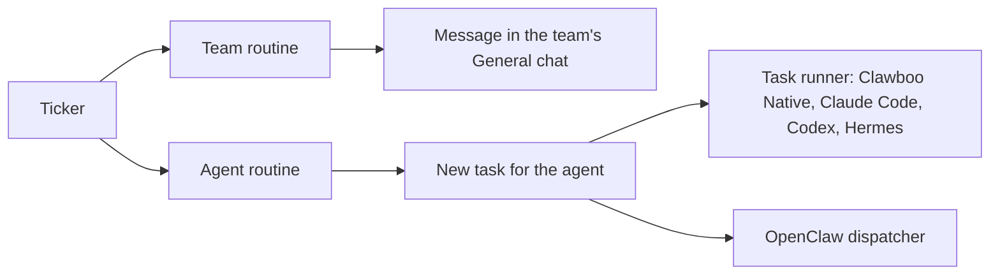

A **routine** is work Clawboo starts on a schedule. Each time it fires, it hands its instructions to a team or to one agent, with nobody at the dashboard. This page explains what happens when a routine fires, what happens when a fire fails, and the rules that keep a routine from running twice. To create and manage routines, see [Routines](/using/routines).

## How a routine fires

- **The routine is a row in Clawboo's database.** It holds who the routine goes to, its schedule, its instructions, its status and the time of its next run.
- **The schedule** is a cron expression, such as `0 9 * * 1-5` for weekdays at 9:00, or a single time written as `once@` followed by an ISO date and time. Cron times use the time zone of the machine the Clawboo server runs on.
- **The ticker**, a timer inside the Clawboo server, wakes when the next routine is due, and at least once a minute. Each time, it finds the routines that are due, claims each one so that it fires only once, and hands it on. Routines that fall due together fire side by side. Nothing fires while the Clawboo server is stopped.
- **Run now** queues a routine immediately, and the ticker fires it straight away.

Each fire then goes one of two ways:

## Missed and overlapping runs

- **Missed times are not made up.** If Clawboo was stopped, or the machine was asleep, when a routine was due, the routine fires once when the ticker next checks. It then carries on from its next scheduled time after that run.
- **A routine never overlaps itself.** Scheduled times that pass while a run is still going are skipped.
- **A restart in the middle of a fire** leaves a recurring routine waiting for its next scheduled time, and stops a one-time routine with an error for you to check. A fire that was claimed but had not started yet runs as soon as the server is back. The cut-off run shows as **interrupted** in the routine's history after its next fire.
- **A one-time routine** fires once, then shows as **finished** and never runs again.

## What a team routine does

A team routine posts its instructions into the team's **General** chat, never into a room. The message is labelled **Routine** with the routine's name instead of **You**, and it is routed like a message you type: if it starts with `@Name`, it goes to that teammate; otherwise it goes to the team's lead (Boo Zero when you have one, else the team's Leader, else its first active member).

The lead is told the message came from a routine and that you may not be watching, so it should carry the work out and make reasonable assumptions instead of asking questions and waiting. The fire counts as done, shown as **posted**, once the message reaches the lead, even if the lead's turn waits behind one already running. From there it is ordinary team chat, with the same hand-offs, Board tasks, **Stop** button and [guardrails](/concepts/governance) as a message you typed. A team routine creates no Board task of its own.

A team fire fails when the team no longer exists, is archived, has no active members, or does not take messages from routines.

## What an agent routine does

An agent routine creates a new Board task for its agent on every fire, with the routine recorded as the task's scheduler. (A routine bound to an existing task through the API runs that task instead.) Then it runs the task in one of two ways, depending on the agent's runtime:

|                               | Clawboo Native, Claude Code, Codex, Hermes                | OpenClaw                                                |
| ----------------------------- | --------------------------------------------------------- | ------------------------------------------------------- |
| Runs through                  | The task runner                                           | A small dispatcher that sends the task over the Gateway |
| Budget check before it starts | Yes                                                       | Yes                                                     |
| Circuit breakers              | Yes                                                       | No                                                      |
| Worktree and verification     | Only when the task template names a repository (API only) | Never                                                   |
| Time limit                    | Ended after 30 minutes with no activity                   | 10 minutes for the whole run                            |
| Trace in Observability        | Yes                                                       | No                                                      |

On OpenClaw, the Gateway must be connected, or the fire fails. A finished OpenClaw run gets a comment on its task saying it completed without verification. If a person moves the task's card out of In progress on the Board while it runs, the run stops at once. That counts as the outcome, not as a failure, and the routine stays on its schedule.

The Routines dialog sets who a routine goes to, its schedule, its name and its instructions. The other task template fields are set only through the [Schedules API](/reference/rest-api/schedules): a repository path (`repoPath`), the task kind, the model, the priority, a per-run cost cap (`maxNodeCents`) and an existing task to bind to (`teamTaskId`). An agent routine made in the dashboard therefore has no repository. It runs as a research task without a worktree, the same way the agent works in team chat: see [What agents can do](/concepts/permissions) for where Claude Code, Codex and Hermes start in that case.

## When a fire fails, the routine stops

A routine whose fire fails stops itself. Its dialog shows **Stopped after a failed run.** with the error, and it does not run again until you press **Resume**. Common causes:

- an agent routine's run is refused before it starts, because a hard-cap budget for the agent, the team or the task's delegation tree is already paused (team routines are not checked);
- a circuit breaker or a hard cap stopped an agent routine's run while it was still working (a Claude Code or Codex run whose last cost report crosses a hard cap keeps its result, and the paused budget refuses the routine's next run instead);
- the run itself failed or timed out;
- the OpenClaw Gateway was not connected (OpenClaw agents only);
- the agent was removed, or the team was deleted or archived.

The task that a failed agent fire created is moved to Blocked, so it waits in **Needs you**, with a comment saying the scheduled run failed and the task was set aside. The routine files a fresh task on its next run. A task the routine is bound to is left as the run left it.

Two outcomes are not failures. If another agent had already claimed the task, the work is happening, and the fire counts as done. If a person moved the task's card, their move is the outcome. Both leave the routine on its schedule.

Routines stop instead of retrying on purpose. A routine that failed on every fire and kept going would spend money and fill the board with copies of the same failure. Stopping it once puts the cause in front of you.

## One scheduler per task

Every Board task has one scheduler on record: you (a task made by hand), Clawboo's routines, or OpenClaw. Two schedulers firing the same task would run it twice, so Clawboo keeps it to one:

- **Binding to an existing task** (`teamTaskId`, through the API) is refused when another scheduler already owns the task. A task you made by hand is taken over by the routine.
- **A bound routine must be one-time.** A task can be claimed only once, so a recurring schedule on a bound task is refused. A team routine cannot be bound to a task at all.
- **The claim is the backstop.** If two fires ever reach one task, only one of them can claim and run it.

## OpenClaw's own cron jobs

The OpenClaw Gateway has its own scheduler, which an OpenClaw agent can use to wake itself. The Routines view lists those jobs in a separate section, **OpenClaw's own cron jobs**, so everything scheduled is in one place. You can enable, disable, run or delete a Gateway job there, but not edit it. While the Gateway is disconnected, the section shows the last list it sent, or hides the jobs until it reconnects. Your own routines are not affected.

Clawboo never uses the Gateway's scheduler for routines, and refuses to schedule team work through it. Claude Code, Codex, Hermes and Clawboo Native have no scheduler of their own that Clawboo drives, so a routine is how you schedule them. The Board's calendar shows the upcoming runs of your routines, but not of Gateway jobs.

<AccordionGroup>

<Accordion title="Under the hood">

- A routine's statuses are `idle`, `queued`, `claimed` (shown as **starting**), `running`, `paused` and `error`. The ticker picks up only `idle` routines whose next run is due. `paused` and `error` wait for a person.
- Each fire is claimed with a conditional database update, so two tickers, or two server processes, cannot both fire it. A lost claim is dropped and never retried.
- After a restart, a `claimed` fire is queued again, a recurring `running` fire is re-armed for its next time with the note `orphaned mid-dispatch (restart)`, and a one-time `running` fire moves to `error`.
- The part that hands a fire on, by posting to the team or by creating and running the agent's task, is the wake bridge. It picks the agent path from the runtime's declared capabilities, never from its name.
- Each fire writes `routine_fired`, then `routine_dispatched` (with the path `team-chat`, `one-shot` or `connected`), then `routine_completed` or `routine_error` to the event log.
- `CLAWBOO_ROUTINE_OPENCLAW_TIMEOUT_MS` changes the 10-minute limit for OpenClaw runs. The [Schedules API](/reference/rest-api/schedules) lists the template fields and the error codes for ownership conflicts and bound schedules.

</Accordion>

</AccordionGroup>

## Related

- [Routines](/using/routines): create, edit, pause, resume and run routines.
- [Budgets and guardrails](/concepts/governance): which guardrails cover team routines and agent routines.
- [Worktrees and handoff](/concepts/worktrees-and-handoff): when a routine's task gets a worktree.
- [What agents can do](/concepts/permissions): where an agent routine without a repository runs.
- [Schedules API](/reference/rest-api/schedules): template fields, one-time schedules and error codes.
