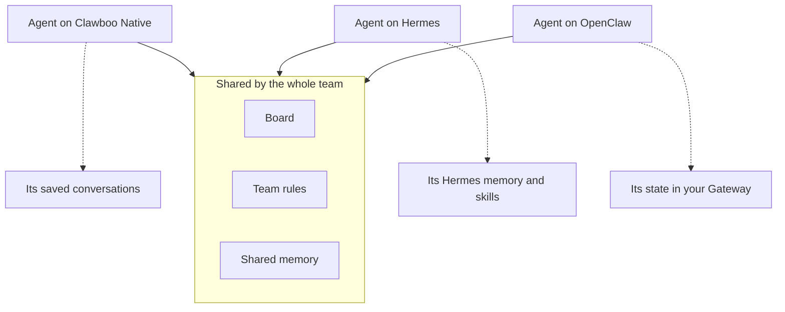

A **team** is a group of agents that work together. It has one board, one set of team rules and a shared memory. You talk to a team in its **General** chat, or in a **room**, a smaller conversation with some of its members. A team can mix runtimes: one member on Clawboo Native, another on Claude Code, a third on OpenClaw.

Use this page to understand what a team has, how its chats run, and what the team shares compared with what each runtime keeps to itself.

## The mental model

Picture a small office. Everyone shares the whiteboard (the board), the house rules (team rules) and the filing cabinet (shared memory). Each person also keeps a private notebook, which here is the runtime's own memory and settings. Teammates cannot read each other's notebooks. Claude Code is the exception: every Claude Code agent uses your own Claude Code setup, as the table below shows.

Solid lines are what every member reaches the same way, whatever its runtime. Dotted lines are what each runtime keeps for itself. OpenClaw is a partial exception, described [below](#openclaw-shares-less).

## What a team has

- **Members.** Agents on any mix of runtimes. An agent is on one team at a time, or on none. Boo Zero leads every team, usually without being a member of any (see [Agents and Boo Zero](/concepts/agent-model)).
- **General.** The team's main chat, with every member in it. The sidebar shows it as **General (Main Room)**. It is always there: you can clear it, but not rename or delete it.
- **Rooms.** Extra chats with some of the members, made with **New room**. Each room has its own conversation and its own list of tasks, and Boo Zero leads it too. You can rename, pin, clear or delete a room. Deleting a room archives it: its conversation is kept, its running work stops, and its tasks stay on the board.
- **One board.** Every task from every chat of the team. A task remembers which chat it came from, and that chat runs it. If the task's room was deleted, General runs it. See [The board](/concepts/the-board).
- **Team rules.** Rules you set, such as "always cite sources". Every agent gets them on every turn it takes in the team's chats, in General and in every room, including work handed off there.
- **Your introduction.** What you write the first time you open a team. It reaches the agents whose replies you read (the lead, or an agent you address directly), not the teammates working on handed-off tasks.
- **A team brief.** Boo Zero's notes about the team. Boo Zero reads it, up to 900 characters, only in its own one-to-one chat, when you start a message there with `@` and the team's name. In team chat, the lead sees the roster with each member's role instead.
- **Shared memory.** A fact a member saves during a team run is filed under the team, so any teammate on any runtime can recall it. See [Memory](/concepts/memory).
- **A peer room.** A notice board that only the team's agents read, separate from General and the rooms. The dashboard does not show it; see [Peer chat](/concepts/peer-chat).

You set the rules and the brief in the team settings, behind the gear in a team chat's header. [Manage teams](/using/teams) has the steps, and [Chat with your team](/using/team-chat) covers General, rooms and clearing a chat.

## How a team's chats run

Each chat, General and every room, has its own **coordinator** on the Clawboo server. The coordinator is the part of Clawboo that routes your message, turns each hand-off into a task on the board, and reports results back. It runs on the server, so work keeps going when you close the browser, and it picks up unfinished work after a restart.

A coordinator sees only its own chat's members and tasks, so two rooms never take each other's work. An agent that belongs to two rooms still runs one turn at a time.

Routines use the same path. A team Routine posts its instructions into the team's General chat as if you typed them, and Boo Zero answers. An agent Routine gives that agent a task on the board. Clawboo never drives a runtime's own scheduled jobs. See [How routines run](/concepts/scheduling).

## Shared and private

**Shared** means Clawboo stores it, and every teammate reaches it the same way, whatever its runtime: the board, the team's chats, team rules and shared memory.

**Private** means the runtime keeps it for itself: its own memory, skills, saved sessions and settings. Clawboo does not copy it into shared memory or hand it to teammates (Claude Code aside, see the table). Private here is about coordination, not security. Most runtimes can read any file your user account can; see [What agents can do](/concepts/permissions).

Clawboo gives three runtimes a folder of their own per agent, inside Clawboo's home folder (`~/.clawboo`, or `CLAWBOO_HOME` if you set it). Only your user account can open these folders.

| Runtime        | Where its own state lives                                                                   | What Clawboo does there                                                                                                                                                                                                         |
| -------------- | ------------------------------------------------------------------------------------------- | ------------------------------------------------------------------------------------------------------------------------------------------------------------------------------------------------------------------------------- |
| Clawboo Native | `~/.clawboo/runtimes/clawboo-native/<agent>`: its saved conversations                       | Creates the folder. A lead's conversation continues from one turn to the next.                                                                                                                                                  |
| Hermes         | `~/.clawboo/runtimes/hermes/<agent>`: its `MEMORY.md`, `state.db` and the skills it creates | Writes three files and nothing else: `mcp.json` on every run, `config.yaml` copied once from your `~/.hermes` if missing, and `auth.json` copied from `~/.hermes` when yours is newer. It never writes to your own `~/.hermes`. |
| Codex          | `~/.clawboo/runtimes/codex/<agent>`: that agent's `CODEX_HOME`                              | Copies in your `codex login` so the agent can run, and keeps its session files, so a Codex lead keeps its conversation between turns.                                                                                           |
| Claude Code    | Your own `~/.claude`, where Claude Code saves each run's session files                      | Nothing. Claude Code agents start without your own Claude Code settings, MCP servers and memory, and with its auto memory off. See [Claude Code](/runtimes/claude-code#your-own-claude-code-setup-stays-out).                   |
| OpenClaw       | Your OpenClaw Gateway's own state                                                           | Nothing. The Gateway owns it.                                                                                                                                                                                                   |

## OpenClaw shares less

OpenClaw agents share the board, but one Gateway configuration serves all of them, so Clawboo's tools cannot tell one OpenClaw agent from another. As a result, OpenClaw agents:

- read and save shared memory in the global area only, so they do not see the team's own facts;
- have no tool for the agents' peer room (see [Peer chat](/concepts/peer-chat));
- cannot claim or assign board tasks through Clawboo's task tools;
- do not get the connectors you give them on the Org chart, and ask you for approval each time they use an app through Composio.

They still receive the team rules and the roster, and they hand work to teammates with a delegate line in their reply. See [OpenClaw](/runtimes/openclaw).

## Mixed runtimes in one team

A team does not have one runtime; each member has its own. Boo Zero leads any mix, and every member receives work and reports back the same way. What differs is how each runtime signals a hand-off and what it can do on your machine:

- [How work is delegated](/concepts/delegation-and-orchestration) lists the hand-off signal for each runtime.
- [What agents can do](/concepts/permissions) explains file access and approvals per runtime.
- [Run a mixed-runtime team](/guides/multi-runtime-team) walks through building one.

## What you control

- **Members and runtimes**: pick each member's runtime when you deploy a team, in **Customize team**. To add a member later, select the team and use **Create Boo**. See [Manage teams](/using/teams).
- **Rooms**: create one with **New room**, then rename, pin, clear or delete it from its menu in the sidebar. See [Chat with your team](/using/team-chat).
- **Team rules and the team brief**: in the team settings behind the gear in a team chat's header, or capture a rule with `/rule` in the composer.

## Limits

- An agent is on one team at a time.
- Team rules reach team chat turns only. A run started by an agent Routine does not include them.
- The team brief is not part of team chat turns; only Boo Zero's one-to-one chat reads it, when you mention the team.
- Deleting a room cannot be undone from the dashboard. Its conversation is kept, but the room is gone from the sidebar.

<Accordion title="Under the hood">

- **Storage.** A team is a row in the `teams` table (name, icon, colours, an optional `leaderAgentId`, `isArchived`). Membership lives on each agent's `teamId`. Rooms are `rooms` and `room_members` rows; General is the implicit room with id `null` and has no row. The visible transcript of every chat is `chat_messages`, keyed by session keys such as `agent:<agentId>:team:<teamId>` and `...:room:<roomId>`.
- **One engine per chat.** The server keeps one long-lived orchestration engine per chat, keyed `<teamId>` for General and `<teamId>:room:<roomId>` for a room. Its roster is the room's live members plus Boo Zero. An idle engine is dropped after 30 minutes and rebuilt on the next message. See [Executor runner](/internals/executor-runner) for the other run path.
- **Per-agent homes.** A runtime whose adapter declares a persistent per-identity home gets `<CLAWBOO_HOME>/runtimes/<runtime>/<agentId>`, created with mode `0700`. That is Clawboo Native, Hermes and Codex. Claude Code declares none and OpenClaw's Gateway owns its own state. See [RuntimeAdapter](/internals/runtime-adapter).
- **OpenClaw identity.** The Gateway registers Clawboo's Memory, Tasks and Tools servers once for every OpenClaw agent, so those sessions carry no verified agent identity. Unverified callers get global-only memory, no `claim_task` or `assign_task`, and no TeamChat tools.

</Accordion>

## Related

- [Agents and Boo Zero](/concepts/agent-model): who leads a team, and what an agent is made of.
- [The board](/concepts/the-board): the task list every chat of a team shares.
- [Memory](/concepts/memory): shared memory compared with each runtime's own memory.
- [Peer chat](/concepts/peer-chat): the agents' own room, separate from the chats you see.
- [Manage teams](/using/teams): create teams, set rules and briefs.
