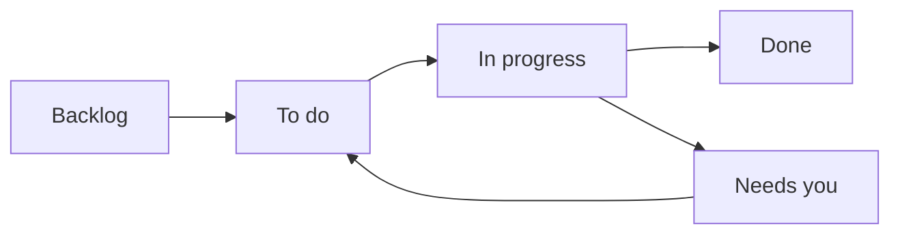

The **board** is a team's task list. Every piece of work a teammate is asked to do becomes a task card on it. A card appears when Boo Zero hands work to a teammate, when you give an agent a task with **New task**, and when an agent Routine fires. The board is the record of who is doing what. The chat only describes it.

Use this page to understand what a card's status means, why a task is waiting, and when work restarts on its own. For the controls, see [Track work on the board](/using/board).

## The mental model

A card moves through statuses, mostly from left to right: **Backlog** to **To do** to **In progress** to **Done**. One agent owns a card while it works on it. A card can wait on other cards. If the agent working on a card stops responding, the card goes back to To do, and Clawboo decides whether to run it again.

## Statuses and columns

| Status      | What it means                                                                                | Where the card shows                    |
| ----------- | -------------------------------------------------------------------------------------------- | --------------------------------------- |
| Backlog     | Parked. Not ready to work yet.                                                               | Backlog                                 |
| To do       | Ready, and waiting for its agent to start.                                                   | To do                                   |
| In progress | An agent is working on it.                                                                   | In progress                             |
| In review   | The finished work is being checked.                                                          | In progress, with a **Verifying** badge |
| Blocked     | Stuck: a run failed or went quiet, a check could not pass it, or an agent marked it blocked. | Needs you                               |
| Done        | Finished.                                                                                    | Done                                    |
| Cancelled   | Dropped.                                                                                     | Cancelled                               |

Done and Cancelled are final: a card in either cannot move again. The board does not let you move a card into In progress or In review by hand, because each means an agent or a check is working on it. A task that reaches In progress some other way, with no agent and no run behind it, shows in Needs you as **Not started**.

## One agent per task

A task is worked by one agent at a time. When an agent starts a task, it claims the card, and only one claim can win, even when several agents try at the same moment. The others see the card as taken and leave it.

Each task also remembers which chat it came from: General or one of the team's rooms. That chat's coordinator runs it (see [Teams, rooms and runtimes](/concepts/teams-and-planes)). If the room was deleted, General runs it.

## Tasks that wait on other tasks

A task can depend on other tasks. It becomes ready only when every task it depends on is Done, and ready tasks start in order of priority: Urgent, High, Normal (where every task starts) and Low, the most recently updated first within each. A plan of hand-offs works this way: each step waits for the one before it. Clawboo refuses a dependency that would make a loop, because a loop could never finish.

When a handed-off task fails, or you cancel a task, the tasks still waiting on it in To do or Backlog are cancelled too. That way they do not sit there forever. Whoever handed out the work is told which steps were dropped.

## Tasks have readable ids

A task of a team has an id you can say out loud, like `MAR-12`: letters from the team's name and a number. The letters are unique across your Clawboo, so a second team whose name starts the same way gets the next free set, like `MA2`. You can change them in Team settings until the team's first task exists. From then on they are fixed, and renaming the team changes no ids.

Agents can use the readable id wherever a tool asks for a task. A task with no team has no readable id.

## A task is made once

A create repeated by a retry, a reconnect or a model saying the same thing twice does not make a second task. Two checks catch it:

- **The same create again.** The New task dialog sends a key per draft, an agent's tool call can name one, and the server makes one up for a call that names none. The same key returns the same task.
- **The same words from an agent.** When an agent creates a task or hands one off, an open task with the same words under the same parent from the last 48 hours is returned instead. Blocked tasks do not count, and neither does a task in To do that will not start by itself, such as one you stopped, because a retry is how that work starts again. A hand-off only matches a task someone is on and that will run, so a card nobody holds, or one parked in Backlog, does not swallow it. One turn asking two teammates the same thing makes a task for each; a later turn saying those words again is a retry.

Tasks you create yourself skip the second check: if you want two tasks with one title, you get two. The agent is told when it got an existing task, and which one.

## Hand-offs do not go in circles

An agent cannot hand work back to an agent that is waiting on it. If Ana hands a task to Ben, Ben cannot hand work on it back to Ana, directly or through a third agent, while Ana's task is open: each would wait on the other. Ben's result reaches Ana by itself when his task ends. The team's lead is exempt, because every agent is told to take a blocker there.

## Comments steer the work

A comment you add to a task is a reply to the agent the task belongs to: the agent working on it, or the agent it is bound to while it waits. Write it in the board's task drawer, in a team chat's **Tasks** card, or in **Tasks & Routines** on the agent's page. What the reply does depends on where the task stands:

- **In progress.** The reply goes into the running work. Clawboo Native, Claude Code, Codex and OpenClaw take it at their next step. Hermes pauses and resumes the same session with your reply as its next input. Replies sent within a second of each other go in together. A reply the run could not take gets the next turn: on team chat work, the agent answers it before the task can count as Done. So does a reply too long to go in whole, and one that went into a run that then died.
- **Waiting on you, or in To do.** The reply starts the agent on the task again, as **Retry** does, so answering a blocked task needs no second click. Replies that come while a run is already on its way for an earlier one start no second run. A plan step that still waits on an earlier task keeps the reply until it can start.
- **Being checked.** The reply waits for the check's answer. If the check sends the work back, the fix round reads it. If the check passes, the agent answers it before the task counts as Done.
- **In Backlog.** You parked the task, so nothing starts. The agent reads the reply when the task next runs.
- **Done or Cancelled.** A finished task cannot run again, so the reply is saved but not sent. You can send it instead as a follow-up task for the same agent.

Clawboo saves a reply as a wake on the task before it does anything else, so a restart cannot lose it, and the agent reads it once. Under each reply, a note says where it went. While a wake waits, the task drawer says what it is waiting for. A steered reply passes on the first 1,000 characters and says when it was cut; a run that reads it in its task block gets up to 4,000. See [Steer a running task](/using/board#steer-a-running-task) for each case, and [Choose a runtime](/runtimes/index) for how each runtime takes a reply mid-run.

## What wakes an agent

An agent starts on its task the moment something happens on it, rather than at the next scan:

- **Your comment.** Only a comment from you, sent from the dashboard, wakes an agent. An agent's comment wakes no one, and neither do the notes Clawboo writes itself.
- **A task it waits on finishing.** When a dependency moves to Done on any path, a task waiting on it that is bound to an agent starts within seconds. A task with no agent bound stays put. A Done written by a [stdio MCP bin](/operating/mcp-servers#the-stdio-bins) reaches the server at its next scan instead, up to a minute later, because a bin is a separate process.
- **All of its hand-offs closing.** This is the [report](/concepts/delegation-and-orchestration) to whoever handed the work off: it says when everything they handed off is in and which of those need you, or, when a task they handed off will not start without you (stopped, parked after failing, moved to Backlog), that it is not all in.

An `@` mention in a comment is text: it wakes no one, and the comment still goes only to the task's own agent.

A task has one live run at a time. A wake that arrives while a run is waiting for a slot, while a check is under way, or while a fix round is about to go out joins that run instead of starting a second one. Until Clawboo can prove a run is alive, a wake does not count on it: it keeps waiting until the run is cleared, and then starts its own. Every wake that waits says why, in the task drawer and in the [activity log](/reference/events-and-errors#task_wake_skipped).

## Needs you

**Needs you** is the board's first column. It holds everything that will not move without a person: pending approvals, and tasks that are stuck for one of these reasons.

| Label        | What happened                                                |
| ------------ | ------------------------------------------------------------ |
| Failed       | The run ended with an error.                                 |
| Timed out    | The agent stopped responding and the run was ended.          |
| Stopped      | You stopped the run. It will not restart on its own.         |
| Needs review | A check could not pass the work.                             |
| Blocked      | An agent marked it blocked.                                  |
| Unassigned   | No agent is bound to it, so no one will pick it up.          |
| Not started  | It is in progress, but no agent and no run is working on it. |

Each card leads with the one action that gets it going: **Retry** runs it again, **Assign** hands a task with no agent to one, and **Review** or **Open** opens the task. Its **More** menu holds the rest, including **Dismiss**, which moves the task to Cancelled for good. Failed and Timed out show a count, such as **Failed 3×**, when it has happened more than once in a row.

## Unread

The board also keeps track of what you have read, per task, on the server. A task is **unread** when someone else changed or commented on it since you last opened it. That covers a new task, a move, an edit and a comment from an agent or from another person. It does not cover the app's own notes or a running task's heartbeat. Acting on a task reads it, so your own comment, move, Retry or Stop never shows as unread for you. The [Inbox](/using/board#see-it-all-in-the-inbox) lists what is unread beside **Needs you**, and a badge counts both.

Marks are positions in the board's history rather than times, and a page marks what it actually showed. So a comment that lands while a task is opening stays unread, and two changes in the same millisecond stay two changes.

With no sign-in there is one built-in reader. Behind a [sign-in proxy](/guides/sso-proxy) each verified person reads for themselves. The record starts when you update to a version that has it, so a task last changed before then is not unread.

## When work restarts by itself

Clawboo starts a task in To do on its own when it is ready and bound to an agent. It holds back when you stopped the task's last run, or when its last 3 runs in a row failed or timed out. A successful run, or a Stop, resets that count.

It also waits before starting a task that keeps coming back with nothing to show. After 2 runs in a row with no visible progress, the next automatic start waits 2 minutes, then 4, doubling up to 30. Your comment or a **Retry** starts it at once. The task stays in To do while it waits, with a note on its card saying how long.

**Visible progress** means something you can see on the board that was not there when the run started: a sub-task it created, or a run that ended well with a result or moved the card forward. Comments do not count, because they are the one thing agents could trade forever; neither do tokens spent, tool calls or files touched, which the board cannot see as work done. A Stop, a refused sign-in or billing, and a run a hard budget cap refused say nothing either way: they are not counted as runs without progress. A start refused while Clawboo is holding new runs is not a run at all.

| What happened                                                | Where the task goes                                        | Does it run again by itself?                                        |
| ------------------------------------------------------------ | ---------------------------------------------------------- | ------------------------------------------------------------------- |
| A handed-off task failed or went quiet in team chat          | Blocked, shown in Needs you as **Failed** or **Timed out** | No. Whoever handed it off is told, and you can **Retry** it.        |
| The process running it died, or the Clawboo server restarted | To do                                                      | Yes, until 3 runs in a row have failed. Then it waits in Needs you. |
| You pressed **Stop**                                         | To do                                                      | No. It waits in Needs you as **Stopped**.                           |

Clawboo notices a dead run in two ways. A running task proves it is alive every 30 seconds; after 3 minutes with no sign of life, the run is timed out and the task returns to To do. When the server starts, runs left over from before that have shown no sign of life for 3 minutes are marked failed, and their tasks return to To do. The limits for a teammate that goes quiet in team chat are on [How work is delegated](/concepts/delegation-and-orchestration).

## The board and the chat

The board is the record of the work. Chat messages describe it, but ordinary chat text does not change the board: only hand-offs (a delegate tool call, or a `<delegate>` or `<plan>` in a reply, see [How work is delegated](/concepts/delegation-and-orchestration)), Clawboo's own task handling, your moves on the board, and agents' task tools do.

When the board changes through Clawboo's board API, which includes your moves and comments in the dashboard, Clawboo also posts a short system line into the agents' peer room. The dashboard does not show that room; see [Peer chat](/concepts/peer-chat).

## Where the work happens

Most tasks run through team chat. An agent Routine that names no repository runs on a separate path (see [Two ways Clawboo runs agents](/intro/how-it-works#two-ways-clawboo-runs-agents)). Neither gets a git worktree of its own or an automatic check. Coding runtimes start in the team's folder (`~/.clawboo/workspaces/<team id>`), with their own approval prompts turned off. They can still read and change any file your user account can. A task lands in Done when its agent reports back.

Runs that name a repository, started through the runtime run API or by an agent Routine (the repository is set through the API), get an isolated worktree for work that changes files. If the agent changed files there, the change is checked before the task can be Done. A worktree keeps file changes apart; it is not a sandbox. See [What agents can do](/concepts/permissions), [When work is checked](/concepts/verification) and [Worktrees and handoff](/concepts/worktrees-and-handoff).

## What you control

- **Give an agent a task**: use **New task** on the board. It starts at once if the agent is free, and waits in To do otherwise.
- **Move a card**: drag it, or change its status in the task drawer. Your move is final. Clawboo stops any run working on the task, and tells whoever handed it off when you finish or cancel it. The agent cannot move the card back: its own status changes are refused until a new run on the task starts.
- **Steer a task**: reply on it in the board's task drawer, the team chat's **Tasks** card or the agent's page.
- **Unstick a task**: use **Retry**, assign an agent, or **Dismiss** from Needs you.

[Track work on the board](/using/board) has the steps for each.

## Limits

- One agent works a task at a time. To split work, hand out separate tasks.
- Agents that create tasks with Clawboo's task tools, or hand them off in team chat, are capped: at most 24 child tasks under one parent and 30 new top-level tasks in 5 minutes (for a hand-off, per team). Finished and cancelled children count, so an agent cannot clear its own way; only your cancel frees a place. Tasks you create on the board are not capped. See [Governance](/concepts/governance).
- One team-chat turn can start at most 8 hand-offs, counted across the whole turn, and a plan can have at most 25 steps. A plan too long, or with no room, is refused whole.
- An agent can set a task's priority up to High. Only you can make a task Urgent.
- Most work runs without a worktree or a check, as described in [Where the work happens](#where-the-work-happens).

<Accordion title="Under the hood">

- **Tables.** The board is the `tasks`, `task_deps`, `task_comments`, `workspaces` and `execution_processes` tables in Clawboo's SQLite database. Every write goes through one data-access layer in `@clawboo/db`, and the legal status changes are declared once in [`@clawboo/board-core`](/reference/packages/board-core), which the server and the board UI both read.
- **Claiming.** A claim is a single conditional update that succeeds only for a `todo` task with no assignee, so a lost race returns `409` and is never retried. Any move to `todo` clears the assignee and the stored check result.
- **Recovery.** At startup, Clawboo first stops agent processes that a crashed or killed server left running. Then a boot pass reaps orphaned runs, and a sweep every 60 seconds times out runs whose task has not been touched for 3 minutes of awake time (`CLAWBOO_BOARD_STALE_TTL_MS`). The re-run rule is `MAX_AUTO_FIRES = 3` over each task's run ledger; a run that ended `cancelled` is never re-fired. Both passes put stuck work straight back to `todo`, outside the normal status rules, except a run whose work was being checked, which goes to **Needs you**.
- **Rooms.** Each task carries a `room_id`. The server's dispatcher fires ready tasks per chat, and a task whose room is archived goes to General.

The claim statement, the write-contention recipe, the dependency walks and both recovery passes are described in [Board internals](/internals/board-internals). The REST surface is the [Board API](/reference/rest-api/board).

</Accordion>

## Related

- [How work is delegated](/concepts/delegation-and-orchestration): how a hand-off becomes a task and how results come back.
- [Teams, rooms and runtimes](/concepts/teams-and-planes): which chat runs a task.
- [When work is checked](/concepts/verification): which tasks get an automatic check before Done.
- [Track work on the board](/using/board): the columns, the task drawer and every action.
- [Board internals](/internals/board-internals): claims, contention and recovery for contributors.
