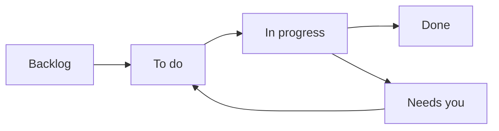

The **board** is a team's task list. Every piece of work a teammate is asked to do becomes a task card on it. A card appears when Boo Zero hands work to a teammate, when you give an agent a task with **New task**, and when an agent Routine fires. The board is the record of who is doing what. The chat only describes it.

Use this page to understand what a card's status means, why a task is waiting, and when work restarts on its own. For the controls, see [Track work on the board](/using/board).

## The mental model

A card moves through statuses, mostly from left to right: **Backlog** to **To do** to **In progress** to **Done**. One agent owns a card while it works on it. A card can wait on other cards. If the agent working on a card stops responding, the card goes back to To do, and Clawboo decides whether to run it again.

## Statuses and columns

| Status      | What it means                                                                                | Where the card shows                    |
| ----------- | -------------------------------------------------------------------------------------------- | --------------------------------------- |
| Backlog     | Parked. Not ready to work yet.                                                               | Backlog                                 |
| To do       | Ready, and waiting for its agent to start.                                                   | To do                                   |
| In progress | An agent is working on it.                                                                   | In progress                             |
| In review   | The finished work is being checked.                                                          | In progress, with a **Verifying** badge |
| Blocked     | Stuck: a run failed or went quiet, a check could not pass it, or an agent marked it blocked. | Needs you                               |
| Done        | Finished.                                                                                    | Done                                    |
| Cancelled   | Dropped.                                                                                     | Cancelled                               |

Done and Cancelled are final: a card in either cannot move again. The board does not let you move a card into In progress or In review by hand, because each means an agent or a check is working on it. A task that reaches In progress some other way, with no agent and no run behind it, shows in Needs you as **Not started**.

## One agent per task

A task is worked by one agent at a time. When an agent starts a task, it claims the card, and only one claim can win, even when several agents try at the same moment. The others see the card as taken and leave it.

Each task also remembers which chat it came from: General or one of the team's rooms. That chat's coordinator runs it (see [Teams, rooms and runtimes](/concepts/teams-and-planes)). If the room was deleted, General runs it.

## Tasks that wait on other tasks

A task can depend on other tasks. It becomes ready only when every task it depends on is Done, and ready tasks start in order of priority. A plan of hand-offs works this way: each step waits for the one before it. Clawboo refuses a dependency that would make a loop, because a loop could never finish.

When a handed-off task fails, or you cancel a task, the tasks still waiting on it in To do or Backlog are cancelled too. That way they do not sit there forever. Whoever handed out the work is told which steps were dropped.

## Comments steer the work

A comment you add to a task is a reply to the agent the task belongs to: the agent working on it, or the agent it is bound to while it waits. Write it in the board's task drawer, in a team chat's **Tasks** card, or in **Tasks & Routines** on the agent's page. What the reply does depends on where the task stands:

- **In progress.** The reply goes into the running work. Clawboo Native, Claude Code, Codex and OpenClaw take it at their next step. Hermes pauses and resumes the same session with your reply as its next input. An older Codex CLI without `codex app-server` cannot take it mid-run, so it waits for the next run.
- **Waiting on you, or in To do.** The reply starts the agent on the task again, as **Retry** does, so answering a blocked task needs no second click. Replies sent within 15 seconds of each other start one run. A plan step that still waits on an earlier task keeps the reply until it can start.
- **Being checked, or in Backlog.** The reply waits in the agent's mailbox, which the agent reads when its next run starts.
- **Done or Cancelled.** A finished task cannot run again, so the reply is saved but not sent. You can send it instead as a follow-up task for the same agent.

Clawboo puts every reply it sends into the agent's mailbox first, so a reply that misses a run is read at the next one. Under each reply, a note says where it went. Clawboo passes on the first 1,000 characters. See [Steer a running task](/using/board#steer-a-running-task) for each case, and [Choose a runtime](/runtimes/index) for how each runtime takes a reply mid-run.

## Needs you

**Needs you** is the board's first column. It holds everything that will not move without a person: pending approvals, and tasks that are stuck for one of these reasons.

| Label        | What happened                                                |
| ------------ | ------------------------------------------------------------ |
| Failed       | The run ended with an error.                                 |
| Timed out    | The agent stopped responding and the run was ended.          |
| Stopped      | You stopped the run. It will not restart on its own.         |
| Needs review | A check could not pass the work.                             |
| Blocked      | An agent marked it blocked.                                  |
| Unassigned   | No agent is bound to it, so no one will pick it up.          |
| Not started  | It is in progress, but no agent and no run is working on it. |

Each card leads with the one action that gets it going: **Retry** runs it again, **Assign** hands a task with no agent to one, and **Review** or **Open** opens the task. Its **More** menu holds the rest, including **Dismiss**, which moves the task to Cancelled for good. Failed and Timed out show a count, such as **Failed 3×**, when it has happened more than once in a row.

## When work restarts by itself

Clawboo starts a task in To do on its own when it is ready and bound to an agent. It holds back when you stopped the task's last run, or when its last 3 runs in a row failed or timed out. A successful run, or a Stop, resets that count.

| What happened                                                | Where the task goes                                        | Does it run again by itself?                                        |
| ------------------------------------------------------------ | ---------------------------------------------------------- | ------------------------------------------------------------------- |
| A handed-off task failed or went quiet in team chat          | Blocked, shown in Needs you as **Failed** or **Timed out** | No. Whoever handed it off is told, and you can **Retry** it.        |
| The process running it died, or the Clawboo server restarted | To do                                                      | Yes, until 3 runs in a row have failed. Then it waits in Needs you. |
| You pressed **Stop**                                         | To do                                                      | No. It waits in Needs you as **Stopped**.                           |

Clawboo notices a dead run in two ways. A running task proves it is alive every 30 seconds; after 3 minutes with no sign of life, the run is timed out and the task returns to To do. When the server starts, runs left over from before that have shown no sign of life for 3 minutes are marked failed, and their tasks return to To do. The limits for a teammate that goes quiet in team chat are on [How work is delegated](/concepts/delegation-and-orchestration).

## The board and the chat

The board is the record of the work. Chat messages describe it, but ordinary chat text does not change the board: only hand-offs (a delegate tool call, or a `<delegate>` or `<plan>` in a reply, see [How work is delegated](/concepts/delegation-and-orchestration)), Clawboo's own task handling, your moves on the board, and agents' task tools do.

When the board changes through Clawboo's board API, which includes your moves and comments in the dashboard, Clawboo also posts a short system line into the agents' peer room. The dashboard does not show that room; see [Peer chat](/concepts/peer-chat).

## Where the work happens

Most tasks run through team chat. An agent Routine that names no repository runs on a separate path (see [Two ways Clawboo runs agents](/intro/how-it-works#two-ways-clawboo-runs-agents)). Neither gets a git worktree of its own or an automatic check. Coding runtimes start in the team's folder (`~/.clawboo/workspaces/<team id>`), with their own approval prompts turned off. They can still read and change any file your user account can. A task lands in Done when its agent reports back.

Runs that name a repository, started through the runtime run API or by an agent Routine (the repository is set through the API), get an isolated worktree for work that changes files. If the agent changed files there, the change is checked before the task can be Done. A worktree keeps file changes apart; it is not a sandbox. See [What agents can do](/concepts/permissions), [When work is checked](/concepts/verification) and [Worktrees and handoff](/concepts/worktrees-and-handoff).

## What you control

- **Give an agent a task**: use **New task** on the board. It starts at once if the agent is free, and waits in To do otherwise.
- **Move a card**: drag it, or change its status in the task drawer. Your move is final. Clawboo stops any run working on the task, and tells whoever handed it off when you finish or cancel it. The agent cannot move the card back: its own status changes are refused until a new run on the task starts.
- **Steer a task**: reply on it in the board's task drawer, the team chat's **Tasks** card or the agent's page.
- **Unstick a task**: use **Retry**, assign an agent, or **Dismiss** from Needs you.

[Track work on the board](/using/board) has the steps for each.

## Limits

- One agent works a task at a time. To split work, hand out separate tasks.
- Agents that create tasks with Clawboo's task tools are capped: at most 24 child tasks under one parent (finished ones count) and 30 new top-level tasks in 5 minutes. Tasks you create on the board are not capped. See [Governance](/concepts/governance).
- Most work runs without a worktree or a check, as described in [Where the work happens](#where-the-work-happens).

<Accordion title="Under the hood">

- **Tables.** The board is the `tasks`, `task_deps`, `task_comments`, `workspaces` and `execution_processes` tables in Clawboo's SQLite database. Every write goes through one data-access layer in `@clawboo/db`, and the legal status changes are declared once in [`@clawboo/board-core`](/reference/packages/board-core), which the server and the board UI both read.
- **Claiming.** A claim is a single conditional update that succeeds only for a `todo` task with no assignee, so a lost race returns `409` and is never retried. Any move to `todo` clears the assignee and the stored check result.
- **Recovery.** A boot pass reaps orphaned runs, and a sweep every 60 seconds times out runs whose task has not been touched for 3 minutes (`CLAWBOO_BOARD_STALE_TTL_MS`). The re-run rule is `MAX_AUTO_FIRES = 3` over each task's run ledger; a run that ended `cancelled` is never re-fired. Both passes put stuck work straight back to `todo`, outside the normal status rules.
- **Rooms.** Each task carries a `room_id`. The server's dispatcher fires ready tasks per chat, and a task whose room is archived goes to General.

The claim statement, the write-contention recipe, the dependency walks and both recovery passes are described in [Board internals](/internals/board-internals). The REST surface is the [Board API](/reference/rest-api/board).

</Accordion>

## Related

- [How work is delegated](/concepts/delegation-and-orchestration): how a hand-off becomes a task and how results come back.
- [Teams, rooms and runtimes](/concepts/teams-and-planes): which chat runs a task.
- [When work is checked](/concepts/verification): which tasks get an automatic check before Done.
- [Track work on the board](/using/board): the columns, the task drawer and every action.
- [Board internals](/internals/board-internals): claims, contention and recovery for contributors.
