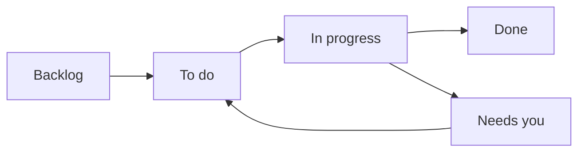

The **board** is a team's task list. Every piece of work a teammate is asked to do becomes a task card on it. A card appears when Boo Zero hands work to a teammate, in a team's chat or from its own chat, when you give an agent a task with **New task**, and when an agent Routine fires. The board is the record of who is doing what. The chat only describes it.

Use this page to understand what a card's status means, why a task is waiting, and when work restarts on its own. For the controls, see [Track work on the board](/using/board).

## The mental model

A card moves through statuses, mostly from left to right: **Backlog** to **To do** to **In progress** to **Done**. One agent owns a card while it works on it. A card can wait on other cards. If the agent working on a card stops responding, the card goes back to To do, and Clawboo decides whether to run it again.

## Statuses and columns

| Status      | What it means                                                                                   | Where the card shows                      |
| ----------- | ----------------------------------------------------------------------------------------------- | ----------------------------------------- |
| Backlog     | Parked. Not ready to work yet.                                                                  | Backlog                                   |
| To do       | Ready, and waiting for its agent to start.                                                      | To do                                     |
| In progress | An agent is working on it.                                                                      | In progress                               |
| In review   | The finished work is being checked.                                                             | In progress, with a **Verifying** badge   |
| Blocked     | Waiting: a run failed or went quiet, a check could not pass it, or an agent says what it needs. | Needs you, unless it waits on other tasks |
| Done        | Finished.                                                                                       | Done                                      |
| Cancelled   | Dropped.                                                                                        | Cancelled                                 |

Done and Cancelled stay put until you say otherwise: **Reopen** in the task's drawer brings a finished task back. Agents have no tool for it and the team engine never does it, and the route takes only a request from the board's own page, which on a local install is a [speed bump](/operating/security#what-counts-as-a-person). The board does not let you move a card into In progress or In review by hand, because each means an agent or a check is working on it. A task that reaches In progress some other way, with no agent and no run behind it, shows in Needs you as **Not started**.

## What a task waits on

A task that waits says what for. Agents must give the reason when they block a task, and Clawboo's own parks give theirs: a failed run, a check that could not pass, a run with nothing to show for it, a provider that kept refusing, a stop from a budget or the breaker, a restart. Needs you reads it:

| The task waits on                   | Where it shows                                                                 | What ends the wait                                                                                                                              |
| ----------------------------------- | ------------------------------------------------------------------------------ | ----------------------------------------------------------------------------------------------------------------------------------------------- |
| You: something only a person can do | Needs you as **Blocked**, saying what is needed                                | Your reply or **Retry**                                                                                                                         |
| Your answer to a question           | Needs you as **Waiting for your answer**, with its controls                    | Your answer, saved as a wake on the task, so a restart cannot lose it                                                                           |
| Another task                        | In progress, saying **Waiting on** and the task's title                        | That task finishing. If it is cancelled instead, the task comes to Needs you to say so                                                          |
| Its own sub-tasks                   | In progress, saying **Waiting on 3 sub-tasks**, and how many of those need you | The last one closing, which starts its agent once more. See [A task that hands out work waits for it](#a-task-that-hands-out-work-waits-for-it) |
| A check, a failure, a stop          | Needs you, saying why                                                          | **Retry** or **Assign**                                                                                                                         |
| Its turn to try again               | To do, saying **Retrying soon**                                                | The wait running out, or a comment from you                                                                                                     |
| Room in a budget                    | To do, saying **Waiting for room in a budget**                                 | Runs already going ending. If the cap fills instead, the task comes to Needs you to say so                                                      |

## A task that hands out work waits for it

On a team chat run, a task whose run ends with work it handed out still going does not close. Its run is kept as the success it was, its reply goes on the card, and the task waits on those sub-tasks. When they have closed, its agent gets one more turn, with their results in its context, however many there were and however far apart they finished. The task is done after that turn. A restart in between changes nothing: the wait and the results are on the board.

Closed means nothing more will come from a sub-task by itself:

| The sub-task                                                                                                                                            | To the task waiting on it                                  |
| ------------------------------------------------------------------------------------------------------------------------------------------------------- | ---------------------------------------------------------- |
| Done                                                                                                                                                    | Closed                                                     |
| Cancelled or removed                                                                                                                                    | Closed, and not done                                       |
| Ended badly: a failed run or check, a budget or breaker stop, parked                                                                                    | Closed, and not done. Its failure reaches the agent's turn |
| In Backlog                                                                                                                                              | Closed, and not done: nothing starts work from there       |
| Waiting on you: a question, an approval, a hand-back, or held by a person                                                                               | Still open. The card says how many need you                |
| Queued, running, being checked, waiting on other work, waiting for its next try after a provider failure or for room in a budget, or stopped by a pause | Still open                                                 |
| Nobody was given it, like a note an agent left itself                                                                                                   | Not waited on                                              |
| It needs this task to finish first                                                                                                                      | Not waited on: this task's finishing is what frees it      |

What comes after that turn:

- **All of them done:** the task is done, and goes through the team's check first if the team has one.
- **Some did not finish:** the task is not called done. It comes to Needs you as **Blocked**, naming them, with the agent's reply as its comment, unless the agent says with `report_result` that it made up for them. Then it is done, and a comment and the report to whoever handed it out both say what did not finish. Otherwise retry those sub-tasks, or mark the task done yourself. When none is left unfinished, the task starts again by itself, for one more turn with their results. Until then its card names the ones that still are.
- **Some were cancelled:** the agent is told which, and that a person's cancel is not to be redone. The task can be done over them, and a comment says so.
- **The agent hands out more:** the task waits again.

Whoever handed out the waiting task is not woken for this. It stays on their list of what is still outstanding, and they hear once, when it is done or needs you.

**After a Stop** no such turn starts. A task waiting on its sub-tasks goes back to To do as **Stopped**, like any run a Stop ended, and **Retry** runs it with whatever came back. Retrying a stopped sub-task does not start the parent by itself once the parent reads Stopped: retry the parent too, and it picks up what is in. If you retry the parent first, the sub-tasks still stopped count as not finished.

**Under a pause** nothing is lost and nobody is asked. A sub-task a pause stopped still counts as coming, so the task keeps waiting and does not say it did not finish. A task whose last sub-task closes while its own agent is paused goes back to To do and waits there, and a turn a pause stops goes back the same way. The turn runs after the resume, with every result that came back.

**On a team with a check,** a task that hands out work is checked at the end of that last turn, not when it first handed the work out. See [How work is checked](/concepts/verification#checks-in-team-chat).

This is how team chat runs work. A task on the task runner closes at the end of its own run.

## What an agent reports

An agent on a team chat run can say how its task went with `report_result`: done, or not done, with a summary. It is a report, not a move. It changes no status, and Clawboo decides when the run ends:

- A failing check, or a run that ended on an error, is never overruled by saying it is done.
- Saying it is not done stops a Done that would otherwise have happened. The task comes to Needs you as **Blocked**, with what the agent said, and is not checked.
- Saying nothing changes nothing: the reply is the report, as it always was.

An OpenClaw agent cannot use it, because its tools cannot tell one agent from another. A run on the task runner does not have it either, and uses `block_task`.

## Tasks for a person

A task has one assignee, an agent or a person, never both. A task assigned to a person never starts on its own and no agent can claim it. It shows in Needs you as **Assigned to you**, until you mark it done or give it to an agent. An agent can also hand its own task back to the person who asked for it, saying what they must do: the card says whose turn it is, and your reply or **Give back to its agent** returns it. The **Mine** filter narrows the board to the tasks assigned to you, and the Inbox has a **Mine** tab that lists the same ones.

On a local install there is one built-in person, "You". Behind a [sign-in proxy](/guides/sso-proxy), you are the person the proxy's token names, and a task that an agent handed back with no one on record who asked goes to whoever opens it. There is no member list: you can assign a task to yourself, or to the person who asked for it.

## Your request is one main task

When you ask a team for something in chat and its lead hands out work, your message becomes one **main task**, with every hand-off and plan step for it filed under it as a sub-task. So the board shows what you asked for, with the helpers' work nested under it, not a pile of top-level cards. A plain answer stays in chat and makes nothing: the main task is made with the first hand-off.

- **What it holds.** Your words, you as who asked, and the agent you were talking to looking after it (the team lead, or a teammate you @mentioned).
- **It runs nothing.** No agent claims it, nothing starts it, and it cannot fail. It costs helpers no level of hand-offs: they go as deep as they would have without it. The caps on sub-tasks still apply: 24 under one main task, and a plan that would not fit is refused whole.
- **Its life.** It shows how far its work has got and waits In progress. When everything under it has closed and its lead has written the summary, which goes to chat and on the card, it moves to **Done**. If none of its work got done, it moves to **Cancelled** instead. Anything its lead hands out on the way goes under it too. It waits on what a task handing out work waits on, plus two things: work that did not finish holds it until you retry or cancel that work, and so does a plan waiting for your answer. A note an agent left itself holds nothing, and neither does a task that needs the request closed first.
- **A sub-task that needs you** still shows in Needs you, labelled with its main task. Nothing that needs you hides.
- **To add to a request,** comment on its main task. Your words go to the agent looking after it, which can hand out more under it. A second message in the chat is a new request with its own main task, so unrelated work never merges. If the agent looking after it moves to another team, that chat's lead takes it over.
- **Stop.** A Stop halts the helpers as it always did: their tasks wait in Needs you. The main task stays open and starts nothing. If its work had all closed, what came back waits for the lead's next run, and the request closes after that run. The lead's reply is in the chat, though that run may have been about something else.
- **Cancel or Done.** Cancelling a main task, or marking it Done, cancels every sub-task still open and stops any run on them, all in one write. The board asks first. The lead is not started just to hear it. A closed request takes no more work from an agent. New work a person files under it opens it again, as does reopening one of its sub-tasks, so nothing runs hidden inside a finished card.
- **Pause and budgets.** A main task is the top of its tree, so a pause or a mission budget on it covers the whole request. Under a pause its sub-tasks stop and wait in To do, nothing is reported to its lead, and anything you say on it waits too. The lead's update comes after you resume, and the request closes on its reply as usual. Spend still lands on each run's own task; the card adds it up.

A request from [Boo Zero's own chat](/using/boo-zero#give-a-team-work-from-this-chat) is a main task the same way, one per team per message. Its reports and your comments on it go to that chat, not the team's, and the reply there is what closes it. A `<plan>` does not run from that chat, and a batch of hand-offs on a team that asks first waits for your answer as it does from the team's chat.

A task you create on the board is already its own main task: what its agent hands out is filed under it, and it runs itself, so it counts as a level. A team routine's message becomes a main task the same way a person's does, when its turn hands out work. An agent routine's card is its own. Tasks from before this stay as they are.

Only the team engine files work this way. A task an agent makes with the Tasks tools during a chat turn stays where it put it.

## One agent per task

A task is worked by one agent at a time. When an agent starts a task, it claims the card, and only one claim can win, even when several agents try at the same moment. The others see the card as taken and leave it.

Each task also remembers which chat it came from: General or one of the team's rooms. That chat's coordinator runs it (see [Teams, rooms and runtimes](/concepts/teams-and-planes)). If the room was deleted, General runs it.

## Tasks that wait on other tasks

A task can depend on other tasks. It becomes ready only when every task it depends on is Done, and ready tasks start in a fair order. A task that already ran and came back (a run that died or failed, or one a pause stopped) goes first, because its work is under way. Then priority: Urgent, High, Normal (where every task starts) and Low. Then oldest first, so editing a task does not move it forward. A task that keeps waiting reads one priority higher every 4 hours, up to High, so Low work gets through newer work. It never reads as Urgent, so a task someone marked Urgent still goes first. A plan of hand-offs works this way: each step waits for the one before it. Clawboo refuses a dependency that would make a loop, because a loop could never finish.

When a handed-off task fails, or you cancel a task, the tasks still waiting on it in To do or Backlog are cancelled too. That way they do not sit there forever. Whoever handed out the work is told which steps were dropped.

## Tasks have readable ids

A task of a team has an id you can say out loud, like `MAR-12`: letters from the team's name and a number. The letters are unique across your Clawboo, so a second team whose name starts the same way gets the next free set, like `MA2`. You can change them in Team settings until the team's first task exists. From then on they are fixed, and renaming the team changes no ids.

Agents can use the readable id wherever a tool asks for a task. A task with no team has no readable id.

## A task is made once

A create repeated by a retry, a reconnect or a model saying the same thing twice does not make a second task. Two checks catch it:

- **The same create again.** The New task dialog sends a key per draft, an agent's tool call can name one, and the server makes one up for a call that names none. The same key returns the same task.
- **The same words from an agent.** When an agent creates a task or hands one off, an open task with the same words under the same parent from the last 48 hours is returned instead. Blocked tasks do not count, and neither does a task in To do that will not start by itself, such as one you stopped, because a retry is how that work starts again. A hand-off only matches a task someone is on and that will run, so a card nobody holds, or one parked in Backlog, does not swallow it. One turn asking two teammates the same thing makes a task for each; a later turn saying those words again is a retry.

Tasks you create yourself skip the second check: if you want two tasks with one title, you get two. The agent is told when it got an existing task, and which one.

## Hand-offs do not go in circles

An agent cannot hand work back to an agent that is waiting on it. If Ana hands a task to Ben, Ben cannot hand work on it back to Ana, directly or through a third agent, while Ana's task is open: each would wait on the other. Ben's result reaches Ana by itself when his task ends. The team's lead is exempt, because every agent is told to take a blocker there.

## Comments steer the work

A comment you add to a task is a reply to the agent the task belongs to: the agent working on it, or the agent it is bound to while it waits. Write it in the board's task drawer, in a team chat's **Tasks** card, or in **Tasks & Routines** on the agent's page. What the reply does depends on where the task stands:

- **In progress.** The reply goes into the running work. Clawboo Native, Claude Code, Codex and OpenClaw take it at their next step, and Hermes after its current tool calls. Replies sent within a second of each other go in together. A reply the run could not take gets the next turn: on team chat work, the agent answers it before the task can count as Done. So does a reply too long to go in whole, and one that went into a run that then died.
- **Waiting on you, or in To do.** The reply starts the agent on the task again, as **Retry** does, so answering a blocked task needs no second click. Replies that come while a run is already on its way for an earlier one start no second run. A plan step that still waits on an earlier task keeps the reply until it can start.
- **Being checked.** The reply waits for the check's answer. If the check sends the work back, the fix round reads it. If the check passes, the agent answers it before the task counts as Done.
- **In Backlog.** You parked the task, so nothing starts. The agent reads the reply when the task next runs.
- **Done or Cancelled.** A finished task does not run again, so the reply is saved but not sent. You can **Reopen** the task, which starts its agent with your reply, or send the reply as a follow-up task for the same agent.

Clawboo saves a reply as a wake on the task before it does anything else, so a restart cannot lose it, and the agent reads it once. Under each reply, a note says where it went. While a wake waits, the task drawer says what it is waiting for. A steered reply passes on the first 1,000 characters and says when it was cut; a run that reads it in its task block gets up to 4,000. See [Steer a running task](/using/board#steer-a-running-task) for each case, and [Choose a runtime](/runtimes/index) for how each runtime takes a reply mid-run.

## What wakes an agent

An agent starts on its task the moment something happens on it, rather than at the next scan:

- **Your comment.** A comment from you, sent from the dashboard, always wakes an agent, at once. The notes Clawboo writes itself wake no one.
- **A teammate's comment, once you allow it.** An agent can start a teammate with a comment when the teammate's task is Blocked on something the teammate said it needs. The first time that would happen on a job, Needs you asks **Allow on this job**, **Always allow in this team**, or **No**. Until you say yes, the comment waits on the task and nothing starts. A job is a task and everything under it. A team has one of these cards up at a time: other tasks that would ask wait behind it, the card says how many, and your answer covers them too, so a lead handing work to several helpers asks you once.
- **A task it waits on finishing.** When a dependency moves to Done on any path, a task waiting on it that is bound to an agent starts within seconds. A task with no agent bound stays put. A Done written by a [stdio MCP bin](/operating/mcp-servers#the-stdio-bins) reaches the server at its next scan instead, up to a minute later, because a bin is a separate process.
- **All of its hand-offs closing.** This is the [report](/concepts/delegation-and-orchestration) to whoever handed the work off: it says when everything they handed off is in and which of those need you, or, when a task they handed off will not start without you (stopped, parked after failing, moved to Backlog), that it is not all in.

An `@` mention in a comment is text: it wakes no one, and the comment still goes only to the task's own agent.

Agents waking each other have limits, whatever you allowed. A job's agents can start each other 12 times an hour, then the next one waits and Needs you says so. Two agents answering each other are stopped after 4 wakes in a row, on one job or across a team's jobs, and three or more in a ring are stopped the same way. That shows in Needs you too, and while the wake it stopped is waiting it stays stopped until you let them carry on or comment to either of them. With nothing waiting on it, an hour of quiet ends it, so a later job's first reply starts fresh. Runs that show no progress back off. A budget comes before all of this: with a cap reached you are not asked, and the wake waits for the cap.

A teammate's comment never ends a question, a task handed back to you, a failed run or a check: those stay yours. Nor does it end a wait on another task or on sub-tasks, or a task kept from Done until its sub-tasks come through, which end when that work does: the comment stays on the thread and wakes nothing. Clawboo does not pass a teammate's comment into a run that is going. That run sees it only if it reads the task, and otherwise the agent reads it in a later run. A task the task runner runs reads it from its mailbox when its next run starts.

A task has one live run at a time. A wake that arrives while a run is waiting for a slot, while a check is under way, or while a fix round is about to go out joins that run instead of starting a second one. Until Clawboo can prove a run is alive, a wake does not count on it: it keeps waiting until the run is cleared, and then starts its own. Every wake that waits says why, in the task drawer and in the [activity log](/reference/events-and-errors#task_wake_skipped).

## Needs you

**Needs you** is the board's first column. It holds everything that will not move without a person: pending approvals, and tasks that are stuck for one of these reasons.

| Label                   | What happened                                                                                                                                                                                       |
| ----------------------- | --------------------------------------------------------------------------------------------------------------------------------------------------------------------------------------------------- |
| Failed                  | The run ended with an error.                                                                                                                                                                        |
| No result               | The agent finished twice with nothing to show for it.                                                                                                                                               |
| Rate limited            | The provider kept refusing, and Clawboo stopped trying by itself.                                                                                                                                   |
| Provider unavailable    | The provider stayed out of reach, and Clawboo stopped trying by itself.                                                                                                                             |
| Out of room             | The agent ran out of room twice before finishing.                                                                                                                                                   |
| Budget cap              | A hard budget cap stopped it.                                                                                                                                                                       |
| Stopped by the breaker  | The circuit breaker stopped a run going wrong.                                                                                                                                                      |
| Sign-in failed          | The runtime's key or login was refused, missing or expired.                                                                                                                                         |
| Billing problem         | The provider refused the account: no credit, a hold or a pending verification.                                                                                                                      |
| Timed out               | The agent stopped responding and the run was ended.                                                                                                                                                 |
| Stopped                 | You stopped the run. It will not restart on its own.                                                                                                                                                |
| Needs review            | A check could not pass the work.                                                                                                                                                                    |
| Blocked                 | An agent marked it blocked, and says what it needs.                                                                                                                                                 |
| Waiting for your answer | An agent asked you a question and stopped.                                                                                                                                                          |
| Assigned to you         | The task is yours, or an agent handed it back to you.                                                                                                                                               |
| Waiting for your OK     | A teammate's comment would start this task, and you have not said yes for this job, or agents on it hit a limit, or the job has started as many runs by itself as it may. The card has the buttons. |
| Unassigned              | No agent is bound to it, so no one will pick it up.                                                                                                                                                 |
| Not started             | It is in progress, but no agent and no run is working on it.                                                                                                                                        |

Each card leads with the one action that gets it going: **Retry** runs it again, **Assign** hands a task with no agent to one, **Fix sign-in** opens the runtime whose key or login was refused, **Mark done** finishes a task that is yours, and **Review** or **Open** opens the task. Its **More** menu holds the rest, including **Dismiss**, which moves the task to Cancelled for good. Failed and Timed out show a count, such as **Failed 3×**, when it has happened more than once in a row.

## Unread

The board also keeps track of what you have read, per task, on the server. A task is **unread** when someone else changed or commented on it since you last opened it. That covers a new task, a move, an edit and a comment from an agent or from another person. It does not cover the app's own notes or a running task's heartbeat. Acting on a task reads it, so your own comment, move, Retry or Stop never shows as unread for you. Nor does the card moving when your comment starts a run, even some time later, such as when a hold lifts, though anything you had not read by then stays unread, and what the agent does next is news as usual. The [Inbox](/using/board#see-it-all-in-the-inbox) lists what is unread beside **Needs you**, and a badge counts both.

Marks are positions in the board's history rather than times, and a page marks what it actually showed. So a comment that lands while a task is opening stays unread, and two changes in the same millisecond stay two changes.

With no sign-in there is one built-in reader. Behind a [sign-in proxy](/guides/sso-proxy) each verified person reads for themselves. The record starts when you update to a version that has it, so a task last changed before then is not unread.

## When work restarts by itself

Clawboo starts a task in To do on its own when it is ready and bound to an agent. It holds back when you stopped the task's last run, when a hard budget cap or the circuit breaker stopped it, when its last 3 runs in a row failed or timed out or 3 in a row were cut off because their process died, or while a [pause](#pause) covers it. Those two counts are kept apart. A successful run, a Stop or a breaker trip resets them.

A whole job has a limit too. Clawboo counts the runs a job starts by itself, from the task at its top down: hand-offs, follow-ups, wakes, fix rounds, extra turns, retries, plan steps and task updates. After 100 nothing more starts by itself. The work waits where it is, and the top of the job shows in Needs you with **Carry on**, which allows another 100, and **Stop**, which ends the runs under this job and starts nothing more by itself, leaving other jobs alone. Your own message, **Retry**, reply and **Accept** never count and are never refused, and starting work in a stopped job may bring the card back the next time something would start by itself. A count means a run that started: a run a budget refuses before it starts counts nothing. A task update outside any request counts toward the job it read, so what it hands out next is part of that job and not a new one.

It also waits before starting a task that keeps coming back with nothing to show. After 2 runs in a row with no visible progress, the next automatic start waits 2 minutes, then 4, doubling up to 30. Your comment or a **Retry** starts it at once. The task stays in To do while it waits, with a note on its card saying how long.

**Visible progress** means something you can see on the board that was not there when the run started: a sub-task it created, or a run that ended well with a result or moved the card forward. A run whose task went to Blocked with only words to show made none, unless a sub-task it waited on got done, and neither did one whose sub-tasks all failed. Comments do not count, because they are the one thing agents could trade forever; neither do tokens spent, tool calls or files touched, which the board cannot see as work done. A Stop, a refused sign-in or billing, a provider failure and a run a hard budget cap refused say nothing either way: they are not counted as runs without progress. A start refused while Clawboo is holding new runs is not a run at all.

| What happened                                                                     | Where the task goes                                                                  | Does it run again by itself?                                                                                                                                                                                                                                                                                          |
| --------------------------------------------------------------------------------- | ------------------------------------------------------------------------------------ | --------------------------------------------------------------------------------------------------------------------------------------------------------------------------------------------------------------------------------------------------------------------------------------------------------------------- |
| A handed-off task failed or went quiet in team chat                               | Blocked, shown in Needs you as **Failed** or **Timed out**                           | No. Whoever handed it off is told, and you can **Retry** it.                                                                                                                                                                                                                                                          |
| The process running it died, or the Clawboo server restarted                      | To do                                                                                | Yes, until 3 runs in a row have failed. Then it waits in Needs you.                                                                                                                                                                                                                                                   |
| You pressed **Stop**                                                              | To do                                                                                | No. It waits in Needs you as **Stopped**.                                                                                                                                                                                                                                                                             |
| The provider rate limited it, was overloaded, or could not be reached (team chat) | To do, saying so                                                                     | Yes, twice: after 30 seconds, then 60, of time the machine is awake, with a little added so tasks do not all come back at once. Then it goes to Needs you as **Rate limited** or **Provider unavailable**, and sooner if the task has already failed 3 times in a row. A refused sign-in or billing is never retried. |
| The agent replied with nothing and has nothing else to show (team chat)           | Stays In progress                                                                    | One more turn, asked to say what it did. A second empty reply goes to Needs you as **No result**.                                                                                                                                                                                                                     |
| The agent ran out of room (team chat)                                             | Stays In progress                                                                    | One continuation. A second time goes to Needs you as **Out of room**.                                                                                                                                                                                                                                                 |
| A hard budget cap stopped it                                                      | To do on the task runner, Blocked in team chat, shown in Needs you as **Budget cap** | No. Raise the cap, then **Retry**.                                                                                                                                                                                                                                                                                    |
| Runs already going have set aside the rest of a budget                            | To do, saying so                                                                     | Yes, once those runs have ended. If what they spent fills the cap, or the task has already failed 3 times in a row, it goes to Needs you as **Budget cap**.                                                                                                                                                           |
| The circuit breaker stopped it                                                    | To do, shown in Needs you as **Stopped by the breaker**                              | No. Read its last comment, then **Retry**.                                                                                                                                                                                                                                                                            |
| A [pause](#pause) stopped its run                                                 | To do                                                                                | Yes, when you resume. It does not show in Needs you.                                                                                                                                                                                                                                                                  |

**What counts as an empty reply.** No text, or only a control token such as `__skipped__`, with no hand-off or sub-task from that work, no comment of its own on the task and no `report_result` on that run. A run with any of those reported some other way and finishes as usual, and a task with work it handed out still going waits for it instead. A task's turn after its sub-tasks close belongs to the same work, so sub-tasks it handed out count there too, and an extra turn it already had is not handed out again.

An empty reply reaches Done in one case: the run changed the team's folder, the team has a work check, and the check passed it. The check is the evidence, so that run gets no extra turn, and a failed check sends the fix round it always did. When a teammate was working in the folder during the run, the change may not be this agent's, so the agent is asked first. Files are not counted anywhere else, because only a work check can see them. So on a team with no check, an agent that wrote a file and said nothing gets the one extra turn, which asks it to say what it did.

Each kind of extra turn happens once, until something new starts the task again, such as your **Retry** or your comment. An empty reply and running out of room cannot hand each other more.

Clawboo notices a dead run in two ways. A running task proves it is alive every 30 seconds; after 3 minutes with no sign of life, the run is timed out and the task returns to To do. When the server starts, runs left over from before that have shown no sign of life for 3 minutes are marked failed, and their tasks return to To do. The limits for a teammate that goes quiet in team chat are on [How work is delegated](/concepts/delegation-and-orchestration).

## The board and the chat

The board is the record of the work. Chat messages describe it, but ordinary chat text does not change the board: only hand-offs (a delegate tool call, or a `<delegate>` or `<plan>` in a reply, see [How work is delegated](/concepts/delegation-and-orchestration)), Clawboo's own task handling, your moves on the board, and agents' task tools do. A hand-off in [Boo Zero's own chat](/using/boo-zero#give-a-team-work-from-this-chat) counts too when the Clawboo server runs that chat, and its result goes back there rather than to the team's chat.

When the board changes through Clawboo's board API, which includes your moves and comments in the dashboard, Clawboo also posts a short system line into the agents' peer room. The dashboard does not show that room; see [Peer chat](/concepts/peer-chat).

## Where the work happens

Most tasks run through team chat. An agent Routine that names no repository runs on a separate path (see [Two ways Clawboo runs agents](/intro/how-it-works#two-ways-clawboo-runs-agents)). Neither gets a git worktree of its own or an automatic check. Coding runtimes start in the task's own folder inside the team's folder (`~/clawboo-work/teams/<team id>/tasks/<task id>`), where they are asked to save the task's files, with their own approval prompts turned off. They can still read and change any file your user account can. The task's **Files** section on the Board shows that folder once it exists and either holds a file or the task is in progress or in review. A task lands in Done when its agent reports back.

Runs that name a repository, started through the runtime run API or by an agent Routine (the repository is set through the API), get an isolated worktree for work that changes files. If the agent changed files there, the change is checked before the task can be Done. A worktree keeps file changes apart; it is not a sandbox. See [What agents can do](/concepts/permissions), [When work is checked](/concepts/verification) and [Worktrees and handoff](/concepts/worktrees-and-handoff).

## Pause

You can pause one agent, one team, or a task with the tasks under it (its task tree). Nothing it covers starts until you resume it, and that holds through a restart. There is no time limit, and agents cannot pause or resume anything.

A pause stops its runs within seconds. A task whose run it stopped goes back to To do and keeps its agent. Every other task stays in its status. When you resume, the tasks start again by themselves. In team chat, Clawboo Native, Claude Code, Codex and Hermes continue the session they had on the task; the task runner picks up from its saved handoff, and from a session if the task had saved one. A task made while the pause lasts, under a paused task, is paused too.

A routine's run that a pause stops does not count as having run: the routine runs again on resume, as a new task, and a one-time routine is not used up.

A pause does not cover a 1:1 chat with an OpenClaw agent, which runs in the OpenClaw Gateway rather than on Clawboo's server. A team's work check that is already running finishes its command. It starts no reviewer under the pause, and the result says the review did not run. It starts no fix round either: the task waits in To do with what the check found. See [Pause work](/using/board#pause-work).

## What you control

- **Pause work**: pause an agent, a team or a task tree, and resume it when you are ready.
- **Give an agent a task**: use **New task** on the board. It starts at once if the agent is free, and waits in To do otherwise.
- **Close a request**: change its main task's status to Done or Cancelled in its drawer. It finishes by itself otherwise.
- **Move a card**: drag it, or change its status in the task drawer. Your move is final. Clawboo stops any run working on the task, and tells whoever handed it off when you finish or cancel it. The agent cannot move the card back: its own status changes are refused until a new run on the task starts.
- **Steer a task**: reply on it in the board's task drawer, the team chat's **Tasks** card or the agent's page.
- **Unstick a task**: use **Retry**, assign an agent, or **Dismiss** from Needs you.
- **Answer a question**: use the controls on its card in Needs you, or in the task drawer.
- **Bring back a finished task**: use **Reopen** in its drawer.

[Track work on the board](/using/board) has the steps for each.

## Plans

A plan is a list of steps an agent hands out in order: each step starts when the one before it is done. An agent can also write a plan as a document on its task, with `write_plan`. You read it on the task's **Plan** tab, and the agent's later runs read it in their ticket. Every revision is kept, so a newer one never costs you an older one. A document starts nothing by itself.

By default a plan's steps start as soon as the agent writes them. To decide first, turn on **Ask me before splitting work** in the team's settings. It is off until you turn it on, and it is per team. With it on:

- A plan waits for you in **Needs you** and raises an alert. So does a list of tasks an agent proposes with `ask_person`, and two or more `<delegate>` tags in one reply, which start together if you accept them. None of the work exists yet.
- You read each step whole and can change its words. What is in the box when you accept is what the agent gets, and nothing you took out reaches it.
- **Accept** creates the steps and their order in one go, once. Pressing it again creates nothing, and neither does a restart. A plan of more than 25 steps is refused whole.
- **Turn down** creates nothing, and the agent hears what you wrote.
- A plan an agent repeats while one waits never stacks up. The same steps change nothing. Different steps take the waiting plan's place: the card says so, its title changes, the chat says so too, and the old plan stays readable as a revision.
- The same steps from a later turn are recognised for 48 hours after you answer. Nothing new is created, and the agent is told you already decided.
- **Stop** closes what waits: nothing starts, and a later press of **Accept** creates nothing. Moving the task's card closes it too.

The plan waits on the task the agent was running, which stays **Blocked** until you answer, and your answer starts that task again. A lead writing a plan from chat has no such task, and neither does a follow-up on a finished task or a routine's run, so its plan waits on a card of its own, titled **Plan:** and the first step. You answer it the same way. That card holds only the plan: its steps are created beside it, not under it, and no agent runs on it unless you move the card back to To do. On a request from chat, the card and the steps you accept are all filed under its main task. Your answer closes it, **Done** if you accepted and **Cancelled** if you did not, and the agent hears your answer in its chat as a task update. A task does not wait for such a card as it waits for work it handed out: only the steps you accept count as that.

The switch does not cover everything. A hand-off made by tool call starts when it arrives, one at a time, because nothing can know another is coming. So a lead can still hand off a task, or several in turn, without a question. So can one `<delegate>` tag in a reply.

Turning the switch off leaves a waiting plan for you to answer. If its agent then starts a plan without asking, that plan takes the waiting one's place: the card is cancelled, so the same work cannot run twice.

## Limits

- One agent works a task at a time. To split work, hand out separate tasks.
- Agents that create tasks with Clawboo's task tools, or hand them off in team chat, are capped: at most 24 child tasks under one parent and 30 new top-level tasks in 5 minutes (for a hand-off, per team, where a request's main task is the top-level one). Finished and cancelled children count, so an agent cannot clear its own way; only your cancel frees a place. Tasks you create on the board are not capped. See [Governance](/concepts/governance).
- One team-chat turn can start at most 8 hand-offs, counted across the whole turn, and a plan can have at most 25 steps. A plan too long, or with no room, is refused whole.
- A plan's steps start at once unless the team asks first. See [Plans](#plans).
- An agent can set a task's priority up to High. Only you can make a task Urgent.
- Most work runs without a worktree or a check, as described in [Where the work happens](#where-the-work-happens).

<Accordion title="Under the hood">

- **Tables.** The board is the `tasks`, `task_deps`, `task_comments`, `workspaces` and `execution_processes` tables in Clawboo's SQLite database. Every write goes through one data-access layer in `@clawboo/db`, and the legal status changes are declared once in [`@clawboo/board-core`](/reference/packages/board-core), which the server and the board UI both read.
- **Claiming.** A claim is a single conditional update that succeeds only for a `todo` task with no assignee, so a lost race returns `409` and is never retried. Any move to `todo` clears the assignee and the stored check result.
- **Recovery.** At startup, Clawboo first stops agent processes that a crashed or killed server left running. Then a boot pass reaps orphaned runs, and a sweep every 60 seconds times out runs whose task has not been touched for 3 minutes of awake time (`CLAWBOO_BOARD_STALE_TTL_MS`). The re-run rule is `MAX_AUTO_FIRES = 3` over each task's run ledger; a run that ended `cancelled` is never re-fired. Both passes put stuck work straight back to `todo`, outside the normal status rules, except a run whose work was being checked, which goes to **Needs you**.
- **Rooms.** Each task carries a `room_id`. The server's dispatcher fires ready tasks per chat, and a task whose room is archived goes to General.

The claim statement, the write-contention recipe, the dependency walks and both recovery passes are described in [Board internals](/internals/board-internals). The REST surface is the [Board API](/reference/rest-api/board).

</Accordion>

## Related

- [How work is delegated](/concepts/delegation-and-orchestration): how a hand-off becomes a task and how results come back.
- [Teams, rooms and runtimes](/concepts/teams-and-planes): which chat runs a task.
- [When work is checked](/concepts/verification): which tasks get an automatic check before Done.
- [Track work on the board](/using/board): the columns, the task drawer and every action.
- [Board internals](/internals/board-internals): claims, contention and recovery for contributors.
