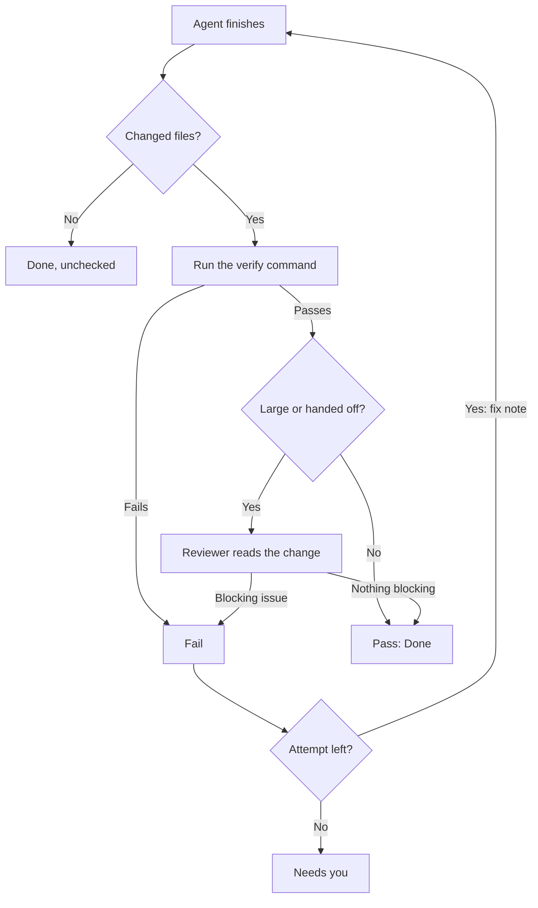

Clawboo can check an agent's work before the task counts as done. It runs the project's test command, and for bigger or handed-off changes a second agent reviews the change. These checks run in one narrow case: a task-runner run that worked in its own git worktree and changed files. Most work, including everything handed off in team chat, is never checked.

## When checks run

Checks run only when all three of these are true:

1. **The task ran on the task runner.** That means an agent Routine whose task names a repository (set through the API), or a run started with `POST /api/runtimes/:id/run` and a `repoPath`. [How a team works](/intro/how-it-works) explains the two paths. A worktree completed through the board's workspace API is also checked, without a reviewer.
2. **The task changes files**, so it got its own git worktree. Research and review tasks get none.
3. **The agent changed something.** A run that changed no files lands in **Done** without a check.

Nothing in the dashboard starts a checked run. A Routine you create in the app sends only its instructions, so it runs without a repository, and its work is not checked.

### Never checked

- Work handed off in team chat, in General or a room, including the steps of a plan
- Tasks you give an agent on the Board, and reruns from **Retry** or **Assign**
- One-to-one chats
- OpenClaw work. An OpenClaw Routine run gets a comment saying it completed without verification.
- Routines created in the app
- Research and review tasks
- Tasks you move to **Done** yourself

A task with no check result reaches **Done** normally. Unchecked is not the same as failed.

## What happens during a check

1. The agent's run ends. On the [Board](/using/board) the card stays in **In progress** with a **Verifying** badge.
2. Clawboo runs the verify command named in the worktree's `init.sh`, inside the worktree, and reads its exit code. The command gets 10 minutes.
3. If the command passes and the change is large or was handed off, a reviewer agent reads the committed change.
4. Clawboo stores the result on the task and moves the card to match.



## The three outcomes

| Outcome                   | When                                                                    | What you see                                                                                                         |
| ------------------------- | ----------------------------------------------------------------------- | -------------------------------------------------------------------------------------------------------------------- |
| **Pass**                  | The command passed, and the reviewer, if it ran, found nothing blocking | The card moves to **Done**                                                                                           |
| **Fail, attempt left**    | The command failed, or the reviewer found a blocking issue              | The task goes back to the agent with a note: what failed, why, and how to fix it. The agent tries again              |
| **Fail, no attempt left** | The last attempt failed too. By default that is the second attempt      | The card moves to **Needs you** with a comment, and whoever handed out the task (or the team's leader) gets a notice |

In **Needs you**, the card reads **Needs review** while the test command still fails. When only reviewer findings are left, it reads **Blocked**.

Each task gets two attempts by default: the first, plus one fix round. The `CLAWBOO_MAX_FIX_CYCLES` environment variable sets the number of fix rounds; `0` means a single attempt.

## The verify command in practice

Clawboo does not know your project's test command. Each new worktree gets an `init.sh` whose verify line is a placeholder:

```bash
VERIFY_CMD='echo "[init] configure VERIFY_CMD in init.sh"'
```

A placeholder counts as no command, and no command counts as a failure, because a check cannot pass work it never tested. So the first check fails unless the agent has already set a real command. The fix note tells the agent to set `VERIFY_CMD` in `init.sh`. If it does, and that command passes, the second attempt can pass. Otherwise the task ends in **Needs you**.

<Tip>

To get a useful check, say in the task which command proves the work, for example: "Before you finish, set `VERIFY_CMD` in `init.sh` to `npm test`."

</Tip>

The agent that did the work can edit `init.sh`, so it can also weaken its own check. The reviewer is the independent part.

## When the reviewer runs

The reviewer runs only after the test command passes, and only when at least one of these holds:

- The task was handed out by another agent (it has a parent task).
- More than 5 files changed.
- More than 300 lines changed, counting lines added and removed.

These thresholds are fixed. A small change on a task nobody handed out is judged by the test command alone.

How the reviewer works:

- **It is a second run of the same runtime.** It starts a fresh session, on a separate checkout of the committed change that has no branch to push. It gets none of the first agent's session or runtime home.
- **It uses the same model** unless you set `CLAWBOO_REVIEWER_MODEL`, which picks a different model on that runtime.
- **Only five kinds of finding block:** security, crash, data loss, wrong algorithm, and missing acceptance criteria. Style, performance and other notes are recorded and never block.
- **It cannot hold the work back by failing.** If the reviewer fails to run, the test command alone decides. A reply Clawboo cannot read becomes one note that does not block.
- **Its spend is not recorded.** Your provider bills the reviewer's run, but it does not count toward budgets or show in the cost views.

## What you can do

- **Move a card while it is being checked.** If you move it to **Done** or **Cancelled**, your move wins. Clawboo keeps the check's result on the task but moves nothing.
- **Accept the work anyway.** While the card is still in **In progress** with **Verifying**, move it to **Done**: if the stored result is a failure, the board asks you to confirm with **Complete anyway**, and Clawboo records the override in the audit log. Once the card is in **Needs you**, the dashboard cannot move it to **Done**; through the API, move the task to `in_progress` and then to `done` with `humanOverride` (see the [Board API](/reference/rest-api/board)).
- **Run it again.** **Retry**, or another agent picked from the card's **More** menu, sends the task back to **To do** and clears its check result. That rerun goes through the team, not the task runner, so it has no worktree and is not checked.
- **Drop it.** **Dismiss** moves the task to **Cancelled**.

## The failures checks are for

| Failure                                   | What Clawboo does                                               | What you see                                        | What you can do                                    |
| ----------------------------------------- | --------------------------------------------------------------- | --------------------------------------------------- | -------------------------------------------------- |
| The agent says it is done, but tests fail | Runs the verify command itself and trusts only its exit code    | The task goes back for a fix, then to **Needs you** | Read the failure comment on the card               |
| The agent marks its own work              | A reviewer in a fresh session reads large or handed-off changes | Blocking findings send the work back                | Set `CLAWBOO_REVIEWER_MODEL` for a different model |
| No test command is set                    | The placeholder counts as a failure                             | **Needs review** after the last attempt             | Name the command in the task                       |
| A fix loop that never ends                | Two attempts by default, then stop                              | The card waits in **Needs you**                     | Retry, complete it anyway, or dismiss it           |
| A check that hangs                        | Stops the command after 10 minutes, with everything it started  | Counts as a failure                                 | Make the command finish faster                     |

## Limits

- Only task-runner runs in a worktree are checked, and the dashboard cannot start one.
- A check is only as strong as its command, and the agent can edit `init.sh`.
- The reviewer runs on the agent's own runtime, with the agent's model unless you set `CLAWBOO_REVIEWER_MODEL`.
- Checked work stays on its own branch, `clawboo/task-<id>`. Clawboo never merges it; merging is up to you.
- A check is not continuous integration: it runs one command, once per attempt, with no pipeline, cache or test matrix.

<Accordion title="Under the hood">

- **Where it runs.** `verifyTask` (`apps/web/server/lib/verification/index.ts`) is called only from `actOnTaskWorkspace` (`apps/web/server/lib/worktrees.ts`). The task runner calls it with a reviewer when a run completes (`apps/web/server/lib/executorRunner.ts`). `PATCH /api/board/:taskId/workspace` with `{"action": "complete"}` calls it without one, so that route never runs the reviewer.
- **The command.** The gate reads `VERIFY_CMD='...'` from `init.sh`, then the `- Verify:` line of `VERIFICATION.md`. A command containing `configure VERIFY_CMD` counts as none (`packages/governance/src/verify/commandParser.ts`). It runs through a shell in the worktree with Clawboo's secrets removed from its environment, keeps the last 4,000 characters of output, and refuses a worktree outside the Clawboo folder (`apps/web/server/lib/verification/deterministicGate.ts`).
- **The stored result.** Statuses are `pass`, `fail` and `completed_with_debt`, which is given at the last attempt. `PATCH /api/board/:taskId` refuses `done` with `409 verification_required` while a stored result blocks it, unless the request sets `humanOverride`, which writes a `verification` audit row. A stored result that cannot be parsed does not block, and `completed_with_debt` over a passing command does not block a later move to Done.
- **Skipped by Clawboo.** A run that changed nothing, and an OpenClaw Routine completion (an `unverified` audit row), both reach `done` without the gate.
- **The reviewer trigger.** `shouldRunCritic` in `packages/governance/src/verify/criticTrigger.ts`. It also accepts a `riskFlag`, which nothing sets.
- **Clearing.** Any move to `todo` clears the stored result.

See [Executor runner](/internals/executor-runner) and the [Board API](/reference/rest-api/board).

</Accordion>

## Related

- [How a team works](/intro/how-it-works): which work runs on the task runner.
- [Worktrees and handoff](/concepts/worktrees-and-handoff): the checkout a check runs in.
- [Board](/using/board): Needs you, Retry and Dismiss.
- [What agents can do](/concepts/permissions): why a worktree is not a sandbox.
- [Environment variables](/reference/environment-variables): `CLAWBOO_MAX_FIX_CYCLES` and `CLAWBOO_REVIEWER_MODEL`.
