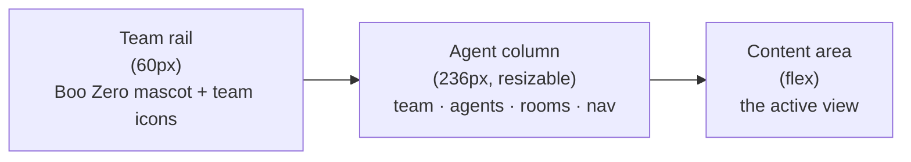

The Clawboo dashboard is a single-page app: a sidebar on the left and one large content area that swaps between views. This page is a map. It walks the shell left to right (the team rail, the agent column, the content area), explains the **view modes** that decide what fills the content area, and clarifies the one distinction newcomers trip on most: the **Org chart** (formerly Atlas), which draws every team on one [Ghost Graph](/using/ghost-graph) canvas, versus the **per-team Ghost Graph** in a card beside each team's chat.

Read this after you've finished onboarding ([native](/getting-started/quickstart-native) or [OpenClaw](/getting-started/quickstart-openclaw)) and have at least one team. If the dashboard is empty, [deploy your first team](/getting-started/first-team) first.

## The shell

The app is a two-part sidebar plus a swappable content area:

Together, the team rail and the agent column are **the sidebar**. The content area is always present. The agent column is hidden in the standalone **Boo Zero** view: that view dedicates the window to Boo Zero's agent page, so the agent column, which follows the selected team, has nothing to show. In that view the rail carries the sidebar toggle at its top. You can also collapse the whole sidebar out of the way.

### Resize and collapse the sidebar

- **Resize** the agent column by dragging its right edge, anywhere from 176 to 420px (its natural width is 236px). Double-click the edge to reset it. The edge works from the keyboard too: focus it, then use the left and right arrow keys to narrow or widen the column, or Enter to collapse it. Narrower than its natural width, the column keeps its layout and is clipped, fading out at its right edge.
- **Collapse** the sidebar with the collapse toggle in the agent column's top row, with `Cmd/Ctrl + \`, or by dragging the edge below about 120px. Collapsed, the whole sidebar (rail and column) leaves the screen.
- **Expand** it again from the expand toggle at the start of the view's header. While the sidebar is collapsed, every view puts one there: Home, the Org chart, a team chat, an agent's page, panels such as Board, Memory, Connectors, and Marketplace, and the welcome screen's top bar. Hover the toggle to **peek**: the sidebar slides in over the content at its docked position, with its own toggle right under your pointer, and hides again when the pointer leaves. Click the toggle to dock the sidebar.

Your browser remembers the width and whether the sidebar is collapsed (the `clawboo.sidebar.width` and `clawboo.sidebar.collapsed` keys).

### Team rail

The leftmost strip is a Discord-style icon rail. Top to bottom:

- **The Boo Zero mascot** (the Clawboo logo). Clicking it deselects any team and opens the standalone **Boo Zero** view. [Boo Zero](/concepts/agent-model) is the universal team leader, teamless in the registry, but present in every team. Right-clicking the mascot offers "Show all agents," which clears the team filter and opens the [Org chart](#the-org-chart-vs-the-per-team-ghost-graph).
- **One icon per active team** (its emoji on its color; hover for its name). Clicking a team icon selects that team _and_ opens its **[Home](#home)**. A pill marks the selected team. Right-clicking a team icon opens a context menu: archive/unarchive, "Refresh Protocol" (regenerate each agent's routing file), "Delete team only" (orphan the agents), or "Delete with agents."
- **The "+" button** (Create a team), below the team icons, opens the Marketplace's **Teams** tab, the one place to browse and deploy a team or start one from scratch.

Archived teams are filtered out of the rail; unarchive one from a team's context menu while it's still visible, or before archiving.

### Agent column

This column follows the selected team. Top to bottom:

- **The top row**: the selected team's name (or "All Agents" when no team is selected), a **search** icon, and the **collapse toggle**. The search icon opens a quiet field in the same row that filters the agents by name as you type; `Escape` clears and closes it.
- **The mascot grid**: the team's agents as tiles, each with its Boo and name. A pulsing dot marks an agent that's working and a red dot one in error, and Boo Zero comes last. Clicking a tile opens that [agent's page](#the-agent-page). With no team selected, every agent is listed as a row instead, with a live status badge (Idle / Working / Error / Sleeping, with a fine-grained activity verb when running), a "seen X ago" timestamp, and a trash icon on hover to delete it.
- **The rooms list**, with no heading: a **New room** button, then **General**, the team's own group chat with everyone on the team (its row reads "General (Main Room)" and is always pinned). The team's other [rooms](#rooms) follow, pinned ones first (most recently pinned on top), then newest first. Each row shows its members' faces; click a row to open that chat, or hover it for its **"..."** menu.
- **Create Boo**: adds a new agent to the selected team, on OpenClaw while an OpenClaw Gateway is connected and on Clawboo Native otherwise.
- **The nav**: the work surfaces you switch between most, then the **Settings** gear.
- **The theme toggle**, at the very bottom.

The nav is deliberately short, five work surfaces plus the team's Home and the Settings gear, in this order:

| Item                                 | View it opens                                 | Shortcut       |
| ------------------------------------ | --------------------------------------------- | -------------- |
| **Home** _(when a team is selected)_ | The team's [Home](#home)                      | None           |
| **Org chart**                        | The all-teams Ghost Graph                     | `Cmd/Ctrl + 1` |
| **Board**                            | The durable task board, by status and by day  | `Cmd/Ctrl + 2` |
| **Connectors**                       | Connect MCP servers and apps for your agents  | `Cmd/Ctrl + 3` |
| **Memory**                           | The shared memory, full-screen with its graph | `Cmd/Ctrl + 4` |
| **Marketplace**                      | Browse 436 agents and 85 teams                | None           |
| **Settings** (gear)                  | Opens the Settings modal (see below)          | `Cmd/Ctrl + ,` |

<Note>
There is no standalone **Approvals** nav item. Approvals surface where they are raised: the **Needs you** column on the [board](/using/board) and an inline tray above the [group-chat](/using/group-chat) composer. See [Approvals](/using/approvals).
</Note>

**Fleet** is no longer in the sidebar; it lives in the Settings modal, under **Insights**. It is the read-only overview of the whole fleet: agent count, 24-hour task and verify pass rates, spend, and per-runtime health.

### The Settings modal

Everything for managing, configuring, and inspecting the dashboard lives in a **Settings modal**, opened from the gear at the bottom of the sidebar or with **`Cmd/Ctrl + ,`**. It groups eleven surfaces. Memory is one of them and is also in the sidebar, on purpose: Settings shows its list, and the sidebar opens it full-screen with the graph.

| Group     | Item              | What it shows                       |
| --------- | ----------------- | ----------------------------------- |
| Workspace | **Providers**     | Connect/manage LLM provider keys    |
| Workspace | **Runtimes**      | Connect/manage runtimes             |
| Workspace | **Memory**        | Shared-memory browser               |
| Workspace | **Capabilities**  | The capability inventory            |
| Workspace | **Routines**      | Scheduled work for teams and agents |
| Insights  | **Fleet**         | The fleet overview (see above)      |
| Insights  | **Tokens Used**   | Cost dashboard                      |
| Insights  | **Observability** | Traces, errors, fleet health, evals |
| Insights  | **Governance**    | Budgets, caps, audit, approvals     |
| System    | **System**        | Gateway control, model, API keys    |
| System    | **System Health** | Boot probe + degradation checks     |

### Content area

The content area renders exactly one view at a time, chosen by the current **view mode** (see below). When you switch views, the old view fades out and the new one fades in. Pressing `Escape` from an agent's page, the Boo Zero view, a team's Home, or a team chat returns you to the welcome screen.

## View modes

The dashboard's state is a single discriminated union, the `ViewMode`, and the content area is a `switch` over it. There are six shapes:

| View mode   | What it shows                                                                           | How you reach it                                           |
| ----------- | --------------------------------------------------------------------------------------- | ---------------------------------------------------------- |
| `welcome`   | The welcome screen                                                                      | `Escape` from a chat, agent, or Home view, or no selection |
| `agent`     | An agent's page: its chat, with cards beside it                                         | Click a mascot tile or an agent row                        |
| `booZero`   | Boo Zero's agent page (agent column hidden)                                             | Click the mascot                                           |
| `teamspace` | A team's Home                                                                           | Click a team icon, or **Home** in the nav                  |
| `groupChat` | A team chat (General or a room), with cards beside it                                   | Click **General** or a room in the rooms list              |
| `nav`       | One of the nav panels (5 in the sidebar, 11 in the Settings modal, with Memory in both) | Click a nav item or a Settings item                        |

The `groupChat` mode carries an optional `roomId`; without one, it is the team's own group chat, General. The `nav` mode carries a `view` field, one of the 15 `NAV_VIEWS`: `graph` (the Org chart), `fleet`, `cost`, `marketplace`, `connectors`, `routines`, `system`, `obs`, `board`, `runtimes`, `providers`, `memory`, `governance`, `capabilities`, `health`. The dashboard opens on `nav: graph` (the Org chart) by default, so a fresh launch lands you on the org-wide map.

### Keyboard navigation

- `Escape`: leave an agent's page, the Boo Zero view, a team's Home, or a team chat, back to the welcome screen. Ignored while you're typing, or while any overlay is open: an open dialog, drawer, menu or dropdown takes `Escape` first, innermost one first, so dismissing a dropdown inside a dialog leaves the dialog (and anything you typed into it) alone.
- `Cmd/Ctrl + 1` to `Cmd/Ctrl + 4`: jump to the first four work surfaces in the nav, in order: **1** Org chart, **2** Board, **3** Connectors, **4** Memory. Marketplace has no shortcut.
- `Cmd/Ctrl + ,`: open the Settings modal (Providers, Runtimes, Memory, Capabilities, Routines, Fleet, Tokens Used, Observability, Governance, System, System Health).
- `Cmd/Ctrl + \`: collapse or expand the sidebar.

## Home

Each team has a **Home** page. The team's icon in the rail opens it, and so does the **Home** row at the top of the nav. For now Home is a placeholder: it says the team's dashboards, and the artifacts its agents make, will live there. To talk to the team, open **General** or one of its rooms from the rooms list.

## The team chat

Clicking **General** or a room opens a team chat: the conversation on the left, with **cards** stacked beside it. The first time you open a team's chat, the one-time "Know Your Team" gate fills the window instead; see [Deploy your first team](/getting-started/first-team).

The chat's header shows the team's icon, the chat's name, and its members' faces. In a room, clicking the faces (**Edit room members**) opens the room dialog to change the room's name and members, or delete it. The gear opens the team's **brief & rules**, and the header also holds one toggle per card. The cards stack top to bottom:

- **Browser**: what the chat's agents have open in their browsers, in a window of its own, with their faces in its top bar to switch between them.
- **Team graph** (**Room graph** in a room): the per-team [Ghost Graph](#the-org-chart-vs-the-per-team-ghost-graph).
- **Tasks**: the chat's board tasks in sections (Needs you, In progress, To do, Done, Cancelled); a room shows only its own tasks. Open a task to see its progress and comments, leave a comment that steers the agent working on it, or jump to it with **Open on Board**.
- **Activity**: the team's live activity feed: tool calls, results, and errors.

The graph and **Tasks** start open. Each card has maximize and close buttons, you can resize the splits between the chat and the cards, and with every card closed the chat takes the whole width. Your browser remembers which cards are open in each view (the `clawboo.panes` key) and how you sized them. Delegated work also shows up in the conversation itself, as Board task cards.

### Rooms

A team can have **rooms**: each is a subset of the team's members with its own conversation, its own task cards (the tasks delegated in it), and its own **Room graph** card. The team's own group chat is the default room, **General**. Boo Zero presides over every room the way it presides over the team, and the team's rules, brief, memory, and board stay team-wide.

- **New room**, at the top of the rooms list, opens a dialog for a name and the members (at least one). Creating the room opens its chat.
- Each room row's **"..."** menu offers **Pin / Unpin**, **Rename** (inline, in the row), **Clear chat**, and **Delete**. General's menu has only **Clear chat**.
- **Clear chat** sets the chat's messages aside and starts its agents on the conversation fresh; **Delete** archives the room and stops its work. Both ask first, and both leave the tasks on the board.

See [Using group chat](/using/group-chat) for rooms, routing inside a room, and clearing a chat.

## The Org chart vs the per-team Ghost Graph

The single most useful thing to internalize: **the same Ghost Graph component renders at two scopes**, and which one you're looking at depends on how you got there.

- **The Org chart** is the Ghost Graph at **`atlas` scope** (the scope value keeps the view's old name). It ignores the selected team and pulls _every_ agent onto one canvas, with each team clustered around a presiding Boo Zero (the default radial layout; a Tree/Radial toggle switches to a top-down hierarchy with each team laid out as a row). Reach it from the **Org chart** nav item, `Cmd/Ctrl + 1`, or the mascot's "Show all agents." Its header toggles an **Activity** dock, and its command bar opens an **agent browser** dock; in the radial layout, the browser dock turns the graph so the team you're watching sits beside it. This is the org-wide map, every team at once.
- **The per-team Ghost Graph** is the same component at the default **`team` scope**, shown in the **Team graph** card beside a team's chat. It filters to the selected team's agents (plus Boo Zero), or to a room's members in a room, and renders that team's internal routing as a top-down hierarchy. You don't navigate to it separately; it's one of the team chat's cards. It has no Activity or browser dock of its own, because those are cards beside the chat.

So: **the Org chart is a nav destination; the per-team Ghost Graph is a card in a team's chat.** They share rendering, hover cascades, the peacock skill-expand interaction, and the **+** button for building on the canvas, while the Tree/Radial toggle and team halos belong to the Org chart. See [Using the Ghost Graph](/using/ghost-graph) for both in depth.

## The agent page

Clicking a mascot tile (or an agent row) opens the agent's page: its chat on the left, and **cards** on the right that you toggle from the chat header, stacked top to bottom:

- **Graph**: the agent's compact graph (its Boo, skills, and resources), with the runtime-and-model control and the **+** button in its top-right corner.
- **Tasks & Routines**: the agent's tasks in sections (Needs you, In progress, To do, Done, Cancelled), each opening in place with its progress, its comments, a comment box that steers the agent, and **Open on Board**; then the routines that send this agent work, with **New routine**.
- **Browser**: the agent's browser.
- **Activity**: the agent's live activity feed.
- **Details** (the folder icon): its section pills sit in its top row, with no title above them: **Workspace**, **Personality**, **Permissions** (on OpenClaw and native agents), **Brief** (Boo Zero only), and **Agent Files**. Agent Files opens a second row of tabs, one per agent file the agent's runtime reads (SOUL.md, IDENTITY.md, TOOLS.md, and AGENTS.md on an OpenClaw agent), with **Save**.

**Graph** and **Details** start open. As in a team chat, each card can be maximized or closed, the splits are resizable, and your browser remembers the sizes and which cards are open. See [Working with agents](/using/agents).

## Where to go from here

- Click a **team icon** to open its Home, then **General** in the rooms list to watch the team collaborate.
- Open the **Org chart** to see how all your teams relate under Boo Zero.
- Open the **Board** to see delegated work as durable, claimable tasks, laid out by status and by day, with anything waiting on you in **Needs you**.
- Open **Settings**, then **Runtimes**, to connect Claude Code, Codex, Hermes, or OpenClaw alongside the native runtime.

## See also

- [Deploy your first team](/getting-started/first-team), get a team on screen, then come back to this map
- [Using group chat](/using/group-chat), the team chat, its rooms, and clearing a chat
- [Using the Ghost Graph](/using/ghost-graph), the Org chart and the per-team graph in depth
- [Working with agents](/using/agents), the agent page and its cards
- [Teams and planes](/concepts/teams-and-planes), what a team is, shared vs private plane
- [The board](/concepts/the-board), the durable substrate beneath the Board view
- [Peer chat](/concepts/peer-chat), what happens inside a team's group chat
- [Agent model](/concepts/agent-model), Boo, Boo Zero, and the runtime classes
- [Connecting runtimes](/runtimes/connecting-runtimes), what the Runtimes view manages
- [Glossary](/appendices/glossary), canonical term definitions
