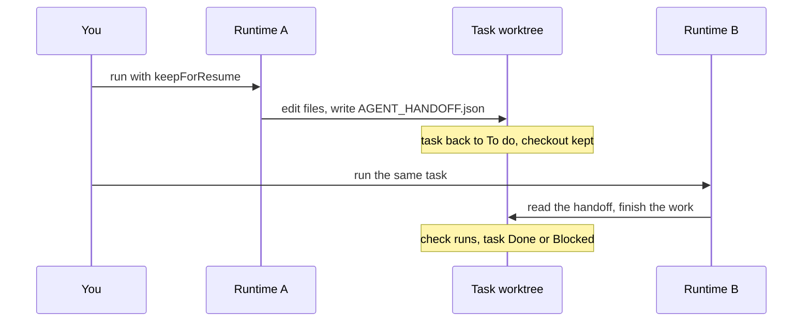

Use this recipe to start a code change on one runtime, for example Claude Code, pause it, and have another runtime, for example Codex, finish it in the same git checkout. The second runtime learns what is done and what is next from files in that checkout, not from a chat history. This is a developer recipe: you drive every step through the REST API.

<Note>

A handoff needs a git worktree, a separate checkout Clawboo makes for one task. A run gets one only when it is started with `POST /api/runtimes/:id/run` and a `repoPath`, or by an agent routine whose task template names a `repoPath` (set through the API; the routine dialog has no repository field). Team chat, rooms, delegations and tasks you start from the board never get a worktree, so they never write a handoff.

</Note>

**What you'll build:** one task, started by Claude Code with a pause at the end, then finished by Codex in the same checkout, with the result left on a branch for you to merge.

**Time:** about 20 minutes, plus however long the two runs take.

## Before you begin

- Two of these runtimes connected: Clawboo Native, Claude Code, Codex, Hermes. OpenClaw cannot take part: `/api/runtimes/openclaw/run` answers `404` with `unknown runtime 'openclaw'`. See [Providers and runtimes](/using/providers-and-runtimes).
- A git repository on this computer with at least one commit, and its absolute path.
- The server address. The examples use `http://127.0.0.1:18790`; `clawboo` prints the address it actually uses. If you set `STUDIO_ACCESS_TOKEN`, API calls need the access cookie; see [Reach Clawboo from another machine](/guides/self-host-securely).

<Warning>

A worktree keeps a task's file changes apart from your own checkout. It is not a sandbox. Claude Code, Codex and Hermes run with their approval prompts turned off and can read and change any file your user account can. See [What agents can do](/concepts/permissions).

</Warning>

## How it works



## Steps

<Steps>

<Step title="Create the task without an assignee">

```bash
curl -s -X POST http://127.0.0.1:18790/api/board \
  -H 'Content-Type: application/json' \
  -d '{"title":"Add input validation to the signup form","description":"Reject an empty email and passwords under 12 characters, with tests. Set VERIFY_CMD in init.sh to npm test.","teamId":"<team-id>"}'
```

The response holds the new task, in status `todo`. Keep its `id`.

Leave out `assigneeAgentId`. A task created for an agent goes straight to the team's chat engine, which runs it without a worktree, and your run in the next step then gets a `409`. The `teamId` is optional (`GET /api/teams` lists your teams' ids): with it, the task shows on that team's board and its spend counts toward the team's budget.

</Step>

<Step title="Start the task on the first runtime">

```bash
curl -s -X POST http://127.0.0.1:18790/api/runtimes/claude-code/run \
  -H 'Content-Type: application/json' \
  -d '{"taskId":"<task-id>","assigneeAgentId":"<agent-id>","repoPath":"/absolute/path/to/repo","keepForResume":true}'
```

The request stays open until the run ends, which can take minutes. Keep it open, and call the server directly rather than through a proxy with a short timeout: closing the connection cancels the run and its process, and the task goes back to To do.

What the fields do:

- `keepForResume: true` (the boolean) makes the run pause at the end instead of finishing.
- `repoPath` is the repository the worktree branches from. The run's `kind` defaults to `code`, which needs it. Read-only `research` and `review` runs get no worktree.
- `assigneeAgentId` becomes the run's identity. Memory and the board credit the work to it, and Clawboo Native, Codex and Hermes keep a home folder per identity. Use the id of an agent on the task's team (from `GET /api/agents`), or leave it out to use the runtime's id. Only letters, digits, `-` and `_` are allowed.

Clawboo claims the task and makes the worktree: a folder under `~/.clawboo/worktrees/` on a new branch, `clawboo/task-<task-id>`, in your repository. The agent works there. At the end, Clawboo writes `AGENT_HANDOFF.json` into the worktree, with the agent's summary as the next step, and puts the task back in To do. The worktree stays, and no check runs on a pause.

You should get a `200` whose JSON includes `"ok": true`, `"status": "todo"`, `"usedWorktree": true` and the agent's `summary`.

</Step>

<Step title="Read the handoff (optional)">

```bash
curl -s http://127.0.0.1:18790/api/board/<task-id>/workspace
```

The response has four parts: `ok`, `workspace` (including `worktreePath`, the folder, and `branch`), `resume` (what the next runtime will read: `done`, `broken`, `next`, and `lastRuntime`), and `handoff` (the parsed `AGENT_HANDOFF.json`). The handoff is structured data, so the next runtime reads fields rather than prose.

</Step>

<Step title="Finish the task on the second runtime">

Send the same `taskId` and `repoPath` to the other runtime, without `keepForResume`:

```bash
curl -s -X POST http://127.0.0.1:18790/api/runtimes/codex/run \
  -H 'Content-Type: application/json' \
  -d '{"taskId":"<task-id>","assigneeAgentId":"<agent-id>","repoPath":"/absolute/path/to/repo"}'
```

Clawboo finds the task's worktree and reuses it. If the folder was removed by a cleanup, Clawboo rebuilds it from the branch, which is why the second run needs `repoPath` too. Codex starts from the handoff: what is done, what is broken, and what to do next.

</Step>

<Step title="Let the check decide where the task lands">

When the second run ends, Clawboo compares the worktree with its starting point:

| What changed  | What happens                                                                                                     | The task ends in                                                                                                                                            |
| ------------- | ---------------------------------------------------------------------------------------------------------------- | ----------------------------------------------------------------------------------------------------------------------------------------------------------- |
| Nothing       | Clawboo removes the worktree and its branch.                                                                     | **Done**                                                                                                                                                    |
| Files changed | The check runs: the verify command from the worktree's `init.sh` and, for a large change, a separate review run. | **Done** when it passes. A failure is retried inside the same request; once the attempts are used up (2 by default), **Blocked**, waiting in **Needs you**. |

The request returns once that is settled. The worktree starts with a placeholder verify command, and a placeholder counts as a failed check, which is why the task description in step 1 asks the agent to set `VERIFY_CMD`. See [How work is checked](/concepts/verification).

</Step>

<Step title="Review and merge the work">

Clawboo never merges or pushes. The work stays on the branch `clawboo/task-<task-id>` in your repository, and in the worktree folder:

```bash
git -C /absolute/path/to/repo log --oneline main..clawboo/task-<task-id>
git -C /absolute/path/to/repo diff main...clawboo/task-<task-id>
git -C /absolute/path/to/repo merge clawboo/task-<task-id>
```

Replace `main` with the branch you started from. An agent may leave its changes uncommitted in the worktree folder. Clawboo commits them once the verify command passes, when you pause the workspace, and before a cleanup removes the folder. If the branch shows nothing new, look in the folder from `workspace.worktreePath`.

</Step>

</Steps>

## Check that it worked

- After the first run, `GET /api/board/<task-id>` shows the task in `todo`, and the workspace response shows `resume.hasHandoff: true` with `lastRuntime` set to `claude-code`.
- After the second run, `GET /api/board/<task-id>/executions` lists a run by each runtime.
- The task ends in `done` or `blocked`, and `git -C /absolute/path/to/repo branch` lists `clawboo/task-<task-id>` unless the run changed nothing.

## Variations

| You want                          | Do this                                                                                                                                                                                                                                                                                              |
| --------------------------------- | ---------------------------------------------------------------------------------------------------------------------------------------------------------------------------------------------------------------------------------------------------------------------------------------------------- |
| Hand the task to a person         | Write the handoff yourself with `POST /api/board/<task-id>/workspace/handoff`, for example `{"handoffFrom":"Sam","runtime":"human","nextBestStep":"Finish the password rule and its test"}`. `handoffFrom` and `runtime` are required. The person works in the folder from `workspace.worktreePath`. |
| Pause without a run               | `PATCH /api/board/<task-id>/workspace` with `{"action":"pause"}` commits any uncommitted work, removes the folder and keeps the branch. The next run rebuilds the folder from the branch when you pass `repoPath`.                                                                                   |
| Resume on the same runtime        | Send the second run to the runtime that did the first. Where the runtime supports it, it also picks up its own earlier session; a different runtime starts from the handoff file alone.                                                                                                              |
| See the worktree's files and diff | `GET /api/board/<task-id>/workspace/detail` returns the task notes in the worktree and the diff against its starting point.                                                                                                                                                                          |
| Run it on a schedule              | Create an agent routine through the API with a `repoPath` in its task template. Each fire makes a new task and runs it in a worktree, without a pause. See the [Schedules API](/reference/rest-api/schedules).                                                                                       |

## Troubleshooting

<AccordionGroup>

<Accordion title="The run answers 409">

**What it means:** Clawboo could not claim the task. It is not in To do, it already has an assignee (for example because you created it with `assigneeAgentId`), or you closed the connection before the claim.

**Fix:** check the task with `GET /api/board/<task-id>`. Do not retry in a loop. To run a task that is assigned or **Blocked**, move it back to To do first with `PATCH /api/board/<task-id>` and `{"status":"todo"}`, which also clears the assignee.

</Accordion>

<Accordion title="The run answers 422 and the task has a [blocked: no isolation] comment">

**What it means:** the run changes files, so it needs a worktree, and Clawboo could not make one. The comment reads "This task changes files, so it needs an isolated git worktree, but no repository path was provided for it." when `repoPath` is missing, or names the path when Clawboo could not create the worktree there. The task goes back to To do.

**Fix:** pass `repoPath` with the absolute path of a git repository that has at least one commit. For read-only work, send `"kind":"research"` or `"kind":"review"` instead.

</Accordion>

<Accordion title="The run answers 404 unknown runtime 'openclaw'">

**What it means:** OpenClaw agents cannot be run this way. The run route accepts `clawboo-native`, `claude-code`, `codex` and `hermes`.

**Fix:** use one of those runtimes.

</Accordion>

<Accordion title="curl seems to hang">

**What it means:** the run is still going. The request returns only when the run ends.

**Fix:** leave it open. If you stop it, Clawboo cancels the run, and the task goes back to To do with the worktree kept.

</Accordion>

<Accordion title="The first run finished instead of pausing">

**What it means:** the run body did not carry `"keepForResume": true` as a boolean, so the run went on to the check.

**Fix:** send `true`, not `"true"`. A task that reached Done cannot be reopened, so create a new task for the rest of the work. A Blocked task can go back to To do with `PATCH /api/board/<task-id>` and `{"status":"todo"}`.

</Accordion>

<Accordion title="The task ended Blocked">

**What it means:** the check failed on every attempt. A placeholder verify command in `init.sh` always fails.

**Fix:** read the task's comments with `GET /api/board/<task-id>` to see what failed. Set `VERIFY_CMD` in the worktree's `init.sh`, move the task back to To do, and run it again with the same `repoPath`.

</Accordion>

</AccordionGroup>

## Next steps

- [Worktrees and handoff](/concepts/worktrees-and-handoff): the files in a task's worktree and what each one is for.
- [How work is checked](/concepts/verification): the verify command, the review run, and when a task lands Blocked.
- [Runtimes API](/reference/rest-api/runtimes): every field and status of `POST /api/runtimes/:id/run`.
- [Board API](/reference/rest-api/board): the task and workspace routes used here.
- [Mix runtimes on one team](/guides/multi-runtime-team): put agents on different runtimes in team chat.
