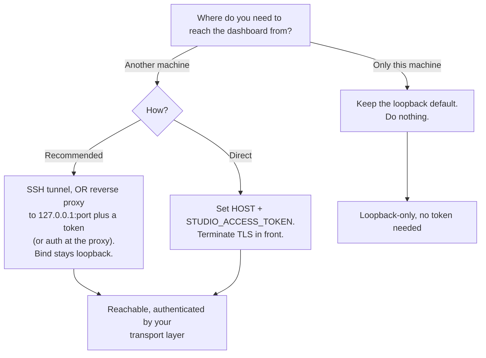

Use this guide when you are running Clawboo somewhere other than your own laptop, a home server, a VPS, a container, and you need to decide how exposed it should be. It composes three pages into one decision path: the [security model](/operating/security), the [deployment](/operating/deployment) mechanics, and the [environment variables](/reference/environment-variables) reference. Read those for the full detail; this guide is the walkthrough.

The short version: a fresh install binds loopback and is already safe. The two ways to reach it from elsewhere are a **tunnel** (recommended: keep the bind loopback) or a **wide bind plus an access token** (the opt-in second wall). Everything below makes that choice concrete.

<Note>
Clawboo is single-tenant and local-first. There are no user accounts, roles, or scopes; the access gate is one shared secret that grants full operator access. See [The honest caveats](#the-honest-caveats) before you expose it to anyone but yourself.
</Note>

## Prerequisites

- A working Clawboo server you can start with `node dist/server.js` or `clawboo`. See [Deployment](/operating/deployment).
- For the recommended path: SSH access to the box, or a reverse proxy (nginx, Caddy) you can terminate TLS on.
- For the wide-bind path: the ability to set environment variables on the process (`HOST`, `STUDIO_ACCESS_TOKEN`).

## Decision path



## Step 1: Understand the default (do nothing if it fits)

On a fresh install the dashboard binds `127.0.0.1`, not `0.0.0.0`. The host resolver returns loopback unless you explicitly set `HOST`; an explicit value wins (trimmed), anything else falls back to loopback. So the dashboard and every `/api/*` route are reachable only from the local machine until you opt out of that. (`HOSTNAME` is deliberately **not** a bind signal — Docker/systemd/CI auto-inject it, so honoring it would silently widen the bind inside a container. Use an explicit `HOST=`.)

`localhost`, `::1`, and the whole `127.0.0.0/8` range count as loopback. `0.0.0.0`, `::`, a LAN IP, or a hostname are all network-exposed; and binding one of those without a token is what makes the server refuse to start (see below).

If you only need the dashboard from the same machine, and you do not set `HOST`, you are done. No token, no proxy, nothing else to configure.

## Step 2: Reach it from another machine without widening the bind (recommended)

The safest way to reach Clawboo remotely is to keep the bind loopback and put a real transport-security layer in front. Two options:

**SSH tunnel.** Forward a local port on your client to the loopback port on the server. Nothing about Clawboo's bind changes:

```bash
# from your client machine; assumes Clawboo is on the default 18790
ssh -N -L 18790:127.0.0.1:18790 user@your-server
# then open http://localhost:18790 on your client
```

**Reverse proxy that terminates TLS.** Run nginx/Caddy on the box, terminate HTTPS there, and forward to `127.0.0.1:<port>`. Pin the port so the upstream is stable ([Port resolution](/operating/deployment#port-resolution)), and widen the same-origin guard to the public hostname you will reach it at:

```bash
CLAWBOO_API_PORT=18790 \
CLAWBOO_UI_DIR=./dist/ui \
CLAWBOO_ALLOWED_ORIGINS=https://dash.example.com \
CLAWBOO_ALLOWED_HOSTS=dash.example.com \
node dist/server.js
```

Forward both HTTP and the WebSocket upgrade for the Gateway proxy at `/api/gateway/ws`:

```nginx
# nginx sketch — terminate TLS, forward to the loopback Clawboo server
location / {
    proxy_pass http://127.0.0.1:18790;
    proxy_set_header Host $host;
    proxy_set_header X-Forwarded-Proto $scheme;
    # WebSocket upgrade for the Gateway proxy
    proxy_http_version 1.1;
    proxy_set_header Upgrade $http_upgrade;
    proxy_set_header Connection "upgrade";
}
```

<Warning>
Skip those two variables and the proxy recipe fails in a way that looks like it worked. The same-origin guard runs always, independent of the access gate, and its `Host` allowlist is loopback plus the literal bind host only. `proxy_set_header Host $host;` forwards your public hostname, which is not on that list, so every `/api/*` request answers `403 Cross-origin request blocked.` while the SPA HTML still loads (the guard gates `/api/` only): the dashboard renders and then nothing works. `CLAWBOO_ALLOWED_HOSTS` covers the forwarded `Host`; `CLAWBOO_ALLOWED_ORIGINS` covers the browser `Origin` on state-changing fetches and the `/api/gateway/ws` upgrade. Both only widen the allowlist, never disable it, and a loopback bind logs no boot warning about the omission.
</Warning>

With either option, Clawboo never accepts a connection off-host directly; your tunnel or proxy is the only network-facing surface. An SSH tunnel brings its own authentication. A reverse proxy brings TLS, but it authenticates nobody unless you configure it to, so pair it with an access token ([Step 3](#step-3-or-widen-the-bind-and-set-an-access-token) shows how to set one; the bind can stay loopback).

<Warning>
**A reverse proxy is not authentication.** Every request nginx, Caddy or a Cloudflare Tunnel connector forwards reaches Clawboo from `127.0.0.1`, so from the server's side of the socket the whole internet looks like a local caller. Unless the proxy authenticates requests itself (HTTP basic auth, an SSO proxy such as oauth2-proxy, Cloudflare Access), set `STUDIO_ACCESS_TOKEN` as well. Without it, the dashboard and every `/api/*` route are open to anyone who can reach the proxy. Because the bind is loopback the server does not refuse to start; it logs a one-time `SECURITY:` warning when the first request arrives carrying a proxy's forwarding header (`Forwarded`, `X-Forwarded-*` or `X-Real-IP`). If you see that warning, this is why.
</Warning>

**Deny the MCP server routes at the proxy.** `/api/mcp/tasks`, `/api/mcp/memory`, `/api/mcp/tools` and `/api/mcp/teamchat` are the runtime control plane: the MCP servers Clawboo's own spawned runtimes attach to. Runtimes reach them on the loopback port directly and never through the proxy, so nothing legitimate needs them from outside. With the gate on, Clawboo already refuses them without the operator cookie or a runtime's attach token ([Step 4](#step-4-know-how-the-gate-behaves-once-its-on)). Blocking them at the proxy as well is defence in depth: it still holds if the gate is off or an attach token leaks.

Leave `/api/mcp/config` reachable. The dashboard's Runtimes panel loads its attach snippet from it through the proxy, and with the gate on it needs the operator cookie like any other dashboard route. (If you never use that panel remotely, denying the whole `/api/mcp/` prefix works too.)

```nginx
# The four MCP server routes. Case-insensitive, and a regex location wins over
# the `location /` prefix above.
location ~* ^/api/mcp/(tasks|memory|tools|teamchat)(/|$) {
    return 404;
}
```

```caddyfile
dash.example.com {
    @mcp path /api/mcp/tasks* /api/mcp/memory* /api/mcp/tools* /api/mcp/teamchat*
    respond @mcp 404
    reverse_proxy 127.0.0.1:18790
}
```

```yaml
# cloudflared config.yml: the deny rule must come before the Clawboo service
ingress:
  - hostname: dash.example.com
    path: ^/api/mcp/(tasks|memory|tools|teamchat)(/|$)
    service: http_status:404
  - hostname: dash.example.com
    service: http://127.0.0.1:18790
  - service: http_status:404
```

Under a path prefix (`CLAWBOO_BASE_PATH=/clawboo`, below), deny the same four routes under the prefix (`/clawboo/api/mcp/tasks` and so on) as well.

**Sharing a hostname with other apps.** The recipe above gives Clawboo the whole origin. To put it under a path instead, set `CLAWBOO_BASE_PATH=/clawboo` and forward `location /clawboo/` with a `proxy_pass` that carries no URI part, so the prefix reaches Clawboo intact ([Serving under a path prefix](/operating/deployment#serving-under-a-path-prefix)). Requests are stripped of the prefix before any security check runs, so the same-origin guard and the access gate enforce exactly what they do at the root, and the access cookie is scoped to `Path=/clawboo` so the sibling apps on that origin never receive it.

## Step 3: Or widen the bind, and set an access token

If you do bind a non-loopback interface, you take on the access gate yourself. Set `HOST` **and** `STUDIO_ACCESS_TOKEN` together (a token-less wide bind refuses to start):

```bash
HOST=0.0.0.0 \
STUDIO_ACCESS_TOKEN="$(openssl rand -hex 24)" \
CLAWBOO_API_PORT=18790 \
CLAWBOO_UI_DIR=./dist/ui \
CLAWBOO_ALLOWED_ORIGINS=http://192.168.1.10:18790 \
CLAWBOO_ALLOWED_HOSTS=192.168.1.10 \
node dist/server.js
```

The allowlist lines are not optional here either. `0.0.0.0` is a wildcard, not a name anyone types, so the guard's automatic bind-host entry covers nothing and a LAN browser 403s until you enumerate the address it actually uses. (Binding that address directly, `HOST=192.168.1.10`, gets the same two entries for free.) The boot log warns on any non-loopback bind with no `CLAWBOO_ALLOWED_ORIGINS`.

<Warning>
A non-loopback bind with **no** access token would expose the dashboard and every `/api/*` route to your network, unauthenticated, including the routes that resolve provider keys into spawned runtimes. Clawboo never auto-generates a token; instead it **refuses to start** in that configuration (the origin guard is not authentication against a non-browser client, which can forge the `Host`/`Origin` headers). Set `STUDIO_ACCESS_TOKEN`, unset `HOST` to bind loopback only, or set `CLAWBOO_ALLOW_INSECURE=1` to run unauthenticated on purpose.
</Warning>

The token must come from the safe charset `[A-Za-z0-9._~-]` (which `openssl rand -hex` satisfies). A token containing any other character is rejected; the gate logs a warning naming the offending character and **disables itself** rather than ship a permanent lockout, because a cookie-delimiter character would otherwise corrupt the auth cookie and silently 401 every `/api/*` route. So a "wrong charset" token doesn't half-work; it turns the gate off. Generate from the safe set and you will never hit this.

## Step 4: Know how the gate behaves once it's on

When `STUDIO_ACCESS_TOKEN` is set, the access gate is the only authentication on the dashboard. Four behaviors matter for a self-host setup; the [security page](/operating/security#the-access-gate-opt-in) has the full treatment.

**Presenting the token, and the cookie.** Open `/?access_token=<token>` once. The gate validates it, sets an `HttpOnly`, `SameSite=Lax` cookie named `clawboo_access` scoped to the path the app is served under (`Path=/` by default, or the `CLAWBOO_BASE_PATH` prefix when one is set), and 302-redirects to strip the token from the URL. After that the cookie is the steady-state credential, validated on every `/api/*` request and on the `/api/gateway/ws` WebSocket upgrade. A request without a valid cookie gets `401` with a JSON `{ error }` body whose message tells you to open `/?access_token=<token>` once.

**Constant-time, length-hiding compare.** The token is never compared byte-by-byte. Both the cookie value and the configured token are SHA-256-hashed to a fixed 32-byte digest first, then compared in constant time; so the check neither short-circuits on the first differing byte (a timing oracle) nor leaks the token's length.

**Case-folded path test.** The gate lowercases the pathname before testing the `/api/` prefix, so an uppercased `/API/settings` can't slip past a case-sensitive prefix check and reach the real handler unauthenticated. The Express app also sets case-sensitive routing so its matcher and the gate agree.

**The runtime control plane takes an attach token; a loopback address alone admits nothing.** A spawned runtime attaches its MCP client to `http://127.0.0.1:<port>/api/mcp/*` with no cookie, by design, because the runtime's environment is scrubbed of the access token. It proves itself instead with the `attachToken` Clawboo writes into every MCP attach URL it hands a runtime, an HMAC derived from a per-install secret that never leaves the server. The gate lets a cookieless request through only when all of these hold:

- it targets one of the four MCP transport routes (`/api/mcp/tasks`, `/api/mcp/memory`, `/api/mcp/tools`, `/api/mcp/teamchat`);
- it carries a valid attach token;
- it reached the server directly from loopback (`127.0.0.1` or `::1`);
- it did not come through a proxy (no `Forwarded`, `X-Forwarded-*` or `X-Real-IP` header).

The last two can only refuse. A runtime always dials the loopback port directly, so a token that arrives from another host or through a proxy was lifted from a config, and it is worth nothing there. `/api/mcp/config` mints signed attach URLs, so it always needs the cookie, like every other `/api/*` route.

<Info>
Earlier releases skipped the cookie for any `/api/mcp/*` request whose TCP peer was loopback, on the theory that only the server's own runtimes connect from there. A same-host reverse proxy breaks that theory, because it forwards every request from `127.0.0.1`. Behind the Step 2 recipe, anyone who could reach the proxy could call the MCP servers, and `/api/mcp/config` would sign them an agent identity of their choosing, all without the token. The attach token closes that whatever sits in front of the server; deny the four MCP server routes at the proxy as well ([Step 2](#step-2-reach-it-from-another-machine-without-widening-the-bind-recommended)).
</Info>

## Step 5: Terminate TLS so the cookie is `Secure`

The gate marks the access cookie `Secure` **only** when the request arrived over TLS, which it detects from the `X-Forwarded-Proto: https` header. This is deliberate: a `Secure` cookie is never sent back over plain HTTP, so adding it unconditionally would break the gate on a loopback/dev HTTP origin.

The practical consequence for a self-host: terminate TLS at your reverse proxy and forward `X-Forwarded-Proto`. The nginx sketch in [Step 2](#step-2-reach-it-from-another-machine-without-widening-the-bind-recommended) already sets `proxy_set_header X-Forwarded-Proto $scheme;`; that single header is what upgrades the cookie to `Secure` end to end.

## Options / variations

| Goal                               | What to set                                      | Notes                                                                                            |
| ---------------------------------- | ------------------------------------------------ | ------------------------------------------------------------------------------------------------ |
| Loopback-only (default)            | nothing                                          | Safe out of the box; no token.                                                                   |
| Remote access, bind stays loopback | SSH tunnel or reverse proxy → `127.0.0.1:<port>` | Recommended. A proxy also needs a token (or its own auth) and should deny the MCP server routes. |
| Direct wide bind                   | `HOST=0.0.0.0` + `STUDIO_ACCESS_TOKEN=…`         | Always pair the two. TLS in front for a `Secure` cookie.                                         |
| Reverse proxy or LAN origin        | `CLAWBOO_ALLOWED_ORIGINS=…`                      | Widens the always-on guard; add `CLAWBOO_ALLOWED_HOSTS` for a proxied `Host`.                    |
| Stable upstream port               | `CLAWBOO_API_PORT=18790`                         | An explicitly pinned port gets **no** fallback, frees you from the auto-scan.                    |
| Custom state dir                   | `CLAWBOO_HOME=/path`                             | Moves the vault, settings, port file, and worktrees with it.                                     |
| Bring your own vault key           | `CLAWBOO_SECRETS_MASTER_KEY=…`                   | 32-byte base64, 64 hex chars, or a raw 32-char string.                                           |

See [Environment variables](/reference/environment-variables) for every variable, its reader, and its default.

## Verify it worked

- **Confirm the bind.** Boot the server and read the startup log. A non-loopback bind with no token **refuses to start** with a `SECURITY:` error (unless `CLAWBOO_ALLOW_INSECURE=1`, which logs a loud warning instead); a clean boot means you're either loopback or gated.
- **Check the access gate.** With the gate on, `curl https://your-host/api/settings` without a cookie should return `401`. The same request with `?access_token=<token>` should `302`-redirect and set the `clawboo_access` cookie. A `403 Cross-origin request blocked.` instead means the always-on same-origin guard rejected the public `Host` before the gate ever ran; add that hostname to `CLAWBOO_ALLOWED_HOSTS`.
- **Check the control plane is closed.** `curl -i https://your-host/api/mcp/tasks` should return `404` (denied at the proxy) or `401` (refused by the gate); a `400` means it reached the MCP server, so neither is in place. `curl -i https://your-host/api/mcp/config` without the cookie should return `401`. A `200` there, with an attach snippet, means anyone who can reach your proxy can mint agent identities; fix it before going further.
- **Confirm Clawboo-shaped health.** `GET /api/settings` returns `{ gatewayUrl, hasToken }`; `GET /api/health` returns the boot probe (`{ ok, degraded, fatal, checks, … }`). `ok: true` means no fatal checks failed. See [Deployment → Verify it worked](/operating/deployment#verify-it-worked).

## Troubleshooting

<Warning>
**The log says a request reached the server through a reverse proxy and `STUDIO_ACCESS_TOKEN` is not set.** Clawboo saw a `Forwarded`, `X-Forwarded-*` or `X-Real-IP` header with the gate off, so everything behind your proxy is reachable without a credential. Set `STUDIO_ACCESS_TOKEN` and restart, or confirm the proxy authenticates every request. The warning is logged once per process and never blocks a request.
</Warning>

<Warning>
**The gate seems off even though I set a token.** Check the boot log for a charset warning. A token with any character outside `[A-Za-z0-9._~-]` disables the gate by design (fail-loud rather than a silent lockout). Regenerate with `openssl rand -hex 24` and restart.
</Warning>

<Warning>
**The cookie isn't sticking over HTTPS.** The gate only sets `Secure` when it sees `X-Forwarded-Proto: https`. If your proxy terminates TLS but doesn't forward that header, the cookie may be dropped by the browser as insecure, or never marked `Secure`. Add `proxy_set_header X-Forwarded-Proto $scheme;` (or the equivalent for your proxy).
</Warning>

<Warning>
**WebSocket / Gateway connection fails behind the proxy.** The gateway proxy upgrade lives at `/api/gateway/ws` and the gate guards it with the same cookie check. Forward the upgrade headers (`Upgrade`, `Connection: upgrade`) and make sure the access cookie reaches the upgrade request.
</Warning>

<Danger>
**Don't reach for `CLAWBOO_ALLOW_INSECURE=1` "just for a minute."** Every `/api/*` route, including the ones that resolve provider keys into spawned runtimes, is reachable unauthenticated the moment the bind is non-loopback and no token is set. That's exactly why a token-less wide bind refuses to start; the opt-out flag disables that safety, so only use it behind your own firewall/proxy.
</Danger>

## The honest caveats

Clawboo is single-tenant and local-first by design. The access gate makes a _deliberately exposed single-user_ dashboard safe; it is not a multi-user authorization system.

- **The token is all-or-nothing.** Everyone who has it has full operator access. There are no per-user accounts, roles, or scopes, and no per-user revocation; rotate by changing the env var and restarting.
- **The vault is defense in depth, not targeted-attacker-proof.** It defeats commodity infostealers and the accidental backup or sharing of the vault file, but it does not protect against a process running as you. See [Security → the vault](/operating/security#the-encrypted-secrets-vault).
- **Single-tenant only.** The `tenant_id` columns across the schema are a dormant future seam; no per-tenant isolation or scoping is active in v0.5.0.
- **OpenClaw shared memory is registered globally.** Because OpenClaw agents are cross-team, Clawboo registers the shared [Memory](/concepts/memory) MCP server for the OpenClaw runtime at _global_ scope rather than per-run/per-team scope (the other four runtimes get per-run team scope). In a multi-tenant world that would need narrowing; it is a documented multi-tenant deferral, not a leak in the single-tenant model Clawboo ships today.

<Note>
These docs describe Clawboo **v0.5.0**, the current release.
</Note>

## See also

- [Security model and safe exposure](/operating/security), the full security model end to end
- [Deploying Clawboo](/operating/deployment), ports, state dir, host binding, reverse-proxy setup
- [Environment variables](/reference/environment-variables), `HOST`, `STUDIO_ACCESS_TOKEN`, `CLAWBOO_HOME`, `CLAWBOO_SECRETS_MASTER_KEY`, and the rest
- [Connecting runtimes](/runtimes/connecting-runtimes), the encrypted vault and the credential-resolution chain
- [MCP servers](/operating/mcp-servers), the `/api/mcp/*` control plane and the attach token it takes
- [Glossary](/appendices/glossary), access gate, vault, loopback, runtime
