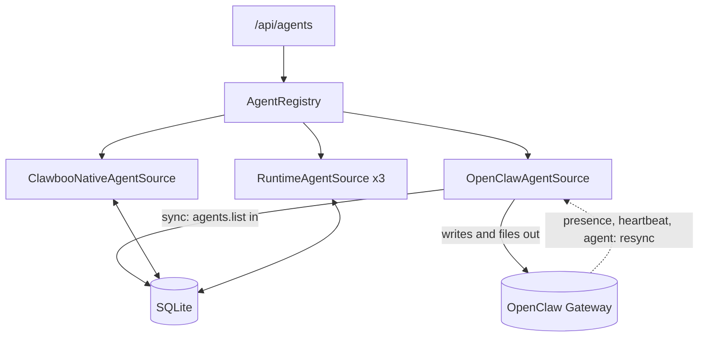
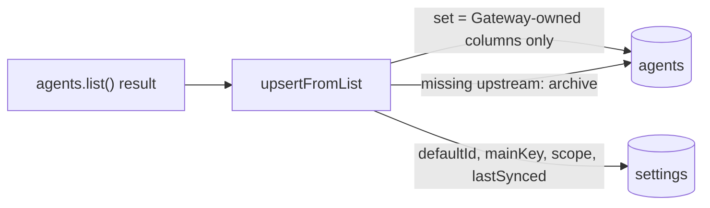

`AgentSource` answers one question: where does the agent list come from? Clawboo's answer is that SQLite holds the record of every agent, and each upstream is one `AgentSource` that syncs into it. Reads come from SQLite, so the fleet renders even when a runtime is offline. Writes, agent-file reads and writes, and live session lists go to the source that owns the agent and mirror back.

Use this page when you work on agent creation, deletion, sync, or the server's Gateway connection. For what an agent is from a user's point of view, see [the agent model](/concepts/agent-model); for the REST surface, see the [Agents API](/reference/rest-api/agents).

## What it is, and what it isn't

`AgentSource` is about who exists. How an agent runs is the [`RuntimeAdapter`](/internals/runtime-adapter) trait, and the two layers never reach into each other: a source produces and persists `AgentRecord`s, an adapter executes a run. The board is a third, separate layer: it references agents by id and owns only task state.

The trait and record types live in `@clawboo/agent-registry`, a pure, browser-safe package with no `dependencies` key at all. The concrete sources live server-side in `apps/web/server/lib/agentSource/`.

## The five registered sources

The server registers five sources in one `AgentRegistry` (`apps/web/server/lib/agentSource/registry.ts`):

| Source                     | `sourceId`                       | Upstream             | Writes                                                                                      | New agent id                 |
| -------------------------- | -------------------------------- | -------------------- | ------------------------------------------------------------------------------------------- | ---------------------------- |
| `OpenClawAgentSource`      | `openclaw`                       | the OpenClaw Gateway | create and file calls need the server's Gateway connection; a delete made offline is queued | the Gateway's agent id       |
| `ClawbooNativeAgentSource` | `clawboo-native`                 | SQLite itself        | always work                                                                                 | `native-<slug>-<6 chars>`    |
| `RuntimeAgentSource` (x3)  | `claude-code`, `codex`, `hermes` | SQLite itself        | always work                                                                                 | `<runtime>-<slug>-<6 chars>` |

`getRegistry()` returns a process-wide singleton that exposes them as `.source` (OpenClaw), `.nativeSource`, `.runtimeSources`, and the multiplexer as `.registry`. A `SIGTERM` or `SIGINT` handler stops the OpenClaw connection on shutdown.



One rule shapes every operation: registry reads come from SQLite, and writes go to the owning upstream and mirror back. A disconnected Gateway therefore degrades a write on an OpenClaw agent (`503`), never a registry read: `GET /api/agents` still answers, flagged `stale`. Listing an OpenClaw agent's sessions is the exception (see `listSessions` below).

## The AgentSource trait

```ts
export interface AgentSource {
  readonly id: RuntimeId

  // Reads: SQLite-backed, work even when the upstream is down
  listAgents(opts?: { includeArchived?: boolean; teamId?: string }): Promise<AgentRecord[]>
  getAgent(id: string): Promise<AgentRecord | null>
  listTeams(opts?: { includeArchived?: boolean }): Promise<TeamRecord[]>
  listSessions(agentId: string): Promise<SessionRecord[]>

  // Writes: require a live upstream, throw when disconnected
  createAgent(input: CreateAgentInput): Promise<AgentRecord>
  updateAgent(id: string, patch: UpdateAgentInput): Promise<AgentRecord>
  archiveAgent(id: string): Promise<void>

  // Agent files: route through the source
  readFile(agentId: string, name: AgentFileName): Promise<string>
  writeFile(agentId: string, name: AgentFileName, content: string): Promise<void>

  // Lifecycle and observability
  start(): Promise<void>
  stop(): Promise<void>
  health(): Promise<HealthResult>
  sync(): Promise<SyncResult> // idempotent upstream-to-SQLite reconcile
  events(): AsyncIterable<AgentEvent>
}
```

The contracts worth pinning down:

- **`listSessions` is the one read that can fail on a disconnect.** Sessions change too fast to cache, so the OpenClaw source asks the Gateway live and throws `gateway_disconnected` when it is down. The SQLite-backed sources read the `sessions` table.
- **`AgentFileName` is a local literal.** The package keeps its own copy of the seven names (`AGENTS.md`, `SOUL.md`, `IDENTITY.md`, `USER.md`, `TOOLS.md`, `HEARTBEAT.md`, `MEMORY.md`) so it stays dependency-free. Which files each runtime actually consumes is `AGENT_FILE_RUNTIME_SUPPORT` in `@clawboo/protocol`.
- **`events()` is consumer-terminated**, like `RuntimeAdapter.events()`. The `AgentEvent` union is `agent-upserted`, `agent-status`, `agent-archived`, `sync-complete` and `connection`.
- **`health()` reports a connection state** (`connected`, `connecting`, `reconnecting`, `disconnected`) plus the last sync time. The SQLite-backed sources always report `connected`.
- **`sync()` is idempotent** and must preserve every column Clawboo owns. That rule is the core of the OpenClaw source.

## The record types

`AgentRecord` is Clawboo's own shape, not an OpenClaw protocol shape, and a source adapts its upstream into it in both directions. Each field is annotated in `packages/agent-registry/src/records.ts` with who owns it:

- **Upstream-owned** (overwritten on every OpenClaw sync): `displayName`, `emoji`, `avatarUrl`, `sessionKey`, `isDefault`, `sourceAgentId`. `status` is marked Gateway-synced, but the sync writes it only as `'idle'` on first insert and `'archived'` when the agent leaves the list.
- **Clawboo-owned** (set by Clawboo and preserved across a sync): `teamId`, `personalityConfig`, `execConfig`, `avatarSeed`, `participantKind`, `runtime`, `capabilities`, `tenantId`.
- **Clawboo's column, managed by sync**: `archivedAt`. The OpenClaw sync sets it when an agent leaves the Gateway's list and clears it when the agent returns.
- **Optional, per source**: `model?` (the configured model, surfaced for the native and coding-runtime sources) and `providerReady?` (native only: whether a key, a fallback key, or a set-up keyless Ollama resolves for the agent's provider).

`RuntimeId` is the same open set as the executor's (`'openclaw' | 'claude-code' | 'codex' | 'hermes' | (string & {})`). `AgentRecordStatus` is `idle | running | error | sleeping | archived`, a superset of the Gateway's status that adds the `archived` tombstone. `TeamRecord` carries a computed `agentCount`; `SessionRecord` carries the upstream session key as `sourceSessionId` and a status of `active`, `idle` or `closed`.

The write inputs are thin. `CreateAgentInput` is `{ name, teamId?, personalityConfig?, execConfig?, avatarSeed?, files?, tenantId? }`, where `files` maps agent-file names to content written at create time and `tenantId` is resolved at the REST handler. `UpdateAgentInput` is `{ displayName?, teamId?, personalityConfig?, execConfig?, avatarSeed?, status? }`.

<Info>

`participantKind` (`'agent' | 'human'`) and `tenantId` are reserved fields. The only branch on `participantKind` is the wake bridge, which throws `NotImplementedError` for a human Routine target. No request filters by tenant: every row carries `tenantId: null`.

</Info>

## The registry

`AgentRegistry` is a thin catalog keyed by `RuntimeId`:

```ts
export class AgentRegistry {
  register(source: AgentSource): void
  unregister(id: RuntimeId): void
  get(id: RuntimeId): AgentSource | undefined
  default(): AgentSource // first registered; throws if none
  has(id: RuntimeId): boolean
  list(): AgentSource[]
}
```

`default()` returns the first registered source, which is the OpenClaw source.

REST handlers route a per-agent operation by the row's `sourceId` (`sourceForAgent` in `apps/web/server/api/agents.ts`): look up the row, take `registry.get(row.sourceId)`, and fall back to the OpenClaw source for an unknown id so its `404` semantics hold.

`GET /api/agents` calls `listAgents()` on every registered source and flattens the result. Alongside the list it returns `defaultId` (the runtime-neutral Boo Zero from `resolveBooZero`: an override, else the native Boo Zero, else the OpenClaw default), `mainKey`, `stale` and `lastSyncedAt` (both from the OpenClaw connection), and `pendingDeleteIds` (see [Pending deletes](#pending-deletes)).

## OpenClawAgentSource

The OpenClaw source holds the server's own `GatewayClient`, separate from any browser tab, and reconciles the Gateway's agent list into SQLite. The client is injected through a `makeClient` dependency, so tests pass a fake that implements only the `OpenClawClientLike` slice the source uses.

### Reads and writes

Reads (`listAgents`, `getAgent`, `listTeams`) select from SQLite (`listAgents` is scoped to `sourceId = 'openclaw'`, `getAgent` looks a row up by id alone, and teams are shared), parse the stored `identityJson` for the display name, emoji and avatar, and build the `sessionKey` as `agent:<sourceAgentId>:<mainKey>`. They work whether or not the Gateway is up.

`createAgent`, `archiveAgent` and the file calls go through the Gateway and guard on a live connection with `requireClient()`, which throws `Error('gateway_disconnected')`; the REST layer maps that to `503`.

- **`createAgent`** asks the Gateway for its config path, derives a `workspace-<slug>` directory beside it, calls `agents.create`, clears any pending-delete marker the returned id still carries, writes `SOUL.md`, `IDENTITY.md`, `TOOLS.md` and `AGENTS.md` through `agents.files.set` (browsing guidance goes into `AGENTS.md`, because the OpenClaw 2026.9 Gateway does not load `TOOLS.md`), tries `CLAWBOO.md` best-effort, applies the command-approval posture (below), and only then inserts the SQLite row.
- **`updateAgent`** patches the Clawboo-owned columns in SQLite and does not touch the Gateway.
- **`archiveAgent`** is a hard delete: it deletes the agent upstream, then removes the SQLite row, its cost records, its approval history, and its `boo-zero:display-name:<id>` setting.
- **`readFile` and `writeFile`** call `agents.files.read` and `agents.files.set`.

<Note>

The reversible `archivedAt` tombstone and the `archiveAgent` hard delete are different paths. Sync sets the tombstone when an agent disappears upstream and clears it if the agent comes back. `archiveAgent` is the delete a person asks for.

</Note>

### The posture write that can fail a create

The command-approval posture is written between the file writes and the SQLite insert, and it is the one step that can fail the whole call.

- **What is written.** The caller's `execConfig.execAsk`, or `DEFAULT_EXEC_ASK` (`'on-miss'`, labelled Ask for Unknown in the dashboard) when the caller sends no `execConfig` at all. It goes through `applyExecApprovalPolicy` and `upsertExecApprovalPolicy` (`exec.approvals.set` under the Gateway's compare-and-swap, retried against a fresh read up to three attempts in all), keyed by OpenClaw's agent id, because the Gateway keys its policy by its own ids.
- **When it is skipped.** When the value fails `isExecAsk` (it is not `'off'`, `'on-miss'` or `'always'`), including an `execConfig` with no `execAsk`. The agent is then created with no posture sent.
- **What a refusal does.** The source deletes the agent it just created upstream (best-effort; a failure there is logged) and throws `Could not set this agent's command permissions on the Gateway, so it was not created: <error>`. The SQLite insert never runs, so there is no half-created row. `POST /api/agents` answers `500` with that message. A Gateway that is simply down never gets this far: `requireClient()` throws first and the route answers `503`.

Nothing re-asserts a posture later. The only other write site is `POST /api/exec-settings`, and there a Gateway refusal answers `502 { ok: false, savedLocally: true }`, leaving the refused value in Clawboo's `exec_config`. `sync()` never touches the approvals store. See [Command permissions](/using/command-permissions).

### The idempotent sync

`sync()` first sends any deletes it owes (see [Pending deletes](#pending-deletes)), then calls `agents.list()` and hands the result to `upsertFromList`, which runs the whole reconcile in one transaction:

1. **Upsert.** Each listed agent is inserted, or on conflict updated with a `set` clause that touches only Gateway-owned columns: `name`, `gatewayId`, `sourceAgentId`, `identityJson`, `archivedAt: null` (revival) and `updatedAt`. It never writes `teamId`, `personalityConfig`, `execConfig`, `avatarSeed`, `participantKind`, `runtime`, `capabilities` or `tenantId`, so a re-sync can never clobber an agent's team, personality or avatar.
2. **Archive.** Any live `openclaw` row missing from the list gets `archivedAt` and `status = 'archived'`, and an `agent-archived` event fires.
3. **Metadata.** The list's `defaultId`, `mainKey` and `scope`, plus the sync time, are upserted into the `settings` table inline (the transaction handle is not typed as a `ClawbooDb`, so `setSetting` cannot be reused there).

Re-running the sync against an unchanged Gateway leaves every Clawboo-owned column exactly as it was. The dashboard pushes the list it reads from the Gateway to `POST /api/agents/sync`, which runs the same `upsertFromList`, so SQLite stays current even when the server's own connection is degraded.



### Pending deletes

`DELETE /api/agents/:agentId` with the Gateway down still removes the local row, and for an OpenClaw agent it records an `agent-source:openclaw:pendingDelete:<gatewayId>` row in `settings`. The response is `{ ok: true, upstreamDeleted: false, upstreamDeletePending: true }`.

- **What sync does.** `sync()` sends `agents.delete` for every pending id before it lists. While a marker exists, `upsertFromList` skips that id, so the agent is never revived or re-created, whether the list came from the server's sync or the dashboard's `POST /api/agents/sync` push. `POST /api/teams/:id/agents` refuses to assign a pending agent with `409 agent is being deleted`.
- **What clears a marker.** The delete lands; a list arrives without the agent; the Gateway refuses the delete outright (a `GatewayResponseError` with code `INVALID_REQUEST` or `retryable: false`, logged as a warning, after which the agent comes back on that same sync); or `createAgent` gets the same id back from `agents.create`.
- **What keeps it.** A transport failure leaves the marker for the next sync.

`GET /api/agents` exposes the markers as `pendingDeleteIds`, and the dashboard's Gateway hydrate leaves those agents out of the fleet.

### Connection lifecycle

`start()` opens the connection. With no Gateway URL configured, the source stays `disconnected` and reads still serve SQLite. On a successful connect it:

1. registers Clawboo's MCP servers in the Gateway config, at the top-level `mcp.servers` key: `clawboo-memory`, `clawboo-tasks` and `clawboo-tools`, all unbound (one process-wide config cannot carry a per-agent identity). TeamChat is deliberately not registered, and a stale `clawboo-teamchat` entry is pruned;
2. in the same `config.patch`, unions `sessions_spawn` and `sessions_yield` (plus any ids the operator listed) into the Gateway's top-level `tools.deny`, so a team agent cannot launch its own throwaway sub-agents. Clawboo records the ids it wrote so it can later take back only its own;
3. runs an initial `sync()`.

The patch is skipped when nothing changed, because the Gateway rate-limits control-plane writes. The `onStatus` callback flips the connection state and schedules a resync on reconnect; `onGatewayEvent` schedules one on every `presence`, `heartbeat` or `agent` frame. Resyncs are debounced by 750 ms, so the registry tracks fleet changes without polling.

Reconnect ownership is split. The source owns only the retry after an initial connect fails: exponential backoff from 2 s to 60 s, `.unref()`'d so it never holds the process open. An auth-class failure (bad token, unpaired device, bad connect params, a lockout) backs off to at least 2 minutes, honouring the Gateway's `retryAfterMs`, so retries never trip the Gateway's failed-auth lockout. Once a connection has opened, the `GatewayClient`'s own reconnect loop (800 ms to 15 s) owns later drops. The two are gated on disjoint conditions, so they never race.

### The operator surface

Beyond the trait, the source exposes `operatorCall`, `onGatewayBroadcast`, `onConnectionChange`, `operatorClient` and `reconnectAndWait`. They ride the same single connection, and they are what makes OpenClaw the runtime Clawboo drives over a live connection rather than a spawned process. Their consumers:

- the team engine, which runs every OpenClaw team-chat turn through `buildOpenClawServerAdapter()`;
- the Routines wake bridge, which runs OpenClaw routine fires through a thin dispatcher;
- the `openclaw-gateway-cron` schedule source and the OpenClaw capability source;
- the exec-approval surface and the session activity watcher (see [Gateway connection internals](/internals/gateway-and-events)).

`reconnectAndWait(timeoutMs)` (default 8,000 ms) is the delivery-resilience primitive. When a team-chat send finds the connection down, the engine reconnects, waits for it, and retries the delivery once, persisting a visible "could not reach your OpenClaw agents" message only if that also fails. This works because the Gateway Clawboo starts is spawned detached with its output in `gateway.log` in the Clawboo state directory, so it survives a server restart.

## ClawbooNativeAgentSource

The native source has no remote upstream: SQLite is its upstream. Reads and writes are direct SQL, `start()` and `sync()` do nothing, `stop()` only drops event listeners, `health()` always reports `connected`, and writes never throw `gateway_disconnected`, so a native agent can be created, edited and deleted with no Gateway at all.

- **Storage.** Agent files and the per-agent `AgentConfig` live in `settings` rows under a per-agent key prefix; sessions come from the `sessions` table the native harness writes.
- **`SOUL.md` is the persona.** `writeFile('SOUL.md', ...)` re-derives `AgentConfig.systemPrompt`, which is what a native run reads; an emptied file falls back to the default prompt, and the same resolved text is stored, so the editor never shows one thing while the agent runs another.
- **`createAgent`** mints a `native-<slug>-<6 chars>` id, validates the config with `agentConfigSchema`, inserts the row, stores the config and files, and, when the config sets `budgetUsd`, creates an agent-scope budget in `cap` mode.
- **`archiveAgent`** is a hard delete of the row, its cost records, approval history and sessions, its config and file rows, and its team-session resume pointers. The `archivedAt` tombstone is unused, because a source with no remote upstream can never see an agent "gone upstream".
- **`getAgent` is scoped.** It returns `null` for a row owned by another source, which is what lets the registry aggregate every source's list without overlap.

## RuntimeAgentSource

One `RuntimeAgentSource` (`apps/web/server/lib/agentSource/runtimeAgentSource.ts`) is registered for each coding runtime in `CODING_RUNTIME_SOURCE_IDS` (`claude-code`, `codex`, `hermes`, listed in `registry.ts`). Like the native source, SQLite is its upstream: reads and writes are direct, `start()` and `sync()` do nothing, and it is always `connected`.

Unlike the native source it keeps no `AgentConfig`. The server runs these agents from the row's `runtime`, the runtime's own credentials, and the task or message it delivers. Files given at create time (filtered to the seven agent-file names) are stored in `settings` under `runtime-agent-file:<agentId>:<name>`. Of those, only `SOUL.md` reaches a prompt: the server injects it as a `[Your persona]` block on both the team-chat and board paths (`runtimes/personaBlock.ts`). `AGENTS.md` draws the agent's routing edges on the Org chart. A coding-runtime agent's model, when set, lives in `execConfig` and is surfaced as `model`.

`archiveAgent` hard-deletes the row and its cost records, approval history, sessions, file rows and team-session resume pointers.

## Cleanup is scoped to OpenClaw rows

`POST /api/agents/cleanup-ghosts` deletes local rows that are missing from a supplied list of live Gateway ids. It compares only rows with `sourceId = 'openclaw'`, and so does the sync's archive step.

<Danger>

Keep that scoping on any sweep that reconciles against a Gateway list. The list comes from the Gateway, so only Gateway-owned rows may be compared against it. An unscoped sweep would delete every native and coding-runtime agent the moment a Gateway list arrived.

</Danger>

## Server connect requirements (OpenClaw 2026.5 and later)

A headless Node connection to the Gateway is not a browser connection, and the differences are easy to break. Four options in the registry's `connectOptions()` are load-bearing:

| Option                                      | Why                                                                                                                                                                                                                                                                                                                     |
| ------------------------------------------- | ----------------------------------------------------------------------------------------------------------------------------------------------------------------------------------------------------------------------------------------------------------------------------------------------------------------------- |
| `clientName: 'cli'`                         | The Gateway checks `client.id` against a fixed allowlist. A custom id such as `clawboo-server` is rejected (`invalid connect params: at /client/id`, the socket closes with `1008`). The browser ids (`openclaw-control-ui`, `webchat-ui`) also require a browser `Origin`. `cli` has no origin rule.                   |
| `origin` and `webSocketImpl`                | The global undici WebSocket sends no `Origin`, which trips `CONTROL_UI_ORIGIN_NOT_ALLOWED`. The source injects the `ws` package's WebSocket and presents the Gateway host's own origin (`resolveServerOrigin`), the same recipe the proxy uses upstream.                                                                |
| `disableDeviceAuth: true` and `signConnect` | The browser device path needs `crypto.subtle` and `localStorage`, which Node lacks. The source skips it and signs the connect with the already-paired proxy device identity. If signing throws, the connect proceeds without device fields.                                                                             |
| `caps: ['tool-events', 'exec-approvals']`   | The Gateway sends tool-call frames only to connections that declared `tool-events`, and routes held commands only to connections that declared `exec-approvals`. The latter is declared only because the approval handler exists: a declaring connection that never answers turns a fast refusal into a 30-minute hang. |

<Warning>

These options travel together. Changing `clientName` away from an allowlisted programmatic id, or dropping the injected `WebSocket` or `origin`, leaves the server's connection permanently disconnected. That shows up not as a connection error but as `503`s on every OpenClaw agent write and a fleet that renders from stale SQLite. Verify against a running Gateway, not only a typecheck.

</Warning>

## Design rationale

The central decision: SQLite is the source of truth for who exists, and each upstream is the source of truth for how its runtime runs. That buys an offline-tolerant dashboard (reads never need the Gateway), lets a new runtime plug in as a new source behind the same interface, and keeps Clawboo's own configuration (team, personality, avatar) in columns no upstream can overwrite.

The cost is a second persistence layer and a sync discipline that must be exact. Restricting the upsert's `set` clause to Gateway-owned columns is what keeps a routine resync from overwriting Clawboo's configuration. The SQLite-backed sources pay a different price: they get offline writes for free but use hard deletes rather than a reversible tombstone, because nothing remote can go missing.

## Boundaries

- **Not the runtime.** A source never executes a turn; that is `RuntimeAdapter`.
- **Not the board.** No agent identity, files or session state live in board tables.
- **One team per agent.** An agent row has a single `teamId`.
- **Reserved fields.** `participantKind: 'human'` and per-tenant filtering are not implemented.

## Related

- [The agent model](/concepts/agent-model): what an agent is, Boo Zero, and runtime classes
- [The RuntimeAdapter trait](/internals/runtime-adapter): the parallel "how they run" layer
- [Capability and schedule sources](/internals/seams): the multiplexers that mirror this pattern
- [Gateway connection internals](/internals/gateway-and-events): the browser proxy and the server's Gateway connection
- [Agents API](/reference/rest-api/agents): the REST surface over the registry
- [Database schema](/reference/database-schema): the `agents`, `teams` and `sessions` tables
