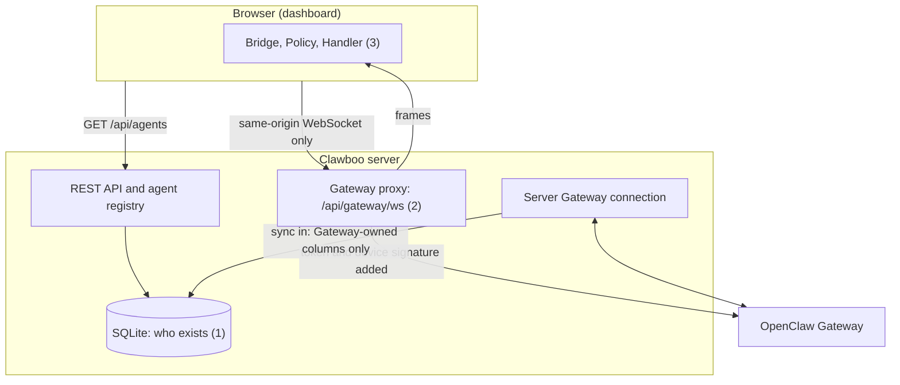

An architecture invariant is a structural rule the codebase holds no matter what changes around it. Break one and a whole class of bug becomes possible: the fleet list disappears during a Gateway outage, an edge on the Org chart stops meaning anything, or the browser ends up holding a credential it should never see.

This page lists the seven invariants and the code, test or lint rule that enforces each. Read it before a change that touches the agent registry, the Gateway connection, a package boundary, the Org chart, or the database schema.

## What counts as an invariant

An invariant is something you can point a grep, a test or one file at and say "this holds, and here is where it would break". It is not:

- **a setting.** Nothing turns an invariant off;
- **a style convention**, such as where files live or how components are named, which review enforces;
- **a behavioural guarantee** spread across many files, such as "team chat never floods with dozens of replies", which tests and the coordination code uphold.

## The model

Numbers refer to the invariants below.

## The seven invariants

### 1. SQLite records who exists; each upstream owns how its runtime runs

SQLite is the record of every agent: the `agents` and `teams` rows are canonical for who exists. The server registers five agent sources: one for the OpenClaw Gateway, one for Clawboo Native, and one SQLite-backed source each for Claude Code, Codex and Hermes. The OpenClaw source syncs the Gateway's list into SQLite over the server's own connection. The dashboard reads the fleet from `GET /api/agents`, which serves every source from SQLite and flags `stale: true` when the OpenClaw connection is down, so the fleet still renders with the Gateway offline.

The rule that makes this safe is a column-scoped sync. When the Gateway's list is upserted (`upsertFromList` in `apps/web/server/lib/agentSource/openClawAgentSource.ts`), the conflict-update clause writes only Gateway-owned columns: `name`, `gatewayId`, `sourceAgentId`, `identityJson`, `archivedAt` and `updatedAt`. It never writes `teamId`, `personalityConfig`, `execConfig`, `avatarSeed`, `participantKind`, `runtime`, `capabilities` or `tenantId`, so a re-sync can never undo a team assignment or a personality setting.

The Gateway stays canonical for what the registry does not own: live sessions and the execution stream, exec approvals, cron jobs and runtime config. Clawboo drives those over two connections. The browser's proxied connection carries 1:1 chat with an OpenClaw agent (`client.call('chat.send', ...)` in `apps/web/src/features/chat/chatSendOperation.ts`); the server's own connection runs OpenClaw team-chat turns and Routine fires, and the Gateway cron list. See [AgentSource](/internals/agent-source).

### 2. The browser reaches the Gateway only through the same-origin proxy

The browser never talks to the Gateway directly. Its only path is the proxy route on its own origin: `resolveProxyGatewayUrl` (`packages/gateway-client/src/helpers.ts`) builds `ws(s)://<window host><base path>/api/gateway/ws` from `window.location` and the app's base path, so there is nothing to point at a remote host.

- Every browser caller connects with `disableDeviceAuth: true`. The proxy injects the upstream token server-side, so the server never sends the saved credential to the browser, only a `hasToken` flag from `GET /api/settings`. The browser sends a token only when the operator types a new one on the connect screen. The proxy also signs the connect frame with a persistent Ed25519 device identity, so no browser context needs its own device key.
- The server's upgrade handler (`apps/web/server/index.ts`) accepts exactly `/api/gateway/ws` or `<base path>/api/gateway/ws`. It runs the always-on Origin and Host guard first and answers a refused handshake with `403 Forbidden`, then hands the socket to the proxy. Every other upgrade path is destroyed.
- The proxy's own `allowWs` check repeats the path, the Origin guard and the optional access-token gate, so a request that slips past the router is still refused.

The only other connection to the Gateway is the server's own (`OpenClawAgentSource`), signed with the same proxy device identity. See [Gateway connection internals](/internals/gateway-and-events).

### 3. Every Gateway frame the browser receives goes Bridge, then Policy, then Handler

In the browser, every Gateway event frame passes through one three-stage pipeline with no shortcuts. `processEvent` in `@clawboo/events` makes the contract explicit: classify the frame (`classifyEvent`), derive intents (`derivePolicy`), apply them (`handler.applyIntents`). The `useGatewayEvents` hook is its only caller and holds one `client.onEvent` subscription, so a frame takes exactly one path.

The middle stage is the load-bearing one: Policy is pure. `derivePolicy` turns a classified event into an `EventIntent[]` and dispatches nothing, which is why it is unit-tested without a Gateway, a store or a clock. Only the Handler holds state.

The rule covers frames the browser receives. The server's consumers of the same Gateway (the registry resync, the session activity watcher, the exec-approval surface, and the OpenClaw runtime adapter) use their own code and map frames to `RuntimeEvent`s where they need to. A new cross-cutting browser concern belongs on an intent, never on a second raw-frame subscriber. See [The event pipeline](/internals/event-pipeline).

### 4. Packages never import apps

Dependencies flow one way: `apps/` depends on `packages/`, never the reverse. That is what keeps every `@clawboo/*` package independently buildable, browser-safe where it claims to be, and free of app coupling. A repo-wide search for a package `src/` file importing from `apps/` (or `@clawboo/web`) finds no import statements, only comments that name a caller.

ESLint enforces it (`eslint.config.mjs`): `no-restricted-imports` with the `PACKAGES_TO_APPS` patterns on `packages/**`. The same file draws the boundary inside `apps/web`: the Express server may not import the browser code and the browser code may not import the server, with extra selectors that catch dynamic `import()` calls. `apps/web/server/lib/__tests__/importBoundary.test.ts` pins that `apps/web`'s lint script covers `server/` as well as `src/`, so the server rule cannot be silently dropped. Anything two layers share belongs in a package.

### 5. Every graph edge maps to real state

The Org chart and the team graphs draw edges only from real configuration or board state (`apps/web/src/features/graph/useGraphData.ts`). There are four edge kinds:

- **Dependency edges** (agent to agent) come from each agent's `AGENTS.md` routing rules: `parseAgentsMd` resolves `@mentions` and routing phrases such as "route to @Name" against the fleet's names and yields one edge per target, an instruction the agent will act on.
- **Skill and resource edges** (agent to capability) come from real `CapabilityRecord`s in the capability inventory, and the server-evaluated `available` flag decides whether a node renders greyed out.
- **Grant edges** connect an agent to a grant-backed connector capability. The edge is the authorization, so it carries the grant's id, state and mode.

To make the tree readable the graph also adds structure, never decoration. Boo Zero links to each team, and on the Org chart invisible `team-root` junctions group a team's members. These edges encode the real team-membership hierarchy and are tagged `isSynthetic: true`, so a consumer that reads `AGENTS.md` routing can tell them apart.

Three node kinds come from the graph layer rather than from capability records: Boo Zero's Leadership orbital (skill id `clawboo-leadership`), a Model orbital on every agent (skill id `clawboo-model`, showing the runtime's default label when the model is unknown), and a "+N more" overflow tile (skill id `more`) that stands in for capabilities that did not fit the ring. The `clawboo-` ids are reserved so they cannot collide with a real capability.

### 6. Every Boo is a real agent record

Each Boo on a graph is backed by a real `AgentRecord`: the graph builds one node per agent in the registry, with no placeholder or mock agents. Boo Zero is a real record too (teamless in the database); the graph places it at the root of the tree, draws it slightly larger and gives it the Leadership orbital, but it is an agent, not an invented node.

The corollary lives on the server. Anything that reconciles local rows against a Gateway list is scoped to `sourceId = 'openclaw'`, because the list came from the Gateway and only Gateway-owned rows can be missing from it. The sync's archive step and the `POST /api/agents/cleanup-ghosts` route both apply that scope, and the dashboard keeps SQLite current by pushing the Gateway list it reads to `POST /api/agents/sync`. A native or coding-runtime agent can never be mistaken for a ghost of an OpenClaw list.

### 7. The schema is idempotent and additive

There is no migration ladder. The `CREATE TABLE IF NOT EXISTS` block in `ensureSchema` (`packages/db/src/schemaBootstrap.ts`) is the only schema source and declares every table, index and trigger on a fresh database. Three things keep it honest:

- **No migration runner ships.** The `@clawboo/db` package's `files` excludes `drizzle`, and there is no `db:migrate` or `db:generate` script (only `db:studio`). `schemaSource.test.ts` pins this posture.
- **The type layer and the DDL agree.** `schemaSource.test.ts` builds a real database through `createDb()` and asserts that every table and column in the Drizzle `schema.ts` type layer matches the live DDL, and the other way round.
- **An existing database is reconciled up to the DDL.** `IF NOT EXISTS` skips the whole `CREATE TABLE` when the table exists, so a new column would never reach an older database on its own. `reconcileSchema` derives the declared columns from the same DDL and adds what is missing, before the DDL batch runs (an index over a new column cannot exist until the column does). See [Database schema](/reference/database-schema#upgrading-an-existing-database).

A database opens with one idempotent DDL block, once per process for the server, which then holds one connection for its lifetime.

<Danger>

The in-place upgrade is additive only. A new column on an existing table must be addable: it may not be `PRIMARY KEY`, `UNIQUE` or a `STORED` generated column; its `DEFAULT` must be a constant, not an expression or `CURRENT_TIMESTAMP`; a `NOT NULL` column needs a non-null `DEFAULT`; and a `REFERENCES` column may not have a non-null `DEFAULT`. A declaration that breaks a rule fails the test suite. If one ever reaches a user, the bootstrap throws a message naming the column and the remedy, and the boot probe reports a fatal `databaseSchema` check. Changing an existing column's type or constraints is not an in-place upgrade; a removed column stays, unused, in existing files.

</Danger>

## Design rationale

The invariants make whole categories of failure impossible rather than merely caught.

- **SQLite as the agent record (1)** keeps the dashboard working when the Gateway is down, because who exists lives locally and only how an agent runs needs the upstream. The cost is a second persistence layer and the sync discipline that keeps the two from fighting.
- **The same-origin proxy (2)** makes the browser structurally unable to read the saved Gateway token or the device key. The cost is an extra hop and a proxy that must inject auth correctly on every connect.
- **The pure Policy stage (3)** makes decision logic testable with no Gateway, store or clock, at the cost of three stages where a naive version would dispatch inline.
- **One-way dependencies (4)** keep packages buildable and browser-safe, at the cost of keeping app glue in `apps/`.
- **Real edges and real records (5, 6)** give a graph you can trust: what you see is what the system will do. The cost is the synthetic-edge tagging and the source-scoped reconciliation.
- **The idempotent schema (7)** makes a fresh install need no migration step and makes the upgrade path free to maintain, because it is derived from the DDL. The cost is that a column can be added to an existing database but not changed in place.

## Boundaries

- **Structural, not behavioural.** The invariants fix the shape of the system: who is canonical, who talks to whom, which way dependencies point. They do not prove a feature behaves correctly; tests do that.
- **Invariants 2 and 3 are about the OpenClaw Gateway.** The other runtimes never use the proxy or the browser pipeline; they emit `RuntimeEvent`s on the server through their adapters (see [the RuntimeAdapter trait](/internals/runtime-adapter)).
- **Additive schema only.** A change that must rewrite a column in place is not supported by the upgrade path and needs a deliberate design.

## Related

- [AgentSource](/internals/agent-source): the sources and the sync rule behind invariant 1
- [Gateway connection internals](/internals/gateway-and-events): the proxy, the guards and the server connection behind invariant 2
- [The event pipeline](/internals/event-pipeline): Bridge, Policy and Handler (invariant 3)
- [Monorepo and build](/internals/monorepo-and-build): the package layout invariant 4 protects
- [Database schema](/reference/database-schema): the tables the DDL declares (invariant 7)
- [Contributing](/appendices/contributing): how to propose a change
