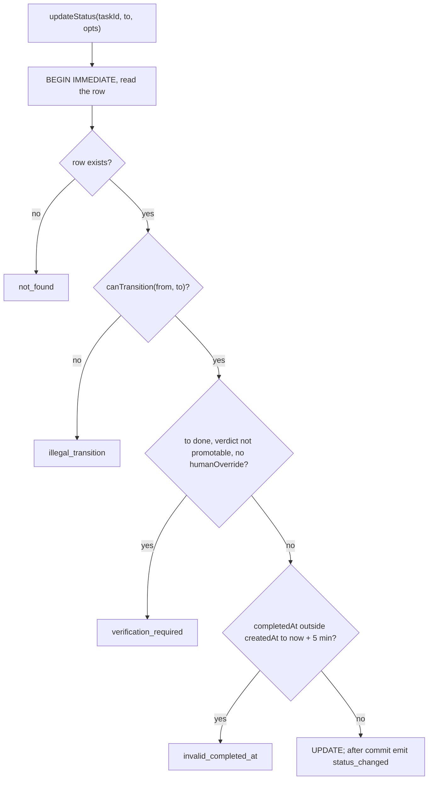

[The board](/concepts/the-board) is where Clawboo keeps task state. This page is for people working on its data-access layer: the module that owns every board write, the conditional `UPDATE` that makes single-assignee work race-free, the state machine enforced inside a write transaction, the SQLite recipe that keeps many concurrent writers safe, the recursive queries over dependencies and parents, and the passes that recover stuck work.

## The modules

Everything lives in `packages/db/src/board/`:

| Module                                          | Holds                                                                                                                            |
| ----------------------------------------------- | -------------------------------------------------------------------------------------------------------------------------------- |
| `repository.ts`                                 | Every board read and write: create, claim, status changes, dependencies, comments, workspaces, execution rows, reconciliation.   |
| `contention.ts`                                 | `withWriteRetry` and `immediateWrite`, the write recipe.                                                                         |
| `schemas.ts`                                    | Zod shapes for REST bodies and for the ancestor walk's raw rows.                                                                 |
| `verification.ts`                               | `setTaskVerification`, which persists a verdict for the `done` gate.                                                             |
| `events.ts`                                     | The in-process lifecycle bus every write publishes to after it commits.                                                          |
| `rooms.ts`                                      | Chat rooms: the `rooms` and `room_members` tables.                                                                               |
| `attempts.ts`                                   | `classifyAttempts`, which reads a task's execution ledger as crash, error, success or cancelled attempts.                        |
| `attention.ts`, `runCost.ts`, `runningSince.ts` | Read helpers the board REST routes attach to each task: why it needs a person, what its runs cost, when its current run started. |

The pure rules sit one package over in [`@clawboo/board-core`](/reference/packages/board-core): `state-machine.ts` (the transition table), `dispatch.ts` (the fire policy), `attention.ts` (why a task needs a person) and `runCost.ts`. `@clawboo/db` re-exports the transition helpers, `TASK_STATUSES` and `summarizeRunCost` unchanged, and wraps the fire policy and the attention rule in its own repository and read helpers. `board-core` imports nothing outside its own files, which is what lets the dashboard bundle the same rules the server enforces. The repository takes the transition table and fire policy from `board-core`, and the creation caps plus the shared verdict rule `isVerdictPromotable` from `@clawboo/governance`. The connection pragmas are set in `packages/db/src/db.ts`.

The layer is the only code that touches the board tables: `tasks`, `task_deps`, `task_comments`, `workspaces` and `execution_processes`, plus the chat-room tables in `rooms.ts`. `apps/web` never reaches them with raw Drizzle; it calls a repository function. Reads that could be tenant-scoped take an optional `scope` with a `tenantId`, but nothing passes one: every row has `tenant_id` null.

## The state machine

`@clawboo/board-core`'s `state-machine.ts` holds a `TaskStatus` union of seven values and one transition table:

```ts
const LEGAL: Record<TaskStatus, readonly TaskStatus[]> = {
  backlog: ['todo', 'blocked', 'cancelled'],
  todo: ['in_progress', 'blocked', 'backlog', 'cancelled'],
  in_progress: ['in_review', 'done', 'blocked', 'todo', 'cancelled'],
  in_review: ['done', 'in_progress', 'blocked', 'cancelled'],
  blocked: ['todo', 'in_progress', 'backlog', 'cancelled'],
  done: [],
  cancelled: [],
}
```

`canTransition(from, to)` is `true` when `from === to` (re-emitting a transition is harmless) and otherwise checks `LEGAL[from]`. `legalTargets(from)` returns that row as a fresh array, which is how the dashboard's status editor offers only legal moves. `isTerminal(status)` is true for `done` and `cancelled` (a test pins it to an empty `legalTargets`), and `isLocked(status)` is true for `in_progress` and `in_review`, where a task is owned and its assignee must not change. One table serves three consumers: the repository enforces it, `@clawboo/team-orchestration` types its board client with `TaskStatus`, and the board UI derives its columns and editor from `TASK_STATUSES` and `legalTargets`.

`updateStatus` in the repository enforces the table inside the write:



The row is read inside the `BEGIN IMMEDIATE` transaction, so two concurrent callers cannot both pass a stale check; a REST-layer pre-check is only fast-fail ergonomics. `PATCH /api/board/:taskId` maps `not_found` to `404`, `invalid_completed_at` to `400` and the rest to `409`.

Three side effects ride the same write:

- **The first move to `done` or `cancelled` stamps `completedAt`, once.** Writing the same terminal status again (a run's late result after a person marked the task done) leaves it alone. `opts.completedAt` back-dates the stamp for a person marking work done on the day it was really done; it must fall between the task's `createdAt` and now plus five minutes of clock skew (a time inside the skew is recorded as now), or the move is refused with `invalid_completed_at`.
- **Any move to `todo` releases the task.** It clears `assigneeAgentId`, `assigneeRuntime` and the stored `verification` verdict, from any source status. Clearing the assignee lets the [claim](#the-atomic-claim) re-acquire the task (its guard requires a null assignee); clearing the verdict means a previous runtime's failing verdict cannot block a fresh runtime's completion. `releaseTask` does the same three-field clear directly, for a task still `in_progress`, and publishes `task_released`.
- **A person's move is stamped.** With `opts.actor: 'person'` the write sets `personMovedAt` to now. An agent's own write through the Tasks MCP tools (`update_task_status`, `block_task`, `unblock_task`) passes `opts.unlessPersonMoved`, and is refused with `person_moved` when `personMovedAt` is later than the task's latest run start (the latest, across its executions, of each one's `startedAt`, else `claimedAt`, else `createdAt`), or when the task has no execution yet. The run the person overruled cannot put the card back; a run started after the move writes as usual.

The two recovery passes write outside the table on purpose: they release stuck `in_progress` and `in_review` work straight to `todo`, and `in_review` to `todo` is not a legal transition. See [Orphan and stale reconciliation](#orphan-and-stale-reconciliation).

After the transaction commits, `updateStatus` publishes `status_changed` on the lifecycle bus, so no subscriber can act on an uncommitted change. `opts.actor: 'person'` rides on the event when a person made the move; only the board's `PATCH` route sets it, and subscribers leave a person's move to that route, which stops the run working on the task and tells the delegator (see [`PATCH /api/board/:taskId`](/reference/rest-api/board)). A person's move back to `todo` also wakes the team's dispatch pump (the loop that starts the next ready task, described under [The fire policy](#the-fire-policy)).

### The `done` gate

The move to `done` is gated inside the board itself:

```ts
if (to === 'done' && !opts.humanOverride && !verdictCellPromotable(row.verification)) {
  return { ok: false, reason: 'verification_required' }
}
```

`verdictCellPromotable` is a light read of the stored JSON cell. The full zod parse happens on write (`setTaskVerification`); here an inline `JSON.parse` plus the shared `isVerdictPromotable` rule avoids importing `verification.ts`, which would create an import cycle with `getTask`.

| Stored cell                                        | Promotable | Why                                                                                      |
| -------------------------------------------------- | ---------- | ---------------------------------------------------------------------------------------- |
| `null` or absent                                   | yes        | An unverified task is not failing. The gate blocks only a verdict that exists and fails. |
| unparseable                                        | yes        | Cannot tell, so do not block.                                                            |
| `pass`                                             | yes        | Verified.                                                                                |
| `completed_with_debt` over a passing command check | yes        | Debt covers open critic findings, never a failing build or test command.                 |
| `completed_with_debt` over a failing command check | no         | A red command check routes to a person.                                                  |
| `fail`                                             | no         | Known to fail.                                                                           |

Only an explicit `opts.humanOverride: true` bypasses the gate. `PATCH /api/board/:taskId` accepts `humanOverride` and records the bypass in the governance audit log; the Tasks MCP `update_task_status` tool and the team engine cannot pass it. Two server paths set it too: an empty-diff worktree completion (`apps/web/server/lib/worktrees.ts`), which has nothing to verify, and the OpenClaw Routine dispatcher (`routines/openclawDispatch.ts`), which records the run as unverified first.

<Note>

`isVerdictPromotable(null)` in `@clawboo/governance` returns `false`, while `verdictCellPromotable(null)` returns `true`. They do not contradict each other: the repository calls the shared rule only when a cell exists, because a missing verdict means unverified, which the gate deliberately allows. Do not pass the null straight through.

</Note>

## The atomic claim

A task is worked by one assignee at a time. `claimTask` guarantees it with one conditional statement rather than a read followed by a write:

```sql
UPDATE tasks
   SET assignee_agent_id = ?, assignee_runtime = ?, status = 'in_progress', updated_at = ?
 WHERE id = ?
   AND status = 'todo'
   AND assignee_agent_id IS NULL
   AND dropped = 0
RETURNING *
```

Because the guard is part of the statement that writes, at most one concurrent caller wins. The winner gets the row back through `RETURNING` and a `task_claimed` lifecycle event fires; every loser gets zero rows.

A zero-row result is data, not an error. `claimTask` checks whether the row exists and returns `{ ok: false, reason: 'conflict' }` (someone else owns it) or `{ ok: false, reason: 'not_found' }`, which REST maps to `409` and `404`. The rule the whole system follows is never retry a `409`: a retry would either do nothing or fight for work that is already taken.

<Tip>

The never-retry rule is structural. The claim runs inside `withWriteRetry`, which retries only transient SQLite lock errors and returns a zero-row result unretried, so an application conflict and database lock contention travel through different mechanisms. See [the contention recipe](#the-contention-recipe).

</Tip>

Re-claiming an abandoned `in_progress` task is not the claim's job: its `WHERE` matches only `todo`. Liveness lives in one place; [reconciliation](#orphan-and-stale-reconciliation) releases such a task to `todo`, and an ordinary claim re-acquires it.

Reconciliation reaps only work that has a `running` execution. An `in_progress` task with no assignee and no running execution was dragged there by hand, which starts nothing, so no pass will move it. `isStrandedInProgress` recognizes it, the Needs you rule reports it as `unstarted`, and a person hands it back: `assignTaskDelegation` (re-bind to an agent and release to `todo` in one `BEGIN IMMEDIATE` transaction) and the retry route both accept it, as they accept a `todo`, `backlog` or `blocked` task.

## Rooms

Every task carries a `room_id`. Null means the team's General chat; a string names a room. That chat's engine runs the task, and a task whose room was archived falls back to General (`roomIdForTask` in `apps/web/server/lib/teamChat/roomRoster.ts`). Repository reads that take a room filter (`listTasks`, `getReadyTasks`) read `undefined` as every room, `null` as General only, and a string as that room only.

`rooms.ts` stores a team's extra conversations in `rooms` and `room_members`. General has no row. A room's live roster is its stored members intersected with the team's active agents, so an agent that is archived or moves to another team drops out of every room without a sweep. Names are whitespace-collapsed and capped at `ROOM_NAME_MAX` (80) characters; deleting a room archives it and keeps its conversation.

## Dependencies and the recursive queries

Tasks form a blocks and blocked-by graph in `task_deps`, with a composite primary key on `(task_id, depends_on_task_id)` that prevents duplicate edges. `linkDep` writes an edge inside `immediateWrite`: it refuses a self-link, then probes reachability with a recursive query and throws `TaskDependencyCycleError` when the new edge would close a direct or transitive cycle. Only then does it insert, with `onConflictDoNothing`, so re-linking an existing edge stays harmless. Probe and insert share one transaction, so two concurrent links cannot race a cycle into the graph.

```sql
WITH RECURSIVE dependencies(id) AS (
  SELECT depends_on_task_id FROM task_deps WHERE task_id = :dependsOnTaskId
  UNION
  SELECT td.depends_on_task_id FROM task_deps td
  JOIN dependencies dep ON td.task_id = dep.id
)
SELECT id FROM dependencies WHERE id = :taskId LIMIT 1
```

A cycle is refused at write time because nothing downstream can recover from one: every task in it would stay un-ready forever and nothing would report it. `TaskDependencyCycleError` carries `code: 'task_dependency_cycle'`; the `link_task` MCP tool returns it as a tool error, and the REST dependency route answers `409` with that code.

A task is **ready** when it is `todo`, not dropped, and every dependency is `done`. `getReadyTasks` expresses the last part with `NOT EXISTS (SELECT 1 FROM task_deps d JOIN tasks dt ON dt.id = d.depends_on_task_id WHERE d.task_id = tasks.id AND dt.status != 'done')` and orders by priority, then `updatedAt`, both descending. It accepts a team and a room filter.

Two recursive reads walk the graph:

- **`getDependents`** walks downstream: every task transitively blocked by a given one. It returns raw rows (the caller filters by status). `cancelDependents` uses it to cancel only the still-pending (`todo` or `backlog`) members when a blocker fails or a person cancels it, and returns them so the engine can report the stalled plan; tasks already running, done or cancelled are untouched.
- **`getAncestors`** walks the parent chain through `parent_task_id` and returns `{ id, parent_task_id, title, status }` per ancestor, parsed with `ancestorRowsSchema` (the codebase's rule is not to trust a type over raw query output). It uses `UNION`, not `UNION ALL`, so the walk terminates even on a corrupt parent cycle.

`getAncestors` counts depth at two call sites that read the same `DEFAULT_MAX_DEPTH` (2): the team engine refuses to delegate from a task already at the cap (`ancestors.length >= max`, since the child would be one past it), and the executor runner refuses to dispatch a task past it (`ancestors.length > max`). The split is what makes the deepest creatable task also runnable.

### Capped creation

The Tasks MCP create tools call the repository's bounded creates, which return a result rather than throwing (a throw would reach the model as a protocol error instead of a tool result):

- **`createCappedSubtask`** does the parent lookup, an indexed count of the parent's live children, a step-bounded parent-chain walk and the insert in one `BEGIN IMMEDIATE` transaction. It refuses with `parent_not_found`, `child_cap` (24 live children, `DEFAULT_MAX_CHILDREN`) or `depth_cap` (`DEFAULT_MAX_DEPTH`, 2). One transaction matters because the Tasks MCP runs as a stdio process per attached runtime on the shared file, so a count-then-insert gap would let two agents both add the 25th child. It walks the chain itself because `getAncestors` takes a connection rather than a transaction handle, and a hard step bound cannot spin on corrupt data while holding the write lock.
- **`createCappedRootTask`** guards parentless tasks with a rolling-window rate instead: 30 live roots per 5 minutes (`DEFAULT_MAX_ROOT_CREATES`, `DEFAULT_ROOT_CREATE_WINDOW_MS`), refused with `root_rate_cap`. Rows created through REST or Routines count too, so an agent cannot launder rows through another surface; dropping rows frees quota early.

The team engine, the REST board and the evals harness create their tasks, parented ones included, with the uncapped `createTask`. `createSubtask` is a thin uncapped wrapper over it that inherits the parent's team and room; only tests call it. Every count comes from board state, never from the model.

## The fire policy

The dispatch pump starts ready tasks and re-fires released work, and `ledgerAllowsAutoFire` in `@clawboo/board-core` (`dispatch.ts`) decides whether a ready task may fire, from its execution ledger:

| Last runs in the ledger                                       | Fires? | Why                                                  |
| ------------------------------------------------------------- | ------ | ---------------------------------------------------- |
| none                                                          | yes    | Never delivered (fresh, deferred or newly assigned). |
| last run `running`                                            | no     | Something owns it.                                   |
| last run `cancelled`                                          | no     | A person stopped it; only a person re-queues it.     |
| `MAX_AUTO_FIRES` (3) unsuccessful runs in a row at the end    | no     | Parked in Needs you instead of being fed forever.    |
| otherwise (`failed`, `timed_out`, an orphan reaped as failed) | yes    | Infrastructure death, not intent.                    |

A success or a `cancelled` run resets the streak (`trailingFailedRuns`). The ledger is the counter, so the cap survives a restart. The repository re-exports the rule as `isLedgerAutoFireable`, and `listRoomsWithFireableDelegations` (with `listTeamsWithFireableDelegations` on top) tells the server's dispatch pump which (team, room) engines have a ready task bound to an agent whose ledger allows a fire. A task's bound agent is the `:agent:<id>` segment of its `sourceDelegationId` (`delegationTargetOf`), written by every engine delegation and by a person assigning a task on the board.

`attempts.ts` reads the same ledger differently: `classifyAttempts` separates a process that keeps dying (an orphan reap or a stale sweep) from a run that keeps failing, and the executor runner turns the result into the interrupted-work note it adds to the next attempt's prompt.

## Worktree pointers and execution rows

The board owns pointers into the worktree subsystem, not the worktree. `setTaskWorkspaceRefs` records `worktreeRef` and `branchRef` on the task, and a `workspaces` row tracks the checkout from `active` to `archived` (cleanup) or `stale` (garbage collection). `POST /api/board/:taskId/workspace` refuses to provision a worktree for a `research` or `review` task with `422 no_isolation`. See [Worktrees and handoff](/concepts/worktrees-and-handoff).

Each run is an `execution_processes` row, a per-run ledger for any executor. `createExecutionProcess` opens it as `running` (optionally with the git commit before the run); `completeExecutionProcess` closes it with an outcome (`succeeded`, `failed`, `timed_out` or `cancelled`), optional token and cost figures, and the git commit after the run. The close is guarded on `status = 'running'`, so the first terminal wins and a losing writer gets `null` back and must not emit a second `execution_completed`. That guard matters because the ledger feeds the fire policy, where `cancelled` means a person's Stop: a late abort overwriting a swept `timed_out` row would turn an infrastructure death into a Stop and park re-fireable work for good. By convention a row is opened only after a successful claim, because crash recovery reads this ledger on restart.

Each row also records its run's cost: `costUsd`, its tokens, and a `costSource` of `reported` (the runtime priced the run), `local` (a model the user's own Ollama served, at $0), `token-estimate` or `char-estimate` (Clawboo estimated it).

- The team engine's drain writes them at the end of a run through `recordExecutionUsage`, which matches the row whatever its status, because a Stop or the idle watchdog can close the row before the run's own terminal arrives. It touches only the cost, token and `runtime` columns, never the status, completion time, summary or error, so first-terminal-wins still holds.
- `tasks.cost_usd` is the sum of the task's rows, recomputed from the ledger after each cost write (in the same transaction for `recordExecutionUsage`) rather than added to, so rewriting a run's cost never counts it twice.
- The board reads each task's total, whether any of it is estimated, and whether all of it ran locally, with `runCostForTasks` (one ledger read per board) and the pure `summarizeRunCost`. `runningSinceForTasks` reads when each task's newest running execution started, which is how an In progress card shows how long its run has gone.

## The contention recipe

Many agents may write one SQLite file, and processes outside the server (the MCP stdio servers a runtime spawns) open the same file the server uses. Without care, concurrent writers pile up behind SQLite's single-writer lock. The answer is five connection pragmas plus two application-level pieces.

Every connection sets these pragmas when it opens (`openDb` in `packages/db/src/db.ts`). The server opens exactly one connection at boot; each MCP stdio server opens its own:

| Pragma               | Value        | Why                                                                                             |
| -------------------- | ------------ | ----------------------------------------------------------------------------------------------- |
| `journal_mode`       | `WAL`        | Readers and one writer proceed concurrently.                                                    |
| `foreign_keys`       | `ON`         | Referential integrity is enforced.                                                              |
| `synchronous`        | `NORMAL`     | The usual WAL balance of durability and speed.                                                  |
| `busy_timeout`       | `250` (ms)   | Wait a quarter-second for the write lock, then hand over to the jittered retry below.           |
| `wal_autocheckpoint` | `50` (pages) | SQLite's own passive checkpoint keeps the WAL small without an application-level write counter. |

`contention.ts` adds:

- **`withWriteRetry(fn)`** runs a synchronous write and retries only transient lock errors (`SQLITE_BUSY`, `SQLITE_BUSY_SNAPSHOT`, `SQLITE_LOCKED`, as `isBusyError` recognizes them) with a jittered backoff of 20 to 150 ms, until a wall-clock budget runs out: 1,500 ms by default (`CLAWBOO_DB_WRITE_BUDGET_MS`), with a 24-attempt backstop. The budget is a deadline rather than a count because the retry sleep blocks the calling thread, which in the server is the event loop; worst case is the budget plus one `busy_timeout`, about 1.75 s. On exhaustion it throws `WriteBudgetExhaustedError`, which keeps `code = 'SQLITE_BUSY'` so existing callers still recognize it. A zero-row result is returned unretried, which is what lets callers honour never-retry-a-409; any other error propagates at once.
- **`immediateWrite(db, cb)`** runs `cb` in `db.transaction(cb, { behavior: 'immediate' })`. `BEGIN IMMEDIATE` takes the write lock up front instead of upgrading mid-transaction, which avoids lock-upgrade deadlocks. It is itself wrapped in `withWriteRetry`, so the whole transaction re-runs on a transient lock error. `updateStatus`, `assignTaskDelegation`, `linkDep`, the capped creates and both reconciliation passes run through it.

<Warning>

The budget applies per outermost write, not per request: a handler doing three writes can block for three times the worst case. It also relies on the rule that an `immediateWrite` body uses its `tx` handle directly and never calls a `withWriteRetry`-wrapped function. Nest them and the budgets multiply.

</Warning>

The retry sleep is synchronous and does not spin: it uses `Atomics.wait` on a throwaway `SharedArrayBuffer`. `better-sqlite3` is fully synchronous, so making every repository method `async` just to await a backoff would cost more than it gives. The recipe is exercised by `packages/db/src/board/__tests__/board.contention.test.ts`, which runs 20 worker threads against one database file when `CLAWBOO_CONCURRENCY_TEST=1` (CI's `test` job sets it).

## Orphan and stale reconciliation

Two recovery passes keep stuck work from piling up: one for crashes, one for abandonment. Each runs in a single `immediateWrite` transaction, publishes its `task_released` events only after commit, and never blocks boot. Both release work straight to `todo`, bypassing the transition table.

**`reconcileOrphans` runs once at startup and is liveness-aware.** It reaps a `running`, un-tombstoned execution row only when its task row is missing or the task's `updatedAt` is older than `opts.staleAfterMs` (the package default is `6 * TASK_HEARTBEAT_MS`; the server passes the same `CLAWBOO_BOARD_STALE_TTL_MS` the sweep uses). A row whose task still beats belongs to a live process, such as a second Clawboo on the same state directory or the previous server's drains during a fast restart, and must survive boot. Each reaped execution is marked `failed` with `orphaned: process not alive on restart` and `recovery_tombstone = 1`, so a second pass is a no-op, and its task is released to `todo` if it is `in_progress` or `in_review`, clearing the assignee, the assignee runtime and the verdict. A run that died but is not yet stale at boot keeps missing beats, and the interval sweep releases it once the TTL passes.

**`reconcileStaleInProgress` runs at boot and then on an interval.** It releases an `in_progress` task whose owner has stopped proving it is alive, whether that owner died with a previous server or wedged inside the current one. A task that is `in_progress`, not dropped, last updated before the TTL cutoff, and has a `running` execution is timed out (the execution becomes `timed_out` with `stale: no heartbeat within the watchdog window`) and released to `todo`. A task with no running execution has nothing beating it and is skipped. The `task_released` event detaches the task from any team engine still mapping it to a session and wakes that team's dispatch pump. The server wires it as one immediate sweep plus a `setInterval(...).unref()` loop.

<Info>

`tasks.updatedAt` is a liveness signal. Every drain that claims a task also beats it: `startTaskHeartbeat` bumps `updatedAt` every `TASK_HEARTBEAT_MS` on a timer, not on events, so a run that is working silently keeps beating. The beat is what makes a short TTL safe, so a drain that claims a task without beating it will have its live work swept. There are three: the executor runner, the team engine's `serverDeliver`, and the OpenClaw routine dispatcher. Any new one must beat too.

</Info>

The timers that interact with these passes:

| Timer                        | Default | Override                        | What it bounds                                                            |
| ---------------------------- | ------- | ------------------------------- | ------------------------------------------------------------------------- |
| `TASK_HEARTBEAT_MS`          | 30 s    | none                            | How often a drain beats its task.                                         |
| Stale TTL                    | 3 min   | `CLAWBOO_BOARD_STALE_TTL_MS`    | Missed beats before the sweep (and the boot reap) treats a run as dead.   |
| Stale sweep interval         | 60 s    | `CLAWBOO_BOARD_STALE_SWEEP_MS`  | How often `reconcileStaleInProgress` runs.                                |
| Engine watchdog sweep        | 30 s    | none                            | How often each chat's engine checks its delegations.                      |
| `DELEGATION_IDLE_TIMEOUT_MS` | 8 min   | none                            | A delegate silent this long is failed by its engine.                      |
| `OPEN_TOOL_CALL_TIMEOUT_MS`  | 24 min  | none                            | The allowance while a delegate is inside an unresolved tool call.         |
| `PENDING_START_TIMEOUT_MS`   | 24 min  | none                            | The allowance for a delegation still waiting to start behind another run. |
| `HOME_MUTEX_ACQUIRE_MS`      | 10 min  | `CLAWBOO_HOME_MUTEX_ACQUIRE_MS` | The wait for a persistent-home agent's run lock before the start fails.   |

The engine's idle watchdog is the first responder for a delegate that goes quiet, and it runs on the server whether or not a browser is open. Its idle window restarts when the run starts, so time spent waiting for a lock never counts against the 8 minutes. The stale TTL plus the sweep interval must stay under that 8-minute window: the sweep's `task_released` is what detaches a stale session before the watchdog reaches it.

## Board changes in the peer room

After a board REST route writes a change, `reflectToRoom` (`apps/web/server/lib/teamChat/reflect.ts`) posts a `kind: 'system'` line authored by `clawboo` into the team's agent peer room (the `team_chat` table, read by the TeamChat MCP tools). That room is not the General chat a person sees. The post runs after the write, best-effort, and is never a way back into the board: the board is the authority and the room line is narration. See [Peer chat](/concepts/peer-chat).

## Schema: no migration ladder

The `CREATE TABLE IF NOT EXISTS` block in `ensureSchema` (`packages/db/src/schemaBootstrap.ts`) is the only schema source: it declares every table and column on a fresh database. Upgrading an existing file is `reconcileSchema`, which is derived from the same DDL and only adds: it `ALTER TABLE ... ADD COLUMN`s whatever an existing database is missing and leaves extra columns alone, so an older file keeps a removed column harmlessly. Changing a column's type or constraints is not an in-place upgrade. A new column must be addable to a table that already has rows; the rules are on [Database schema](/reference/database-schema#upgrading-an-existing-database). The package ships no `db:migrate` or `db:generate` script (only `db:studio`) and no `drizzle/` directory.

`schema.ts` is the Drizzle type layer over the same tables, used for typed queries and `$inferSelect` / `$inferInsert`, never to migrate. `schemaSource.test.ts` keeps the two in step: it builds a database through `createDb()`, reads each table's columns with `PRAGMA table_info`, and asserts they match the type layer both ways. It compares column names only (type, `NOT NULL`, `DEFAULT`, keys and indexes are not checked, because the Drizzle-to-PRAGMA mapping is lossy), excludes the FTS5 tables, and also pins that no migration runner ships. `schemaReconcile.test.ts` guards the upgrade path: it holds every column added after the snapshot in `schemaBaseline.ts` to the addability rule. Re-snapshot that file only to record a deliberate exception, never to make a failing test pass.

## Design rationale

The board is a hand-written repository rather than a generic ORM facade, for the same reason the claim is a conditional `UPDATE` rather than a read-modify-write: the properties that matter (one assignee, legal transitions, crash recovery) are easier to see and to test as explicit single-purpose functions. The pure state machine and the contention helpers are split out so each can be reasoned about alone: transition legality with no database, lock handling with no business logic.

SQLite with the WAL recipe is a deliberate choice: it runs in-process, needs no database server, and handles team-scale write contention. The cost is a second persistence layer beside each runtime's own session state, and a recovery story (the two passes and the stale TTL) that holds only as long as every claiming drain beats its task.

## Boundaries

- **Not the agent or session registry.** The board references agents, runtimes and sessions by id, with no foreign key, and owns no agent identity, agent files or live session state. Its foreign keys all point inside the board: `parent_task_id` at the parent task, each `task_deps`, `task_comments`, `workspaces` and `execution_processes` row at its task, and an execution row at its workspace. See [AgentSource](/internals/agent-source).
- **Not a general-purpose tracker.** The statuses, transitions and recovery passes are tuned for runtime-driven work.
- **Single tenant.** Every board table has a `tenant_id` column, always null; no read filters by it.

## Related

- [The board](/concepts/the-board): the user-level model this layer implements
- [The executor runner](/internals/executor-runner): the consumer that claims, runs, verifies and releases
- [Verification](/concepts/verification): the gate behind `verification_required`
- [Database schema](/reference/database-schema): every table and column
- [Board API](/reference/rest-api/board): the REST surface over these functions
