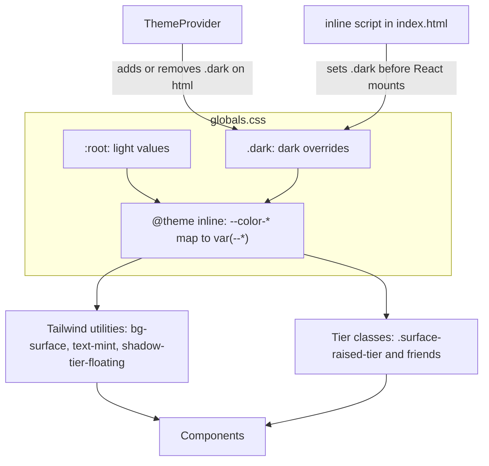

The dashboard's look lives in one CSS file and a small runtime. Every color, shadow, font, motion curve and type step is a CSS custom property in [`apps/web/src/app/globals.css`](https://github.com/clawboo/clawboo/blob/main/apps/web/src/app/globals.css), and switching the whole theme is one class on `<html>`. A set of shared components in `apps/web/src/features/shared/` packages those tokens for the patterns that repeat.

Use this page when you change UI: add a component, touch a color, or change how the theme switches. `globals.css` is the source of truth for every value below.

## Rules for UI code

- **Theme tokens, never raw hex.** Use the CSS variables and the Tailwind utilities built on them. Brand marks are the only exception.
- **Lucide icons only.** Never an emoji in the UI.
- **A shared component before a new one.** Check [the shared components](#shared-components) first.
- **Overlays dismiss through `useDismissableLayer`.** A capture-phase key listener fails lint.
- **Muted text uses `--muted-foreground`,** not a low-opacity `text-foreground/N`. A test holds it to the contrast floor.
- **A filled button uses the `-solid` token** (`bg-primary-solid`, `bg-destructive-solid`) under a white label. See [Contrast](#focus-and-contrast).

## Tooling

Tailwind 4 runs through `@tailwindcss/postcss` (`apps/web/postcss.config.mjs`), and `globals.css` starts with `@import 'tailwindcss'`. The shadcn/ui config is `apps/web/components.json`; shadcn components are set up per app, not shipped from `@clawboo/ui`.

## The model



The indirection is what makes the theme switch at runtime. A utility such as `bg-surface` resolves to `--color-surface`, which the `@theme inline` block maps to `var(--surface)`, which `:root` sets to `#ffffff` and `.dark` sets to `#111827`. Flip the class and every `bg-surface` element repaints, with no rebuild. Component code names a semantic token, never a color.

## Theme architecture

### `@theme inline` aliases

Near the top of `globals.css`, a Tailwind 4 `@theme inline` block holds pure aliases: `--color-surface: var(--surface)`, `--color-mint: var(--mint)`, and so on. Tailwind generates utilities from the `--color-*` names, and each one points at a second variable that each theme redefines. The `inline` keyword is what makes Tailwind read the value from the cascade at runtime instead of baking it in at build time.

Just above that block, `@custom-variant dark (&:where(.dark, .dark *))` makes `dark:` utilities follow the `.dark` class rather than a media query. The app decides the theme itself, including a System mode that resolves to light or dark.

### `:root` light, `.dark` overrides

Light is the default. `:root` declares every token with its light value and `color-scheme: light`; `.dark` redeclares the same names with dark values and `color-scheme: dark`. The light theme is paper white (`--background: #f8fafc`, `--surface: #ffffff`, slate-900 text). The dark theme uses `--background: #0a0e1a`, `--surface: #111827` and `#e8e8e8` text. Brand colors are deeper in light mode for contrast on white: OpenClaw Red is `#d82947` in light and `#e94762` in dark, mint `#059669` and `#34d399`, amber `#d97706` and `#fbbf24`.

A few tokens look the same in both themes:

- **Terminal surfaces:** `--terminal-bg: #0d1117` and `--terminal-fg: #e8e8e8`, declared with the same values in `:root` and `.dark`, so install and Gateway log windows always read as a terminal.
- **Motion tokens:** declared once in `:root` (see [Motion](#motion-and-reduced-motion)).

### The one-class flip

Two pieces apply the `.dark` class, and they must agree:

1. **`ThemeProvider`** (`apps/web/src/features/theme/ThemeProvider.tsx`) is a React context with the preference `theme: 'system' | 'light' | 'dark'` and the result `resolvedTheme: 'light' | 'dark'`. It reads `localStorage['clawboo.theme']` and defaults to `'light'` when nothing is stored, so onboarding happens in light mode. It follows `prefers-color-scheme` only while the preference is System, and adds or removes `.dark` on `document.documentElement` whenever `resolvedTheme` changes. `useTheme()` returns `{ theme, resolvedTheme, setTheme }` and throws outside the provider. The provider wraps the app in `apps/web/src/app/providers.tsx`.
2. **An inline script in `apps/web/index.html`** runs before React mounts, so the page never flashes the wrong theme. It repeats the provider's logic: read `clawboo.theme`, default to `'light'`, resolve System through `matchMedia`, set `.dark`.

The switch the user clicks is `ThemeToggle` (`apps/web/src/features/theme/ThemeToggle.tsx`): a segmented System, Light and Dark radio group with icons only (Monitor, Sun, Moon). Each segment calls `setTheme` directly, and the System segment's tooltip shows the mode it resolves to, such as "System (dark)".

<Info>
The inline script and `ThemeProvider`'s resolver are deliberate copies, because the script must run before any bundle loads. Keep the storage key, the light default and the System branch identical in both. A hard refresh that flashes the wrong theme means they have drifted.
</Info>

Components that draw their own themed surfaces read `resolvedTheme` and pick a matching theme object; the code editor, for example, exports `clawbooEditorThemeDark` and `clawbooEditorThemeLight`.

## Surface elevation

The visual hierarchy has four tiers. Tier 1 is the base `--surface`. Tiers 2 to 4 each bundle a background, border, shadow and (for the glass tiers) a backdrop blur into one class, so a card, popover or modal gets its elevation from one `className`.

| Tier        | Class                    | Used for                                     | Treatment                                                        |
| ----------- | ------------------------ | -------------------------------------------- | ---------------------------------------------------------------- |
| 1           | (`bg-surface`)           | The base panel surface                       | Opaque base                                                      |
| 2: Raised   | `.surface-raised-tier`   | Cards in normal flow (marketplace cards)     | Opaque lift + subtle shadow                                      |
| 3: Floating | `.surface-floating-tier` | Popovers, dropdowns, context menus, tooltips | Glass: translucent + `blur(16px) saturate(140%)`                 |
| 4: Overlay  | `.surface-overlay-tier`  | Modals, sheets, command palettes, wizards    | Glass: translucent + `blur(20px) saturate(140%)` + lifted shadow |

The raised tier uses `--surface-raised` (`#fdfdfe` light, `#141b2e` dark), `--border` and `--shadow-raised`. The floating and overlay tiers use translucent surfaces (`--surface-floating`, `--surface-overlay`), borders that read on glass (`--border-floating`, `--border-overlay`) and heavier shadows (`--shadow-floating`, `--shadow-overlay`). Shadows follow the theme: soft and slate-tinted in light mode, a deep black drop in dark mode.

A tier class brings only background, border, shadow and blur. Radius, padding, an accent border and positioning stay on the element. A glass tier sits over a scrim: `--overlay-scrim` (modal strength) or `--overlay-scrim-soft` (sheet strength). `--code-block-bg` is the matching token for code rows and command previews.

```tsx
// Modal: overlay tier, with a separate scrim element behind it
<motion.div className="surface-overlay-tier w-full max-w-md rounded-2xl p-6">…</motion.div>

// Card: raised tier as a base, accent border kept inline
<motion.div
  className="surface-raised-tier"
  style={{ border: `1px solid ${accent}25`, borderRadius: 12 }}
>…</motion.div>
```

The shadows also exist alone as utilities (`shadow-tier-raised`, `shadow-tier-floating`, `shadow-tier-overlay`), generated from the `--shadow-tier-*` aliases, for when you want the shadow without the rest of the tier.

## Motion and reduced motion

Motion tokens are the same in both themes and live in `:root`:

| Token                      | Value                                  | Use                                  |
| -------------------------- | -------------------------------------- | ------------------------------------ |
| `--motion-fast`            | `150ms cubic-bezier(0.4, 0, 0.2, 1)`   | Hover, focus, button press           |
| `--motion-base`            | `200ms cubic-bezier(0.4, 0, 0.2, 1)`   | State changes, tab switches          |
| `--motion-emphasized`      | `300ms cubic-bezier(0.32, 0.72, 0, 1)` | Modal or sheet enter                 |
| `--motion-easing-standard` | `cubic-bezier(0.4, 0, 0.2, 1)`         | Easing only, for custom `transition` |
| `--motion-easing-spring`   | `cubic-bezier(0.32, 0.72, 0, 1)`       | Spring-feel easing only              |

The first three are full duration-and-easing values for a `transition` (`transition: border-color var(--motion-fast)`); the last two are curves for when you pick your own duration. Framer Motion springs cover choreography that CSS transitions cannot express.

Reduced motion is handled in three places:

- A global `@media (prefers-reduced-motion: reduce)` rule cuts CSS animation and transition durations to `0.001ms`, freezes the skeleton shimmer to a static tint, and sets `scroll-behavior: auto`.
- One `<MotionConfig reducedMotion="user">` in `app/providers.tsx` makes Framer Motion follow the setting. Framer Motion does not do that on its own.
- The graph's two `requestAnimationFrame` loops (the idle float in `useFloatingMotion` and the relaxation pass in `graphPhysics`) are out of CSS's reach, so they read the setting through `lib/prefersReducedMotion.ts`. The float stays parked, and the relaxation runs to rest in one pass, so nodes land where the animation would have left them. Both follow live changes to the OS setting.

## Focus and contrast

A global `:focus-visible` rule draws a 2px ring (`outline: 2px solid var(--primary)`) on every keyboard-focused control. CodeMirror, which draws its own focus, and React Flow's pane and handles are excluded. `.react-flow__node` is not excluded, because nodes are real Tab stops; Boo nodes draw the ring on their inner `.group`, since the node wrapper is a large transparent box around a smaller shape.

`--muted-foreground` holds at least 4.5:1 against the five surface tokens the test checks (`--background`, `--surface`, `--card`, `--popover`, `--surface-raised`) in both themes. `apps/web/src/app/__tests__/tokenContrast.test.ts` parses `globals.css` and enforces the floors: every text token clears 4.5:1 on every surface it is painted on, every status color clears 3:1, and both button-label-on-fill pairs clear 4.5:1. Its `KNOWN_DEBT` list is empty; adding to it means shipping text below AA on purpose.

The brand red is two tokens, because one value cannot do both jobs in dark mode. As text, the red must be light enough to read on dark surfaces; under a white button label, it must be dark enough for the label to read.

| Token             | Role                         | Dark                          | Light               |
| ----------------- | ---------------------------- | ----------------------------- | ------------------- |
| `--primary`       | Text, accents, focus ring    | `#e94762` (4.52:1 as text)    | `#d82947`           |
| `--primary-solid` | The fill under a white label | `#c83b53` (4.99:1 with white) | aliases `--primary` |

`--destructive` and `--destructive-solid` follow the same pattern. Light mode has no conflict, so the `-solid` tokens alias their base there. Use `bg-primary-solid` or `bg-destructive-solid` when a filled button carries `text-primary-foreground` or `text-destructive-foreground`, and plain `bg-primary` for tints, rings and borders. The contrast test checks the label pairs against the `-solid` fills, and `apps/web/src/app/__tests__/solidFillPairing.test.ts` fails any `.tsx` file that puts a label token on a plain `bg-primary`, `bg-destructive` or `var(--primary)` fill.

## Type scale

Two typefaces cover three tokens. `--font-display` and `--font-body` are both **Inter** (loaded from Google Fonts), told apart by weight and letter spacing. `--font-mono` is Geist Mono, a local `@font-face` from a woff2 file, for code and data. The `@theme inline` block exposes them as the `font-display`, `font-body` and `font-mono` families.

The custom steps fill the gaps in Tailwind's default scale (`text-xs` 12, `text-sm` 14, `text-base` 16, `text-lg` 18, `text-2xl` 24):

| Token            | Size / line height | Utility        | For                             |
| ---------------- | ------------------ | -------------- | ------------------------------- |
| `--text-micro`   | 11 / 14            | `text-micro`   | Micro labels, count pills       |
| `--text-compact` | 13 / 18            | `text-compact` | Compact agent and row names     |
| `--text-section` | 22 / 28            | `text-section` | Section headers                 |
| `--text-page`    | 28 / 34            | `text-page`    | Page titles                     |
| `--text-hero`    | 40 / 46            | `text-hero`    | The welcome hero, big headlines |

Titles of 18px and up use `--font-display` (Inter, bold) with negative letter spacing; body text and small headings use `--font-body`; code, tool-call lines, timestamps and metric columns use Geist Mono. The `.font-data` class bundles mono with `tabular-nums`, so numeric columns (cost, tokens, ports, durations) line up and do not jitter as values change.

## Brand palette and team colors

### Brand colors

The brand is three accents (OpenClaw Red as primary, mint and amber) plus a category palette. Each accent has a per-theme value and an `rgb` triplet companion (`--primary-rgb`, `--mint-rgb`, `--amber-rgb`, `--foreground-rgb`), so code can build a translucent overlay as `rgb(var(--mint-rgb) / 0.2)` instead of a fixed alpha hex.

| Token       | Light     | Dark      | Role                           |
| ----------- | --------- | --------- | ------------------------------ |
| `--primary` | `#d82947` | `#e94762` | OpenClaw Red: accent, emphasis |
| `--mint`    | `#059669` | `#34d399` | Success, working, done         |
| `--amber`   | `#d97706` | `#fbbf24` | Warning, pending               |

The **category palette** (`--category-data`, `--category-comm`, `--category-code`, `--category-file`, `--category-web`, `--category-other`) gives each classification a stable color for skill, cron and source badges. `comm` aliases mint and `file` aliases amber; `data`, `code` and `web` are their own hues, one step deeper in light mode, and `other` is a neutral gray in both. Mix opacity with `color-mix(in srgb, var(--category-X) N%, transparent)`.

<Note>
`@clawboo/ui` also exports a `tokens` constant of literal hex values and font names. It does not track `globals.css` (its accent is `#E94560` and its fonts are not Inter), and it does not switch with the theme. Never use it for themed UI.
</Note>

### Team color collections

A team picks a color collection, not individual colors, and each of its Boos gets a distinct color generated from it. The recipes are in `apps/web/src/lib/teamPalettes.ts`, and the team's choice is the `color_collection_id` column on `teams`. There are eight collections: `vivid-pop`, `dusty-pastel-pro`, `coastal-mist`, `executive-jewel`, `sharp-saas`, `soft-neutral-editorial`, `monochrome-accent` and `classic`.

`generateTeamColors(collectionId, count, theme, hueRotation)` builds a generative palette. It divides the OKLCH hue wheel into `count` even steps from the recipe's `hueOffset`, alternates lightness (so a team still reads as distinct in grayscale or with color-vision deficiency), picks the lightness band by theme, nudges any adjacent pair that ends up too close, and maps each result into sRGB with culori's `clampChroma` (lower chroma, keep hue and lightness). A per-team `hueRotation` from `hueRotationFromSeed` (an FNV-1a hash of the team id, 0 to 359 degrees) shifts which hues appear, so two teams on the same collection and size do not look identical.

`classic` is the default. It holds a fixed list (the Boo tints without Boo Zero's red) and ignores the OKLCH fields, and `pickBooColor` in `apps/web/src/lib/resolveTeamBooColor.ts` gives each agent `resolveBooTint(agentId)`, a stable per-agent hash. The tint list itself is `TINTS` in `@clawboo/boo-avatar` (re-exported by `@clawboo/ui`): index 0 (`#ff4d4d`, OpenClaw Red) is reserved for Boo Zero, and every other agent hashes into `TINTS[1..9]`. The create-team dialog mints the team id on the client, so the palette it previews (seeded by that id) is the one the deployed team gets. Choosing a collection in the dashboard is covered in [Teams](/using/teams).

## Shared components

The app-wide building blocks live in `apps/web/src/features/shared/`. Each one bundles the right tokens, so it stays correct in both themes, accessible and safe under reduced motion. Reach for one before you write a new pattern.

| Component                           | What it gives you                                                                                                                                            |
| ----------------------------------- | ------------------------------------------------------------------------------------------------------------------------------------------------------------ |
| `Button`, `IconButton`              | Every button treatment: variants `primary`, `solid`, `secondary`, `outline`, `ghost`, `danger`; sizes `sm`, `md`, `lg`.                                      |
| `Chip`                              | A rounded filter pill with an optional icon and active state. It is a button only when given an `onClick`; otherwise it renders as a label.                  |
| `Switch`                            | A toggle switch (`role="switch"`, keyboard support, `aria-checked`), brand red when on.                                                                      |
| `Tabs`                              | An underline tab bar: the active tab gets a foreground label and a red underline.                                                                            |
| `SegmentedControl`                  | A pill track with the active segment as a raised chip, for small mutually exclusive choices.                                                                 |
| `SearchInput`                       | A search field with a leading icon, an optional clear button and the red focus ring; `quiet` drops the border for tight rows.                                |
| `PanelHeader`                       | The shared panel header: optional icon, title, subtitle and a right-aligned actions slot.                                                                    |
| `Modal`                             | The app's one modal: scrim, `role="dialog"` with `aria-modal`, focus trap and return, Escape, and the enter and exit motion. Variants `center` and `drawer`. |
| `ConfirmDialog`                     | Replaces `window.confirm`. Mounted once at the app root and driven by `confirm()` from `stores/confirm.ts`.                                                  |
| `FloatingCard`                      | A side card beside a chat (agent graph, files, team graph) with a slim header for title, actions, maximize and close.                                        |
| `GlossTerm`                         | A jargon tooltip: a dotted underline with a definition popover on hover or focus.                                                                            |
| `CommandStream`                     | A terminal-style log box, always dark. Pair it with `useCommandLog` for the 200-line capped append pattern.                                                  |
| `Skeleton`                          | A shimmer placeholder (`width`, `height`, `radius`) that freezes to a static tint under reduced motion. `aria-hidden`.                                       |
| `Spinner`                           | A `Loader2` spinner that becomes a static ring under reduced motion. `aria-hidden`.                                                                          |
| `StatusPill`                        | The mono, uppercase status indicator. `tone` is `working`, `done`, `idle`, `warning`, `success` or `error`; leave out `label` for a dot only.                |
| `EmptyState`                        | The branded empty state: icon disc, Lucide icon, title, helper text and an optional action. `tone` is `neutral`, `mint`, `amber` or `primary`.               |
| `FormattedAlert`                    | An in-flow callout strip with a leading icon. `tone` is `info`, `warning` or `error`; errors use `role="alert"`, the others `role="status"`. Not for toasts. |
| `Select`                            | A custom listbox popover, not a native `select`: arrow-key navigation, check marks, viewport flipping and an optional search filter. `size` is `sm` or `md`. |
| `ErrorBoundary`                     | The error boundary and its fallback card (Try again, Reload). `variant` is `app`, `panel` (default) or `compact`.                                            |
| `LazyBoundary`                      | `ErrorBoundary`, `Suspense` and a retry that re-imports, in one wrapper. Every lazily loaded surface renders through it.                                     |
| `ResizeHandle`                      | The divider between two resizable panels: a groove line and a drag grip.                                                                                     |
| `SECTION_LABEL` (`sectionLabel.ts`) | The class recipe for uppercase mono section labels.                                                                                                          |

Three hooks sit in the same folder: `useDismissableLayer` (below), `useFocusTrap` (moves focus into a dialog, keeps Tab inside it, and restores focus on close) and `useMenuKeyboard` (the WAI-ARIA menu keyboard pattern with a roving tab index, used by the context menus).

### Dismissal: one stack, one owner

Overlays do not each listen for Escape. `useDismissableLayer.ts` keeps one `keydown` and one `pointerdown` listener on `document`, registered at module load, and hands each event to the topmost open layer only. `Modal`, `Select`'s popover, `ConfirmDialog`, the context menus and the model pickers register there while open.

Two rules set the order:

- A `popover` layer always outranks a `dialog`, so a dropdown inside a modal closes on its own and the modal, with its half-filled form, waits for the next Escape.
- The listener runs in the bubble phase, so a handler nearer the target (a React `onKeyDown`, CodeMirror's keymap) runs first and can claim the key by calling `preventDefault()`. That is the contract for element-scoped Escape handlers.

An outside press dismisses only the topmost layer that owns presses and lets the click carry on, so a click on a dialog's button both closes an open dropdown and activates the button. A lint rule in `eslint.config.mjs` rejects capture-phase key listeners anywhere in `apps/web/src`.

## The `@clawboo/ui` package

`@clawboo/ui` is private like every `@clawboo/*` package, and it ships only inside the CLI bundle. It exports:

- `BooAvatar` and `BooVariantAvatar`, the agent avatars;
- from `@clawboo/boo-avatar`, re-exported by name: `BOO_VARIANTS`, `loadBooVariant`, `resolveBooTint`, `TINTS` and `variantIdForRuntime` (the runtime-specific Boo for an agent);
- `cn` (class merging), `cva` and its `VariantProps` type, from `class-variance-authority`;
- the legacy `tokens` constant (see the note under [Brand colors](#brand-colors)).

The shared components above are app code in `apps/web`, not part of this package. There is no externally published Clawboo UI kit.

## Related

- [Theming](/using/theming): switching between System, Light and Dark in the dashboard.
- [Teams](/using/teams): picking a team's color collection.
- [Monorepo and build](/internals/monorepo-and-build): the lint rules and where `apps/web` sits in the build.
- [Contributor overview](/internals/index): the repo map.
