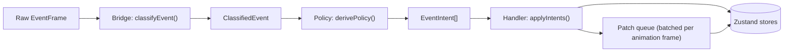

`@clawboo/events` turns the OpenClaw Gateway's raw WebSocket event frames into dashboard state. Three stages do the work: the **Bridge** classifies a frame, the **Policy** decides what should happen, and the **Handler** applies it. The first two are pure functions (the Bridge only stamps the current time on each frame) that you can test without a Gateway, a browser or a store; only the Handler holds state.

Use this page when you change how the dashboard reacts to Gateway frames: live streaming text, an agent's status, approval cards, or a committed chat turn. For the Gateway connections themselves (the browser proxy and the server's own connection), see [Gateway connection internals](/internals/gateway-and-events).

## Which frames go through it

The pipeline runs in the browser only. The `useGatewayEvents` hook makes one `client.onEvent` subscription and calls `processEvent(frame, handler)` for every frame, so each Gateway frame the browser receives takes exactly one path through the three stages. (`GatewayClient` consumes `connect.challenge` itself, before the fan-out.) That hook is the only caller of `processEvent`.

The server reads the same Gateway over its own connection, and those frames never pass through this pipeline:

- `OpenClawAgentSource` resyncs the agent registry on `presence`, `heartbeat` and `agent` frames;
- the session activity watcher reads `session.message` commits for the activity feed, OpenClaw spend and 1:1 transcripts;
- the exec-approval surface mirrors `exec.approval.*` requests into Clawboo's approvals queue;
- the OpenClaw `RuntimeAdapter`, which runs OpenClaw team-chat turns and Routine fires, maps frames to `RuntimeEvent`s with `mapFrameToRuntimeEvents`.

Two of them, the session activity watcher and the OpenClaw adapter, reuse the Bridge's pure parsers; none of them uses its intents. Runtimes other than OpenClaw never produce Gateway frames: they emit `RuntimeEvent`s on the server (see [the RuntimeAdapter trait](/internals/runtime-adapter)).

The package's only runtime dependencies are `@clawboo/gateway-client`, `@clawboo/protocol` and `@clawboo/logger`, and it imports nothing from `node:*`, so it ships in the browser bundle.

## The three layers

- **Bridge** (`bridge.ts`): parsing, pure apart from the timestamp. `classifyEvent(frame)` answers "what is this frame?" and returns a `ClassifiedEvent` (`kind`, the extracted `agentId` and `sessionKey`, a timestamp). It never decides what to do.
- **Policy** (`policy/*`): pure decisions. `derivePolicy(event)` answers "what should happen?" and returns an array of typed `EventIntent`s: a description, not a mutation.
- **Handler** (`handler.ts`): the one stateful stage. `createEventHandler(deps)` dispatches each intent to injected store writers, applying the guards (debounce, stale-run dropping) as it goes.

`processEvent(frame, handler)` threads a frame through all three: `classifyEvent`, then `derivePolicy`, then `handler.applyIntents`.



## Stage 1, Bridge: `classifyEvent`

`classifyEvent(frame)` switches on the frame's `event` name. The mapping is small and total; anything unrecognized becomes `unknown` rather than throwing:

| Frame `event`                                        | Classified `kind` |
| ---------------------------------------------------- | ----------------- |
| `presence`, `heartbeat`                              | `summary-refresh` |
| `chat`                                               | `runtime-chat`    |
| `agent`                                              | `runtime-agent`   |
| `exec.approval.pending` / `.requested` / `.resolved` | `approval`        |
| anything else                                        | `unknown`         |

Agent identity is extracted defensively. For `chat` frames the `agentId` comes from the session key `agent:<id>:<session>` (`SESSION_KEY_RE`). For `agent` frames a top-level `agentId` wins, else the session key is parsed. For approval frames the `agentId` may be at the top level or inside `payload.request`, and both are checked.

The Bridge also owns small pure helpers the rest of the code reuses:

- `parseChatPayload` and `parseAgentPayload` shape-check a payload and return `null` on anything malformed. A chat payload needs a `runId`, a `sessionKey` and a known `state`; an agent payload needs only a `runId`. The Policy router turns that `null` into an `ignore` intent instead of a crash.
- `parseSessionMessagePayload` parses a committed `session.message` row. It is a sibling of `parseChatPayload`, not a widening of it: a committed row has no streaming `state`, and its `runId` is optional because a row from a run nobody in Clawboo started still carries work. Its consumers are on the server (the session activity watcher and `@clawboo/adapter-openclaw`).
- `isReasoningStream(stream)` decides whether a stream is a thinking trace. Its deny list (`assistant`, `tool`, `lifecycle`) is checked before its allow list (`reason`, `think`, `analysis`, `trace`), so an `assistant` stream is never read as reasoning.
- It re-exports `extractText`, `extractThinking` and `extractToolLines` from `@clawboo/protocol` so consumers have one import surface.

There is no per-run de-duplication in the Bridge. Duplicate suppression happens once, in the Handler's `closedRuns` guard.

## Stage 2, Policy: `derivePolicy`

`derivePolicy(event)` routes on the classified `kind` to one of four pure deciders, each in its own file:

```ts
// packages/events/src/policy/index.ts
export function derivePolicy(event: ClassifiedEvent): EventIntent[] {
  switch (event.kind) {
    case 'summary-refresh':
      return decideAgentEvent(event)
    case 'runtime-chat': {
      const payload = parseChatPayload(event.payload)
      if (!payload) return [{ kind: 'ignore', reason: 'malformed chat payload' }]
      return decideWorkChatEvent(event, payload)
    }
    case 'runtime-agent': {
      const payload = parseAgentPayload(event.payload)
      if (!payload) return [{ kind: 'ignore', reason: 'malformed agent payload' }]
      return decideWorkAgentEvent(event, payload)
    }
    case 'approval':
      return decideTrustEvent(event)
    case 'unknown':
    default:
      return [{ kind: 'ignore', reason: 'unknown event kind' }]
  }
}
```

The router re-validates each payload with the Bridge's parser, so a malformed payload always becomes one `{ kind: 'ignore', reason }` intent. Nothing in this layer throws. Every intent except `ignore` carries a `plane` field (`work`, `agent` or `trust`) naming the kind of state it touches.

- **`decideAgentEvent`** (`agent.ts`), for `summary-refresh`: one `scheduleSummaryRefresh` intent with `delayMs: 750`, and `includeHeartbeatRefresh` set only when the frame was a `heartbeat`. It asks the Handler to debounce a fleet reload rather than changing fleet state itself.
- **`decideWorkChatEvent`** (`work.ts`), for `runtime-chat`. A `delta` becomes a `queueLivePatch` carrying the streaming text and thinking trace. A `final` becomes a `clearPendingLivePatch` plus a `commitChat` that finalizes the turn: its `outputLines` hold the reply text and the tool lines extracted from the final message, it carries the frame's `runId` for the Handler's stale-run guard and an `idle` patch, and it carries a `cost` from `deriveChatCost`. If the final message had no thinking trace, a `requestHistoryRefresh` follows. The web app answers it with a best-effort `listAgentSessions(agentId)` call whose result it discards; the transcript is built from the frames. `aborted` and `error` each become a `clearPendingLivePatch` plus a `commitChat` with status `idle` or `error`.
- **`decideWorkAgentEvent`** (`work.ts`), for `runtime-agent`. The `lifecycle` stream's `start`, `end` and `error` phases become `updateAgentStatus` intents (`running`, `idle`, `error`); the `assistant` and reasoning streams become `queueLivePatch` intents. The `tool` stream and unknown streams return `ignore`; tool lines reach the transcript through the final message's `outputLines`.
- **`decideTrustEvent`** (`trust.ts`), for `approval`: `approvalPending` for `exec.approval.pending` and `.requested`, else `approvalResolved`. A missing `agentId` is an `ignore`, not an error.

`deriveChatCost(payload, responseText)` uses the Gateway's usage block when the message carries one. Otherwise it estimates the output side at about 4 characters per token and leaves `inputTokens: null`, because pricing the prompt needs a transcript read and Policy stays pure; the host fills it in.

Because every decider reads only its inputs and returns an array, the same input always derives the same intents. That is what `policy-work.test.ts` and `policy-trust.test.ts` exercise: feed a `ClassifiedEvent`, assert the `EventIntent[]`, with no Gateway and no store.

## The seam: `EventIntent`

The boundary between pure and stateful is a typed union. Policy emits these; the Handler consumes them:

```ts
// packages/events/src/types.ts (abridged)
export type EventIntent =
  | {
      kind: 'queueLivePatch'
      plane: 'work'
      agentId: string
      sessionKey?: string
      patch: AgentStatusPatch
    }
  | { kind: 'clearPendingLivePatch'; plane: 'work'; agentId: string }
  | {
      kind: 'commitChat'
      plane: 'work'
      agentId: string
      sessionKey?: string
      runId: string | null
      patch: AgentStatusPatch
      outputLines: string[]
      cost: ChatCost | null
    }
  | {
      kind: 'updateAgentStatus'
      plane: 'agent'
      agentId: string
      runId: string | null
      patch: AgentStatusPatch
    }
  | {
      kind: 'scheduleSummaryRefresh'
      plane: 'agent'
      delayMs: number
      includeHeartbeatRefresh: boolean
    }
  | {
      kind: 'requestHistoryRefresh'
      plane: 'agent'
      agentId: string
      reason: 'chat-final-no-trace'
    }
  | { kind: 'approvalPending'; plane: 'trust'; agentId: string; payload: unknown }
  | { kind: 'approvalResolved'; plane: 'trust'; agentId: string; payload: unknown }
  | { kind: 'ignore'; reason: string }
```

An intent describes what should happen and never calls a store. That indirection keeps Policy pure (a function that only builds plain objects cannot write to a store) and lets the Handler apply its guards to every intent the same way, whichever decider produced it.

## Stage 3, Handler: `applyIntents`

`createEventHandler(deps)` returns `{ applyIntents, dispose }`. The `deps` (`EventHandlerDeps` in `types.ts`) are injected state queries and store writers: `getAgentRunId`, `dispatchIntent`, `queueLivePatch`, `clearPendingLivePatch`, `appendOutputLines`, `requestHistoryRefresh`, `loadSummarySnapshot` and `refreshHeartbeatLatest`, plus an injectable `setTimeout` / `clearTimeout` pair and an optional `log`. The package never imports `apps/web`; the wiring goes the other way.

`applyIntents(intents, event)` is a `switch` over `intent.kind`, and most cases delegate to one dependency. Two carry the logic.

**The `closedRuns` guard.** The Handler keeps a `Map` from `runId` to `{ expiresAt, byCommit }`, with a 30-second TTL (`CLOSED_RUN_TTL_MS`) and at most 500 entries (`CLOSED_RUNS_MAX_SIZE`, oldest evicted). It is pruned at the top of every `applyIntents`.

- A `commitChat` that closes its run (the agent's `runId` is null after dispatch) records the incoming frame's `runId` with `byCommit: true`. A later `commitChat` for that run is a replay and is dropped, so a duplicate `final` never mints a second set of transcript entries.
- A terminal `updateAgentStatus` records the run with `byCommit: false`, but only if the dispatch actually cleared the agent's `runId` (it compares the value before and after). A run closed this way still owes its reply, because OpenClaw sends the `agent` lifecycle end before the `chat` final, so the `final` is let through unless a different run is already live (then it is a stale replay whose idle patch would wrongly stop the live run).
- A terminal `updateAgentStatus` for a run already in the map is dropped, so a late lifecycle `end` cannot flip a freshly started run back to idle.

The guard compares the incoming frame's `runId`, which is why both intents carry one. The agent's current `runId` cannot work: by the time a stale frame arrives, the run it names is already cleared, so the current value is `null` or the next run's id. A missing `runId` fails open, because losing a real message is worse than showing a duplicate.

**Pending approvals.** While an exec approval is pending for an agent, the hook's `dispatchIntent` deliberately skips the terminal status patch: the model's stream ended but the run is alive, waiting on the decision. The agent's `runId` therefore survives the dispatch, the run is not marked closed, and the real final that arrives after the approval resolves still goes through.

**The summary-refresh debounce.** `scheduleSummaryRefresh` cancels any pending timer and re-arms one, so a burst of `presence` and `heartbeat` frames collapses into one fleet reload after `delayMs`. `dispose()` clears the timer and the `closedRuns` map. The hook calls it from its effect cleanup, which runs when the tab's Gateway client is replaced or cleared and on unmount, so nothing leaks into the next client.

## The patch queue

Streaming deltas arrive faster than the screen redraws. `createPatchQueue(onFlush)` (`patch-queue.ts`) keeps a `Map` from agent id to its pending updates; `enqueue` merges an incoming patch into that agent's entry and schedules a flush on the next `requestAnimationFrame`, and `flush` hands everything accumulated to `onFlush` once. The store is written at most once per animation frame per agent.

The merge has one rule: a change of `runId` discards the old streaming state. When an incoming patch carries a different `runId` than the pending one, the queue replaces the entry instead of merging it, so a stale partial stream from a finished run never bleeds into a new run's text:

```ts
// packages/events/src/patch-queue.ts (abridged)
const existingRunId = typeof existing['runId'] === 'string' ? existing['runId'] : ''
const incomingRunId = typeof patch.updates['runId'] === 'string' ? patch.updates['runId'] : ''
if (incomingRunId && existingRunId && incomingRunId !== existingRunId) {
  state.pending.set(patch.agentId, { ...patch.updates }) // replace, do not merge
} else {
  state.pending.set(patch.agentId, { ...existing, ...patch.updates }) // merge
}
```

The queue schedules through `requestAnimationFrame` and cancels through `cancelAnimationFrame` only when those globals exist, so the same code is a harmless no-op in Node tests. `dispose()` cancels any pending frame and clears the map.

## Wiring in the web app

The binding to real stores lives in one place, the `useGatewayEvents` hook (`apps/web/src/features/connection/useGatewayEvents.ts`). For each Gateway client the tab holds, it:

1. creates a patch queue whose `onFlush` writes each batch into the fleet store;
2. builds the Handler with store-backed dependencies: `getAgentRunId` reads the fleet store, `dispatchIntent` applies status, commit and approval intents (including the pending-approval rule above), `queueLivePatch` feeds the patch queue, `loadSummarySnapshot` reloads the fleet from the server, and `requestHistoryRefresh` makes the best-effort sessions call described above;
3. subscribes once with `client.onEvent` and runs `processEvent(frame, handler)` for every frame;
4. starts a 5-second sweep that removes expired approval cards and adds a "timed out" line to the agent's transcript, because the Gateway emits no resolved event when an approval times out. It is a plain interval, so it keeps running in a hidden tab.

For a team session key (`agent:<id>:team:<teamId>` and the room variant), the hook skips any `chat` frame it receives: no transcript commit and no live streaming-text writes. The server's team engine is the only writer of team chat: it persists each turn and streams it to the dashboard over `GET /api/teams/:id/chat/stream`.

The cleanup function unsubscribes, clears the sweep, and calls `patchQueue.dispose()` and `handler.dispose()`.

## Cost on this path

OpenClaw turn cost is recorded on the server, not here. The session activity watcher reads the Gateway's `session.message` commits on the server's own connection and records each turn's real model and token counts in `cost_records`, including turns no browser saw. `recordChatCost` in the hook therefore returns early for an agent whose runtime is `openclaw`, so a turn is never billed twice.

For any other fleet row whose turn arrives as a Gateway `chat` frame, `recordChatCost` still takes the `commitChat` intent's `cost`, estimates a missing input side from the agent's last user message at about 4 characters per token, and posts `/api/cost-records`.

Cost rides the `commitChat` intent rather than a second raw-frame subscription, so it sits behind the same `closedRuns` guard and a replayed frame is never charged twice. A new cross-cutting concern belongs on an intent, not on another `client.onEvent` subscriber.

## Design rationale

**Pure Bridge and Policy, stateful Handler.** What a frame means and which intents it produces are the parts that are hard to get right. Keeping them pure makes them deterministic and testable in isolation, and pushes every piece of timing state (the debounce timer, the stale-run map) into one auditable place.

**Intents over direct store calls.** Policy could call the stores directly and skip the union. It does not, because the indirection is what enforces purity and lets the Handler apply its guards uniformly.

**Batching over a write per frame.** Writing the store on every streaming delta would thrash React's render path. Coalescing per agent per animation frame keeps the live fleet view smooth without dropping data, and the replace-on-new-`runId` rule keeps the coalescing correct across run boundaries.

**Injected effects.** The Handler takes its timers and every store writer as dependencies, so the package stays browser-agnostic and tests drive it with fake timers and spy dispatchers.

## Boundaries

- **OpenClaw frames in the browser only.** The pipeline maps OpenClaw Gateway frames to the live fleet view. Server-side consumers of the same Gateway, and every other runtime, use other code (see [Which frames go through it](#which-frames-go-through-it)).
- **Not the team engine.** Bridge, Policy and Handler keep an agent's status, streaming text and approval cards in sync. Turning delegation signals into durable board work is the team engine's job, on the server. See [Delegation and orchestration](/concepts/delegation-and-orchestration).
- **Not a transport.** The package never opens a socket. The socket, reconnects and the same-origin proxy live in `@clawboo/gateway-client` and `@clawboo/gateway-proxy`; see [Gateway connection internals](/internals/gateway-and-events).

## Related

- [Gateway connection internals](/internals/gateway-and-events): the browser proxy, the handshake, and the server's own Gateway connection
- [Architecture invariants](/internals/architecture-invariants): the rule this pipeline upholds for browser frames
- [The RuntimeAdapter trait](/internals/runtime-adapter): how the other runtimes emit lifecycle events
- [`@clawboo/events` notes](/reference/packages/index#events): where the package sits among the workspace packages
- [OpenClaw](/runtimes/openclaw): connecting and using the OpenClaw runtime
