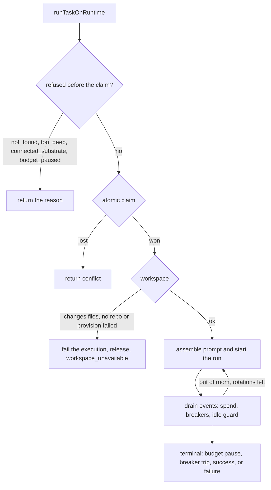

The executor runner, `runTaskOnRuntime` in `apps/web/server/lib/executorRunner.ts`, drives one existing board task through one runtime from claim to finish. Given a task id, an assignee and an adapter factory, it claims the task, opens an execution row, sets up a worktree when the task changes files, assembles a tiered prompt, drains the adapter's event stream while recording spend and running the circuit breakers, rotates the session when it runs out of room, runs the verification gate, and writes a handoff for the next runtime.

It is one of two execution paths, and not the default one:

- **The executor runner** serves `POST /api/runtimes/:id/run` and agent Routine fires on Clawboo Native, Claude Code, Codex and Hermes. With `CLAWBOO_ENABLE_MOCK_RUNTIME=1`, Routine fires on `clawboo-mock` use it too; the run route accepts only the four real runtimes.
- **The team engine** (`serverDeliver`, driven by the team orchestrator) runs every team-chat turn, every delegation, and every board task a person starts. It provisions no worktree, passes the team's folder (`<CLAWBOO_HOME>/workspaces/<teamId>`, from `teamWorkdirFor`) as the working directory for Claude Code, Codex, Hermes and Clawboo Native, and has no verification, memory auto-injection or circuit breakers. See [How a team works](/intro/how-it-works).

Use this page when you change how a task runs on a spawned runtime, or need to know what a run through the runtime run API does.

## Where it sits

The runner talks to a runtime only through the [`RuntimeAdapter`](/internals/runtime-adapter) trait and an injected adapter factory (`adapterFactoryFor(runtimeId)` in production). It is not:

- **the team engine**, which decides what to delegate and runs team chat;
- **the OpenClaw path**: OpenClaw runs over its live Gateway connection, so the runner refuses it before claiming anything, and OpenClaw routine fires use a separate dispatcher (see [How a Routine fire picks its path](/internals/seams#how-a-routine-fire-picks-its-path));
- **the verification critic**: it triggers the verification gate, which reuses the runner's adapter factory to drive an independent reviewer.

`runTaskOnRuntime(input)` returns a `RunTaskResult` and never throws for an expected board outcome. A refusal is `{ ok: false, reason }`; `runtimesRunPOST` maps it to an HTTP status:

| `reason`                | Meaning                                                                 | REST status |
| ----------------------- | ----------------------------------------------------------------------- | ----------- |
| `not_found`             | The task does not exist.                                                | `404`       |
| `conflict`              | The claim was lost, the caller went away, or a fix cycle lost the task. | `409`       |
| `too_deep`              | The task sits deeper than the depth cap.                                | `422`       |
| `connected_substrate`   | The runtime runs over a live connection (OpenClaw).                     | `422`       |
| `budget_paused`         | A cap-mode budget on the agent, mission or team is paused.              | `422`       |
| `workspace_unavailable` | The task changes files but no worktree could be provided.               | `422`       |

A completed run answers `200` with the result (`doneReason`, final `status`, `summary`, `costUsd`, `usedWorktree`, `degradations`). An unexpected throw answers `500`. The request blocks for the whole run, and the handler aborts the run if the client disconnects.

## The lifecycle

## Before the claim

Everything that can refuse a run without changing the board runs before the claim, so a misrouted or over-budget call never opens an execution row or spawns a process. In order:

1. **Aborted waiter.** A run for a persistent-home runtime waits its turn on a per-agent lock (`homeDispatchMutex`, below). The wait is bounded by `HOME_MUTEX_ACQUIRE_MS` (10 minutes, `CLAWBOO_HOME_MUTEX_ACQUIRE_MS`); past it the run rejects with `MutexAcquireTimeoutError`. If the caller disconnected or a person moved the card while it waited, the runner returns `conflict` without touching the board.
2. **Task exists**, else `not_found`.
3. **Depth.** A task with more than `MAX_SPAWN_DEPTH` (2) ancestors is refused with `too_deep`. Creation and dispatch read the same `DEFAULT_MAX_DEPTH` from `@clawboo/governance` but compare differently: a create is refused when the parent is already at the cap, a dispatch only when the task itself is past it. So anything that can be created can also run.
4. **Connected runtime.** `resolveRuntimeIntegration(caps)` gives OpenClaw a `connected` home, and the runner returns `connected_substrate`.
5. **Budget preflight.** A paused budget in `cap` mode on the agent, the mission (the root task of the delegation tree) or the team returns `budget_paused`. Budgets in `warn` mode, the default, never read paused and never block.

The integration plan also decides serialization. A persistent home (Clawboo Native, Codex, Hermes) is one state directory per (runtime, agent), so two concurrent runs of the same agent wait for each other on `homeDispatchMutex`, keyed on the home path. The team engine and 1:1 chat take the same lock for their own runs of that agent. An ephemeral home (Claude Code) is never keyed.

## The claim

The claim is one conditional `UPDATE` through the board's `claimTask` (see [the atomic claim](/internals/board-internals#the-atomic-claim)). A lost claim returns `conflict` and is never retried: another runner legitimately owns the task. A verification fix cycle is the one dispatch that does not claim; it checks that the task is still `in_progress` and still assigned to this agent, and returns `conflict` otherwise.

Right after the claim the runner opens an `execution_processes` row and emits `execution_started`. The row's run reason is `verify-fix` on a fix cycle, `resume-via-handoff` when the runtime cannot resume natively, and `run` otherwise. A liveness heartbeat (`startTaskHeartbeat`, every 30 seconds) starts before the mutex wait and stops in a `finally`, so it spans the wait, the run and every fix cycle; that beat is what keeps the stale sweep from releasing a live run.

## The workspace

`acquireWorkspace` sets up a workspace only when the adapter declares `capabilities().worktrees`. Clawboo Native, Claude Code, Codex and Hermes all do; the test-only `clawboo-mock` does not, so its runs get no working directory. Whether a task needs a worktree comes from its kind (`isolationForTask` in `@clawboo/worktrees`): `research` and `review` need none; `code`, the default, and any unknown kind need one. There are four outcomes:

- **Reuse.** The task already has a worktree, which is the cross-runtime continuation path. If garbage collection reaped it (the row is `stale`, the directory is missing, or git does not list it as a worktree), the runner rebuilds it from the retained branch with `resumeTaskWorkspace`.
- **Provision.** A file-changing task with a `repoPath` gets a fresh checkout on a `clawboo/task-<id>` branch from `provisionTaskWorkspace`, with the handoff scaffold files.
- **None.** A `research` or `review` task gets no worktree. Its run starts in the team's folder from `taskRunWorkdirFor` (`apps/web/server/lib/runtimes/teamWorkdir.ts`): `<CLAWBOO_HOME>/workspaces/<teamId>`, or `workspaces/_no-team` for a task with no team, created owner-only (`0700`) first. If the folder cannot be created, the run is refused as below, with `Could not create the working folder <path> for this run: <error>` as the reason.
- **Refused.** A file-changing task with no `repoPath`, or one whose worktree cannot be provisioned, does not run. The runner adds a `[blocked: no isolation] <reason>` system comment, closes the execution as `failed` with `workspace_unavailable: <reason>`, releases the task to `todo`, and returns `workspace_unavailable`.

The refusal happens after the claim, so a refused task shows one failed execution on its ledger. Two callers set the kind: `POST /api/runtimes/:id/run` defaults it to `code`, so a request without `repoPath` is refused; the Routines wake bridge runs an agent Routine that has no `repoPath` as `research`, so it runs without a worktree instead.

<Warning>

The refusal exists because of how the drivers run. Claude Code runs with `permissionMode: 'bypassPermissions'`, Codex with `--dangerously-bypass-approvals-and-sandbox` (app-server: approval policy `never`, sandbox `danger-full-access`), and Hermes with `--yolo` and `--accept-hooks`. A run with no working directory would start in the server's own working directory, which for an npm install is the Clawboo state directory holding the database and the secrets vault. The worktree keeps a task's file changes on its own branch, and the team's folder only sets where a read-only run starts; neither is a sandbox, and the process still has every permission of the user who started Clawboo. Team-engine runs start in the team's folder too. See [What agents can do](/concepts/permissions).

</Warning>

When a worktree exists, the runner reconstructs a `ResumeState` from its `AGENT_HANDOFF.json` and scaffold files, so a different runtime picks the task up where the last one left it. See [Worktrees and handoff](/concepts/worktrees-and-handoff).

## Prompt assembly

The prompt goes through `assembleTiers` from `@clawboo/executor/tiers`, in three tiers ordered so the frozen part forms the cacheable prefix:

| Tier       | Content                                                                                                                                                                                                                                                                                                                                                                              |
| ---------- | ------------------------------------------------------------------------------------------------------------------------------------------------------------------------------------------------------------------------------------------------------------------------------------------------------------------------------------------------------------------------------------ |
| `stable`   | The persona block, then `# Task: <title>` and the description. A board run skips the team-chat preamble, so for Claude Code, Codex and Hermes the runner injects the agent's `SOUL.md` itself as a `[Your persona]` block.                                                                                                                                                           |
| `context`  | The resume handoff; the MCP note (it names `team_chat_post` only for a team task, because an unscoped run gets no TeamChat tools); memory guidance; `Degradations applied: ...`; the interrupted-work note built from earlier attempts' ledger rows (`classifyAttempts`, `buildResumeNote`); the fix note on a fix cycle; the rotation handoff on a successor; and the inbox digest. |
| `volatile` | The auto-injected memory block.                                                                                                                                                                                                                                                                                                                                                      |

The inbox digest packs up to 20 undelivered mailbox rows for the assignee into an addressed section and an ambient section, the same split the team-chat path renders, and marks only the rendered rows delivered once the run has started.

**Memory auto-injection** (`buildMemoryInjection`) seeds the most relevant team facts for the task into the volatile tier, so the runtime starts with the team's knowledge without calling the Memory MCP tools (it still can). It searches the same memory store the `/api/memory` routes use, keeps the top 5 facts within 1,500 characters, drops any candidate the injection scanner flags, scrubs secrets, and injects nothing when memory is empty. It runs once per task and is reused across rotations. `disableMemoryAutoInject` turns it off (eval runs set it). See [Memory](/concepts/memory).

A persistent-home runtime also gets `homeDir`, `<Clawboo state dir>/runtimes/<runtime>/<agent>`, created owner-only (`0700`) before the driver touches it; the critic's own run gets none, so the reviewer never shares the builder's memory. The run context (`RuntimeRunContext`) carries the `cwd` (the worktree, else the team's folder), the model, the native resume id (only when the last runtime on this worktree was the same one), the MCP base URL, the memory scope (team, agent, the attach secret, and provenance stamps), the home directory and any provider keys. The run starts with session key `runtime:<runtime>:task:<taskId>`, the task title as its message, and `childToolBlocklist: ['sessions_send']`.

## The event drain

`adapter.start` returns a `RunHandle`, and the runner drains `adapter.events(run)` through `withIdleTimeout` until a terminal `done`:

- **`text-delta`**: accumulated into the run's text. The `reasoning` channel is skipped, so the summary shows what the agent did, not its private reasoning.
- **`cost`**: recorded against budgets (below) and emitted as a `cost` event.
- **`tool-call`** (settled calls only, not each streaming-input delta), **`tool-result`** and **`error`**: emitted as observability events and fed to the circuit breaker. An `error` goes through the error taxonomy: an unknown class is a harness bug and raises an alert; a recognized policy denial is expected governance, not a bug.
- **`done`**: captures the reason and summary and ends the pass.

The idle guard aborts a run that is silent for 30 minutes (`CLAWBOO_RUN_SILENT_TIMEOUT_MS`), then allows 5 seconds for the adapter's own terminal. A silent timeout is recorded as a failure with the cause stated ("runtime silent: no events for N minutes"), never as a clean abort and never as a reason to rotate. A pass that finishes without reporting any usage logs a `spend_unreported` warning, because budgets then under-count that run.

An external `abortSignal` (the REST handler wires it to the response's `close`) aborts the current run, even across a rotation, and forces the aborted terminal.

### Stopped by a person

`runTaskOnRuntime` folds the caller's signal and a person's stop into one `AbortController` and registers the run with the per-task stop registry (`registerRunStop`, `apps/web/server/lib/runStops.ts`) for its whole life, fix cycles included. After a board `PATCH` writes a move, `noteHumanMove` calls `stopTaskRuns(taskId, note)` for every move except into `in_progress` or `in_review`. That aborts the run and leaves a note such as `Stopped: a person moved the card to Done.`, which becomes the run's system comment. The result carries `stoppedByPerson: true`, so a caller treats the move as the outcome rather than a failure (a Routine fire stopped this way stays armed). The OpenClaw routine dispatcher registers with the same registry; the team engine stops the runs it started itself.

### Steering

The live run is also registered with the per-task steer registry (`registerRunSteer`, `runSteers.ts`), re-pointed on every rotation and fix cycle. A person's comment on the task reaches it through `steerTaskRun` after the comment is written to the agent's mailbox. How each runtime takes a steer is described on [the RuntimeAdapter trait](/internals/runtime-adapter) page.

### Spend and budgets

On every `cost` event the runner records spend against the agent, mission and team budgets with `recordSpend`. A runtime that reports usage but no USD (`costUsd: null`) is priced from its exact token counts with `estimateRunCostUsdFromUsage`, which falls back to the shared default rate for an unpriced model; a reported `costUsd` is used as is. The per-run ceiling accumulates whole cents while the budget ledger takes fractional cents, so sub-cent events are carried, not lost. The execution row records the run's cost with `costSource` `reported` or `token-estimate`.

Budgets default to warn mode. A warn budget records spend and writes a `budget` audit row when it crosses 80% and 100%, but never pauses. Only a `cap` budget that crosses 100%, or the per-run `maxNodeCents` ceiling (set only by a Routine template through the API), aborts the live run; the explicit `mode === 'cap'` check backs up the database layer's rule that a warn budget never reads paused. See [Governance](/concepts/governance).

### Circuit breakers

The circuit breaker halts a run that makes no progress, repeats a failing tool or burns tokens, before the dollar ceiling. It reads typed signals only: token counts on `cost`, a tool signature on `tool-call` and `tool-result` (correlated by `toolCallId`), and the typed code of a policy-denied `error`. The defaults (`BREAKER_DEFAULTS` in `@clawboo/governance`):

| Reason                 | Trips when                                          |
| ---------------------- | --------------------------------------------------- |
| `iteration-cap`        | more than 30 settled tool calls in the run          |
| `repeat-failure`       | 3 consecutive failures of the same tool call        |
| `no-progress`          | 6 consecutive results with no new successful output |
| `token-velocity`       | over 200,000 tokens a minute, after 15 seconds      |
| `repeat-policy-denied` | 2 identical typed denials                           |

`POST /api/runtimes/:id/run` accepts a partial `breakerConfig` to override them. The breaker is fed only while no budget stop is pending, and its teardown runs after the budget teardown, so the budget wins a tie and a run gets at most one `adapter.abort`.

## Session rotation

The runner's unit of context is the run, not the model turn: the runtime owns its inner loop. When a pass ends out of room (an explicit `done` with reason `max_turns`, or a non-success `done` whose input tokens crossed 85% of the declared context window) and rotations are left (`maxRotations`, default 3), the runner calls `rotateSession`. That serializes the predecessor best-effort, builds a short handoff note (the last summary, never the transcript), and starts a fresh successor session (`<sessionKey>:r<n>`) whose prompt carries the note in its context tier.

The watermark reads input tokens alone, because the prompt is what occupies the window. A runtime that declares no context window and never emits `max_turns` never rotates. Successors always start fresh (`ctx.resume = null`): resuming the exhausted session would exhaust it again. Budget and breaker state are cumulative across rotations; only the per-pass counters reset. Each rotation records session lineage and emits `session_rotated`. A budget, breaker, cancel or silent-timeout stop ends the run and never rotates.

## Terminal handling

After the loop exactly one terminal branch runs. Every branch closes the execution row only if it is still `running` (a stale sweep may have closed it first), and emits `execution_completed` only when its close landed.

**Budget pause.** Audit a `budget` row with reason `auto_pause`, add the comment `Auto-paused: <scope> budget reached. Raise the cap (or resume) to continue.`, close the execution `cancelled` with `budget_paused:<scope>`, and release the task to `todo`, ready to retry once someone raises the cap.

**Breaker trip.** Audit a `circuit_break` row, add `[stopped: <reason>] <detail> Released to todo for re-planning.`, close the execution `cancelled` with `circuit_broken:<reason>`, and release to `todo`. The worktree stays intact, so a retry resumes from it.

**Success.** The summary is scrubbed of secrets before it lands in a board comment, the execution row, the handoff or the HTTP response. The runner then writes the agent's comment, closes the execution `succeeded`, and:

- **With a worktree:** persists the native session id into `AGENT_HANDOFF.json` (best-effort) and, if a previous attempt crashed, records that its outcome is unknown. With `keepForResume` it releases the task to `todo` for another runtime to pick up. Otherwise it calls `actOnTaskWorkspace(taskId, 'complete')`, which runs the verification gate and routes the status:

  | Outcome                                    | Status                                                                                                 |
  | ------------------------------------------ | ------------------------------------------------------------------------------------------------------ |
  | empty diff                                 | `done`, without running the gate (nothing to check)                                                    |
  | `pass`                                     | `done`                                                                                                 |
  | `fail` with attempts left                  | `in_progress`; the runner re-dispatches a fix cycle with the structured `{ what, why, howToFix }` note |
  | `fail` with the attempts spent             | `blocked`, with a system comment and a notice to the delegator (or the team leader)                    |
  | `completed_with_debt` (only at exhaustion) | `blocked`                                                                                              |

  The attempt budget is `CLAWBOO_MAX_FIX_CYCLES` plus one, 2 by default. Fix cycles run outside the home mutex, each taking it fresh, because the mutex is not re-entrant. The gate reads its command from `VERIFY_CMD` in the worktree's `init.sh` (or the `- Verify:` line in `VERIFICATION.md`). The scaffold writes a placeholder there, so a task whose agent never sets a real command fails verification. If a person moved the task to `done` or `cancelled` while the check ran, their move stands and the verdict stays only as a record. The critic reuses this run's adapter factory on a detached checkout with a fresh session and no builder `homeDir`; `CLAWBOO_REVIEWER_MODEL` can make it a different model. See [Verification](/concepts/verification).

- **Without a worktree** (a `research` or `review` task): `updateStatus(db, taskId, 'done')`. If the board refuses (the task was released, the verification gate holds a non-promotable verdict, or the row is gone), the runner keeps the result as a `[late result ...]` system comment that says which.

**Failure.** A system comment records the outcome (a person's stop note, or `Run <reason>: 
`), the execution closes `cancelled` for an abort or `failed` otherwise, and a `done` with reason `error` is classified through the taxonomy and alerts on an unknown class. A run that attempted a native resume and failed clears the stored session id, so the next dispatch falls back to the prose handoff instead of retrying a stale id. Finally `releaseTask` returns a task still `in_progress` to `todo`; a task a person already moved stays where they put it, and the result reports its real status.

## Degradation notes

`planDegradations(caps)` (`apps/web/server/lib/degradation.ts`) derives three flags from the adapter's capabilities:

| Flag                           | Set when             | Effect                                                                       |
| ------------------------------ | -------------------- | ---------------------------------------------------------------------------- |
| `resumeViaHandoff`             | `!caps.resume`       | A note, and the execution's run reason becomes `resume-via-handoff`.         |
| `routeApprovalsThroughClawboo` | `!caps.toolApproval` | A note (`approvals-via-clawboo (no native tool approval)`) and nothing else. |
| `coarseStreaming`              | `!caps.streaming`    | A note that progress arrives in blocks, not tokens (Hermes).                 |

`describeDegradations` renders the notes into the prompt's context tier and the result's `degradations`, so a gap is visible. The flags do not change tool handling: Clawboo adds no approval gate for a runtime that lacks one. Every real adapter declares `resume` and `toolApproval`, so in practice only Hermes gets a note.

## Tracing

Every dispatch runs inside `withTaskSpan`. The trace id is the mission root, so a multi-agent task renders as one trace. The run's span id is derived from its task id, and its parent span is either an explicit cross-process `parentTraceparent` or the parent task's span. Lifecycle events (`execution_started`, `cost`, `tool_call`, `tool_result`, `error`, `session_rotated`, `execution_completed`) go through `emitEvent`, which is best-effort. The Org chart's live overlay and the trace view read this same event log. See [Observability](/concepts/observability).

## Design rationale

"Drive one runtime through one task" is one testable function with one set of invariants, instead of being spread across the team engine, the worktree code and each adapter. It buys three things:

- **Capability-driven routing.** The connected-runtime refusal, home serialization, degradation notes and the rotation watermark all come from declared capabilities, so a new runtime is a new adapter and driver, not a runner change.
- **One teardown per run.** Cumulative budget and breaker state above the rotation loop, the breaker yielding to a budget stop, and never rotating over a stop guarantee one `adapter.abort` and one terminal, even across a rotation chain.
- **Recoverability.** Every terminal closes the execution row and either sets a real status or releases the task; the board's orphan and stale passes clean up after a crash (see [Orphan and stale reconciliation](/internals/board-internals#orphan-and-stale-reconciliation)).

The cost is a second concurrency boundary, the per-agent home lock, on top of the board's claim: the claim de-duplicates a task, not a writer to one runtime's state directory.

## Related

- [The RuntimeAdapter trait](/internals/runtime-adapter): the interface the runner consumes
- [Board internals](/internals/board-internals): the claim, the transitions and the recovery passes
- [How a team works](/intro/how-it-works): team chat versus the task runner
- [What agents can do](/concepts/permissions): the coding runtimes' safety posture
- [Verification](/concepts/verification) and [Governance](/concepts/governance): the gate and the budgets this runner enforces
- [Runtimes API](/reference/rest-api/runtimes): `POST /api/runtimes/:id/run`
