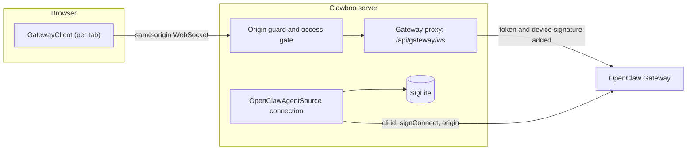

The OpenClaw Gateway is the long-running OpenClaw service that runs OpenClaw agents. It accepts a `connect` handshake, answers RPC calls (`chat.send`, `sessions.list`, `agents.create` and more), and broadcasts event frames (`chat`, `agent`, `exec.approval.*`, `presence`, `heartbeat`, `session.message`). Clawboo talks to it over two separate connections: one per browser tab through a same-origin proxy, and one long-lived connection held by the server.

Use this page when you work on the proxy, device pairing, or the server's Gateway connection. For setting up OpenClaw as a user, see [OpenClaw](/runtimes/openclaw). For how browser frames become dashboard state, see [The event pipeline](/internals/event-pipeline).

## Two connections

|             | Browser connection                                                                     | Server connection                                                                                                                                                              |
| ----------- | -------------------------------------------------------------------------------------- | ------------------------------------------------------------------------------------------------------------------------------------------------------------------------------ |
| Opened by   | each dashboard tab's `GatewayClient`, through `/api/gateway/ws`                        | `OpenClawAgentSource`, when the server starts                                                                                                                                  |
| Credentials | the proxy injects the token and signs the device fields                                | the token, plus `signConnect` with the proxy's device identity                                                                                                                 |
| `client.id` | `webchat-ui`                                                                           | `cli`                                                                                                                                                                          |
| `caps`      | `exec-approvals`                                                                       | `tool-events`, `exec-approvals`                                                                                                                                                |
| Carries     | 1:1 chat with an OpenClaw agent, live streaming and status, approval cards in that tab | every OpenClaw team-chat turn and Routine fire, the registry sync, the Gateway cron list on the Routines view, exec approvals with no tab open, and session activity and spend |

The browser never talks to the Gateway directly, and the server never sends the saved Gateway token to the browser. The server's connection is the one that keeps working with every tab closed.

## The same-origin proxy

`createGatewayProxy` (`@clawboo/gateway-proxy`) runs a `ws` `WebSocketServer` in `noServer` mode. The server's upgrade handler routes `/api/gateway/ws`, or `<base path>/api/gateway/ws` when Clawboo is mounted under a subpath (`CLAWBOO_BASE_PATH`), into the proxy after the Origin guard passes; it answers a refused handshake with `403 Forbidden` and destroys any other upgrade. The browser builds the URL from its own origin with `resolveProxyGatewayUrl()`, so it never hardcodes a port; the `ws://localhost:18790/...` fallback applies only where `window` is undefined (SSR and Node tests).

The proxy is eager: when a browser socket opens, it immediately loads the upstream settings and opens its own socket to the Gateway, before the first browser message. The Gateway sends a `connect.challenge` event right after the handshake. The proxy captures its nonce to sign the connect, and the browser's client sends `connect` when the challenge arrives (or after 750 ms without one). Frames buffer in both directions until each side is ready, up to `maxPendingFrames` (512); an overflow closes the connection rather than growing without bound.

Every frame passes through untouched except a `connect` request, which the proxy rewrites:

1. **Token injection.** If the browser sent no `auth.token` and the server has an upstream token, the proxy adds it. `GET /api/settings` exposes only a `hasToken` flag, never the saved value. The browser sends a token only when the operator types a new one on the connect screen; the proxy keeps that one.
2. **Device signing.** The proxy signs the connect params with a persistent Ed25519 identity, loaded once and shared by all connections (`loadOrCreateProxyDeviceIdentity`, `signConnectParams`, using the challenge nonce). It replaces any device fields the browser sent, and if signing fails it strips the device fields and forwards without them rather than failing the connect.

Server-side signing is what lets any browser context (a preview pane, a private window, a new machine) connect without registering a device key of its own. The proxy also pings the upstream every `keepaliveIntervalMs` (30 seconds) and terminates a connection whose pong has not arrived by the next ping, so a half-open socket is torn down within one or two intervals instead of stalling an RPC.

## The connect handshake

The browser's `GatewayClient.connect()` opens the socket, waits briefly for `connect.challenge`, then sends a `connect` request:

| Field                         | Value                                                      | Why                                                                                                                                                                                                                                         |
| ----------------------------- | ---------------------------------------------------------- | ------------------------------------------------------------------------------------------------------------------------------------------------------------------------------------------------------------------------------------------- |
| `minProtocol` / `maxProtocol` | 3 / 4                                                      | Clawboo negotiates either connect protocol, so older and newer Gateways both work.                                                                                                                                                          |
| `role`                        | `operator`                                                 | The dashboard acts as an operator.                                                                                                                                                                                                          |
| `scopes`                      | `operator.admin`, `operator.approvals`, `operator.pairing` | Admin calls, answering approvals, and pairing.                                                                                                                                                                                              |
| `client.id`                   | `webchat-ui`                                               | The Gateway allowlists `client.id`. `openclaw-control-ui` claims to be the Gateway's own bundled Control UI, which the Gateway refuses unless its build id matches (`protocol mismatch: Control UI updated; reload this page to continue`). |
| `caps`                        | `exec-approvals` (`GATEWAY_BROWSER_CAPS`)                  | Makes the socket an approval surface. The Gateway routes a held command only to connections that declared it; with no route, a run is denied as headless.                                                                                   |
| device auth                   | `disableDeviceAuth: true`                                  | The proxy signs the device fields, so the client's own `crypto.subtle` path is skipped.                                                                                                                                                     |

A rejected connect is parsed into a `GatewayResponseError` carrying a `code`.

## Device pairing

A new device must be approved once before the Gateway accepts it. An unapproved device's connect fails with `{ code: 'NOT_PAIRED', message: 'pairing required: device is not approved yet' }`. The dashboard branches on that code (in `GatewayConnectScreen`, `GatewayBootstrap` and `OpenClawInlineSetup`) and shows a one-click approval card.

<Steps>

<Step title="Preview the pending request">

The card posts to `POST /api/system/approve-device`, which runs `openclaw devices approve --latest`. On the CLI that is a preview: it prints the pending request id and exits non-zero by design.

</Step>

<Step title="Extract the request id">

The handler matches `/openclaw devices approve\s+([a-f0-9-]{36})/i` against the captured stdout and stderr. No match answers `404` (no pending request found).

</Step>

<Step title="Approve it">

The handler runs `openclaw devices approve <UUID>`. A non-zero exit here is a real failure and is reported with the CLI's stderr.

</Step>

<Step title="Reconnect">

The dashboard connects again. On the connect screen that is one retry of the connect. In the OpenClaw setup flow, a failed reconnect (a second `NOT_PAIRED` included) shows the error with a **Retry** button, and Retry brings back a fresh approval card when the device still needs one.

</Step>

</Steps>

<Warning>

The endpoint parses the OpenClaw CLI's output for the request id. If a future OpenClaw release changes that wording, the parse fails and the endpoint answers `404`. The approval card also shows the manual commands (`openclaw devices approve --latest`, then `openclaw devices approve <requestId>`) so nobody is stuck.

</Warning>

## The server connection

`OpenClawAgentSource` (`apps/web/server/lib/agentSource/openClawAgentSource.ts`) opens the server's single Gateway connection and signs it with the same proxy device identity through the gateway-client `signConnect` hook. Its connect options (`clientName: 'cli'`, an injected `ws` WebSocket with the Gateway host's origin, `signConnect`, and `caps: ['tool-events', 'exec-approvals']`) and why each is required are listed on the [AgentSource](/internals/agent-source) page. The connection has four jobs:

1. **Run OpenClaw agents for Clawboo.** Every OpenClaw turn in team chat (`buildOpenClawServerAdapter` over `operatorClient()`, used by `serverDeliver` and the peer exchange) and every OpenClaw Routine fire (`routines/openclawDispatch.ts`) runs over this connection, as do the read and write calls behind the Gateway cron list on the Routines view (the `openclaw-gateway-cron` schedule source). None of this needs a browser tab.
2. **Keep the registry in sync.** It reconciles the Gateway's `agents.list` into SQLite and resyncs on `presence`, `heartbeat` and `agent` frames. Reads serve SQLite, so the fleet renders when the Gateway is down. Creating an agent and reading or writing its files need a live Gateway; a delete made while the Gateway is down is queued for the next sync, and `updateAgent` writes SQLite only.
3. **Answer exec approvals with no tab open.** Because it declares `exec-approvals`, the Gateway routes a held shell command to it. The exec-approval surface (`execApprovalSurface.ts`) mirrors each `exec.approval.requested` into Clawboo's `tool_call_approvals` queue, keyed by the Gateway's own request id so a redelivery lands on the same row, and relays the answer back with `exec.approval.resolve`. It decides nothing: the command stays held by the Gateway, and the policy that decides which commands ask is OpenClaw's own. A card expires at the Gateway's deadline, or after 30 minutes, checked every 30 seconds; an expiry is never recorded as a deny. See [Approvals](/using/approvals).
4. **Record activity nobody started from Clawboo.** The session activity watcher (`sessionActivityWatcher.ts`) calls `sessions.subscribe` on every connect (a subscription dies with its socket) and reads `session.message`, which fires when a transcript row commits rather than on who is watching. A cron job the agent owns, an incoming channel message or someone typing at OpenClaw's own terminal still produces activity rows. The same frames carry real token counts, so the watcher records OpenClaw spend in `cost_records`, and it saves 1:1 transcripts so a conversation is kept even with no tab open.

There is no other server-side Gateway client; every server feature that needs OpenClaw shares this one connection, and its reconnect and retry rules live in the source (see [Connection lifecycle](/internals/agent-source#connection-lifecycle)).

## Guards in front of the API and the proxy

Two independent checks sit in front of `/api/*` and the Gateway WebSocket upgrade. Nothing guards the server's own outbound connection to the Gateway. [Security](/operating/security) is the canonical page; this is how they apply to the Gateway path.

**The Origin and Host guard is always on** (`packages/gateway-proxy/src/origin-guard.ts`). Every `/api/*` request and every WebSocket upgrade is checked against an allowlist of origins and hosts, which defends against cross-site WebSocket hijacking (a page riding the proxy's injected token) and DNS rebinding on a default loopback install with no configuration. `CLAWBOO_ALLOWED_ORIGINS` and `CLAWBOO_ALLOWED_HOSTS` only widen the list; nothing disables it. A refused HTTP request gets `403 { "error": "Cross-origin request blocked." }`, and a refused upgrade gets `403 Forbidden`.

**The access gate is optional** (`access-gate.ts`), active only when `STUDIO_ACCESS_TOKEN` is set. Opening `/?access_token=<token>` once sets an `HttpOnly` cookie and redirects; after that every `/api/*` request and the WebSocket upgrade need the cookie. The token is compared after SHA-256 hashing both sides, with `timingSafeEqual`. A token containing a character outside `[A-Za-z0-9._~-]` stops the server at boot on every bind (`accessTokenRefusal.ts`), and `createAccessGate` throws on one. The server also refuses to start on a non-loopback bind with no token unless `CLAWBOO_ALLOW_INSECURE=1`.

<Info>

The gate admits one other credential: the `attachToken` that the server writes into the MCP attach URLs it gives to the runtimes it spawns (whose environment is scrubbed of the access token), and into the Memory, Tasks and Tools URLs it registers in a Gateway on the same machine. Only the four transport routes (`/api/mcp/tasks`, `/memory`, `/tools`, `/teamchat`) accept it; `/api/mcp/config` never does. It is accepted only on a direct loopback request with no forwarding headers, never from another host or through a proxy, because a same-host reverse proxy delivers every remote request from loopback.

</Info>

## What the browser does with frames

Each tab's frames run through the [event pipeline](/internals/event-pipeline): the Bridge classifies a frame, the Policy derives intents, and the Handler applies them to the stores. Two rules there depend on the split above:

- **Team chat is the server's.** For a team session key (`agent:<id>:team:<teamId>`, with or without a room suffix) the browser skips any `chat` frame it receives rather than writing a second copy: no transcript commit and no live streaming-text writes. The team engine persists each turn and streams it back over `GET /api/teams/:id/chat/stream`.
- **OpenClaw spend is the server's.** OpenClaw turns are billed from the Gateway's real token counts by the session activity watcher, so the browser's cost path skips OpenClaw agents. A non-OpenClaw agent whose turn reaches the browser as a Gateway `chat` frame is billed from the frame's usage block when it has one, and otherwise estimated at about 4 characters per token.

## Design rationale

**A proxy rather than a direct browser connection.** A direct connection would have to ship the upstream token to the browser and make every browser context register its own device key. The proxy keeps the credential on the server and reuses one device identity, at the cost of one hop and a rewrite of the `connect` frame, paid once per connection.

**One server connection for everything the server does.** Funnelling registry sync, OpenClaw runs, approvals, cron and session activity through one `OpenClawAgentSource` connection gives exactly one place that owns the connect options, the reconnect rules and the pairing state on the server. The Gateway accepts many connections per device (every browser tab is one), so the server's is one more.

**Declare only what is answered.** The server declares `exec-approvals` only because a handler mirrors every request it receives into the approvals queue and relays the answer a person gives. A declaring connection that never answered would turn the Gateway's fast refusal into a held command waiting 30 minutes for nobody.

## Boundaries

- **OpenClaw only.** The proxy, the handshake and the pairing flow exist for the OpenClaw Gateway. The other runtimes run on the server through their adapters (see [the RuntimeAdapter trait](/internals/runtime-adapter)).
- **Pairing depends on the OpenClaw CLI.** `approve-device` is a convenience over `openclaw devices approve`, not a reimplementation of OpenClaw's pairing.
- **The server keeps the Gateway credentials.** The saved token and the Ed25519 device identity stay on the server, and the identity signs the Gateway handshake only. Dashboard access is the separate, optional `STUDIO_ACCESS_TOKEN`, held in the browser as an `HttpOnly` cookie while the gate is on.

## Related

- [OpenClaw](/runtimes/openclaw): connecting and using the OpenClaw runtime
- [The event pipeline](/internals/event-pipeline): how browser frames become dashboard state
- [AgentSource](/internals/agent-source): the server connection's sync, connect options and reconnect rules
- [Architecture invariants](/internals/architecture-invariants): the same-origin rule and the browser pipeline rule
- [Security](/operating/security): the Origin guard, the access gate and remote access
- [Gateway client and proxy](/reference/packages/gateway-client): the `@clawboo/gateway-client` and `@clawboo/gateway-proxy` packages
