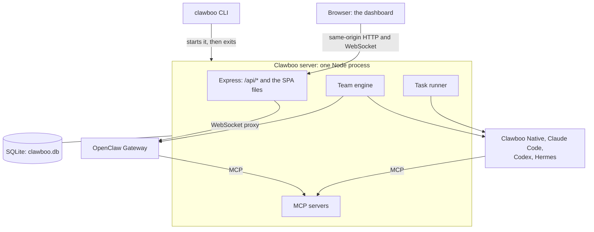

This tab is for people who change Clawboo's code: fix a bug, add a runtime, touch the board, or cut a release. It explains how the repository is laid out, how the parts talk to each other while Clawboo runs, and where to read before you change something.

If you want to use Clawboo rather than change it, start with the [Quickstart](/getting-started/quickstart). The process rules (setup, branches, the local gate, changesets) are on [Contributing](/appendices/contributing) and in the repo's [`CONTRIBUTING.md`](https://github.com/clawboo/clawboo/blob/main/CONTRIBUTING.md).

## How the codebase is laid out

Clawboo is a TypeScript monorepo. pnpm workspaces link the packages and Turborepo runs the build in dependency order. `pnpm-workspace.yaml` has four globs: `packages/*`, `packages/adapters/*`, `apps/*` and `docs`.

| Path                     | What lives there                                                                                                                             |
| ------------------------ | -------------------------------------------------------------------------------------------------------------------------------------------- |
| `apps/cli`               | The `clawboo` CLI, the only package published to npm. At release its `dist/` also carries the server bundle, the SPA and the MCP stdio bins. |
| `apps/web/src`           | The dashboard: a React single-page app built with Vite.                                                                                      |
| `apps/web/server`        | The Express server: the REST API (`server/api/`), the team engine, the task runner and the runtime drivers (`server/lib/`).                  |
| `packages/*`             | 27 shared packages under the `@clawboo/*` scope, one of them the config-only `tsconfig`.                                                     |
| `packages/adapters/*`    | 6 runtime adapters: `native`, `openclaw`, `claude-code`, `codex`, `hermes`, and `mock` (a test-only runtime).                                |
| `docs/`                  | This site: hand-edited Mintlify pages, deployed as they are.                                                                                 |
| `catalog/`               | Marketplace content (agent and team packs). Not a workspace member.                                                                          |
| `website/`               | The marketing site, with its own lockfile. Not a workspace member.                                                                           |
| `scripts/`, `tests/e2e/` | Repo scripts (bundle assembly, the clean-install gate, catalog tools) and the Playwright specs.                                              |

So `packages/` holds 33 `@clawboo/*` packages: 27 at the top level and 6 adapters. Every one of them is `private: true`. The build inlines the libraries the server needs into one bundle, which ships inside the `clawboo` package. Dependencies flow one way: apps import packages, and a lint rule fails any package that imports an app. [Monorepo and build](/internals/monorepo-and-build) covers the build order and what ships.

The packages group by job:

| Job                     | Packages                                                                            |
| ----------------------- | ----------------------------------------------------------------------------------- |
| Board and coordination  | `db`, `board-core`, `team-orchestration`, `governance`, `compaction`                |
| Running agents          | `executor` (the `RuntimeAdapter` trait), `adapters/*`, `worktrees`, `model-catalog` |
| OpenClaw Gateway        | `gateway-client`, `gateway-proxy`, `events`, `protocol`                             |
| Registries              | `agent-registry`, `capability-registry`, `scheduler`                                |
| Tools and connectors    | `mcp` (the Tasks, Memory, Tools and TeamChat servers), `connector-catalog`          |
| Observability and evals | `obs`, `evals`, `logger`                                                            |
| UI                      | `ui`, `boo-avatar`                                                                  |
| Shared plumbing         | `config`, `control-client`, `process-lookup`, `pack-format`, `tsconfig`             |

The [package overview](/reference/packages/index) says what each package is for, who uses it and how the packages depend on each other, and links the deeper package guides.

## Architecture at a glance

Clawboo runs as one local Node process. The CLI starts it, the browser talks to it, and it keeps its state in one SQLite file. Agents run on the runtimes you connect, and every runtime reaches Clawboo's board and memory through MCP servers.

### The CLI starts the server, then exits

`clawboo` is a launcher. It first looks for a dashboard that is already running: the port in `CLAWBOO_API_PORT` (or `CLAWBOO_API_URL`), then the port the server wrote to `~/.clawboo/api-port.txt`, then ports 18790 to 18809. A port counts only when `GET /api/settings` answers with Clawboo's JSON shape, because other services listen in that range. If nothing answers, the CLI forks the bundled `server.js` as a detached process with `~/.clawboo` as its working directory, waits for it, and opens the browser. The code is in `apps/cli/src/lifecycle.ts`.

### The server serves the dashboard and the API on one origin

The Express server serves the built SPA and every `/api/*` route from the same origin, so the browser needs no backend address. It binds `127.0.0.1` unless `HOST` says otherwise, and listens on the first free port from 18790 to 18809 (or exactly `CLAWBOO_API_PORT`). The SPA builds its requests with `apiFetch()` and `apiUrl()` from `@clawboo/control-client`, so the app also works under a path prefix (`CLAWBOO_BASE_PATH`).

An optional access token, `STUDIO_ACCESS_TOKEN`, gates `/api/*` and the Gateway WebSocket. A non-loopback bind without a token refuses to start unless `CLAWBOO_ALLOW_INSECURE=1` is set. [Security](/operating/security) has the full model; the entry point is `apps/web/server/index.ts`.

Prompts go only to the providers and apps you connect, and Clawboo itself sends no telemetry. The server makes three calls of its own. It fetches the marketplace catalog index from GitHub (`catalogIndex.ts`, overridable with `CLAWBOO_CATALOG_INDEX_URL`) and checks npm for a newer `clawboo` (`updateCheck.ts`), each cached for 6 hours. When a model picker opens, it also reads OpenRouter's public model list without a key (`openrouterModels.ts`, cached for 30 minutes).

### SQLite holds the state

One file, `clawboo.db` in `~/.clawboo` (or `CLAWBOO_HOME`), holds the board, the agent registry, memory, budgets and the event log. Server code reaches it through one shared connection, `getDb()` in `apps/web/server/lib/db.ts`. The schema is the `CREATE TABLE IF NOT EXISTS` DDL in `packages/db/src/schemaBootstrap.ts`. Opening an older file adds the columns it is missing; there is no migration ladder. See [Board internals](/internals/board-internals) and the [database schema](/reference/database-schema).

### Agents run on runtimes

A runtime is the engine an agent runs on. Clawboo Native runs inside the server process and calls the provider SDKs directly. Claude Code (through the Claude Agent SDK), Codex (`codex app-server`) and Hermes (its CLI) run as local processes the server starts. OpenClaw agents run inside the OpenClaw Gateway. Each runtime has a `RuntimeAdapter` that maps its output onto one normalized event stream; see [The RuntimeAdapter trait](/internals/runtime-adapter).

### MCP servers give every runtime the same tools

Clawboo hosts four MCP servers over the same SQLite data: Tasks (the board), Memory, Tools and TeamChat. Clawboo Native connects to them in-process. Claude Code, Codex and Hermes attach over loopback HTTP at `/api/mcp/*`; each run's attach URL carries a token the server checks. OpenClaw agents get Tasks, Memory and Tools through the Gateway's config, and no TeamChat. The same servers ship as stdio bins (`clawboo-mcp-tasks` and three more) for agents outside Clawboo; those bins open `~/.openclaw/clawboo/clawboo.db` unless `CLAWBOO_DB_PATH` says otherwise. See [MCP servers](/operating/mcp-servers).

### The OpenClaw Gateway is reached two ways

The browser opens a WebSocket to `/api/gateway/ws`, and the server proxies it to the Gateway. The server adds the saved Gateway token and signs the device handshake, so the browser needs no Gateway credential of its own. This connection carries OpenClaw 1:1 chat and the live fleet view, which the browser processes through the pipeline in `@clawboo/events`.

The server also keeps its own Gateway connection. It runs OpenClaw team-chat turns and Routine fires, syncs OpenClaw agents into SQLite, and records their activity and spend. It also mirrors OpenClaw's shell-command approval requests, so they still reach you when no dashboard tab is open. See [Gateway connection internals](/internals/gateway-and-events).

### The event log feeds observability

The server appends coordination events (a task created, a delegation routed, a run started, a cost recorded) to the `orchestration_events` table. The Observability panel and the live status layer on a team's graph read from that log. The graph's layout comes from the team roster and each agent's routing, not from the log. See [Observability](/concepts/observability).

### The two execution paths

Most work reaches a runtime along one of two server paths. They share the board and the runtimes, but not the safety and quality machinery, so check which path your change sits on. [How a team works](/intro/how-it-works) explains the same split for users.

|                       | Team engine                                                                                              | Task runner                                                                                                 |
| --------------------- | -------------------------------------------------------------------------------------------------------- | ----------------------------------------------------------------------------------------------------------- |
| What it runs          | Team chat turns, delegations and plan steps; board tasks a person assigns or retries; team Routine fires | `POST /api/runtimes/:id/run`; Routine fires aimed at one Clawboo Native, Claude Code, Codex or Hermes agent |
| Code                  | `apps/web/server/lib/teamChat/` over `@clawboo/team-orchestration`                                       | `runTaskOnRuntime` in `apps/web/server/lib/executorRunner.ts`                                               |
| Runtimes              | All five; OpenClaw over the server's Gateway connection                                                  | All except OpenClaw, which it refuses                                                                       |
| Git worktree          | Never                                                                                                    | For a task that changes files in a named repo; such a task with no repo is refused                          |
| Working folder        | The team's folder, `<CLAWBOO_HOME>/workspaces/<teamId>` (`runtimes/teamWorkdir.ts`)                      | The worktree, or for a `research` or `review` task the team's folder (`_no-team` when it has no team)       |
| Verification          | No                                                                                                       | Only for a worktree run that changed files                                                                  |
| Circuit breakers      | No                                                                                                       | Yes                                                                                                         |
| Memory auto-injection | No                                                                                                       | Yes                                                                                                         |

Two smaller paths sit beside these. A Routine fire aimed at one OpenClaw agent goes through a dispatcher on the server's Gateway connection (`apps/web/server/lib/routines/openclawDispatch.ts`), with no worktree and no verification. A 1:1 chat with a Clawboo Native agent runs one conversational turn in `apps/web/server/lib/agentChat/`, with no board task.

Claude Code, Codex and Hermes run with their own sandboxes and approval prompts turned off on both paths. A worktree keeps a task's file changes apart, but it is not a sandbox, and neither is the team's folder that a run without a worktree starts in. [What agents can do](/concepts/permissions) is the page that explains this; [Verification](/concepts/verification) and [Governance](/concepts/governance) cover the checks and budget guards per path.

## Where to start reading

1. [Contributing](/appendices/contributing): set up the repo, run the dev stack and pass the local gate.
2. [Monorepo and build](/internals/monorepo-and-build): the workspace, the build order and what ships.
3. [Architecture invariants](/internals/architecture-invariants): the rules every change keeps.
4. The page and the code for the area you are changing:

| Area                         | Start in                                                                                                   |
| ---------------------------- | ---------------------------------------------------------------------------------------------------------- |
| REST API                     | `apps/web/server/api/`; every route is registered in `api/index.ts`                                        |
| Team chat and delegation     | `apps/web/server/lib/teamChat/` and `packages/team-orchestration`                                          |
| Running one task             | `apps/web/server/lib/executorRunner.ts`                                                                    |
| Runtime drivers and adapters | `apps/web/server/lib/runtimes/` and `packages/adapters/*`                                                  |
| Board data and task states   | `packages/db/src/board/` and `packages/board-core`                                                         |
| Routines                     | `apps/web/server/lib/routines/` and `packages/scheduler`                                                   |
| MCP servers                  | `packages/mcp`                                                                                             |
| OpenClaw Gateway             | `packages/gateway-client`, `packages/gateway-proxy`, `packages/events`, `apps/web/server/lib/agentSource/` |
| Dashboard UI                 | `apps/web/src/features/*`; view state in `apps/web/src/stores/view.ts`                                     |
| The CLI                      | `apps/cli/src/` (`lifecycle.ts` finds and starts the server)                                               |

<Accordion title="Dashboard views in code">

The main area shows one `ViewMode` from `apps/web/src/stores/view.ts`: an agent page (`agent`), a team chat in General or a room (`groupChat`), a team's Home (`teamspace`), Boo Zero (`booZero`), the welcome screen (`welcome`), or a nav panel (`nav`). Each nav panel has a `NavView` id, which is what `navigateTo(view)` takes. The labels come from `apps/web/src/lib/navLabels.ts`.

| `NavView` id   | Label         | Where it lives                      |
| -------------- | ------------- | ----------------------------------- |
| `graph`        | Org chart     | Sidebar, `Cmd/Ctrl+1`               |
| `board`        | Board         | Sidebar, `Cmd/Ctrl+2`               |
| `connectors`   | Connectors    | Sidebar, `Cmd/Ctrl+3`               |
| `memory`       | Memory        | Sidebar, `Cmd/Ctrl+4`, and Settings |
| `marketplace`  | Marketplace   | Sidebar                             |
| `providers`    | Providers     | Settings, Workspace                 |
| `runtimes`     | Runtimes      | Settings, Workspace                 |
| `capabilities` | Capabilities  | Settings, Workspace                 |
| `routines`     | Routines      | Settings, Workspace                 |
| `fleet`        | Fleet         | Settings, Insights                  |
| `cost`         | Tokens Used   | Settings, Insights                  |
| `obs`          | Observability | Settings, Insights                  |
| `governance`   | Governance    | Settings, Insights                  |
| `system`       | System        | Settings, System                    |
| `health`       | System Health | Settings, System                    |

</Accordion>

### Caution surfaces

A few files hold rules whose breakage shows up far from the edit. Read the comment block at the top of each, and the linked page, before you change one.

| File                                                                      | What it protects                                                                                                                                                                                     |
| ------------------------------------------------------------------------- | ---------------------------------------------------------------------------------------------------------------------------------------------------------------------------------------------------- |
| `packages/db/src/board/repository.ts` (`createCappedSubtask`)             | Counting a parent's children and inserting the new one happen in one `BEGIN IMMEDIATE` transaction, so caps hold across processes. Only the real-concurrency suite in CI's Test job catches a break. |
| `packages/db/src/board/contention.ts` and `packages/db/src/db.ts`         | The SQLite write recipe: WAL, `busy_timeout` and a jittered retry. See [Board internals](/internals/board-internals).                                                                                |
| `apps/web/server/lib/db.ts` (`getDb()`)                                   | One connection per server process. Server code never opens or closes its own; `sharedConnection.test.ts` enforces it.                                                                                |
| `apps/web/server/lib/executorRunner.ts` (`acquireWorkspace`)              | A task that changes files gets a worktree or is refused. See [The executor runner](/internals/executor-runner).                                                                                      |
| `apps/web/server/lib/agentSource/registry.ts` (`connectOptions`)          | How the server's own Gateway connection authenticates. See [AgentSource](/internals/agent-source).                                                                                                   |
| `apps/web/src/features/connection/useGatewayEvents.ts` (`recordChatCost`) | Skips OpenClaw agents, because the server records their spend. Recording it here too would bill each turn twice.                                                                                     |
| `.github/workflows/publish.yml`                                           | The publish job has no changeset gate, on purpose. See [Release process](/internals/release-process).                                                                                                |
| `apps/web/index.html` and `apps/web/src/features/theme/ThemeProvider.tsx` | The pre-mount theme script and the provider must resolve the theme the same way. See [Design system](/internals/design-system).                                                                      |

## Read it when

| Page                                                          | Read it when                                                                               |
| ------------------------------------------------------------- | ------------------------------------------------------------------------------------------ |
| [Contributing](/appendices/contributing)                      | You are about to open your first pull request.                                             |
| [Monorepo and build](/internals/monorepo-and-build)           | You add a package, change a dependency edge, or need to know what reaches the npm package. |
| [Testing](/internals/testing)                                 | You add a test, a CI job fails, or you touch the e2e sandbox.                              |
| [Release process](/internals/release-process)                 | You write a changeset or cut a release.                                                    |
| [Design system](/internals/design-system)                     | You change UI: tokens, themes or the shared components.                                    |
| [Architecture invariants](/internals/architecture-invariants) | Before you change coordination, the Gateway path or the schema.                            |
| [Gateway connection internals](/internals/gateway-and-events) | You work on the OpenClaw connection or the WebSocket proxy.                                |
| [The RuntimeAdapter trait](/internals/runtime-adapter)        | You add a runtime or change how one is driven.                                             |
| [AgentSource](/internals/agent-source)                        | You change how agents are created, synced or deleted.                                      |
| [Capability and schedule sources](/internals/seams)           | You change what the Capabilities panel or Routines read from each runtime.                 |
| [The executor runner](/internals/executor-runner)             | You change how one task runs: worktrees, prompts, verification, breakers.                  |
| [Board internals](/internals/board-internals)                 | You change task states, claims or the SQLite write path.                                   |
| [The event pipeline](/internals/event-pipeline)               | You change how the browser handles Gateway frames.                                         |
| [Package overview](/reference/packages/index)                 | You need to know which package owns something and what it may import.                      |
| [License and notices](/appendices/license-and-notices)        | You add a dependency or bundled third-party content.                                       |

## Related

- [`CONTRIBUTING.md`](https://github.com/clawboo/clawboo/blob/main/CONTRIBUTING.md): the process rules in the repo itself.
- [How a team works](/intro/how-it-works): the same system from a user's point of view.
- [REST API reference](/reference/rest-api/index): every route the server registers.
- [Glossary](/appendices/glossary): the terms these pages use.
