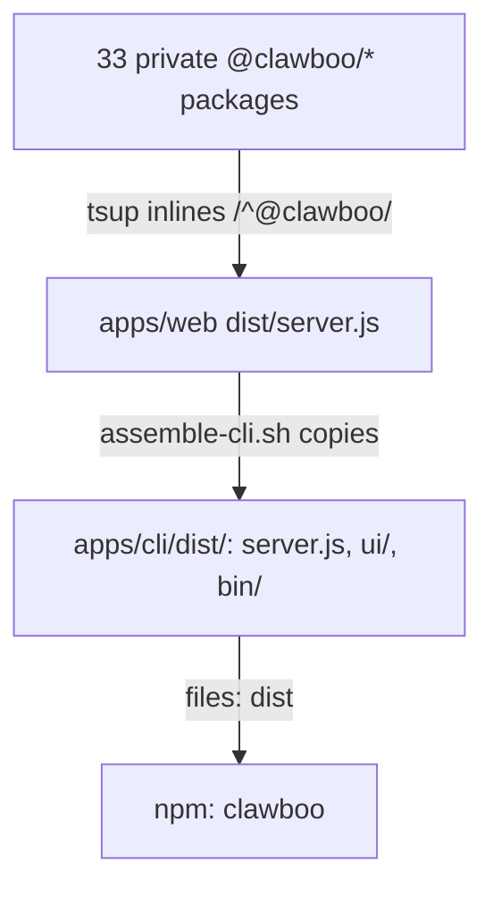
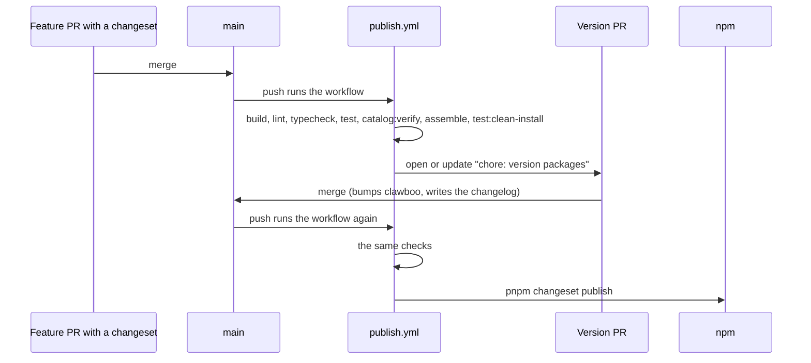

A Clawboo release publishes one npm package: `clawboo`, the CLI in `apps/cli`. Changesets track the version and write the changelog, and `.github/workflows/publish.yml` does the rest in two phases: it opens a Version PR, and when that PR merges it publishes. Contributors add changesets; maintainers merge the Version PR.

Use this page when you write a changeset, cut a release, or need to know why the publish posture looks the way it does. The build side (Turbo, the bundle, `assemble-cli.sh`) is in [Monorepo and build](/internals/monorepo-and-build).

## What ships

`packages/` holds 33 `@clawboo/*` packages (27 at the top level, 6 under `packages/adapters/*`), and every one is `private: true`, like `@clawboo/web` and `@clawboo/docs`. The only public package is `apps/cli`, named `clawboo` (no scope), with `files: ["dist"]`. So `pnpm changeset publish` skips everything else and publishes one tarball.

The libraries still ship, inside that tarball. `tsup.server.config.ts` inlines the whole `@clawboo/*` scope into `dist/server.js`, and `scripts/assemble-cli.sh` copies the server bundle, the SPA and the MCP bins into `apps/cli/dist/`. [What publishes](/internals/monorepo-and-build#what-publishes) lists the tarball's contents and its few external modules.



`apps/web/server/lib/__tests__/packagePosture.test.ts` enforces this. It asserts that the set of public packages is exactly `clawboo (apps/cli)`, and that no public package has a runtime dependency on a private one, which would publish a manifest pointing at packages npm does not have.

## Versions

`apps/cli/package.json` holds the version of the last release. The `.changeset/*.md` files on `main` describe the next one, so `ls .changeset` tells you what the next `publish.yml` run does: any changeset file means it opens or updates a Version PR, none means it publishes.

The CLI's version string comes from the build. `apps/cli/tsup.config.ts` sets `define: { __CLI_VERSION__: JSON.stringify(pkg.version) }`, and `apps/cli/src/version.ts` exports it as `VERSION`, falling back to `0.0.0-dev` when the code runs unbundled under tsx or Vitest. `clawboo --version` prints it, and the CLI passes it to every server it starts as `CLAWBOO_VERSION`.

## Changesets

The whole `.changeset/config.json`:

```json
{
  "$schema": "https://unpkg.com/@changesets/config@4.0.0/schema.json",
  "changelog": "@changesets/cli/changelog",
  "commit": false,
  "fixed": [],
  "linked": [],
  "access": "public",
  "baseBranch": "main",
  "updateInternalDependencies": "patch",
  "ignore": ["@clawboo/docs", "@clawboo/web"],
  "privatePackages": {
    "version": false,
    "tag": false
  }
}
```

The root `package.json` pins `@changesets/cli` at `^3.0.2`. The fields that matter:

- **`privatePackages: { version: false, tag: false }`** is what keeps every private package out of versioning and tagging, so only `clawboo` gets a version bump and a git tag.
- **`ignore`** keeps `@clawboo/web` and `@clawboo/docs` out of the flow as well. They never publish on their own, so a changeset never names them.
- **`commit: false`** means `pnpm changeset` writes files and commits nothing. The Changesets action makes the release commit, titled `chore: version packages`.
- **`access: "public"`** applies to the one package that publishes.
- **`updateInternalDependencies: "patch"`** would re-version internal dependency edges, but no other package publishes, so it changes nothing today.

### Write a changeset

```bash
pnpm changeset
```

Pick `clawboo` and a bump level (`patch`, `minor` or `major`), then write the summary. The command creates a file under `.changeset/`; commit it with your change. The file looks like this:

```md
---
'clawboo': patch
---

One or two sentences a user of the npm package can read.
```

Add one for any change a user of the npm package would notice, including dashboard changes in `apps/web`: the server and the SPA ship inside `clawboo`. A code change deep in a library such as `@clawboo/db` is also released as a `clawboo` bump. Docs-only, CI-only and test-only changes need no changeset.

## The publish workflow

`publish.yml` has one job, `publish`, and it runs on every push to `main` with no path filter and no condition. Its steps, in order:

1. Check out with `fetch-depth: 0` (Changesets needs the full history), set up pnpm and Node 22 with the npm registry.
2. `pnpm install --frozen-lockfile`.
3. `pnpm exec playwright install --with-deps chromium`, for the clean-install gate's browser step.
4. `pnpm build`, `pnpm lint`, `pnpm typecheck`, `pnpm test`.
5. `pnpm catalog:verify`. A content-only pull request skips the test matrix by design, so this is what keeps a bad marketplace pack off npm.
6. `bash scripts/assemble-cli.sh`, then `pnpm test:clean-install`: the tarball about to be published is installed and booted first.
7. `changesets/action`, pinned to the v2.1.2 commit, with `publish-script: pnpm changeset publish`, `commit-message` and `pr-title` both `chore: version packages`, and `push-with-git-cli: true`.

`lint`, `typecheck` and `test` run before assembly, so a failure costs no bundle work and no Turbo task can restore a stale `apps/cli/dist` over the fresh one. The build does not type-check the web app or the CLI, so `typecheck` is the step that stops a type error there from reaching npm.

The rerun is partial. It does not repeat `pnpm format:check`, `pnpm e2e`, `pnpm verify:connectors`, the cross-platform tests, the website build, the real-concurrency suite, the entry-chunk and catalog size checks, or CodeQL; those ran on the pull request. It also needs the network: the install, the Chromium download, and the real `npm install` inside the clean-install gate. The catalog gate is offline by design: it reads what is committed and never fetches the upstream sources the content came from.

The last step gives the flow its two phases:

- **Changesets present** (a feature PR with a `.changeset/*.md` just merged): the action opens or updates the Version PR, titled `chore: version packages`. Its commit consumes the changeset files, bumps `clawboo` in `apps/cli/package.json` and adds the entry to `apps/cli/CHANGELOG.md`; merging it lands those on `main`.
- **No changesets present** (the Version PR just merged): the action runs `pnpm changeset publish`, which publishes `clawboo` to npm with `NODE_AUTH_TOKEN` from the `NPM_TOKEN` secret, then pushes the `clawboo@<version>` git tag and creates the GitHub release.



The workflow's concurrency group never cancels a run in progress. `changeset publish` pushes to npm before it creates the tags, so a cancel between the two would leave a version on npm with no tag behind it.

<Warning>
The `publish` job has no changeset gate, and must not get one. A condition such as "run only when `.changeset/*.md` files exist" is right for the run that opens the Version PR, but it skips the run that publishes: by then the Version PR has merged and Changesets has consumed the files. The action decides between the two phases itself; it needs the job to run every time. A comment in `publish.yml` says the same where someone would add the gate.
</Warning>

## Provenance

The published tarball carries an [npm provenance](https://docs.npmjs.com/generating-provenance-statements) statement: a signed record that it was built from this repository, at a given commit, by this workflow. Three things produce it:

- `id-token: write` in the `publish` job's permissions, which lets the job mint the short-lived OIDC token npm checks. It is why that job's permissions are wider than the workflow's `contents: read` default.
- `NPM_CONFIG_PROVENANCE: true` in the Changesets step's environment, which turns provenance on for the publish.
- A `repository` field in `apps/cli/package.json` (this repo, `directory: apps/cli`). npm refuses provenance for a package that does not say where it came from.

Anyone can check an install with `npm audit signatures`. That matters for a tool that is installed with `npx` and then starts coding agents on the user's machine.

## Cut a release

<Steps>
<Step title="Add a changeset">

Run `pnpm changeset` on your feature branch, pick `clawboo`, and commit the new `.changeset/*.md` file with the change.

</Step>
<Step title="Pass CI">

Every job in `ci.yml` must be green, and CodeQL too. [Testing](/internals/testing) lists the jobs.

</Step>
<Step title="Merge the feature pull request">

`publish.yml` runs its checks, then opens or updates the `chore: version packages` pull request. Check that its version bump and changelog entry are what you expect.

</Step>
<Step title="Merge the Version PR">

`publish.yml` runs its checks again and then `pnpm changeset publish`. When the run is green, the new version is on npm with its git tag and GitHub release.

</Step>
<Step title="Check npm">

Run `npm view clawboo@<version> version`. Asking for the exact version avoids a cached answer; the registry can take a few minutes to show a new release.

</Step>
</Steps>

There is no manual `npm publish` step. Releases go through this flow only.

## Design notes

**One published artifact.** Clawboo is used as a product, not as a set of libraries. Keeping every `@clawboo/*` package private means no semver contract for 33 internal packages, no publish-then-install loop, and no partial release where the CLI ships against a library that never reached npm. `packagePosture.test.ts` turns that posture into a test.

**Inlined libraries.** A clean `npx clawboo` install should need nothing beyond the CLI's short `dependencies` list, so tsup inlines everything else, the provider SDKs and `croner` included. The clean-install gate proves it at runtime, and `pnpm test:bundle-externals` proves it statically.

**Checks inside `publish.yml`.** The pull request already ran CI, but a merge race or a lockfile change can make `main` differ from what the pull request tested. Rerunning the key checks right before `changeset publish` stops that commit from reaching npm. Running them as steps in the same job, rather than waiting on another workflow's result, keeps the release self-contained in one file.

## Limits

- **One package.** No `@clawboo/*` library publishes on its own. Making one public is a posture change, and `packagePosture.test.ts` fails until the test is changed with it.
- **An npm package, not a deployment.** `publish.yml` publishes to npm; running a Clawboo instance is covered under [Deployment](/operating/deployment).
- **No migration step.** A new version brings a user's existing database up to date the first time it opens it, by adding missing columns. See [Schema changes](/internals/monorepo-and-build#schema-changes).

## Related

- [Monorepo and build](/internals/monorepo-and-build): the bundle, `assemble-cli.sh` and the root commands.
- [Testing](/internals/testing): the CI jobs and the clean-install gate.
- [Contributing](/appendices/contributing): where changesets fit in a pull request.
- [Changelog](/appendices/changelog): the release history.
