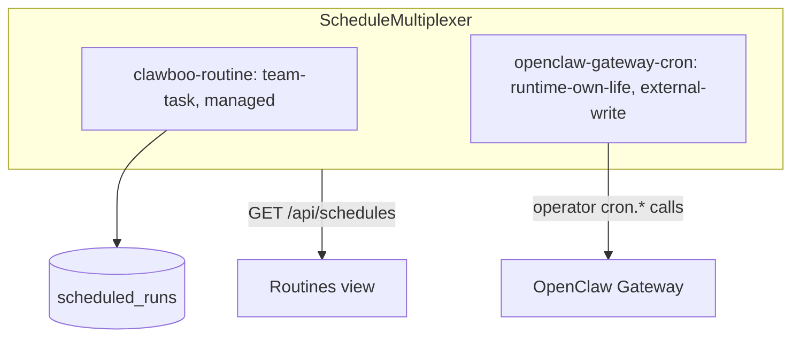

Two server-side layers follow the same pattern as [AgentSource](/internals/agent-source): a neutral record type, a per-source adapter trait, a multiplexer that merges every adapter's records into one stream, and a process-wide singleton that registers the adapters.

- **`CapabilitySource`** projects what each runtime can do (skills, tools, connectors) as `CapabilityRecord`s. Six sources are registered: one for each of the five real runtimes (the test-only `clawboo-mock` has none) plus one for Clawboo's own outbound connectors. The [Org chart](/using/org-chart) and the [Capabilities panel](/using/capabilities) both read this stream.
- **`ScheduleSource`** projects when work fires as `ScheduleRecord`s. Two sources are registered: Clawboo Routines and the OpenClaw Gateway's own cron.

Use this page when you add a source, change how a capability or schedule is written, or debug a degraded source.

## The shared shape

| Part               | `AgentSource`                                                                         | `CapabilitySource`                                         | `ScheduleSource`                              |
| ------------------ | ------------------------------------------------------------------------------------- | ---------------------------------------------------------- | --------------------------------------------- |
| Record type        | `AgentRecord`                                                                         | `CapabilityRecord`                                         | `ScheduleRecord`                              |
| Registry           | `AgentRegistry` (a catalog)                                                           | `CapabilityMultiplexer` (merges `read()`)                  | `ScheduleMultiplexer` (merges `read()`)       |
| Id composition     | the row's `sourceId`                                                                  | `${sourceId}:${rawKey}`                                    | `${source}:${sourceScheduleId}`               |
| Singleton          | `getRegistry()`                                                                       | `getCapabilityMultiplexer()`                               | `getScheduleMultiplexer()`                    |
| Registered sources | 5: OpenClaw, native, and one SQLite-backed source each for claude-code, codex, hermes | 6: native, hermes, claude-code, codex, openclaw, connector | 2: `clawboo-routine`, `openclaw-gateway-cron` |

The record and trait packages, `@clawboo/capability-registry` and `@clawboo/scheduler`, are dependency-light and browser-safe, because the dashboard imports the record types to type the REST responses. `@clawboo/capability-registry` has no runtime dependencies and re-declares the small foreign types it needs (`CapabilityAvailability` mirrors `@clawboo/db`'s `AvailabilityRequirement`). `@clawboo/scheduler` is the only package that imports `croner`, and only in `occurrence.ts`; everything downstream deals in precomputed epoch-millisecond timestamps. The concrete sources live in `apps/web/server/lib/capabilitySource/` and `apps/web/server/lib/scheduleSource/`.

These layers merge and route; they own no canonical rows. The capability projection is persisted to a `capabilities` table, but only as a cache for when a source is offline; each source's backing store (the tool broker's `tool_registry`, a Hermes home's `SKILL.md` files, the Gateway config) stays canonical. The Routines source reads the `scheduled_runs` ledger and the Gateway-cron source reads the live Gateway.

### Routing by id prefix

The composite id is the routing key. `parseCapabilityId` and `parseScheduleId` find the owning source by matching the id against a fixed list of known source ids as a prefix. They do not split on the first colon: a raw key may itself contain colons (brokered ids look like `native:tool_registry:echo`), and an id whose prefix is not a registered source parses to `null`, so it routes nowhere instead of to a plausible wrong source.

## `read()` never rejects

A source's `read()` returns degradation as a value. Each returns `{ records, status }`, where `status` is `{ sourceId, ok, degraded, reason?, at }`; a disconnected Gateway returns no records and `{ ok: false, degraded: true, reason: 'gateway_disconnected' }` (the Gateway-cron source serves its last list instead, with reason `stale_cache`, when it has one). The multiplexer also wraps every `read()` in its own `try/catch`, so even a source that breaks the contract becomes a degraded status entry rather than failing the merge:

```ts
// CapabilityMultiplexer.read(): defensive on both ends
for (const source of this.sources.values()) {
  try {
    const result = await source.read()
    records.push(...result.records)
    sources.push(result.status)
  } catch (err) {
    sources.push({
      sourceId: source.id,
      ok: false,
      degraded: true,
      reason: err instanceof Error ? err.message : String(err),
      at: Date.now(),
    })
  }
}
return { records, sources }
```

A degraded source never fails the request: it rides in the `sources` array and `GET /api/capabilities` or `GET /api/schedules` answers `200`. (`GET /api/capabilities` answers `500` only when the server-side merge itself throws, for example on a database error.)

For capabilities, `loadCapabilities` (`capabilitySource/service.ts`) goes one step further. It persists each healthy source's records into the `capabilities` table (a reconcile scoped to that source) and, for a degraded source, serves that source's last-good rows. A Gateway that drops for one read still shows its tools, stale but present.

## Manageability: the write gate

Clawboo observes every runtime's capabilities and schedules but manages only what the owning runtime allows. The line is a manageability tier, and the UI and the write path are both a pure function of it: neither may offer an action the owner forbids.

**`ScheduleSource` declares manageability per source.** Each source is uniformly `managed`, `external-write` or `observe-only` through a `readonly manageability` field, so the multiplexer can refuse a write before touching the source.

| Tier             | Meaning                                                    | Schedule source                                   |
| ---------------- | ---------------------------------------------------------- | ------------------------------------------------- |
| `managed`        | Clawboo owns the rows                                      | `clawboo-routine` (the `scheduled_runs` ledger)   |
| `external-write` | The runtime owns the store; Clawboo writes through its API | `openclaw-gateway-cron` (operator `cron.*` calls) |
| `observe-only`   | Clawboo can read but never write                           | none today                                        |

**`CapabilitySource` declares manageability per record**, because one source can emit records of mixed tiers (OpenClaw surfaces `runtime-of-record` `tools.*` records, `observe-only` `clawboo-*` servers and a built-ins record from the same `read()`). There is no `manageability` field on the capability trait. The REST layer resolves the target record and rejects `observe-only` or non-`writable` records, and each `source.write()` refuses again.

| Tier                | Meaning                                                           | Capability example                                         |
| ------------------- | ----------------------------------------------------------------- | ---------------------------------------------------------- |
| `managed`           | Clawboo owns the durable row                                      | brokered MCP tools and curated skills (native source)      |
| `external-write`    | The runtime owns the store; Clawboo writes through it             | Codex's attached Clawboo MCP servers (refused today)       |
| `runtime-of-record` | The runtime owns it; Clawboo changes it through the runtime's API | OpenClaw `tools.allow` and `tools.deny` via `config.patch` |
| `observe-only`      | Clawboo can read but never write                                  | runtime built-ins, Hermes `SKILL.md`, connector records    |

A record also carries `writable` (default `true`). A source sets `writable: false` on a record it cannot write yet, such as an OpenClaw MCP server or plugin entry, so the panel renders no dead Enable or Disable button. The `writable` column is not persisted, so when the REST mapper serves last-good rows for an offline source it re-derives `writable` from the row's origin and kind with the same predicate that source's `write()` uses.

## The six capability sources

Each source projects the same `CapabilityRecord` shape. The origin and manageability of its records encode what Clawboo may do with that runtime. They are registered in this order in `apps/web/server/lib/capabilitySource/registry.ts`:

| Source        | What it reads                                                                                                                                                    | Manageability                                                                                                                 | Can `write()`?                                                     |
| ------------- | ---------------------------------------------------------------------------------------------------------------------------------------------------------------- | ----------------------------------------------------------------------------------------------------------------------------- | ------------------------------------------------------------------ |
| `native`      | the tool broker's `tool_registry` (global tools), each native agent's MCP toggles, the per-agent `skills` table                                                  | `managed`                                                                                                                     | yes: install, enable and disable through the tool-broker pipeline  |
| `hermes`      | each per-identity Hermes home's `SKILL.md` files and `mcp.json` connectors                                                                                       | `observe-only`                                                                                                                | no: Clawboo never writes a Hermes skills directory                 |
| `claude-code` | the Clawboo MCP servers attached per run, plus Claude Code built-ins                                                                                             | `observe-only`                                                                                                                | no: Clawboo keeps Claude Code off the user's own `~/.claude` setup |
| `codex`       | the Clawboo MCP servers attached to Codex, plus Codex built-ins                                                                                                  | `external-write`, status `manageable-but-pending-auth`                                                                        | no: shown with the hint to run `codex login`; writes are refused   |
| `openclaw`    | the Gateway's `tools.allow` and `tools.deny`, `mcp.servers` and `plugins.entries`, over the shared connection                                                    | `runtime-of-record` (`tools.*` writable; other MCP servers and plugins `writable: false`); `clawboo-*` servers `observe-only` | yes for `tools.*` through `config.patch`; nothing else yet         |
| `connector`   | Clawboo's own live outbound MCP connections (from the connector supervisor, in memory) plus one record per app a connected Composio session reaches (from cache) | `observe-only`, `writable: false`                                                                                             | no: connect and disconnect live on the connectors REST surface     |

Three details carry invariants the rest of the system depends on:

- **The native source's curated-skill records carry the agent's runtime.** A curated catalog skill installed on an OpenClaw agent is a Clawboo-managed annotation, so the record's `runtime` is the agent's while its manageability stays `managed`. The panel groups it under the agent's runtime and Clawboo still owns the write.
- **The OpenClaw source reuses the shared operator connection.** It is constructed with `getRegistry().source` and never opens a second Gateway connection. A `config.patch` carries the `{ raw, baseHash, replacePaths }` envelope the Gateway expects, where `replacePaths` names every array the patch replaces (OpenClaw 2026.9 refuses a patch that would shorten an undeclared array).
- **The connector source reads no network.** The supervisor already holds every live connection and its tool list, and the Composio app list comes from a cache the connectors shelf refreshes, so a graph rebuild never waits on a remote server.

The native source's `write()` is the only durable managed write, and it reuses the existing pipeline rather than forking it: an install runs `evaluateInjection` and writes the same `skills` table the `POST /api/skills` path writes, with the same `appendAudit` trail. The payload is scanned as two surfaces. The name and skill content are scanned as `prompt` (prose bound for an agent's context); a connector's command, arguments and environment are scanned as `exec` (spawn-bound, so every rule that fires blocks).

## The two schedule domains

`ScheduleRecord.domain` separates two kinds of cron, and keeping them apart is the point of this layer:

- **`team-task`**: Clawboo's own scheduler for team work, the `clawboo-routine` source over the `scheduled_runs` ledger. It is the one external wake for every runtime, whether a Routine posts into a team's chat or files a task for one agent.
- **`runtime-own-life`**: a runtime's own cron, the `openclaw-gateway-cron` source over the live Gateway. The Routines view is an operator surface over these jobs, not their owner.

There are only two sources because Claude Code, Codex, Hermes and Clawboo Native have no live scheduler of their own (scheduling them is a Clawboo Routine), and `hermes gateway` is never launched.



The multiplexer's write gate runs in order: an unknown source raises `UnknownScheduleError`; an `observe-only` source raises `UnsupportedScheduleWriteError`; a `team-task` create aimed at a `runtime-own-life` source raises `TeamTaskDomainViolationError`. The Gateway-cron source also refuses a `team-task` create itself, so the domain rule is defended twice and Clawboo never files a team task into a runtime's own scheduler.

### Typed errors

Every scheduling error carries a `readonly code` so callers branch on structure, never on message text. The REST mapper (`mapScheduleError` in `apps/web/server/api/schedules.ts`) turns them into status codes:

| Error                                                            | Status | Meaning                                                                                                                        |
| ---------------------------------------------------------------- | ------ | ------------------------------------------------------------------------------------------------------------------------------ |
| `InvalidCronSpecError`, a zod error                              | `400`  | A malformed spec or task template. The body's `code` is `invalid_body`.                                                        |
| `BoundRecurringScheduleError` (`bound_recurring_schedule`)       | `400`  | A recurring routine bound to an already-claimable task.                                                                        |
| `InvalidRoutineTargetError` (`invalid_routine_target`)           | `400`  | A team routine with no team, an agent routine with no agent, an agent not on the paired team, or a target that does not exist. |
| `UnknownScheduleError` (`unknown_schedule`)                      | `404`  | An unknown composite id or source.                                                                                             |
| `DuplicateFiringOwnerError`, `IllegalScheduleTransitionError`    | `409`  | The one-firing-owner refusal, or an illegal routine status change. Never retried.                                              |
| `TeamTaskDomainViolationError` (`team_task_domain_violation`)    | `422`  | A team-task create aimed at a runtime-own-life source.                                                                         |
| `UnsupportedScheduleWriteError` (`unsupported_schedule_write`)   | `403`  | A write against an `observe-only` source.                                                                                      |
| `ScheduleSourceUnavailableError` (`schedule_source_unavailable`) | `503`  | The Gateway connection behind the source is down; the body's `error` is `gateway_disconnected`.                                |
| `NotImplementedError` (`not_implemented`)                        | none   | Raised by the wake bridge at fire time for a human-participant Routine target, which is not built.                             |

The one-firing-owner rule is the scheduler's version of the board's atomic claim. A board task carries a `scheduledBy` owner; binding a Routine to a task whose `scheduledBy` is a different owner other than `'manual'` is refused at registration with `DuplicateFiringOwnerError`. Like a lost claim, it is never retried: another engine owns that task's cadence. A runtime's own cron is a different domain and never trips the rule.

The capability errors are the smaller mirror: `UnknownCapabilityError` answers `404`, `UnsupportedCapabilityWriteError` (raised by the shared `unsupported()` helper every `observe-only` source's `write()` calls) answers `422`, and a write that hits a disconnected Gateway answers `503 gateway_disconnected`.

## How a Routine fire picks its path

The wake bridge (`apps/web/server/lib/routines/wakeBridge.ts`) turns a Routine fire into real work. It branches first on the Routine's target. A team Routine posts its instructions into the team's General chat through the team engine, addressed to the team's lead. An agent Routine becomes a board task for that agent, and the bridge then branches on the runtime's integration plan, `resolveRuntimeIntegration(caps).home.kind`, never on a runtime id:

- **`persistent` or `ephemeral` home** (Clawboo Native, Claude Code, Codex, Hermes): `runTaskOnRuntime`, the same [executor runner](/internals/executor-runner) a `POST /api/runtimes/:id/run` uses. That path has budget checks, circuit breakers, a worktree when the task changes files and has a repository path, and the verification gate when that worktree has a diff. A template with no `repoPath` runs without a worktree (a file-changing kind becomes `research`), so it gets no verification.
- **`connected` home** (OpenClaw): a thin dispatcher on the shared Gateway connection (`routines/openclawDispatch.ts`). It runs a budget preflight, claims the task, beats it, records spend, and stops the run on a 10-minute watchdog (`CLAWBOO_ROUTINE_OPENCLAW_TIMEOUT_MS`). It has no worktree, no verification gate and no circuit breakers; a finished run lands `done` with the comment "Completed without verification" and an unverified audit row.

The branch reads the adapter's declared `runtimeClass`, so a new connected runtime routes here without the bridge learning its name.

## Design rationale

**A multiplexer rather than a catalog.** Capabilities and schedules are heterogeneous and partial: six capability sources and two cron systems, any of which may be offline. The merged view is the product, so the registry's job is the merge: collect every `read()`, keep failures as status entries, and present one stream. That is what lets the Org chart and the Capabilities panel share one query and makes a degraded source visible but not fatal.

**Per-record manageability for capabilities, per-source for schedules.** The shape follows the data. Every Routine is `managed` and every Gateway cron job is `external-write`, so a per-source gate is honest. A capability source is not uniform, and a per-source tier would either offer to write a built-in or refuse to manage a managed skill. The per-record tier costs the `writable` re-derivation in the REST mapper but keeps the gate truthful.

**Browser-safe record packages.** The record types cross the wire to the dashboard, so the packages that define them cannot pull in a Gateway client, a SQLite driver or `croner`.

## Boundaries

- **Not stores.** The `capabilities` table is a cache for offline sources; the schedule sources read the `scheduled_runs` ledger and the live Gateway.
- **No per-runtime special cases.** The UI and the write path depend only on `manageability` and `writable` (capabilities) or `manageability` and `domain` (schedules). A new runtime declares its tiers and nothing in the panel or the multiplexer learns its name.
- **Reserved fields.** `CapabilityRecord.tenantId` and the schedule `tenantId` are always `null`. The `'human'` capability runtime and the human-participant Routine are typed but not built.
- **Writes not offered yet.** OpenClaw MCP server and plugin toggles are not writable, and Codex capability writes are refused; both show as non-writable or pending-auth rather than as a dead button.

## Related

- [AgentSource](/internals/agent-source): the agent registry these two mirror
- [The executor runner](/internals/executor-runner): where an agent Routine fire becomes a run
- [Capabilities](/concepts/capabilities) and [Scheduling](/concepts/scheduling): the concepts behind these streams
- [Adding a runtime](/internals/runtime-adapter#add-a-runtime): where a new capability source fits
- [Schedules API](/reference/rest-api/schedules) and [Capabilities API](/reference/rest-api/capabilities): the REST surfaces
