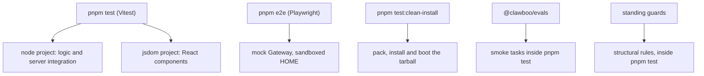

Clawboo has one test layer for each way it can break: logic, the assembled app in a browser, the published package on a fresh machine, the orchestrator's own guarantees, and the repo's structural rules. This page explains each layer, what it protects, and how CI runs it. Use it when you add a test, when a CI job fails, or when you touch the end-to-end sandbox.

## The local gate

Run what CI runs before you push. All of these are root scripts:

```bash
pnpm format:check
pnpm lint
pnpm typecheck
pnpm test
pnpm e2e
pnpm catalog:verify
pnpm verify:connectors
pnpm assemble && pnpm test:clean-install
```

`pnpm e2e` needs `pnpm build` first and a Chromium download (`pnpm exec playwright install chromium`, once per clone). `pnpm test:clean-install` needs the same browser and network access for its `npm install`. Neither will run against a dashboard you started yourself: the e2e guard refuses an unsandboxed server, and the clean-install gate refuses to start while a dashboard answers on ports 18790 to 18809. [CI jobs](#ci-jobs) maps each command to its job.

## The layers



- **Vitest** checks that the logic holds, and that the server's stateful parts work against real git and real SQLite.
- **Playwright** checks that the assembled app renders and round-trips in a browser, without touching your real data.
- **The clean-install gate** checks that the packed npm package installs, boots and runs one agent task on a clean machine.
- **The eval harness** checks the orchestrator's own guarantees by grading the board's final state, not a transcript.
- **The standing guards** check the repo's structural rules: the schema source, the publish posture, layer boundaries, source hygiene.

## Vitest

Every package with code, and both apps, has its own `vitest run` script, and `turbo test` runs them all. The root `vitest.config.ts` only globs `packages/*/src/**/*.test.ts`, for running package tests directly.

`apps/web/vitest.config.ts` defines two projects that one `vitest run` runs together. Both set `restoreMocks`, and the run uses at most half the CPU cores (`maxWorkers: '50%'`).

| Project | Files                                        | Environment | Timeout                | Setup files                                               |
| ------- | -------------------------------------------- | ----------- | ---------------------- | --------------------------------------------------------- |
| `node`  | `src/**/*.test.ts` and `server/**/*.test.ts` | Node        | 30 s (60 s on Windows) | `server/__vitest__/setupHomedir.ts`, `setupEmbeddings.ts` |
| `jsdom` | `src/**/*.test.tsx`                          | jsdom       | 15 s                   | `src/__vitest__/setup.ts`                                 |

**The `node` project** holds pure logic, the Zustand stores, and the server's integration tests. Those run against a real temporary git repository and a real SQLite file, with `$HOME` pointed at a throwaway directory, so they never touch your `~/.clawboo` or `~/.openclaw`. The long timeouts give real-git tests room when the jsdom project runs at the same time. `setupHomedir.ts` makes `$HOME` decide `os.homedir()` on Windows too, so the same sandboxing works there. `setupEmbeddings.ts` sets `CLAWBOO_DISABLE_EMBEDDINGS=1` unless a suite opts back in, so no test embeds fixtures through your own Ollama or provider key.

`apps/web/server/lib/__tests__/executorRunner.integration.test.ts` drives the board, a runner-provisioned worktree, verification, governance and observability together, with a fake `RuntimeAdapter`. It needs no network and no key. The same file has a live variant that drives the real Claude Code runtime; it is skipped unless `CLAWBOO_LIVE_ACCEPTANCE=1` is set, costs real money, and uses your real `$HOME` for Claude's sign-in.

**The `jsdom` project** holds React Testing Library tests for the dashboard. `setup.ts` registers the `jest-dom` matchers and the `jest-axe` accessibility matcher, starts the shared msw server, and shims `matchMedia` and `ResizeObserver`. The msw server listens with `onUnhandledRequest: 'error'`, so a component that calls an `/api/*` route with no matching handler fails its test. A few default handlers keep common background calls quiet: the GitHub star count (the one cross-origin call panels make on mount), the approvals poll and similar reads. A test that asserts on one of them overrides it with `server.use(...)`.

`apps/cli` has its own suites for launcher logic that is risky to get wrong and awkward to run end to end. `discovery.test.ts` decides what a single port is (Clawboo, an access-gated Clawboo, or something else). `discoveryCandidates.test.ts` decides which ports get tried, with the TCP layer mocked so it never probes your own 18790 to 18809.

## Playwright end-to-end tests

`playwright.config.ts` drives the assembled app. Its `webServer` builds the SPA (`build:ui`) and then runs `start`, which serves it from the TypeScript server through tsx (`CLAWBOO_UI_DIR=./dist/ui tsx server/index.ts`). The e2e suite therefore never runs the bundled `dist/server.js`; the clean-install gate does.

| Setting         | Value                                                                                          |
| --------------- | ---------------------------------------------------------------------------------------------- |
| Port            | `19999`, outside the 18790 to 18809 window, so a `pnpm dev` instance never collides with a run |
| Server start    | Up to 180 s, because a cold `vite build` is slow                                               |
| Workers         | One, in file order. Some specs read state that earlier specs leave, so do not shard the suite  |
| Retries         | Two in CI, none locally                                                                        |
| Browser         | Chromium only                                                                                  |
| Existing server | Reused locally, never in CI                                                                    |

The specs talk to a mock Gateway (`tests/e2e/helpers/mockGateway.ts`) instead of a real OpenClaw Gateway. It is a small `ws` server that answers `connect`, `agents.list`, `agents.files.read` and `chat.send`, and pushes scripted chat frames. Its replies depend on the role: the leader answers a normal message with a `<delegate>` block (which creates a board task), the leader answers a `[Task Update]` with a plain synthesis (so it cannot loop), and a specialist answers with a report-up summary (which moves the task to done). One spec can therefore drive a full chat, board and chat round trip.

The 18 spec files in `tests/e2e/` cover:

- **Onboarding:** native setup, adding runtimes, reloading after setup, Codex, OpenClaw with Codex, keyless Ollama.
- **Chat and board:** team navigation, team chat, the board round trip, board drag, the chat transcript's render window.
- **Graph and memory:** the Org chart canvas, the memory graph.
- **Platform:** connection and auto-connect, the agent list in the sidebar, a Gateway drop and reconnect through the real `/api/gateway/ws` proxy, serving under `CLAWBOO_BASE_PATH`, and the eval-smoke button.

### The sandbox

The e2e fixtures delete teams between runs, so the suite must never reach your real database at `~/.clawboo/clawboo.db` (or wherever `CLAWBOO_HOME` points). Three layers keep it out:

1. **A temp sandbox at config load.** `playwright.config.ts` creates a directory under the OS temp root and points the spawned server's `HOME`, `OPENCLAW_STATE_DIR` and `CLAWBOO_HOME` at it. The same `webServer.env` sets `COREPACK_HOME` and `COREPACK_ENABLE_DOWNLOAD_PROMPT=0` (so corepack does not re-download pnpm into the sandbox), sets `CLAWBOO_DISABLE_EMBEDDINGS=1` (so the memory-graph spec is deterministic), and blanks the ten native provider keys and `OLLAMA_BASE_URL` (so your shell cannot steer the onboarding specs).
2. **`globalTeardown` cleanup.** `tests/e2e/globalTeardown.ts` removes the sandbox after the run, and only after checking that the path is under the OS temp directory.
3. **The `assertSandboxed` guard.** Before any destructive helper runs, `assertSandboxed` in `tests/e2e/helpers/fixtures.ts` checks the runner's sandbox markers and asks the live server, through `GET /api/system/status`, where its state directory is. Both must be under the temp root. This catches a stale, unsandboxed server you started yourself with `pnpm dev` or `pnpm start`, which Playwright would otherwise reuse.

<Warning>
Any new Playwright helper that deletes or changes server state must call `assertSandboxed(request)` first. The temp sandbox and the teardown protect against a misconfigured run; only `assertSandboxed` protects against a stale server that points at your real data.
</Warning>

## The clean-install gate

`pnpm test:clean-install` runs `scripts/test-clean-install.mjs`. It simulates `npx clawboo` on a fresh machine and checks that the published package reaches a working dashboard. Run `pnpm assemble` first: the gate packs what assembly produced.

It tests a real install, not the repo build. It runs `pnpm pack` on `apps/cli` (pnpm rewrites `workspace:` versions, as at publish) and `npm install`s the tarball into a temp directory (npm's hoisted layout is what `npx` users get). Running `apps/cli/dist` in place would let Node resolve modules from the monorepo's `node_modules` and hide a missing dependency.

The script refuses to start while anything answers as Clawboo on ports 18790 to 18809, because the CLI would attach to that dashboard instead. Stop your `pnpm dev` server first. Then it works through 20 numbered steps:

| Steps    | What they check                                                                                                                                                                                  |
| -------- | ------------------------------------------------------------------------------------------------------------------------------------------------------------------------------------------------ |
| 1 to 5   | The assembled files exist; the tarball installs; the five bins exist with npm shims; `clawboo --version` runs through its shim; the static externals check passes on the install.                |
| 6 to 11  | A fake 401 listener holds port 18791 (like the OpenClaw Gateway's extra ports); a stub provider starts; the installed CLI starts with an isolated `$HOME` and announces a URL that is not 18791. |
| 12 to 15 | `GET /` and a deep route return the SPA; `/api/settings` and `/api/system/status` return Clawboo's shapes.                                                                                       |
| 16       | Headless Chromium boots the SPA: the sidebar and the onboarding wizard render, with no uncaught exception and no first-party console error.                                                      |
| 17       | The installed `dist/bin/tasks.js` completes a JSON-RPC `initialize` and `tools/list`, and the list includes `list_tasks`.                                                                        |
| 18       | `POST /api/runtimes/clawboo-native/run` drives a board task to `done` against the stub provider.                                                                                                 |
| 19       | A second launch reuses the running dashboard through `api-port.txt` instead of forking another server.                                                                                           |
| 20       | The server survives `npm install -g clawboo@latest` replacing its package folder: it does not run inside that folder, and `server.js` boots from a deleted directory. Skipped on Windows.        |

The run needs no API key: step 7's stub is an OpenAI-compatible server that Clawboo Native reaches as Ollama, through `OLLAMA_BASE_URL`. The task uses `kind: 'research'`, so no git repo or worktree is involved. To stay hermetic, the browser step aborts every request that is not first-party and counts only first-party console errors, so an unreachable font CDN cannot fail a release.

One install shape needs a unit test instead. `npx` installs land under a dot directory (`~/.npm/_npx/...`), and CI checkouts never do. `apps/web/server/lib/__tests__/serveSpa.test.ts` runs the real `mountSpa` against a plain install path and a dotted one, and checks that the server injects the mount point into the shell it serves.

### The externals check

`scripts/check-bundle-externals.mjs` (also `pnpm test:bundle-externals`) scans the Node entry points of the package: the manifest's `bin` targets (`dist/bootstrap.js` and the four `dist/bin/*.js`) plus `dist/server.js`. Every module they still `require()` or `import()` must be in the package's `dependencies`, a Node builtin, or on the optional list in `scripts/lib/bundle-externals.mjs`. It catches what booting cannot: a lazy import fails only when its feature is first used, long after CI went green.

`dist/index.js` is not scanned, because `bootstrap.js` loads it through a runtime-built path the static scan cannot follow; the boot steps above are what prove its imports. The scanner is hand-written rather than a regex, because the inlined `ajv` source holds `require(...)` text in a string and esbuild writes module paths into comments. It tracks strings, template literals, comments and regex literals, and it runs its own fixtures before every check. The optional list holds `@opentelemetry/*` and `@anthropic-ai/claude-agent-sdk`; an entry there means a clean install cannot use that feature until the user installs the module.

## The eval harness

`@clawboo/evals` is a private, server-only package that grades Clawboo's own orchestration, not a model's output. It catches a regression that spans subsystems, which no single unit test sees.

The runner reports two numbers per task. **pass@1** is the share of the K trials that passed. **pass^k** is that share raised to the power k: an estimate of how often k runs in a row would all pass. pass^k is the stricter bar. Each trial gets a fresh SQLite board from `makeBoardContext`, because leftover state makes failures correlate, and a task body that throws is recorded as a failed trial (`run-error`) rather than an unhandled rejection.

- **Code graders** (`graders/code.ts`) inspect the outcome: the board's final state and the event log. They check board state, event counts, dependency readiness, or a custom predicate.
- **Model graders** (`graders/model.ts`) are LLM-as-judge for qualities code cannot grade, such as handoff quality. No task uses them yet, so nothing runs them.

Every task today is deterministic and tagged `smoke`, so the same set runs inside `pnpm test` and in the manual `evals.yml` workflow. That workflow adds the ablation scorecard: the capability tasks run in four variants (with and without the verifier, with and without structured state). The scorecard is a self-test of the harness wiring, not a measurement of the live orchestrator; the executor runner's integration test is what drives the real verifier and worktree.

The dashboard can run the smoke set too. `POST /api/eval/smoke` runs `SMOKE_TASKS` against throwaway boards, with no model, key or network, and clamps `trials` and `k` to 1 to 3. The `09-eval-smoke` spec clicks that button and expects a 100% pass@1.

## The standing guards

Seven guard areas, in nine test files, freeze structural rules of the repo. They run inside `pnpm test` and fail the build as soon as a rule drifts.

| Guard                 | Files                                                                                                                                 | What it freezes                                                                                                                                                                                                                        |
| --------------------- | ------------------------------------------------------------------------------------------------------------------------------------- | -------------------------------------------------------------------------------------------------------------------------------------------------------------------------------------------------------------------------------------- |
| Schema source         | `packages/db/src/__tests__/schemaSource.test.ts`                                                                                      | Every Drizzle `schema.ts` table and column matches the bootstrap DDL, and back (the FTS5 table excepted). No migration scripts, no `drizzle` entry in `files`, no `drizzle/` directory.                                                |
| Schema reconcile      | `packages/db/src/__tests__/schemaReconcile.test.ts` (with `schemaBaseline.ts`), `apps/web/server/lib/__tests__/schemaUpgrade.test.ts` | The DDL parser sees exactly the columns SQLite creates; a populated older database gains a missing column without losing rows; a new column must be addable to an existing file; the server's `getDb()` boot path applies the upgrade. |
| Publish posture       | `apps/web/server/lib/__tests__/packagePosture.test.ts`                                                                                | The only public package is `clawboo` (apps/cli), and no public package depends at runtime on a private one.                                                                                                                            |
| Layer boundaries      | `apps/web/server/lib/__tests__/importBoundary.test.ts`                                                                                | Runs the real ESLint config against sample sources: each crossing is flagged, legitimate imports are not, and `apps/web`'s `lint` script still covers `server/`.                                                                       |
| Repo hygiene          | `repoHygiene.test.ts` and `repoHygieneTracked.test.ts` (same folder)                                                                  | Product source carries no internal scaffolding strings. One walks the filesystem (new files included); the other runs `git grep --untracked` over the tree.                                                                            |
| Browser-bundle purity | `apps/web/src/__tests__/browserBundlePurity.test.ts`                                                                                  | No file under `apps/web/src` value-imports `@clawboo/db` (type-only imports are fine), and the built `@clawboo/board-core` has zero bare import specifiers.                                                                            |
| Shared connection     | `apps/web/server/lib/__tests__/sharedConnection.test.ts`                                                                              | Bursts of 60 reads and of writes open no new SQLite connection (`dbOpenStats()` counters), closing an SSE stream does not close the shared handle, and server source has zero `createDb(` calls.                                       |

The schema checks compare names, not shapes: a change in a column's type, `NOT NULL`, `DEFAULT`, keys or indexes is not caught. Three related guards live elsewhere: `apps/web/src/features/layout/__tests__/entryImportGraph.test.ts` (walks the SPA's static import graph so the marketplace catalog stays out of the bundle), `apps/web/src/app/__tests__/tokenContrast.test.ts` (theme contrast, see [Design system](/internals/design-system)) and `serveSpa.test.ts` (above).

## Other test tools

- **The real-concurrency suite.** `packages/db/src/board/__tests__/board.contention.test.ts` runs 20 worker threads against one SQLite file: writers that must never hit "database is locked", 20 racing claims with exactly one winner, and capped-subtask creates that must not overrun the cap. It needs `@clawboo/db`'s built `dist` and `CLAWBOO_CONCURRENCY_TEST=1`, so `pnpm test` skips it. It is the only guard on `createCappedSubtask`'s single-transaction count and insert. Run it before you touch that path: `pnpm --filter @clawboo/db build`, then `CLAWBOO_CONCURRENCY_TEST=1 pnpm --filter @clawboo/db test`.
- **The fault-injection runtime.** `@clawboo/adapter-mock` registers as `clawboo-mock` only when `CLAWBOO_ENABLE_MOCK_RUNTIME=1` is set. It runs no model; it plays back silences, crashes, unresolved tool calls and slow starts through the real server paths.
- **The live acceptance run.** `CLAWBOO_LIVE_ACCEPTANCE=1 CLAWBOO_LIVE_MODEL=<cheap-model> pnpm --filter @clawboo/web exec vitest run executorRunner.integration` runs the integration test's live variant against a real Claude Code. It needs Claude Code auth and costs money.
- **The live connector check.** `pnpm verify:connectors --live` re-resolves every pinned connector package and dials each remote endpoint. CI runs only the offline half.

## CI jobs

`.github/workflows/ci.yml` runs on every pull request to `main` and on every push to `main`, except a push that touches only `**.md` files, `LICENSE` or `.changeset/**`. Every job except `filter` uses Node 22 and `pnpm install --frozen-lockfile`.

| Job                   | Runs                                                                                                                  | Notes                                                                                                                                                |
| --------------------- | --------------------------------------------------------------------------------------------------------------------- | ---------------------------------------------------------------------------------------------------------------------------------------------------- |
| `filter`              | Compares the pull request's base and head                                                                             | Marks a pull request content-only when every changed path is under `catalog/` and none under `catalog/packs/clawboo/`. A push is never content-only. |
| `lint`                | `pnpm format:check`, then `pnpm lint`                                                                                 | Prettier first: it takes seconds and needs no build. Fix with `pnpm format`.                                                                         |
| `typecheck`           | `pnpm typecheck`                                                                                                      |                                                                                                                                                      |
| `test`                | `pnpm test:coverage`, then builds `@clawboo/db` and runs the real-concurrency suite with `CLAWBOO_CONCURRENCY_TEST=1` | The coverage table is for the log; there is no threshold. A test in the suite checks this CI step still exists.                                      |
| `test-cross-platform` | Windows and macOS: `pnpm build`, then Vitest for `@clawboo/worktrees` and for `@clawboo/web`'s `server/` tests        | The only place unit tests run outside Linux. `fail-fast: false`, 20 minutes; Turbo runs 4 tasks at a time on Windows, 10 on macOS.                   |
| `website`             | `pnpm install` and `pnpm build` in `website/`                                                                         | `website/` has its own lockfile and is outside the root workspace.                                                                                   |
| `build`               | `pnpm build`, then `node scripts/check-entry-chunk.mjs`                                                               | The second step checks the emitted bundle: the built-in seed is in a chunk, no other pack's prose is, and the size budgets hold.                     |
| `catalog-verify`      | `pnpm catalog:verify`, then `node scripts/catalog/budget.mjs`                                                         | Offline.                                                                                                                                             |
| `verify-connectors`   | `pnpm verify:connectors`                                                                                              | Offline; the live half runs only on demand.                                                                                                          |
| `smoke-test-bundle`   | Ubuntu, Windows and macOS: `playwright install --with-deps chromium`, `pnpm assemble`, `pnpm test:clean-install`      | 20 minutes. The Windows leg guards the Windows-specific spawn and process-lookup code.                                                               |
| `e2e`                 | Ubuntu: `playwright install --with-deps chromium`, `pnpm build`, `pnpm e2e`                                           | 15 minutes. Uploads `playwright-report/` and `test-results/` even on success, since a retried pass is otherwise invisible.                           |

Every job after `filter` skips on a content-only pull request. Those run `.github/workflows/catalog-ci.yml` instead: the catalog gate, its size budgets and a Prettier check of the catalog files, in about two minutes. The seed pack (`catalog/packs/clawboo/**`) is compiled into the tarball, so changing it counts as a product change and runs the full matrix. The split lives in a job rather than in `paths-ignore`, because `paths-ignore` has no way to make an exception for the seed.

<Warning>
Never make `catalog-ci.yml` a required check in branch protection. It is path-filtered, so on a pull request that touches no catalog file it never reports, and a required check that never reports leaves the pull request pending forever. Require `ci.yml`'s `catalog-verify` job instead.
</Warning>

`e2e` runs on Ubuntu only because the Playwright `webServer` command uses POSIX shell syntax. It needs `pnpm build` first: every `@clawboo/*` package resolves through its gitignored `dist/`, and nothing builds that during install.

Other workflows:

- **`codeql.yml`** runs GitHub code scanning over the TypeScript sources and the workflow files, on pull requests, pushes to `main` and a weekly schedule. `.github/codeql/codeql-config.yml` excludes only `catalog/`.
- **`evals.yml`** is manual (`workflow_dispatch`). It builds `@clawboo/evals` and its dependencies, then runs its suite and the ablation self-test.
- **`publish.yml`** runs on every push to `main` and repeats part of this gate before it publishes. [Release process](/internals/release-process) lists its steps.

## Limits

- **No coverage threshold.** The suites test guarantees, not line counts.
- **Whether a red job blocks the merge button is a repository setting.** The `main` branch ruleset's required checks decide that, not `ci.yml`.
- **Live-model evals never gate a pull request.** Only the deterministic smoke set runs in `pnpm test`.
- **The schema guards are name-level.** Type and constraint drift between `schema.ts` and the DDL is not checked.

## Related

- [Monorepo and build](/internals/monorepo-and-build): the commands and the build order these tests rely on.
- [Release process](/internals/release-process): the publish workflow that reruns part of this gate.
- [The executor runner](/internals/executor-runner): the run flow the integration test exercises.
- [Board internals](/internals/board-internals): the write path the real-concurrency suite protects.
- [Contributing](/appendices/contributing): the pull request workflow around these checks.
