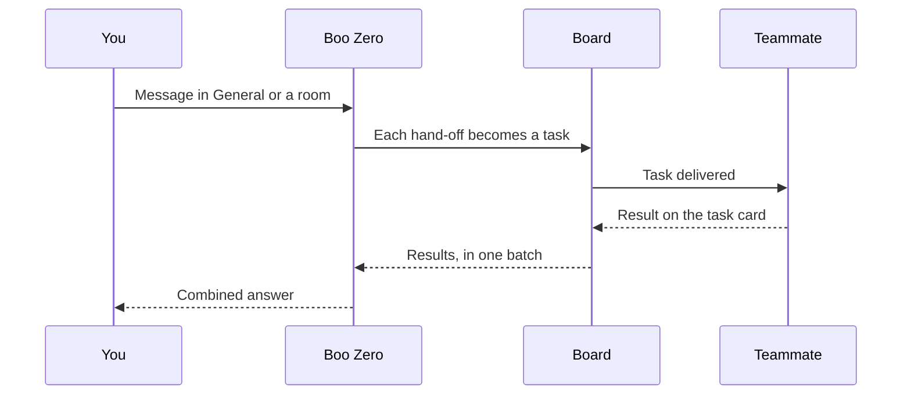

You talk to a team in its chat. The team's leader answers you, or splits the work into tasks for teammates, and every task is a card on the Board. Teammates send their results back to the leader, who replies with the combined answer. This page follows one message through that loop, then explains the two ways Clawboo runs agents.

## The pieces

- **The Clawboo server** is one program that runs in the background on your computer. It runs your teams' work, so closing the browser tab does not stop it. It keeps teams, chats, tasks and memory in a database in your Clawboo folder (`~/.clawboo` by default).
- **The dashboard** is the page you use in your browser. It talks only to that server.
- **Runtimes** are the programs that run agents: Clawboo Native (built in), Claude Code, Codex, Hermes and the OpenClaw Gateway. See [Choose a runtime](/runtimes/index).
- **Providers** are the AI services your agents' prompts go to, such as Anthropic, OpenAI or a local Ollama.

Prompts go only to the providers and apps you connect. There is no Clawboo account, and Clawboo itself sends no telemetry.

## What happens when you send a message

<Steps>

<Step title="You post in a team's chat">

Write in **General** or in a room. To aim the message at one agent, start it with `@` and the agent's name.

</Step>

<Step title="Clawboo picks who answers">

The agent you mentioned answers. Otherwise Boo Zero, your team leader, does. With no Boo Zero, the team's **Leader** answers if it is in this chat, and otherwise the chat's first member.

</Step>

<Step title="The turn runs on the server">

The turn runs on that agent's runtime. You can close the tab; the chat catches up when you come back.

</Step>

<Step title="It answers, or hands off work">

A quick question gets a direct answer. For work with several parts, the leader hands pieces to teammates, and each hand-off becomes a task on the Board, assigned to that teammate. Each runtime signals a hand-off its own way, and Clawboo reads all of them.

</Step>

<Step title="Teammates do their tasks">

Teammates work at the same time. A busy teammate finishes its current task first, and the new one waits in **To do**. A teammate can hand part of its own task to someone else.

</Step>

<Step title="Results come back">

As tasks finish, their results go back to whoever handed out the work, in one batch. Each result also lands on its task card. Clawboo tells the leader which tasks are still out.

</Step>

<Step title="The leader answers you">

The leader combines the results into one reply in the chat. You should see that reply, and the task cards in **Done**.

</Step>

</Steps>

What each agent is told on every turn is listed in [What an agent sees](/concepts/agent-context).

## What you see while it works

- **In the chat**, the reply streams in, and each hand-off appears as a task card with its status, such as **Queued**, **Working** or **Done**.
- **On the Board** and in the chat's **Tasks** card, cards move from **To do** to **In progress** to **Done**. Anything that waits on you collects under **Needs you**.
- **The Team graph** shows which agents are working.
- **The Activity card** shows each tool call as it happens.

## How it ends

- **The answer arrives** in the chat.
- **You press Stop.** While agents in a chat are working, the send button turns into **Stop**. It ends every run in that chat, and their tasks go back to **To do**, where they do not restart on their own. Your other chats keep going.
- **Something fails**, or **something needs you**: see the next section.

## When something goes wrong

| What happens                                                       | What you see                                                                                                                                | What you can do                                                                                |
| ------------------------------------------------------------------ | ------------------------------------------------------------------------------------------------------------------------------------------- | ---------------------------------------------------------------------------------------------- |
| A teammate's run fails                                             | Its task moves to **Needs you** with the reason in a comment, and whoever handed it out is told. Later steps of the same plan are cancelled | Click **Retry**, or use the card's **More** menu to give it to another agent or **Dismiss** it |
| A teammate goes quiet for 8 minutes (24 inside one long tool call) | Clawboo stops the run and the task fails, as above                                                                                          | The same                                                                                       |
| The same teammate fails the same task 3 times                      | Clawboo stops handing that task to it                                                                                                       | Reword the request, or give the task to another agent                                          |
| A hand-off contains a risky word, such as deploy or delete         | The hand-off waits under **Needs you**, and is skipped if nobody answers within 5 minutes                                                   | Allow it or turn it down: see [Approvals](/using/approvals)                                    |

[Troubleshooting](/help/troubleshooting) lists the messages you may see and what to do about each.

## Two ways Clawboo runs agents

Everything above runs on Clawboo's **team chat** path. A second path, the **task runner**, runs one board task at a time, for agent Routines and for runs started through the API. The two paths do not give an agent the same things:

|                                                          | Team chat                                                                                                                                      | Task runner                                                                                                                                                                                                   |
| -------------------------------------------------------- | ---------------------------------------------------------------------------------------------------------------------------------------------- | ------------------------------------------------------------------------------------------------------------------------------------------------------------------------------------------------------------- |
| What runs on it                                          | Messages in General and rooms, hand-offs, plan steps, tasks you give an agent on the Board (including **Retry** and **Assign**), team Routines | Agent Routines on Clawboo Native, Claude Code, Codex and Hermes; runs started with `POST /api/runtimes/:id/run`                                                                                               |
| Where Claude Code, Codex and Hermes work                 | The team's folder, `~/.clawboo/workspaces/<team id>`, shared by the whole team                                                                 | The task's own git worktree when the task names a repository. A task that changes files without one is refused. Research and review tasks, such as agent Routines made in the app, start in the team's folder |
| Clawboo Native file and shell tools                      | File tools stay inside the team's folder. An approved shell command starts there but runs as you, with network access                          | The same, in the worktree, or the team's folder for research and review tasks                                                                                                                                 |
| Work checked before **Done**                             | Never                                                                                                                                          | When the run had a worktree and changed files                                                                                                                                                                 |
| Memory                                                   | Agents look facts up with their memory tools                                                                                                   | The most relevant facts are added at the start                                                                                                                                                                |
| Team rules, teammates and your introduction              | Included                                                                                                                                       | Not included                                                                                                                                                                                                  |
| Circuit breakers                                         | None; the team limits below apply instead                                                                                                      | Yes                                                                                                                                                                                                           |
| A hard-cap budget                                        | Refuses new runs once reached; stops a Clawboo Native run partway only on a priced model                                                       | Refuses new runs once reached, and stops a Clawboo Native run partway                                                                                                                                         |
| Restart in a fresh session when the context window fills | No                                                                                                                                             | Up to 3 times per task                                                                                                                                                                                        |

An agent Routine you create in the app sends only its instructions, so it runs on the task runner without a repository: no worktree and no checks, but with memory added and circuit breakers on. A team Routine posts its instructions into the team's chat, like a message from you.

Several rows have their own page: [What agents can do](/concepts/permissions) covers where agents work, [How work is checked](/concepts/verification) covers checks, and [Budgets and guardrails](/concepts/governance) covers budgets and breakers.

### OpenClaw and one-to-one chat

- **OpenClaw agents never use the task runner.** In team chat they run over the Clawboo server's own connection to the OpenClaw Gateway, so they keep working with the tab closed. An OpenClaw agent Routine goes through a separate dispatcher, with no worktree, no checks and no circuit breakers, and it is stopped after 10 minutes by default.
- **A one-to-one chat** on an agent's page is a plain conversation, outside both paths. A Clawboo Native, Claude Code, Codex or Hermes agent's chat runs on the server and starts in the agent's team folder. An OpenClaw agent's chat goes over the Gateway connection your browser holds.

### The team's own limits

Team chat has no circuit breakers, but it has limits of its own:

- One turn can hand off at most 8 tasks. Extra hand-offs are dropped with a note.
- Hand-offs go at most three levels below the leader. The agent on a third-level task must do the work itself.
- Clawboo stops handing a task to a teammate that has failed it 3 times in a row.
- A teammate that goes quiet for 8 minutes is stopped (24 minutes while inside one tool call).

[Limits and defaults](/reference/limits-and-defaults) lists every number.

<Accordion title="Under the hood">

- **One server.** The `clawboo` command starts a server that serves the dashboard and the `/api/*` routes on one port, the first free one from 18790. It listens on `127.0.0.1` unless you set `HOST`. [CLI](/reference/cli) covers ports and stopping the server, and [Security](/operating/security) covers the access token.
- **Two engines.** Team chat runs on one team engine per chat room (`teamOrchestrator.ts` and `serverDeliver.ts` in `apps/web/server/lib/teamChat/`). The task runner is `runTaskOnRuntime` in `apps/web/server/lib/executorRunner.ts`; see [Executor runner](/internals/executor-runner).
- **Hand-off signals.** A Clawboo Native leader calls its `delegate` tool. A Claude Code, Codex or Hermes leader calls the `team_delegate` tool. An OpenClaw agent writes a `<delegate to="@Name">` block, or uses `sessions_send`. A `<plan>` block sets up an ordered chain of steps. [Delegation and orchestration](/concepts/delegation-and-orchestration) has the details.
- **Clawboo's tools.** Every runtime reaches Clawboo's Tasks, Memory and Tools MCP servers, and every runtime except OpenClaw also gets TeamChat. See [MCP servers](/operating/mcp-servers).
- **Where agents are stored.** OpenClaw agents are mirrored from the Gateway. Other agents exist only in Clawboo's database.
- **The event log.** Each step is recorded in an event log that feeds the Activity cards, the Observability panel and the live status on a team's graph. A graph's layout comes from the team's members and each agent's routing, not from the log.
- **Other traffic.** Besides your providers and connected apps, Clawboo contacts GitHub for the marketplace catalog and npm to check for updates.

</Accordion>

## Related

- [Key concepts](/concepts/index): every term on this page in one sentence.
- [What an agent sees](/concepts/agent-context): the context each turn and run carries.
- [What agents can do](/concepts/permissions): what each runtime can reach on your computer.
- [How work is checked](/concepts/verification): when finished work is tested.
- [Work with your team in chat](/using/team-chat): rooms, Stop, `/reset` and the Tasks card.
- [Delegation and orchestration](/concepts/delegation-and-orchestration): how hand-offs work in detail.
