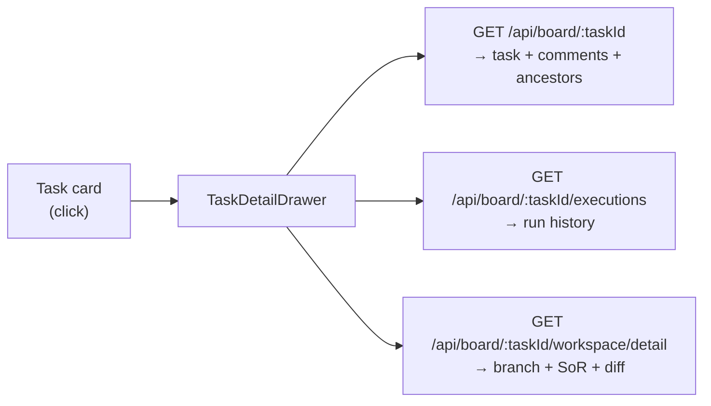
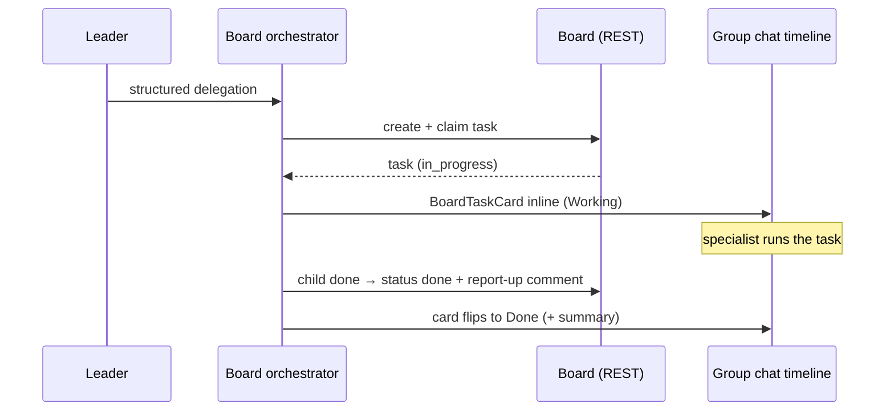

Use this page when you want to see what your team is actually doing; the durable kanban [board](/concepts/the-board) is Clawboo's transactional record of every task, who owns it, whether it verified, and what it cost. The board is canonical; the group chat is narration of it. This page covers the **Board** panel (its views, columns and cards), the per-task **drawer**, and the **chat-fused board** that interleaves task cards directly into group chat.

The Board panel lives in the `BoardPanel` React module and reads `GET /api/board`, plus `GET /api/schedules/occurrences` for the upcoming routine runs its calendar views show; the drawer (`TaskDetailDrawer`) reads `GET /api/board/:taskId`, `GET /api/board/:taskId/executions`, and `GET /api/board/:taskId/workspace/detail`. For the underlying model, the state machine, the atomic claim, and dependency chains, see [The board](/concepts/the-board). For the full request/response shapes, see the [Board API reference](/reference/rest-api/board).


## Prerequisites

<Note>
The Board panel is always available. Its subsystem is always on, so the panel renders real content with no feature gate; an empty board is just a board with no tasks yet.
</Note>

- A running Clawboo dashboard (`clawboo`).
- Tasks on the board. Tasks appear when a team delegates work in group chat, when an agent claims work, or when you give an agent a task yourself with **New task**. A fresh install with no team activity shows the **No tasks yet** empty state.

## Open the board

Click **Board** (the kanban-square icon) in the sidebar's nav, or press **`Cmd/Ctrl + 2`**. The panel mounts in the main content area.

<Note>
The number shortcuts open four of the sidebar's views: `Cmd/Ctrl+1` the Org chart, `+2` Board, `+3` Connectors, `+4` Memory. Marketplace sits in the sidebar without one, and the rest (Fleet, Routines, Tokens Used, System, and so on) live in the Settings modal (`Cmd/Ctrl+,`).
</Note>

## The header and the toolbar

The board has two thin bars above its columns.

The **header** holds the **Board** title, the team picker (**All teams**, or one team), the GitHub **Star** button, and **New task**, which gives an agent a task (press **C** while focus is on the board). When something changed while you were away, a chip beside the team picker says what (see [Since you last looked](#since-you-last-looked)); otherwise there is nothing between the team picker and the Star.

The **toolbar** under it carries the range on the left in the calendar views (on Kanban it reads "Every task by status, newest first"), and the board's controls on the right:

| Control              | What it does                                                                                                                                                                                                                                     |
| -------------------- | ------------------------------------------------------------------------------------------------------------------------------------------------------------------------------------------------------------------------------------------------ |
| **Needs you** chip   | Shown while something waits on you and today's Needs you cell is out of sight. Click it to bring the cell back into view with focus on it.                                                                                                       |
| **Agents working**   | "2 agents working", with their faces, while any agent has a run going. Press it to show only the work running now, and again to show everything. It is hidden while nobody is working, unless its filter is on.                                  |
| **Find** (magnifier) | Searches tasks, agents and routines. Opens with **/** while focus is on the board, or **Cmd/Ctrl+K** anywhere on the board page. See [Find](#find).                                                                                              |
| **Filter**           | Narrows the board to some agents (the team's agents, or every team's under **All teams**), to **No agent** (tasks nobody has), and to **Running now**. Pick several; the button shows how many are on, and **Clear filters** turns them all off. |
| **Display**          | What the board shows: **Routine runs** (in the calendar views, with how many are coming up), the **Cancelled column**, and on every card its **Cost** and **Time**.                                                                              |
| **View** menu        | Names the view on screen and switches it: **Kanban** (**K**), **Today** (**D**), **Week** (**W**), **Month** (**M**).                                                                                                                            |

There is no refresh button: the board polls `GET /api/board` every five seconds while it is on screen, and a small spinner shows at the start of the controls only when a background read takes longer than about 300 ms.

The filter applies to the columns, Needs you's tasks and the calendar alike, and lasts for this visit; it starts over when you switch team. Find still searches every task. When the filters hide every task, the board says **No tasks match these filters** and offers **Clear filters**, so a narrowed board never looks like it lost its work.

## The views

The board opens on **Kanban** the first time. Pick another view from the view menu, or with its key, and the board opens on that view from then on in this browser. The other choices on this page (the Routine runs switch, whether Cancelled is open, and the card properties) are remembered the same way.

| View   | Rows                                                                                               |
| ------ | -------------------------------------------------------------------------------------------------- |
| Kanban | One row holding every task, newest first, with no dates. The default                               |
| Today  | Today alone, with the Earlier row above it. Every card in today's cells shows, with no **+N more** |
| Week   | The seven days of a week, starting on your locale's first weekday                                  |
| Month  | Every day of a month                                                                               |

**Kanban** is the board without days: the status columns, **Needs you** first, and every task in its column, newest first. A card says how long ago it was added or finished ("4m ago", "3h ago", "Yesterday", "3d ago", then its date). It has no routine runs, because they belong to dates, and **T** does nothing there, because it has no today row. A column with nothing in it says so in its own words: "Nothing parked", "Nothing waiting to start", "Nothing running", "Nothing finished yet".

**Today**, **Week** and **Month** are calendar views: the status columns run across the top, and the days run down the side, so every card sits in one cell: its status, on its day. **Today** always shows today: it has no chevrons and no **Today** button, and the day changes with the clock at midnight. Picking a date in its date picker opens that date's week. Its Earlier row still shows three cards a cell, so older work cannot push today out of sight.

### Which day a card sits on

In the calendar views:

- **Open work sits on the day it was added.** A card stays in its row while it moves from Backlog to To do to In progress, so a row reads as "what was asked for that day, and where it stands now".
- **Finished work sits on the day it finished.** A card that reaches **Done** or **Cancelled** moves to the row of the day it ended. When you finish a card yourself and it sits on another day, you pick that day (see [Moving a task by drag-and-drop](#moving-a-task-by-drag-and-drop)).
- **Upcoming routine runs sit on the days they are scheduled**, in **To do** (see [Routine runs](#routine-runs)).
- **Open work from before the range** is gathered in an **Earlier** row at the top, so nothing still in play is hidden by looking at a later week. It appears while the range is the current one or a future one. A past week shows only its own days. The row opens by itself when it holds work that is running or waiting to start, and stays folded when everything in it is parked in Backlog; either way its day column says what it holds ("1 running", "1 to do", "2 parked"). Once you move a card while it is open, it stays open for that range, so the card you just set down does not fold away. Fold or open it with its chevron, and that choice holds until you close the browser tab.

Each calendar card carries a small stamp at the right of its detail row: the time it was added, or for finished work the time it finished. A card in the Earlier row shows its date instead. A task that is running shows how long its current run has been going ("14m", "2h 5m") behind a small live dot, counting up as you watch. Hover the stamp for the full date and time, and for a running task when its run started.

### Reading the board

The board is calm on purpose: neutral lanes and cards, with colour kept to a few small marks. In the calendar views each lane runs unbroken from top to bottom and the days are fine rules inside it, so you read work down a column; a heavier rule runs across the board between weeks in Month view.

- **Each column has a status mark** beside its name: a small ring drawn differently for each status (dashed for Backlog, open for To do, half filled for In progress, a filled check for Done), with a plain count after the name. The marks are the only colour on the columns, apart from **Needs you**, whose reasons are amber. Every lane is the same faint grey, and cards are plain.
- **The day column** shows each day the way a calendar heads it: the weekday over the date. Hover a date for its full name, whether it is yesterday, today or tomorrow, and how many tasks and routine runs it holds. The 1st of a month carries the month's name.
- **Today** has its date in a red circle. Red appears nowhere else in the grid, so today is always the one red mark, and focus rings on the board are drawn in ink for the same reason.
- **Pick a date** in the day column, or in the date picker, to light its whole row across the board. Pick it again, press **Escape**, or move to another range to put it out. Only one day is lit at a time.
- **Past days** show their date and weekday in a quieter grey, and **weekends** (your locale's) their weekday; their cards keep full contrast.
- **Empty days fold into a seam.** A day with nothing on it collapses to a thin dashed line across the board, the way a spreadsheet shows hidden rows, and empty days in a row share one seam. The dates either side of it show which days it holds, and a small handle in the day column repeats them ("Tue 13", or "15–17"). Click the handle, or anywhere along the line, to open those days; the first of them then carries a fold button to close them again. In Month view a seam never crosses into the next week. Today never folds, and neither does a day you picked.
- **A day with only routine runs** keeps a thin row of its own, with each run on one line (its time, then the routine's name), so the schedule stays visible without taking a full day's height.
- **Work comes before routines.** In a cell, the day's cards come first and its routine runs under them. On a day that has work, a run is one line too, except today's runs and the next run on screen, which keep their full strip.
- **Finished work from a day gone by takes two lines**: its title on one line (hover the card for the whole title) and its detail row under it, in a past day's row and on Kanban alike. The card open in the drawer and the one you just touched keep their full title.
- A cell shows three cards (two in Month view), then **+N more**, which opens the rest in place, and **Show less** closes it again. The cards shown are the newest, plus the one open in the drawer and the one you just added or moved, so a card never disappears behind **+N more** right after you touch it. **Today** and **Kanban** show every card, except in Today's Earlier row, which keeps to three.
- The column headers show how many tasks each column holds (in the range on screen, or every task on Kanban), as a plain number, and nothing when it is none. **Needs you** shows its count only while something waits.
- The column headers and the day column cast a soft shadow once the board has scrolled under them.
- Every column fits a 1440-pixel-wide window with Cancelled folded, and on a wider screen the columns grow. When there are more columns than fit, the right edge fades out; scroll sideways to reach them.
- When an agent moves a card or adds one, the card fades in where it landed. Your own moves settle quietly instead.

### Moving through time

- The **Today** button (read out as "Go to today", since the view beside it is also called Today) jumps to the current week or month and scrolls today's row into view, and today's date pings once when it gets there. (The **Today** view is different: it shows today alone.) While today is out of sight, a small arrow on the button points the way: up or down within the range on screen, left or right to another range. The chevrons step one week or month back or forward.
- Click the range title (for example "Oct 25 to 31, 2026") to open a date picker. The range on screen is banded, today is ringed, and a dot marks each day that holds a task. Pick any day to jump to its week or month and light its row. Arrow keys move a day or a week, **Page Up** and **Page Down** a month, **Home** and **End** the ends of the week, **Enter** picks.
- Keyboard, while focus is on the board: **T** goes to today, the **left and right arrows** step back and forward, **K**, **D**, **W** and **M** switch to Kanban, Today, Week and Month (**A**, Kanban's old name All, still works), **/** opens [Find](#find), **C** opens **New task**, and **Escape** puts out a lit day. These keys do nothing while you are typing, while a dialog or menu is open, mid-drag, or while focus is anywhere outside the board. With focus inside the grid itself, the arrows scroll it instead. **Cmd/Ctrl+K** opens Find from anywhere on the board page, even from a field, but not while a dialog, a menu or the drawer is open.

Opening the board, or changing the view, brings today's row into view, and a month opens with today at the top. A week or month without today opens at its top, and a day picked in the date picker is scrolled to the top. The new range slides in from the side you moved toward.

### Find

The magnifier in the toolbar, **/** while focus is on the board, or **Cmd/Ctrl+K** opens **Find**. Type part of a task's title, the name of the agent working it, words from its details, or the first characters of its id; routines match by name, except on Kanban, which draws no routine runs. Results are grouped by where they are against the range on screen: **In this week**, **Before this week** and **After this week** (in Month, the same for the month; in Today, **Today**, **Before today** and **After today**; on Kanban, just **Tasks**), then **Routines**. Each task shows its column's status mark (a cancelled one is struck through, and a screen reader hears the column's name), its day and its agent. The arrow keys move through them; the highlight stays on the same result when the board refreshes under it.

- **Enter** shows the task: the board moves to its day (opening its week, the Earlier row, Cancelled, or the rest of **Needs you** when it is there), and the card gets focus and a brief ring.
- **Shift+Enter** opens the task's drawer, with the card brought into view behind it.
- **Enter** on a routine opens the routine.
- **Escape** closes Find and puts focus back on the magnifier.

### Since you last looked

When you come back to the board after being away (another view, another tab or app, or a closed browser), a chip in the header beside the team picker says what changed meanwhile: **Since 2:10 PM: 3 done, 2 started, 1 new**. The cards that changed carry a small ink dot before their title. A dot goes once you have looked at the card: rest the pointer or keyboard focus on it for a moment, open it, or drag it. **Show** brings the oldest change you have not looked at into view, one at a time; **Mark seen** clears the chip and every dot, and keyboard focus moves to the range title (to Find on Kanban). Changes that sent work to **Needs you** are counted but not dotted, because Needs you lists them already, and once only they are left, **Show** goes to Needs you.

What changed while you watched is not repeated here: an agent's moves made while the board is in front of you are shown as they happen. Neither are your own moves or the tasks you add. The board remembers what you last saw for each team filter, in this browser, and what you saw under one filter counts under the others that show the same card: a change you watched or looked at under **All teams** is not news when you switch to its team.

### Routine runs

In the calendar views, the upcoming runs of your [routines](/using/routines) appear in **To do**, on the days they will run. A run is not a task yet, so it looks different from a card: a dashed outline with no badges and no drag handle. The routine's name comes first, and under it a repeat icon and the time. In the current week or month the next run firms up to a solid edge. While a routine is running, its next run is not firmed up: the scheduler sets that run from when the current one finishes, so the run on the calendar happens only if the current one has finished by then, and the run and its popover say so. A run whose time has passed leaves the calendar, and what it made appears instead. A routine that runs several times in a day shows once that day, with the count ("6 runs") after the time of the first one.

When an agent routine runs, it becomes a real task card on that same day. A team routine posts to its team chat, where the lead takes it from there, and the tasks the team then creates appear as they are made.

Click a run to see the routine's schedule in plain words (the popover grows from the run, which stays lit while it is open) (for example "Weekdays at 9:00 AM"), where it goes, its next runs, and what happens when it runs. From there:

- **Run now** starts the routine immediately.
- **Open routine** opens the full routine, where you can edit, pause, resume or delete it, without leaving the board.

Only routines that will actually run are shown: a paused routine, one stopped after a failed run, and a one-time routine that already ran have none. OpenClaw's own cron jobs are not shown; they belong to the Gateway, not to the board. The team filter applies, and a routine for an agent on no team shows under **All teams**. **Routine runs** in **Display** hides or shows the runs, and says how many are coming up in the range on screen.

The runs are worked out by the server, in the time zone the scheduler fires in, so the times on the calendar are the times the routines will run, shown in your local time. When the server's time zone is not yours, a run's schedule names it (for example "Weekdays at 9:00 AM, New York time"). A routine whose target can no longer receive a run (its team or agent was archived, say) shows no runs, because its first fire would fail.

### Needs you, and Cancelled

**Needs you** is the first column. In the calendar views it has only one day: today. Whatever is waiting on a person is waiting now, so its approvals and stuck tasks sit in today's row, approvals first, three at a time with **+N more** for the rest (in **Today** and on **Kanban**, all of them). Each stuck task names why it waits in amber (hover the line to see when it started waiting), and carries the one action that gets it moving (see [Things that need you](#things-that-need-you)). Tasks that broke the same way share one card: the cause as its heading, the reason and how many tasks, the tasks under it, and **Retry all**, with **Dismiss all** in its **...** menu; both ask once and report once. A card that no longer needs you fades away. The column's header counts every task waiting, and with nothing waiting a calm Boo says so.

Looking at another week or month folds Needs you to a narrow rail with its count; click it to go back to today. Whenever today's Needs you cell is out of sight (another range, or scrolled away on either axis), the **Needs you** chip in the toolbar does the same and puts focus on the cell.

**Cancelled** is folded into a narrow rail by default, with its count at the top. Click the rail to open the column, and the fold button in its header to close it again; focus moves to the other button each time. **Cancelled column** in **Display** does the same. Cancelling a card yourself opens the column when the board is showing the day it went to, and scrolls the card into view, so it does not vanish into the rail.

Each move you make shows one toast saying what happened ("Marked done on Thu, Oct 15."). When the card went to a day the board is not showing, the toast carries **Show**, which takes you there. Adding a task while today's row is out of sight shows a toast with **Go to today**.

## The columns

The board renders a **Needs you** column first, then five status columns in lifecycle order:

| Column      | Holds                                                                    |
| ----------- | ------------------------------------------------------------------------ |
| Needs you   | Pending approvals, and every task that will not move until a person acts |
| Backlog     | `backlog` tasks: triaged, not yet ready to work                          |
| To do       | `todo` tasks that will run on their own: queued for their agent          |
| In progress | `in_progress` tasks, plus `in_review` ones (marked **Verifying**)        |
| Done        | `done` tasks                                                             |
| Cancelled   | `cancelled` tasks                                                        |

There is no **In review** column and no **Blocked** column. `in_review` is the automated [verification](/concepts/verification) step: the builder's work is being checked by the deterministic gate and the critic, and nobody is waiting on you, so those cards stay in **In progress**, marked **Verifying**. When a verdict does need a person, the task moves to `blocked`, and every `blocked` task needs a person, so it lives in **Needs you**. See [Things that need you](#things-that-need-you).

Each column shows its label and a count of the tasks in it: the count for the range on screen, or every task on Kanban. The board polls `GET /api/board` every five seconds, so status changes and new tasks appear without a manual refresh.

Those reads overlap on purpose (the poll, **Retry** after a failed load, and the reconcile that follows a manual create all share one path), so they are **sequenced**: a response may only update the board while it is still the newest read and no local change has been committed since it was issued. A read that resolves out of order is discarded and the next poll reconciles instead, so a card you just created or dragged is never briefly reverted by a request that was already in flight.

The board is a live projection of agent activity: agents create and move cards as they work. The manual path is real, though: **New task** in the header (or **C**, or the **+** in To do's header) gives one agent a task, each task's status is editable from its [drawer](#the-task-detail-drawer), you can **drag a card between columns** (see below), every card in **Needs you** carries the action that gets it moving again, and a [reply](#replying-to-the-agent) from the drawer reaches the agent.

A task whose status falls outside the canonical ones is not silently dropped; an **Other** column is appended only when such a task exists, so off-list statuses stay visible and counted.

<Note>
Until the first fetch resolves, the board shows its lanes under the real column titles, with card-shaped placeholders. If that first fetch fails, the board shows a "Couldn't load the board" error with a **Retry** link (distinct from a genuinely empty board). A *transient* poll failure after a good load keeps the last good snapshot rather than blanking an actively-watched board.
</Note>

A genuinely empty board (loaded fine, zero tasks, and no routine runs in the range) shows one **"No tasks yet"** empty state instead of a row of identical empty columns. It explains that agents populate the board as work is delegated, and offers a **New task** button to give an agent the first one yourself. **Needs you** still shows beside it as a column of its own, because approvals do not depend on the task list.

## Giving an agent a task

**New task** in the header hands one agent a task, the human counterpart to Boo Zero delegating. Press **C** while focus is on the board, or the **+** in To do's header, to open it too. It leads with one field, **What should get done?**, and suggests who should do it:

- The words of your sentence are matched against each agent's name and the one-line role in its SOUL.md. A word in the name counts more than a word in the role, and forms of a word count as one (_draft_, _drafts_, _drafting_). OpenClaw agents have no role there, so they match by name only.
- With no match, it suggests the agent you last gave a task to in this browser, then the team lead, then the team's first agent.
- A note beside the agent says why: **Fits the task**, **Last used** or **Team lead**.

The agent picker lists the agents of the board's team filter, or every team's agents, each with its team's name, when the board shows all teams. Picking an agent also picks its team, and a picked agent stays picked while you keep typing. **Enter** sends it.

**More options** opens the full form: **Team**, **Agent** (that team's members) and optional **Details**: context, constraints, what done looks like.

**Send to _agent_** writes it through `POST /api/board` with an `assigneeAgentId`. The server binds the task to that agent and starts it right away, so the card appears in **To do** and moves to **In progress** as soon as the agent picks it up. If the agent is busy with another task or still replying in chat, the task waits in **To do** and runs the moment the agent is free. The agent receives the title and the details together.

Only that agent works on it. The task is not routed through Boo Zero, and when it finishes, its result is recorded on the task card (on the board and in the team's group chat) rather than handed to the team lead to act on. If the run fails, the card moves to **Needs you** with the reason. On success a toast confirms who got it; a poll that was already in flight when the task was created is discarded rather than blanking the new card. A failed write keeps the dialog open and toasts the error.

## Things that need you

**Needs you** is always the first column and always shows what it holds, even when that is nothing ("Nothing needs you right now"). In the calendar views its items sit in today's row (see [Needs you, and Cancelled](#needs-you-and-cancelled)); on Kanban they sit in its one row. It is scoped to the team filter and holds two kinds of item:

- **Approval pending.** An agent wants to run a command, call a risky tool, or make a risky delegation. Each request renders as its approval card with **Allow Once / Always / Deny**. These come from their own poll rather than `GET /api/board`, so a board outage never hides a time-sensitive gate. See [Approvals](/using/approvals).
- **Tasks nothing will move by themselves.** Each card shows the task's title, then why it waits in amber with the reason the run recorded beside it, then whose it is and **one action**, the one its reason calls for:

| Reason        | What happened                                                                    | The card's action                     |
| ------------- | -------------------------------------------------------------------------------- | ------------------------------------- |
| Failed        | The last run ended in an error (a crash, a provider error, a killed run)         | Retry                                 |
| Timed out     | The agent stopped responding and the run was ended                               | Retry                                 |
| Failed 2×, 3× | The last runs failed in a row; after three, Clawboo stops retrying it on its own | Retry                                 |
| Stopped       | You pressed Stop on its run; it will not restart on its own                      | Retry                                 |
| Needs review  | Verification could not pass it                                                   | Review                                |
| Blocked       | An agent marked it blocked                                                       | Open                                  |
| Unassigned    | No agent is bound to it, so nobody will ever pick it up                          | Assign                                |
| Not started   | It was moved to In progress by hand, which starts no run                         | Assign, or Retry when it has an agent |

A failed or timed-out task with no agent to retry it leads with **Assign** instead. **Review** and **Open** open the task's drawer, where the check's findings or the story of the block are, with every action at hand. The rest are in the card's **...** menu: **Retry** when the card leads with something else, the team's agents under **Assign to** (or **Give to someone else** when the task already has an agent), and **Dismiss**.

**Retry** puts the task back in **To do** and sends it straight to its agent, even one Clawboo had stopped retrying automatically: the automatic limit exists to stop the machine looping, not to overrule you. **Assign** gives the task to a member of its team and starts it. **Dismiss** asks first, then moves the task to **Cancelled**, along with any later plan steps that were waiting on it. Each action also writes a note on the task's comments (for example "Retry requested."), so the trail shows who did what. A [reply](#replying-to-the-agent) to a task that waits on you starts it again too, with your words in front of the agent, as long as it has an agent: a reply to an **Unassigned** task is only saved, so assign it first.

A stuck task does not hold anything else up. Its agent is free for other work, the tasks that depended on a failed one are cancelled so they do not wait forever, and a team lead waiting on results is told about the failure instead of being kept waiting. Why a task is stuck is computed by the server from the task's run history and returned as its `attention` field; see the [Board API](/reference/rest-api/board).

## Moving a task by drag-and-drop

With a mouse or a pen, drag a card from anywhere on it; a click that does not move still opens it. Each card also has a **grip handle** at its top right, shown on keyboard focus and on touch screens, for picking it up from the keyboard or by touch. The card in your hand keeps its column's width and lifts with a deeper shadow. Dragging a card to another column is a status change: it writes through the same `PATCH /api/board/:taskId` path as the drawer's status editor, so the server stays authoritative and the same rules apply.

- **Only legal moves are offered.** Mid-drag, columns the card can't legally transition to (per the [state machine](/concepts/the-board)) are dimmed and won't accept a drop, and so is **Needs you**, which never takes a card. Terminal cards (`done` / `cancelled`) and off-list **Other** cards aren't draggable at all. Cards in **Needs you** are moved with their own actions (Retry, Assign, Dismiss) instead of by dragging.
- **A drop goes where the pointer is.** Letting go over a column that refuses the card, over Needs you, or outside the columns sends the card back, even when the card in your hand overlaps a column that would take it. The card's own column does not light up, since dropping it there changes nothing.
- **In progress is where an agent's run puts a card.** It takes no card from another column, and the drawer does not offer it: moving a card there by hand would start nothing and leave it looking worked on. A card left there earlier with no agent and no run shows in **Needs you** as **Not started**.
- **Finishing asks which day.** Dropping a card on **Done** or **Cancelled** when it sits on a day other than today opens a short prompt: **Today**, the day it sits on, or **Another day**, picked from a small calendar that runs from the day it was added to today. The card lands on the day you choose. A card from today's row goes to Done without a question.
- **Cancelling always asks**, because it cannot be undone: "It moves to Cancelled and will not run again." Later plan steps that were waiting on the task are cancelled with it, and the toast says how many.
- **A running agent is stopped.** When an agent is still working on the card, the prompt says so, and moving the card to Done, Cancelled or To do stops that run. Back in **To do**, its agent starts it again from the beginning; the confirmation says this first. Whoever delegated the task is told a person decided it, so a cancelled task is not handed out again.
- **Your move stands.** An agent whose run you overruled cannot put the card back. Once you move a card, its agent's own status changes through its board tools (`update_task_status`, `block_task`, `unblock_task`) are refused until the task runs again, and the agent is told the status is yours to set and not to retry. A run that starts after your move works the card as usual. See the [tasks MCP tools](/reference/mcp-tools).
- **A failed check is asked about before the card moves.** Dropping a card whose verification did not pass on Done opens the same prompt as **Complete … anyway?**; confirming sends the audited override.
- **To do waits for an agent.** A card bound to an agent is picked up within seconds of landing in To do. A card with no agent bound is drawn in **Needs you** instead, with **Assign**; while you drag it, the outline sits in today's Needs you cell and reads "Needs an agent".
- **Optimistic + poll-safe.** The card moves instantly and is reconciled against the server; a rejected move rolls back with a toast. Neither an in-flight move nor a just-committed one is reverted by the five-second poll, including a poll already in flight when the move landed.
- **Keyboard and touch.** Focus a card's handle and press **Space** to pick it up, **arrow keys** to choose a column, **Space** to drop, **Escape** to cancel; on a touch screen, drag by the handle.
- **Letting go.** A move that lands at once drops straight into its new cell. One that asks first flies back to where it came from until you answer.
- **Where it lands.** On Kanban the column you point at shows a dashed outline reading "Moves here". In the calendar views a move between Backlog, To do and In progress keeps the card on its day, so it slides across its own row; while you drag, the cell it will land in shows a dashed outline ("Moves here", "Done today", "Done, pick the day"), placed where the card will sit in that cell's order, and the folded Cancelled rail shows the same words. A line under the card in your hand says when its row is not the one you are pointing at ("Stays on Mon, Oct 12", "You'll pick the day next", "Lands on today's row"). Routine runs cannot be dragged.

Clicking a card still opens the drawer: a click and a drag don't conflict.

## Task cards

Each task is a card showing its title (up to two lines) and one quiet row of details, in every view:

- **Who has it**: the agent's avatar. In **To do**, a card no agent is bound to shows a dashed empty circle instead.
- **One status mark**: **Verifying**, with its status mark, on an `in_review` task while its verification runs; once a [verification](/concepts/verification) verdict is stored, an amber cross for `fail`, an amber dashed circle for `completed_with_debt`, and a green check for `pass` (but not on a Done card, whose column already says it). Otherwise the card shows its cost. A mark that takes the cost's place moves the cost into the card's tooltip.
- **Cost**: what every run of the task cost, summed from its [run history](#run-history) (the task's `runCost`). It is shown only once a run has recorded a cost, so a task that never ran, or whose only run was stopped before it priced itself, shows none. A card has room for cents: a cost under a cent reads `<$0.01`, an exactly-zero cost reads `$0.000`, and a figure with a tilde (`~$0.18`) is at least partly an estimate: the runtime reported no charge for a run, so Clawboo priced it from the run's token usage, or from the length of its prompt and reply when there was no usage. Hover the figure for the exact amount and which kind it is; the drawer shows four decimals.
- **Subtask**: a small corner arrow when the task has a `parentTaskId` (it was spawned by a delegation) and no mark or cost is shown; otherwise their tooltip says it is a subtask.
- **The stamp**: when it was added or finished (a time in the calendar views, a date in the Earlier row, how long ago on Kanban), or how long its run has been going. See [Which day a card sits on](#which-day-a-card-sits-on).

The card does not name its runtime; the drawer does. **Display** turns **Cost** and **Time** off and on for every card at once.

Click any card to open its drawer.

## The task-detail drawer

Clicking a card opens its drawer (`TaskDetailDrawer`) on the right, laid out like a document. It loads three reads in parallel (the task itself, its run history, and its workspace detail) and shows a placeholder until the task's own detail arrives. Press `Escape`, click **Close**, or click the scrim to close.




The bar at the top has up and down arrows and where the task sits in its column ("2 of 4"). **J** and **K** step to the next and previous task in the same column without closing the drawer, in the order the board draws them, as the arrows do. They work while focus is in the drawer, but not while you are typing in a field or have a menu open. In **Needs you** they step through its stuck tasks; in the calendar views the Earlier row's cards count only while that row is open. A task the board is not showing (another range, or filtered out) has no arrows.

Under the title, small pills give its status (or **Needs you**), its agent and its team. Then come its sections, top to bottom. Each folds from its heading, and a section with nothing in it is not drawn.

### Needs you

Shown only for a task in the **Needs you** column: why it waits, the reason in full, and every way to get it moving: **Retry** (when it has an agent), **Assign to…** (or **Give to someone else…**), and **Dismiss**.

### The agent's report

Headed with the agent's name ("Rin's report"): what the agent reported when it finished, shown once and rendered as the Markdown it wrote.

### Brief

The task's description, when it says more than the title: for a task you gave an agent, the details you wrote.

### Properties

**Status**, **Runtime** (the agent's runtime for open work, the runtime that ran it for finished work; **Unknown** for an agent Clawboo does not know, **Not assigned** when no agent is bound), **Cost** (the same run total as the card, to four decimals and with `est.` when it is an estimate, or "None recorded" when no run recorded a cost), **Added**, **Finished**, and for a subtask its **Parent** (click it to open that task in the drawer) and, when the chain goes further up, **Part of** (the task at its top).

**Status** is an inline editor, not just a label: a dropdown that offers only the transitions the [state machine](/concepts/the-board) permits from the current status (minus **In progress** and **In review**, which only an agent's run and its verification put a task in) (so it never lets you pick a move the server would reject), writes through `PATCH /api/board/:taskId`, and updates optimistically, rolling back and toasting if the write is refused, with the message naming the cause (an illegal transition vs. the verification gate). A committed change also moves the card to its new column on the board immediately rather than waiting for the five-second poll; it goes through the same shared commit path as [drag-and-drop](#moving-a-task-by-drag-and-drop), so a read already in flight can't snap the card back. Releasing a task to **To do** additionally clears its assignee, runtime, and stored verdict, so the card's verification mark disappears, matching what the server writes. Choosing **Done** or **Cancelled** asks the same questions a drag does: which day it finished, and a confirmation for a cancel, a running agent or a failed check. Terminal tasks (`done` / `cancelled`) have no legal moves, so the control locks.

When a task carries a non-promotable [verification](/concepts/verification) verdict, choosing Done asks **"Complete … anyway?"** before anything moves, and confirming submits with the server's `humanOverride`. If the verdict changed since the board last read it and the server still refuses the move, the editor doesn't dead-end: it offers a **"Complete anyway"** confirmation that re-submits with the override. That's the supported path for a human shipping despite a non-promotable verdict, and, like on the server, the override is **recorded in the audit log**. An _illegal_ transition can't be overridden this way (the override only bypasses the verification gate, not the state machine). This lives in the shared status-mutation path, so it works the same whether you change status from this drawer or by [dragging a card](#moving-a-task-by-drag-and-drop) to the Done column.

### Verification

Shown when the task has a stored [verification verdict](/concepts/verification): the verdict in words (**Passed**, **Failed**, **Passed with debt**), the check the gate ran and where it came from (set for the team, from the task setup, or written by the agent, which is flagged, since the builder then picked what it is judged by), who reviewed it (runtime and model, surfaced so you can judge a same-model review's independence caveat, or a note that the review did not complete or returned nothing), any debt notes, and any critic findings (severity and title). A task with no verdict has no Verification section; _unverified_ is not _failing_, and an un-run gate does not block a task.

### Workspace

Shown when the task has a git [worktree](/concepts/worktrees-and-handoff), read from `GET /api/board/:taskId/workspace/detail`:

- **Branch** (`clawboo/task-<id>`) and the absolute **Worktree** path.
- **Changes**, a diff summary (`N files, +insertions −deletions`).
- **System-of-record files**: `TASK.md`, `task-progress.md`, `DECISIONS.json`, `init.sh`, `VERIFICATION.md`, `AGENT_HANDOFF.json` (only those present), each as a collapsible disclosure showing its contents.
- The **Diff** against the branch-point baseline (the SoR bookkeeping files are excluded from it).
- The live view of the same worktree (file tree, change badges, the selected file's diff) when the task has an agent, and a preview of what it produced.

Research and review tasks, and work not yet provisioned, have no worktree and no Workspace section.

### Run history

Every spawned run for the task (`GET /api/board/:taskId/executions`), oldest first, with the count in the heading. Each row shows the runtime that ran it by name (`runtime`, falling back to `executorType`; the team engine records every run it starts with the executor `openclaw`, whatever runtime the agent uses), how it ended (**Succeeded**, **Failed**, **Timed out**, **Cancelled**, or **Running**), when it started, its cost (marked `~$0.0042 est.` when it is an estimate, and absent when the run recorded none), and its tokens (`N in, M out`). When a run carries an `error`, that failure reason is shown under the row; this is where a silently-failed delegate surfaces its reason.

### Comments

The rest of the task's comment log, oldest first, each entry attributed the way you would say it: the agent by name, **You** for your own actions and replies (a retry, an assignment), and **Clawboo** for the notes the orchestrator writes itself (a run failing, a result arriving late, a limit being hit). An agent's comments render as Markdown; yours and Clawboo's stay plain text. The reply box sits at the end of this section, always.

### Activity

Last, under a rule: a live terminal (`ActivityTerminal`) scoped to this task, the streaming tool-call / tool-result / error feed for the task's runs. It tails the observability event log, so you can watch a run progress in real time. See [Observability](/concepts/observability).

## Replying to the agent

The drawer's reply box (**Reply to _agent_…**) sends a comment to the agent the task belongs to: its assignee, or the agent it is bound to while it waits. **Enter** sends, **Shift+Enter** starts a new line. The line beside **Send** says what sending does for the task as it stands, and once sent, a note under your reply says where it went:

| The task                                                                                                       | What your reply does                                                                                                                                        | The note under it                                                                                            |
| -------------------------------------------------------------------------------------------------------------- | ----------------------------------------------------------------------------------------------------------------------------------------------------------- | ------------------------------------------------------------------------------------------------------------ |
| In progress                                                                                                    | Goes into the run working on it, at the run's next step. A card left in progress with no run on it is started again instead                                 | **Sent to _agent_'s run**, or **_agent_ will see this on the next run** when the run did not take it in time |
| Waiting on you (failed, timed out, stopped, blocked or needing review), or waiting in **To do**, with an agent | Starts the task again, as **Retry** does, and the agent reads your reply as the run begins. Clawboo notes "Started again for a person's reply." on the task | **_agent_ is starting on this**                                                                              |
| In review                                                                                                      | Waits for the agent to read after the check                                                                                                                 | **_agent_ will see this after the check**                                                                    |
| In **Backlog**                                                                                                 | Waits for the task's next run                                                                                                                               | **_agent_ will see this on the next run**                                                                    |
| Done or Cancelled, with an agent                                                                               | Is not sent: the task will not run again                                                                                                                    | **Not sent: the task is finished**, with **Send as a follow-up task** when the task also has a team          |
| Nobody has it, whatever its status                                                                             | Is saved on the task only                                                                                                                                   | **Not sent: no agent has this task**                                                                         |

A reply that is sent goes into the agent's mailbox first, which each run reads when it starts, so a reply that does not reach a run directly is read by the next one. Replies a few seconds apart start one run, not one each, and a plan step still waiting on another task does not start: its note says the agent will see it when the task it waits on is done. While a task is in progress, a reply reaches the run at its next step on Clawboo Native, Claude Code, Codex and OpenClaw, and by pausing and resuming the same session on Hermes; when the running agent takes it, it is not delivered a second time later. See [Steering a running task](/runtimes/index#steering-a-running-task).

A finished task cannot run again, so **Send as a follow-up task** makes a new one instead: a task for the same agent on the same team, titled "Follow up: _task title_", with your reply as its brief and the finished task as its parent. It starts like any task you give an agent, and the note then reads **Sent as a follow-up task for _agent_**.

The same box, with the same notes, is at the foot of a task opened in a team chat's [Tasks card](/using/group-chat#the-tasks-card) or in its agent's **Tasks & Routines** card.

## The chat-fused board

In group chat the board is not a separate tab; task cards are interleaved directly into the conversation timeline. When the leader delegates, that delegation becomes a board task, and a `BoardTaskCard` appears inline at the moment the task was created.



How it works:

- **Projection store.** `GroupChatPanel` renders cards from a read-only board projection store (`useBoardStore`), _not_ from the chat transcript. On opening a team it loads the authoritative snapshot via `boardClient.listTasks(teamId)` (a `GET /api/board?teamId=…` read), so the cards survive a page refresh. The orchestrator's client-derived change-feed then applies live mutations (`applyChange`) to the same store, merged last-write-wins by `updatedAt`.
- **Interleaving by `createdAt`.** Each non-`cancelled` board task is placed into the timeline at its `createdAt` timestamp, alongside the chat blocks and any live streaming cards. So a task card appears in causal position, right where the delegation happened, and is not appended to the bottom.
- **One chat's tasks.** A team's **General** chat shows the tasks delegated in General, and each [room](/using/group-chat#rooms) shows only its own. After you [clear a chat](/using/group-chat#clear-a-chat), the cards made before the clear leave its timeline; the tasks stay on the board.
- **Live status.** The `BoardTaskCard` shows the task title, a status pill (Queued, Working, Verifying, Done, Cancelled), and the assignee's avatar + name. A task that needs you says why instead (**Failed**, **Timed out**, **Stopped**, **Unassigned**), with a **Resolve on board** link. As the board change-feed flips the task's status, the card's pill updates in place. A completed (`done`) card also shows the report-up summary, and a failed one shows the reason; because both are board _comments_ (not task-row fields), a card reloaded after a refresh fetches them lazily from `GET /api/board/:taskId`.
- **The trail.** **Comments & activity** at the foot of each card opens, inside the card, the task's comment log and its live activity feed (tool calls, results, errors). It is folded away by default so the timeline stays readable; open it to see how a task reached its result or why it failed. If the comments cannot be loaded, the trail says so and offers **Retry**.
- **Open on board.** The expand icon beside the status pill switches to the Board with that task's drawer open. If the Board is filtered to a different team, the filter switches to the task's team so its card is not hidden. **All teams** already shows the card, so it stays as it is. In the calendar views the board moves to the day the card sits on and brings it into view, so closing the drawer lands on the card.

Beside the conversation, a team chat's **Tasks** card lists that chat's tasks in sections (Needs you, In progress, To do, Done, Cancelled). Opening one there shows its progress, its comments and the reply box that steers its agent, and **Open on Board** in the card's header does what the expand icon does. An agent's page has the same list for the tasks assigned to that agent, in its **Tasks & Routines** card. See [The Tasks card](/using/group-chat#the-tasks-card).

<Info>
The chat-fused board cards and the standalone Board panel read the same canonical board. The panel is the cross-team operator view; the inline cards are the per-team narration. Neither is a write path back to the board; a chat message describes a decision; the [board mutation](/concepts/the-board) *is* the decision.
</Info>

## Verify it worked

- Open **Board**. The first time, it opens on **Kanban**: the column headers count their tasks, and tasks sit in the column matching their status (a failed or stopped task sits in **Needs you**, with its reason and one action). Click a card and check that the drawer's status pill names the card's column, with two expected differences: a task that needs you reads **Needs you** in the pill while **Properties** shows its own status (a stopped task, for example, shows **To do**), and a task in review reads **In review** while its card sits in **In progress**, marked Verifying.
- Pick **Week** from the view menu (or press **W**). Today's date has the red circle, a task you added today sits on today's row, and a routine's next runs appear in **To do** on their days as dashed outlines. Pause the routine and its runs leave the calendar. Reload the page: the board opens on Week.
- Click **New task**, write what should get done, check the suggested agent (or pick another), and press **Enter**. The card appears in **To do**, moves to **In progress** when the agent starts, and shows up in that team's group chat.
- Open a finished task that an agent worked on, type a reply and send it. The note under it reads **Not sent: the task is finished** and, when the task has a team, offers **Send as a follow-up task**.
- In a team's group chat, delegate a piece of work and watch a `BoardTaskCard` appear inline with a **Working** pill, then flip to **Done** with a summary when the run completes.
- Refresh the page; the inline cards reload from `GET /api/board?teamId=…` (refresh-survival), and the panel re-polls. Both show the same task state.
- For the raw data, fetch it directly:

```bash
# All tasks for a team
curl 'http://localhost:18790/api/board?teamId=<team-id>'

# One task + its comments + ancestors
curl 'http://localhost:18790/api/board/<task-id>'
```

## Troubleshooting

<Warning>
**A task is stuck in "In progress" forever.** `tasks.updated_at` **is** a liveness heartbeat: the drain that owns the task beats the row every 30 s on a timer, so a stale sweep releases it after `CLAWBOO_BOARD_STALE_TTL_MS` (default 3 minutes, six missed beats) once the owner is gone. The server orchestrator's own 8-minute idle watchdog covers the other case, a delegate that is alive but has gone silent (and it keeps running with the browser closed). See [the board's reconciliation](/concepts/the-board#orphan-and-stale-reconciliation).
</Warning>

<Warning>
**A task reached "Done" but has no verification mark.** A task with no stored verdict is *unverified*, not *failing*, and lands `done` normally. The verification gate only blocks a known non-promotable verdict. The autonomous worktree-completion path always writes a verdict before `→done`; a manually completed task may carry none. See [Verification](/concepts/verification).
</Warning>

<Danger>
**"Couldn't load the board."** The first `GET /api/board` failed (server not up, or a transient error). Use the **Retry** link. If it persists, confirm the dashboard is running and reachable on its API port (default `18790`).
</Danger>

## Related

- [The board](/concepts/the-board), the state machine, atomic claim, dependency chains, and reconciliation
- [Board API](/reference/rest-api/board), full request/response shapes for every board route
- [Verification](/concepts/verification), builder≠judge, the deterministic gate + critic, `completed_with_debt`
- [Worktrees and handoff](/concepts/worktrees-and-handoff), the per-task system-of-record behind the Workspace section
- [Delegation and orchestration](/concepts/delegation-and-orchestration), how delegations become board tasks
- [Group chat](/using/group-chat), where the chat-fused board cards appear
- [Observability](/concepts/observability), the event log behind the Activity terminal
