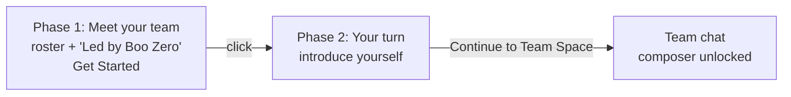
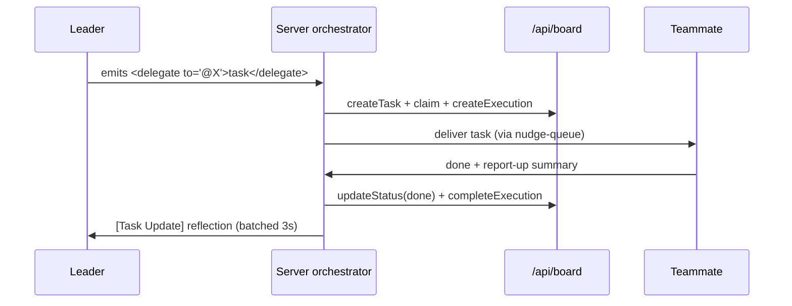

Use this page when you want to talk to a whole [team](/appendices/glossary) at once instead of one agent. A team's group chat is a merged transcript across every agent on the team plus [Boo Zero](/appendices/glossary) (the universal team leader), and the sidebar lists it as **General**. You type one message; Boo Zero triages it, delegates to the right teammates, and synthesizes their work back to you, with each delegation surfacing as a durable card on the [board](/using/board). A team can also have [rooms](#rooms): separate conversations with some of its members, which work the same way.

The chat fills the left of the view, and its tools sit in **cards** stacked beside it: the team's **Browser**, its **Team graph** (the team's [Ghost Graph](/using/ghost-graph)), its **Tasks** and its **Activity** (see [The chat and its cards](#the-chat-and-its-cards)). Orchestration runs **server-side**: the browser posts your message, streams the result back over Server-Sent Events, and renders it. The chat module (`GroupChatPanel`) is backed by `POST` / `GET` / `POST` on `/api/teams/:id/chat`, `/api/teams/:id/chat/stream`, and `/api/teams/:id/chat/stop` (each takes a `roomId` in a room), plus `/api/teams/:id/rooms`, `/api/teams/:id/chat/clear`, `/api/teams/:id/onboarding`, `/api/team-rules/:teamId`, `/api/chat-history`, and `/api/board`.

## Prerequisites

- A team with at least one agent. Create one from the Marketplace or the **+** on the team rail, see [Using teams](/using/teams).
- A connected runtime so agents can actually run. A native team needs a provider key connected; an OpenClaw team needs its Gateway connected. See [Connecting runtimes](/runtimes/connecting-runtimes).

<Note>
The composer is live whenever the team has agents and nothing is currently running; it does **not** require a live OpenClaw Gateway connection. A native-only team (no Gateway) sends and receives exactly the same way, because the orchestration engine runs on the server, not in the browser.
</Note>

## Steps

### 1. Open a team's chat

Click a team's icon on the team rail, the narrow column at the far left. That selects the team and opens its **Home**. In the agent column beside the rail, under the grid of the team's agents, the rooms list starts with a **New room** button, then **General**, labelled "General (Main Room)": the team's own group chat, always pinned first. The team's [rooms](#rooms) follow it. Click **General**. Under the hood this calls `openGroupChat(teamId)`, which routes `ContentArea` to the `{ type: 'groupChat', teamId }` view (a room also carries its `roomId`).

`GroupChatView` then swaps between three states, in order:

1. A brief neutral placeholder while onboarding state hydrates from `GET /api/teams/:id/onboarding`.
2. The full-window **Know-Your-Team gate** (no cards yet) when onboarding is incomplete.
3. The settled chat, with its cards beside it, once onboarding is complete.

A returning team, one that already finished onboarding, lands straight on the chat.

### 2. Pass the "Know Your Team" gate (first open only)

The first time you open a team's chat, a one-time gate intercepts before the composer unlocks. It runs once per team, so once the team has passed it, its rooms open straight to their chat. It has two phases (the `Phase` type: `welcome` then `user-intro`):

- **Phase 1: Meet your team.** A welcome card shows the team's agents and, when present, a "Led by _Boo Zero_" badge. The copy explains that your team is led by Boo Zero, who takes your request and routes it to the right specialist, so you don't need to learn every teammate up front. Click **Get Started** (`data-testid="know-your-team-button"`).
- **Phase 2: Your turn.** A textarea (`data-testid="user-intro-textarea"`) asks you to introduce yourself. The submit button reads **Continue to Team Space** (`data-testid="submit-user-intro"`); your intro must be at least 5 characters. On submit, the text is persisted to SQLite via `PATCH /api/teams/:id/onboarding` (the `userIntroText` field, capped at 4000 chars server-side). Boo Zero then acknowledges you in-character, the chat opens, and the team graph unfolds down its card.

<Info>
There is no agent-introduction round; a team's agents are understood from the welcome (roster plus leader) and, more importantly, from the first real task's live delegation. Cascade prevention is built into the server orchestrator, so the gate no longer needs to sequence introductions to stay safe. Your self-introduction (`userIntroText`) is the source of truth in SQLite; it is re-injected into every group-chat turn's context, so agents always know who they are talking to, even on the very first message and after long gaps.
</Info>

### 3. Send a message

Type in the composer and press Enter. The composer reads "Message General… (@name to target)" in General, and names the room in a room. With no `@mention`, the message routes to the team's leader. The routing priority is:

1. An explicit `@mention` (see the next step).
2. **Boo Zero**, the universal, no-mention default.
3. The team-internal lead (a CTO / Team Lead role detected at deploy time, stored as `team.leaderAgentId`), while it is in this chat.
4. The chat's first member.

The client resolves that target and posts your message to `POST /api/teams/:id/chat` (with the room's `roomId` in a room), which returns immediately (202) while the work proceeds on the server. Before the message reaches the target, the **server** assembles a context preamble and prepends the team's durable rules and your `userIntroText` (and the live roster) to the turn, so a correction or who-you-are persists across the conversation. In a room, the roster lists only the room's members. On the team lead's turn the roster also gives each teammate's runtime and a one-line role read from its `SOUL.md`, so the lead routes work by what each teammate does. An OpenClaw teammate shows only its runtime, because its files live on the Gateway. Every other turn lists teammates by name. The raw message, `@mention` included, is what shows in the transcript; the assembled context goes only to the runtime. Responses stream back live over `GET /api/teams/:id/chat/stream`.

### 4. Route with @mentions

Start a message with `@AgentName` to address one teammate directly instead of the leader. `parseMention` only matches an `@` at the **start** of the message, using a longest-prefix, case-insensitive match against the chat's roster (its members **and** Boo Zero, so `@Boo Zero` works too). The matched name must be followed by whitespace or end-of-string. On a match, the `@mention` is stripped from the message the agent receives, and routing goes to that agent. In a room, the roster is the room's members plus Boo Zero, so a teammate outside the room does not match there and the message goes to the leader.

<Tip>
The agent chips below the transcript are shortcuts; clicking one inserts its `@mention` into the composer for you.
</Tip>

### 5. Watch delegations land on the board

When the leader (or any agent) emits a structured delegation, the server orchestrator turns it into a durable **board task** that appears inline in the chat timeline as a `BoardTaskCard`, and in the chat's [Tasks card](#the-tasks-card). This is the chat-fused board: the board is canonical, the chat is narration. The expand icon on a card opens that task on the [Board](/using/board) with its detail drawer open, and a task waiting on a person says why (for example **Failed** or **Stopped**) and offers **Resolve on board**.

A delegation is a structured directive, not prose; the engine reads only typed signals: a `delegate` or `sessions_send` tool-call, or a `<delegate to="@Name">task</delegate>` (or multi-step `<plan>`) directive parsed once from the agent's terminal turn. Per delegation, the chat's server orchestrator (`getTeamOrchestrator`, one for General and one for each room, over the shared `createBoardOrchestrator` core) does this:

- **Derive**: chat to board: the delegation creates a task, atomically claims it for the target, and opens an execution row.
- **Round-trip**: result to board: when the child finishes, its report-up summary and status are written to the board (never the raw transcript).
- **Reflect**: board to chat: completed tasks are batched (a 3-second window) into a single `[Task Update]` delivered back to the leader for synthesis, plus a visible narration entry. A teammate that handed work off from its own task has often finished that task by the time the results come back. Its follow-up is added as a comment on that task's card and reported to whoever delegated the task to it (a task you assigned keeps it on the card), and it does not post in the chat.

Board task cards update **live** as the cascade runs (the board projection streams over the same connection), so you watch a plan's steps advance without a refresh. Multiple parallel delegations fan out into N tasks (capped at 8 per turn); a `<plan>` becomes a dependency chain where each step fires when its blocker completes. Delivery routes through a non-destructive nudge-queue, so a message to a busy teammate waits for its turn boundary instead of interrupting an in-flight run. Because the engine runs server-side, the cascade keeps going even if you close the tab, and it is all still there when you reopen. The full model is in [Delegation and orchestration](/concepts/delegation-and-orchestration) and [The board](/using/board).

You can steer a task while it runs. A comment you leave on a task (from the team chat's **Tasks** card) goes to the agent working on it, not just onto the card. If the agent is mid-run, most runtimes take it at their next step without stopping (Clawboo Native, Claude Code, Codex, OpenClaw); Hermes pauses its run, reads the comment, and carries on in the same session. If the task is still queued, or the agent's run ends before the comment gets in, the agent reads it when its next run starts. The line under the comment box says which will happen for that task. The details per runtime are in [Steering a running task](/runtimes/index#steering-a-running-task).

When the last delegation completes, the leader synthesizes every deliverable into one final answer:

<Note>
A risky-looking delegation (matching keywords like `delete`, `deploy`, `publish`, `rm -rf`, `secret`, `api_key`) is surfaced on the leader's approval queue via `POST /api/governance/delegation-approval` before it runs. Routine delegations never touch this path. The gate fails closed: an unreachable approval endpoint does **not** auto-approve.
</Note>

### 6. Stop a runaway team

While any agent is running or streaming, the composer's Send button morphs into a red **Stop** button (`data-testid="chat-stop-button"`). Clicking it posts to `POST /api/teams/:id/chat/stop`, which bumps the server's stop generation and aborts every in-flight run for the chat, then cleanly releases each task back to `todo` (it is re-runnable, not blocked, and no failure is reflected). A reply or task that was still waiting for its agent when you pressed Stop never starts. The UI flips to idle immediately, and because the stop happens on the server, a stopped team does not restart its cascade one beat later. Stop acts on this chat only: in a room it stops the room's work, and the team's other chats keep going.

### 7. Capture a durable team rule with `/rule`

Type `/rule <text>` in the composer to add a durable rule for this team. The rule is saved to SQLite (`PUT /api/team-rules/:teamId`), a confirmation entry drops into the transcript, and nothing is routed to an agent. The prefix must be `/rule` followed by a space and a non-empty body (so `/rules` or a bare `/rule` does not misfire).

Team rules are loaded and prepended to the context preamble on every future turn (wrapped as an authoritative `Team Rules` block, set by you), so a correction like `/rule don't do work yourself, delegate via <delegate>` survives across sessions instead of rolling out of the recent-message window. Rules belong to the team, so a rule you add in a room applies in General and in every other room too. The same rules text is also editable from the team's brief & rules (the gear in the chat header), see [Boo Zero](/using/boo-zero).

## The chat and its cards

The chat header shows the team's icon, the chat's name (**General**, or the room's name) and its members as a small stack of faces: everyone on the team in General, and in a room a button that opens the room's editor (see [Rooms](#rooms)). After them come the gear for the team's **brief & rules** and a toggle for each card. When the sidebar is collapsed, the header also starts with the button that brings it back.

The cards stack beside the chat, top to bottom:

| Card       | What it shows                                                                                                              |
| ---------- | -------------------------------------------------------------------------------------------------------------------------- |
| Browser    | The page each of the chat's agents has open in its browser                                                                 |
| Team graph | The team's [Ghost Graph](/using/ghost-graph), with its Boo and skill count in the card's header (**Room graph** in a room) |
| Tasks      | This chat's tasks from the board, and each task's detail                                                                   |
| Activity   | The team's live activity: its agents' tool calls, results and errors                                                       |

The team graph and **Tasks** start open. Each toggle in the header shows or hides its card, and a card's own close button hides it too; which cards are open is remembered in this browser. Drag the gap between the chat and the cards, or between two cards, to resize them. **Maximize** in a card's header fills the view with that card until you press **Restore**. With every card closed, the chat takes the whole width.

### The Tasks card

**Tasks** lists this chat's board tasks in sections: **Needs you**, **In progress**, **To do**, **Done** and **Cancelled**, each with its count and the most recently changed task first. **Done** and **Cancelled** start folded. **Needs you** always shows. It holds the team's pending approvals, which you can answer right there, and every task waiting on a person (a failed, stopped, unassigned or blocked one), by the same rule as the Board's [Needs you](/using/board#things-that-need-you) column. Each row gives the task's title, a line saying why it waits, what it reported or where it stands, the agent's face, and when it last changed. General lists the tasks delegated in General, and a room lists only its own. The card follows the work live, from the same stream as the chat.

Click a task to open it in the card. The card's title becomes **Tasks › _task title_**; click **Tasks**, or press **Escape**, to go back to the list. The task shows its description, status, agent, runtime and cost, its **Output** once it is done (or its **Latest report**, when it has one), its **Progress** as a live activity feed, and its **Comments**.

At the bottom is a comment box (_"Comment or steer this task…"_). **Send** saves your comment on the task and passes it to the agent working on it, as described in [step 5](#5-watch-delegations-land-on-the-board); the line under the box says what sending does for this task, for example that the agent gets it before its next step, or that the task is finished and the comment is only saved. A task waiting on you also offers **Send and retry**, which posts the comment and runs the task again.

**Open on Board**, the kanban icon in the card's header while a task is open, switches to the [Board](/using/board#the-task-detail-drawer) with that task's detail drawer open.

### The Browser window

**Browser** shows the newest page each of the chat's agents has open in its browser. It is a window of its own rather than a card: the agents' faces run along its top bar (a small mint dot marks one with a page to show), and clicking a face switches the screen to that agent. The screen keeps the browser's 16:10 shape and scales to fit the space, and the window's maximize and close buttons sit in its top-right corner. When there is nothing to show, the screen says why: the agent has not opened a page yet, has no browser granted, or runs on a runtime that browses with its own tools, so its screen is not visible here. In a room, the faces are the room's members.

### The team graph and Activity

The **Team graph** card is the team's [Ghost Graph](/using/ghost-graph), with its `N Boos · M skills` count in the card's header. In a room it is titled **Room graph**, draws only the room's members and Boo Zero, and keeps a layout of its own. The graph inside a chat has no browser or Activity buttons; those are the **Browser** and **Activity** cards.

The **Activity** card is the team's live activity feed: every tool call, result and error from its agents' runs, as it happens. It covers the whole team, like the board, so in a room it still shows every teammate. See [the activity terminal](/using/observability-dashboard#6-watch-the-live-activity-terminal).

## Rooms

A room is a separate conversation inside a team, with some of its members. The team's own group chat is its default room, **General**. A room has its own transcript, its own orchestrator on the server, and its own tasks: the tasks delegated in a room appear in its timeline and its **Tasks** card, not in General's, and its graph card (**Room graph**) draws only its members. **Boo Zero** presides over every room the way it presides over the team. It is never a stored member and is not offered in the member picker, and it hands work only to the room's members. What belongs to the team stays team-wide: its rules, its brief, its [memory](/using/memory-browser) and its [board](/using/board).

### Create a room

Click **New room** at the top of the rooms list. The dialog asks for a **Name** and the **Members**, at least one, chosen from the team (Boo Zero is not listed, because it is in every room already). **Create room** opens the new room's chat.

### Talk in a room

A room works like General. The composer names the room ("Message _room name_… (@name to target)"), a new room greets you with "Welcome to _room name_", and `@name` targets one member of the room. A message with no `@mention` goes to Boo Zero, else to the team's own lead if it is in the room, else to the room's first member. Agents in a room see only the room's members as teammates, so the work stays with them. An agent that is in several rooms takes one turn at a time across them.

### Manage a room

Each room's row in the sidebar has a **...** menu, which appears when you hover the row:

| Action          | What it does                                                                                                             |
| --------------- | ------------------------------------------------------------------------------------------------------------------------ |
| **Pin / Unpin** | Pinned rooms sit right under General, most recently pinned first, with a pin on their row; the rest follow, newest first |
| **Rename**      | Edits the name in the row itself. Enter or leaving the field saves; Escape cancels                                       |
| **Clear chat**  | See [Clear a chat](#clear-a-chat)                                                                                        |
| **Delete**      | Asks first, then archives the room                                                                                       |

General's menu has only **Clear chat**: General can't be renamed, deleted or unpinned.

In a room's chat header, the members' faces are a button (**Edit room members**). It opens the room dialog, where you can change the name and the members, or **Delete room**. A member you remove finishes any turn it is taking, and the room's next turns no longer go to it. The header's gear is the team's **brief & rules**, the same in every chat of the team.

Deleting a room keeps its conversation, but the room leaves the sidebar and anything it is working on stops. Its tasks stay on the board, where you can still retry or reassign them. If you were in the room, you land in General.

## Clear a chat

**Clear chat** is in the **...** menu of every chat's row in the sidebar, General's included. It asks first: "Its messages leave the chat, and the agents start this conversation fresh. Tasks stay on the board, and other chats are not touched."

Nothing is deleted. The messages are set aside on the server (`POST /api/teams/:id/chat/clear`), and the chat starts over from its welcome. Clawboo also drops where the chat's Clawboo Native and Codex agents left off in that conversation, and sends `/reset` to its OpenClaw teammates, whose conversations live in the Gateway (the same thing typing `/reset` in the chat does), so every agent's next reply starts fresh. That `/reset` needs the dashboard's Gateway connection; an OpenClaw teammate the dashboard can't reach keeps its session until you `/reset` it. Task cards made before the clear no longer appear in the timeline; the tasks themselves stay on the board, and in the chat's **Tasks** card. The team's other chats are not touched.

## The peer-chat room

Every team also has a durable **peer-chat room** underneath the group chat, where each runtime posts as a named peer. It is not one of the [rooms](#rooms) you create, and it has **no dashboard viewer today**: there is no toggle in the chat header and no card that renders it. Posts land in the shared `team_chat` table from two directions in a shipped install: the bounded exchange engine writes each runtime's turn to the room as a named peer (kicked off by `POST /api/team-chat/exchange`), and board mutations made through the REST board API narrate themselves into the same room as `system` lines. Agents post and read the room directly through the TeamChat MCP tools (`team_chat_post` / `team_chat_subscribe`), which are attached by default on the teams the dashboard creates. The only way for _you_ to read the room back is the REST endpoint, `GET /api/team-chat?teamId=<id>`. It is the "one room, any runtime can lead" surface, distinct from the user-facing group chat above (where you type). See [Peer chat](/concepts/peer-chat) for the model.

## Options / variations

| Action                      | How                                                                   | What it does                                                                                                                                  |
| --------------------------- | --------------------------------------------------------------------- | --------------------------------------------------------------------------------------------------------------------------------------------- |
| Address the leader          | Send with no `@`                                                      | Routes to Boo Zero (default), then the team-internal lead when it is in this chat, then the chat's first member                               |
| Address one teammate        | `@AgentName your message`                                             | Longest-prefix match at message start; `@mention` stripped before the agent sees it. In a room, only the room's members match                 |
| Address Boo Zero explicitly | `@Boo Zero …`                                                         | Boo Zero is in the mention roster even though it is teamless                                                                                  |
| Add a durable rule          | `/rule <text>`                                                        | Persists to `/api/team-rules/:teamId`; injected on every future turn, in every chat of the team                                               |
| Start a fresh conversation  | `/reset` or `/new`                                                    | Ends what every teammate is carrying and drops a divider. No message is removed. See [Agents](/using/agents)                                  |
| Stop the chat               | Click the red Stop button                                             | `POST /api/teams/:id/chat/stop`: aborts this chat's in-flight runs, releases tasks to `todo`, where they wait in **Needs you** as **Stopped** |
| Comment on a running task   | Open the task in the **Tasks** card and send a comment                | Saved on the task and passed to its agent, mid-run where the runtime allows it                                                                |
| Open a task on the Board    | **Open on Board** in the **Tasks** card, or a task card's expand icon | Switches to the Board with that task's detail drawer open                                                                                     |
| Show or hide a card         | The toggles at the right of the chat header                           | Opens or closes **Browser**, **Team graph**, **Tasks** or **Activity**                                                                        |
| Start a room                | **New room** in the sidebar's rooms list                              | Name it, pick its members, and land in its chat                                                                                               |
| Edit a room                 | The members' faces in the room's header                               | Rename it, change its members, or delete it                                                                                                   |
| Pin a room                  | **...** on its row, then **Pin**                                      | Keeps it near the top of the rooms list, right under General                                                                                  |
| Clear a chat                | **...** on its row, then **Clear chat**                               | Sets its messages aside and starts the conversation fresh; its tasks stay on the board                                                        |
| Insert a mention            | Click an agent chip                                                   | Inserts `@AgentName` into the composer                                                                                                        |
| Read further back           | Click **Load earlier messages** at the top of the timeline            | Reveals 100 more items; the chat renders the most recent ~150 by default so a long session stays responsive                                   |

## Verify it worked

- After the gate, the composer unlocks and accepts input. Re-fetch `GET /api/teams/:id/onboarding`; both `agentsIntroduced` and `userIntroduced` should be `true`, and `userIntroText` should hold your introduction.
- Send a message that prompts a delegation; a `BoardTaskCard` should appear inline (assignee avatar, status badge, title) and progress from `in_progress` to `done`, and the same task should be listed in the **Tasks** card. Cross-check `GET /api/board?teamId=<id>`; the same task is there.
- A `/rule …` message should drop a "Rule saved for team" confirmation and show up in `GET /api/team-rules/:teamId`.
- Create a room with **New room**. It appears in the sidebar under General and in `GET /api/teams/:id/rooms`. A message sent there shows in the room only, and a task delegated there is listed in the room's **Tasks** card, not in General's.
- Clear a chat. It returns to its welcome, and `GET /api/board?teamId=<id>` still lists its tasks.

## Troubleshooting

<Warning>
**The composer is disabled.** The composer is enabled when the chat has at least one agent and no run is currently in flight. If it stays disabled, confirm the team has agents (in a room, that the room still has members on the team); while the team is working, Send is intentionally replaced by Stop. A native team does **not** need a Gateway connection to send.
</Warning>

<Warning>
**A response never streams back.** The stream is `GET /api/teams/:id/chat/stream` (SSE). A run that fails before producing any text now posts a system notice into the chat with the reason, so a missing provider key reads as a message rather than as silence. If even that does not appear, confirm the runtime the target agent runs on is connected (a native team needs its provider key; an OpenClaw team needs its Gateway) and check the server logs. The message was accepted (202) as soon as you sent it; the work runs server-side regardless of the browser.
</Warning>

<Warning>
**A teammate never answers in a room.** A room holds only its members and Boo Zero, so an `@mention` of a teammate outside the room does not match and the message goes to the leader instead. Add the teammate from the room's header (**Edit room members**), or talk to them in General.
</Warning>

<Warning>
**The top of the chat is missing.** Nothing was deleted. The timeline renders its most recent ~150 items (messages, task cards, live replies) so a long-running team stays responsive; **Load earlier messages** at the top of the chat reveals the rest, 100 at a time, without moving your reading position. A reply still being written always shows, even when it started long enough ago that its place in the timeline falls outside that window: it appears at the top of what you can see. The full transcript also stays on disk, at `GET /api/chat-history?sessionKey=…`. If you cleared the chat, its earlier messages were set aside; see [Clear a chat](#clear-a-chat).
</Warning>

<Danger>
**Old chat history replaying as new work.** Orchestration runs on the server and is keyed to the durable board, not to what the browser last saw, so reopening a team never replays hydrated history as new delegations. If you see stale activity on team open, it is the live stream catching you up on work that actually ran, not a re-fire.
</Danger>

## Related

- [Peer chat](/concepts/peer-chat), the mixed-runtime room model under the team chat
- [Delegation and orchestration](/concepts/delegation-and-orchestration), structured tags, no-regex, the board-driven engine
- [The board](/using/board), the durable kanban the delegations land on
- [Using teams](/using/teams) · [Boo Zero](/using/boo-zero), team setup, leaders, briefs, and rules
- [Steering a running task](/runtimes/index#steering-a-running-task), how each runtime takes a comment mid-run
- [Connecting runtimes](/runtimes/connecting-runtimes), bring a runtime online so agents can run
